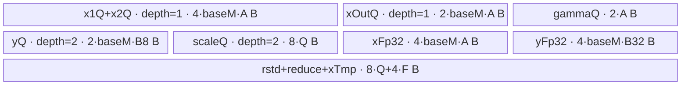
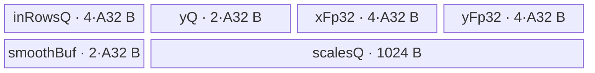

# AddRmsNormDynamicQuant 950 Direct Invoke 算子知识

## 算子速览

| 项目 | 内容 |
|---|---|
| 实际入口 | `cann_bench::add_rms_norm_dynamic_quant`，PyTorch `PrivateUse1` 实现；按 dtype 调用 `launch_add_rms_norm_dynamic_quant_half` 或 `launch_add_rms_norm_dynamic_quant_bfloat16` |
| 计算语义 | `xOut=x1+x2`；按最后一维做 RMSNorm，再做逐行对称动态 INT8 量化并输出反量化尺度 |
| 输入输出 | `x1/x2:[...,N]`、`gamma:[N]`，FP16 或 BF16；`y:[...,N]` INT8，`xOut:[...,N]` 同输入 dtype，`scaleOut:[...]` FP32 |
| 执行类型 | 四条 Route 均为单 Kernel `AIV_VECTOR`，入口显式声明 `KERNEL_TYPE_AIV_ONLY`；无可达 Cube/AIC、MIX_CV、SIMT、NDDMA 或通信节点 |
| Kernel 路线 | 重要性顺序：P0 R-001 full-load/perf；P1 R-002 normal；P2 R-004 split-reduce；P3 R-003 single-row。Route ID 保持 Host selector 身份，不随阅读顺序改号 |
| 核心资源 | GM、AIV UB、`TQue/TBuf/RegTensor`；仅 R-004 使用 GM workspace |
| 来源闭包 | `direct_implementation_closed`：Direct schema/PrivateUse1 → 校验与分配 → workspace producer → dtype launcher → Route selector/POD → 全部 entry/body/helper → 构建接线已闭合 |

## 接口与语义

### 计算语义

令 `M=prod(x1.shape[:-1])`、`N=x1.shape[-1]`。对第 `m` 行：

```text
s[m,n]    = fp32(x1[m,n]) + fp32(x2[m,n])
xOut[m,n] = cast_input_dtype_RINT(s[m,n])
rstd[m]   = 1 / sqrt((Σ_n s[m,n]^2) / N + epsilon)
z[m,n]    = s[m,n] * rstd[m] * fp32(gamma[n])
a[m]      = max_n(abs(z[m,n]))
scale[m]  = a[m] / 127                         # 一般路径
y[m,n]    = int8(pack_fp16(round_RINT(z[m,n] / scale[m])))
```

`scaleOut` 是反量化尺度，非乘到输入上的量化倍率；非退化行满足 `z≈float(y)*scaleOut`。R-003 对 `a[m]==0` 显式令 `scaleOut=1`、`y=0`；R-001/R-002/R-004 的公共 MicroAPI 路径直接形成 `a/127`，没有同等零最大值分支。公共 INT8 路径没有额外 clip/saturate，正确性依赖非零 `scale` 把有效值约束在约 `[-127,127]`。`xOut` 在相加后降回输入 dtype，而 RMSNorm 与量化主计算保留 FP32 中间值。

### 输入、输出与属性

| 参数 | shape/layout | dtype | 约束、默认值与语义 |
|---|---|---|---|
| `x1` | rank 2～8，contiguous strided，最后维 `N>0` | FP16/BF16 | 非空；与 `x2` shape/dtype/device 完全相同 |
| `x2` | 同 `x1` | 同 `x1` | 与 `x1` 相加 |
| `gamma` | contiguous `[N]` | 同 `x1` | RMSNorm 仿射乘数 |
| `epsilon` | 标量 | Host `double`，POD FP32 | 默认 `1e-6`；有限且非负，launcher 前窄化为 FP32 |
| `y` | 同 `x1` | INT8 | 逐行动态量化输出 |
| `xOut` | 同 `x1` | 同输入 | `x1+x2` 的输入 dtype 输出 |
| `scaleOut` | `x1.shape[:-1]` | FP32 | 每行一个反量化尺度 |

### 输出契约与跨 Route 不变量

| 对象 | 物理写入 | 数值/shape 契约 | Route 不变量与边界 |
|---|---|---|---|
| `xOut` | 每个 core 仅写自己的连续行区间；只回写每行有效 `N` 个元素 | shape、dtype、device 与 `x1` 相同；元素是 FP32 加法结果再按输入 dtype 的 RINT cast | 所有 Route 都从未降精度的 `s` 同时派生 `xOut` 和 RMSNorm 输入；不得改成从低精度 `xOut` 回读归一化 |
| `y` | 每行有效 `N` 个 INT8；UB 对齐尾部不进入 GM | 与 `x1` 同 shape，row-major contiguous | 都执行逐行动态量化；pack 前为 FP32 RINT，再经 FP16 中转到 INT8；源码未声明跨 Route byte-identical |
| `scaleOut` | 每行恰有一个 FP32 标量；地址为逻辑行号 | shape=`x1.shape[:-1]`，flatten 后长度 `M` | 一般为 `maxAbs/127`；全零行只有 R-003 明确给出 1，不能把这一分支外推到其他 Route |
| workspace | 仅 R-004 在单 Kernel 内读写，不是可观察输出 | Host 预留三份 `blockDim*N` FP32 slice | 前两份分别承载量化前 `z` 和 FP32 `s`；第三份只为关闭的第二量化输出保留 |

接口返回是异步的：三个输出 Tensor 和 workspace 都由同一 current stream 上的 global 生产/消费。调用后的同流算子可依赖流顺序；跨流消费仍应遵循框架的 stream 记录与同步契约，本 Direct 源码没有额外 event 导出。

### 入口与版本

Direct schema 由 `TORCH_LIBRARY_FRAGMENT(cann_bench, m)` 注册，Meta 实现只复用输入校验和输出 shape/dtype 分配；实际 NPU 路径由 `TORCH_LIBRARY_IMPL(cann_bench, PrivateUse1, m)` 绑定到 `add_rms_norm_dynamic_quant_npu`。它不是 ACLNN 包装：`OpCommand::RunOpApi("AddRmsNormDynamicQuantDirect", directCall)` 内直接发射 Ascend C global。

FP16/BF16 分别进入两个 Host launcher；Route body 模板的 `T_X` 分别为 `half`/`bfloat16_t`，`T_Y` 固定为 `int8_t`。本卡描述 CANN 9.1.0、950 的 Direct 实现；给定官方仓只承担同名算子与 arch35/950 实现的相关映射，不把 Direct launcher、裁剪依赖或构建接线称为官方接口。

## Host/Launcher 执行流程

### 参数校验与前处理

`CheckInputs` 按顺序检查 rank、strided、contiguous、`x1/x2` shape、三输入 dtype、FP16/BF16 白名单、device、`gamma=[N]`、非空和 `epsilon`。随后把 `N=x1.size(-1)`、`M=x1.numel()/N` 写入 `ShapeInfo`，并生成 `scaleShape=x1.shape[:-1]`。失败由 `TORCH_CHECK` 终止，未提供 contiguous/view fallback。

`AllocateOutputs` 分配 INT8 `y`、同输入 dtype 的 `xOut` 和 FP32 `scaleOut`。`OptionalDeviceGuard` 固定输入 device，当前 NPU stream 由 `getCurrentNPUStream().stream(false)` 取得。

### Host 算术与窄化边界

现有 Host 公式使用原生无符号加乘，不是 checked arithmetic。知识复用时应把“数学公式成立”与“机器整数计算安全”分开；至少在 launch 前对下表逐项拒绝溢出或窄化失败。

| 计算点 | 当前表达式/窄化 | 已有前提 | 尚未闭合的边界 |
|---|---|---|---|
| flatten | `rows=uint64_t(x1.numel())/hidden` | `numel>0`、`hidden>0`，shape 本身保证整除 | PyTorch `numel()` 为有符号范围；转换为 `uint64_t` 前没有独立上界断言 |
| ceil/align | `(a+b-1)/b`、`ceil*align` | `b>0` 来自 core 数、固定对齐或 VReg | `a+b-1` 与最终乘法无 `checked_add/checked_mul` |
| 分核 | `blockDim=uint32_t(ceil(M/mPerCore))` | `M,C>0`，数学上 `blockDim<=min(M,C)` | `uint64_t→uint32_t` 依赖实际 AIV core 数可表示，代码无显式检查 |
| UB 求解 | 多项 `baseM*N*bytes`、`cutN*2` | 先查询 `U>0`，最终比较 `<=U` | 比较发生在乘加之后；若中间先 wrap，guard 会失真 |
| workspace | `3*blockDim*N*sizeof(float)` | 仅 R-004 使用 | `uint64_t` 乘法、随后 `uint64_t→int64_t` 作为 Torch shape 均未检查 |
| Device 参数 | `realM→uint16_t`、`N/count→uint32_t`，部分 DMA `blockLen→uint16_t/uint32_t` | 常规张量域与 Route guard | 超大 `M/N` 可静默截断；源码没有统一最大 shape 契约 |

因此，直接复刻 launcher 时应以 checked add/mul、显式 `<=UINT32_MAX/UINT16_MAX/INT64_MAX` 检查闭合这些载荷；当前实现只能把超大 shape 记为未证明域，不能从 UB guard 反推整数安全。

### 参数、Workspace 与生命周期

`add_rms_norm_dynamic_quant_workspace_bytes(M,N)` 分别以 `allowPerf=true/false` 计算一次 Route，取两者 workspace 上界；R-004 所需字节为 `3 * blockDim * N * sizeof(float)`，其它 Route 为零。这里固定传入的 `epsilon=1e-6` 不影响 Route 或容量公式。任意一次 Tiling 抛错都会在 dtype launcher 之前终止，因此“perf 可启动”本身不足以绕过 non-perf 上界计算失败；反过来，即使实际 launch 命中无 workspace 的 R-001，也可能因 non-perf 计算落到 R-004 而预分配 workspace。请求为零时仍分配 32 字节 `UInt8` Tensor，避免传空地址。

workspace 的 Host owner 是局部 Torch Tensor，并由 direct-call lambda 捕获；设备侧只有 R-004 解引用它。流上回收的最终保证属于 PyTorch NPU allocator/framework 边界，Direct 源码内未展开。所有输出和 workspace 指针连同 POD 按值传给单个 global；launcher 没有显式返回码或二次 launch。

### 启动图与失败传播

```text
PrivateUse1 add_rms_norm_dynamic_quant_npu
  -> CheckInputs -> AllocateOutputs -> workspace upper bound
  -> dtype dispatch
     -> launch_add_rms_norm_dynamic_quant_{half|bfloat16}
        -> CalcDirectTiling(M,N,epsilon,true)
        -> exactly one AIV global selected from perf/normal/single/split
           -> RouteClass::Init(..., POD) -> RouteClass::Process()
```

| 节点 | Host 启动函数 | Device entry | blockDim/POD | 输入→输出/workspace | ordering 与失败 |
|---|---|---|---|---|---|
| K-001 | `launch_add_rms_norm_dynamic_quant_{half,bfloat16}` | 对应 dtype 的四个 Route global 之一 | `ceil(M/mPerCore)`；`AddRmsNormDynamicQuantRegbaseTilingData` 按值 | `x1,x2,gamma` → `y,xOut,scaleOut`；R-004 读写 workspace | 当前 stream 单次 launch；Tiling 无可用 Route、平台查询失败或资源为零时 Host 抛异常，因而不发射 Kernel |

没有跨 Kernel 边。R-004 的 workspace 是单 Kernel 内 GM 临时区，顺序由同一 AIV core 上的 `V_MTE3/MTE3_V`、`V_MTE2/MTE2_V` event 与 `PIPE_V` barrier 建立。

## Route 与参数设计

### 分核与资源计算

记 `U=平台查询所得 UB 字节数`、`C=GetCoreNumAiv()`、`V=GetVecRegLen()/4`（FP32 元素数），以及 `align(x,a)=ceil(x/a)*a`：

```text
mPerCore = ceil(M/C)
blockDim = ceil(M/mPerCore)            # 不超过 M 与 C
mLastCore = M - (blockDim-1)*mPerCore
A = align(N,16)                        # FP16/BF16 的 32B 对齐元素数
R = align(N,256)                       # 512B reduce 对齐元素数
B8 = align(N,32)                       # INT8 32B 对齐元素数
B32 = align(N,8)                       # FP32 32B 对齐元素数
P = align(R/(2V),8)                    # reduce partial FP32 元素数
```

每个 block 负责连续 `mPerCore` 行，末 block 用 `mLastCore`。P0 R-001/P1 R-002 再按 `baseM` 分外层批次；P2 R-004 每行沿 N 切片；P3 R-003 每次一行并每 128 行批量写 scale。

### 多核地址不变量

对 `b∈[0,blockDim)`，令 `rows_b=(b==blockDim-1 ? mLastCore : mPerCore)`，则该 block 的逻辑行区间与地址为：

```text
row_begin(b)   = b * mPerCore
row_end(b)     = row_begin(b) + rows_b              # 半开区间
xy_gm_begin(b) = row_begin(b) * N                    # 元素偏移
scale_begin(b) = row_begin(b)                        # FP32 标量偏移
ws(k,b,n)      = (k * blockDim + b) * N + n          # R-004, k=0/1/2
```

正数域内 `blockDim<=C`，并且所有 block 都有至少一行；相邻 `[row_begin,row_end)` 首尾相接，覆盖 `[0,M)` 且不重叠。R-004 的三个 workspace plane 也按 `(k,b)` 分离，同一 block 只在完成当前行的 `s→z→y` 三阶段后才复用自己的 N 元素 slice。四条 Route 都没有跨 core reduction、atomic 或全局 barrier：归约只沿单行 N 维发生，因此分核只能切 M，不能把一行的 N 随意分给多个 core。

### Route 特征与重要性

P0～P3 表示实现知识的阅读与复用重要性，不改变 Route ID，也不改变 Host 的真实判断顺序。运行时短路关系以随后表格的 `Host 顺序`字段为准。

| 重要性 | Route | Route 特征 | 适用域 | 实现前提 |
|---|---|---|---|---|
| P0 | R-001 full-load/perf | 多行输入、FP32 中间、INT8 输出与尺度按 `baseM` 整体驻留 UB，输出 Queue 双缓冲 | `N<=16384` 且 full-load UB 求解得到 `baseM>=1` | `allowPerf=true`；`CalUsedSize` 与 `InitBuffer` 一致；多行 mask、尾批与 Queue 生命周期成立 |
| P1 | R-002 normal | 通用单行 RegBase 主干；一行完成 add、xOut、RMS 归约、尺度与量化，scale/rstd 按行组保存 | R-001 未命中且 normal 单行 UB 可容纳；也是关闭 perf 时优先求解的非 perf 路线 | 512B reduction padding、单行 FP32 temporary 与行组 scale/rstd 同时驻留 UB |
| P2 | R-004 split-reduce | 沿 N 切片，以每 core GM workspace 串接 sum、max 与最终量化三个阶段 | H1～H3 均未命中，但最小 split 布局可容纳 | workspace slice、三级 reduction buffer 与 MTE event 配对保持一致 |
| P3 | R-003 single-row | 专用单行 Queue/TBuf 复用，标量 event 读取归约值，并显式处理零最大值 | R-001/R-002 未命中且 `16*align(N,32)+1024<=U` | 128 行尺度批次、`V_S/S_V` event、Queue 复用与尾批成立 |

R-002 命中后会再次由剩余 UB 估算 `baseM`。源码先置 `baseM=1`，但随后在 `64+CalUBTotalSize(0,N,1)<=U` 时用整数除法覆盖它，未做 `max(1,...)`；在刚好只有一行布局容量的边界上，该式可能得到 0。常规 950 资源域是否永远排除该等号情形，当前源码没有显式证明，因此 R-002 的可复用契约应额外要求最终 `baseM>=1`。

### Host Route 选择

下表按 P0→P3 展示；`Host 顺序`保留 `Calculate` 中实际的 H1→H4 短路链，因此展示顺序不等于运行时判断顺序。

| 重要性 | Route | Host 顺序 | Key/模板 | 精确选择条件 | 短路与 fallback |
|---|---|---|---|---|---|
| P0 | R-001 full-load/perf | H1 | `route=100`；`Kernel...RegbasePerf<T_X,int8_t>` | `allowPerf && CalFullLoadBaseM(N)>=1 && N<=16384` | 命中即返回；否则进入 H2 |
| P1 | R-002 normal | H2 | `route=101`；`Kernel...Regbase<T_X,int8_t>` | H1 未命中且 `CalUBTotalSize(1,N,1)<=U` | 命中即返回；否则进入 H3 |
| P2 | R-004 split-reduce | H4 | `route=103`；`Kernel...RegbaseSpiltReduce<T_X,int8_t>` | H1～H3 均未命中且 `CalUBTotalSize(1,256,3)<=U`；`baseN` 取仍满足 UB 的最大 `256*2^k` | 命中即返回；否则 Host 抛 `no valid route`，无 Device fallback |
| P3 | R-003 single-row | H3 | `route=102`；`Kernel...RegbaseSingleRow<T_X,int8_t>` | H1/H2 未命中且 `16*align(N,32)+1024<=U` | 命中即返回；否则进入 H4 |

```text
if allowPerf && fullLoadBaseM >= 1 && N <= 16384: R-001
else if normalSize <= U:                           R-002
else if 16*align(N,32)+1024 <= U:                 R-003
else if splitMinimumSize <= U:                    R-004
else:                                              fail before launch
```

### 模板/实现执行矩阵

| 重要性 | Route | key/selector | dtype/shape/platform 完整命中条件 | 执行拓扑与 Kernel 节点 | 实际模板/body | 内存与同步特征 | tail/fallback |
|---|---|---|---|---|---|---|---|
| P0 | R-001 full-load/perf | 100 | H1 谓词成立；FP16/BF16；950 | 单 K-001 | `KernelAddRmsNormDynamicQuantRegbasePerf<T_X,int8_t>::Process` | 多行整块驻留 UB；Y/scale depth=2；`PIPE_V` | 末 core 与末 `baseM` 批次收尾；H1 失败进入 H2 |
| P1 | R-002 normal | 101 | H1 不成立且 H2 的单行 normal UB 可容纳 | 单 K-001 | `KernelAddRmsNormDynamicQuantRegbase<T_X,int8_t>::Process` | 每次一行 x/y，scale/rstd 按 `baseM`；Queue 生命周期同步 | N padding 到 16/256 元素；H2 失败进入 H3 |
| P2 | R-004 split-reduce | 103 | H1～H3 不成立且 H4 的 split 最小块可容纳 | 单 K-001 | `KernelAddRmsNormDynamicQuantRegbaseSpiltReduce<T_X,int8_t>::Process` | UB 分片 + 每 block GM workspace；MTE event | N 尾片和多级 reduce；无更低 fallback |
| P3 | R-003 single-row | 102 | H1/H2 不成立且 H3 的专用单行 UB 可容纳 | 单 K-001 | `KernelAddRmsNormDynamicQuantRegbaseSingleRow<T_X,int8_t>::Process` | 复用 3 个 TBuf；标量 event 读取 max/rstd；scale 128 行成批 | 行尾 `rowWork%128`；H3 失败进入 H4 |

### 隐式资源与性能 Guard

| Guard | Host/Tiling 条件 | Device/资源原因 | 影响 Route | 不满足时去向 | 源码符号 |
|---|---|---|---|---|---|
| full-load N 上限 | `N<=16384` | 限制整行/多行驻留实现的适用域 | R-001 | R-002 | `OfficialTilingMath::Calculate` |
| full-load UB | `CalFullLoadBaseM(N)>=1` 且 `CalUsedSize(baseM,...)<=U` | 包含 1024B 保守余量、双缓冲输出和 reduction 暂存 | R-001 | R-002 | `CalFullLoadBaseM`、`CalUsedSize` |
| normal UB | `CalUBTotalSize(1,N,1)<=U` | 单行的 512B reduce padding 与全部 Queue/TBuf 必须同时驻留 | R-002 | R-003 | `CalUBTotalSize` |
| split 最小块 | `CalUBTotalSize(1,256,3)<=U` | `powerSplit` 至少 256 元素，且需三级 256-FP32 reduce buffer | R-004 | Host 失败 | `Calculate`、`InitBuffer` |
| single 32B 对齐 | `16*align(N,32)+1024<=U` | `numLastDimAligned` 按 INT8 的 32 元素对齐；三 TBuf 与队列合计 | R-003 | R-004 | `Calculate`、`InitBaseParams` |
| 平台资源 | `U>0 && C>0 && V>0` | Tiling 公式依赖 UB、AIV 核数和 vector register 长度 | 全部 | Host 失败 | `CalcDirectTiling` |
| 非空域 | `M>0 && N>0` | `mPerCore`、`avgFactor` 和 Route 公式不可接受零除 | 全部 | schema 校验/Host 失败 | `CheckInputs`、`CalcDirectTiling` |

### POD/ABI

`AddRmsNormDynamicQuantRegbaseTilingData` 在 Direct Host/Device 同编译 ABI 下是自然对齐的 plain struct：预期 `sizeof=104`、`alignof=8`。前十个 `uint64_t` 连续占 0～79 字节，两个 `float` 位于 80/84，三个 `uint32_t` 位于 88/92/96，末尾补齐到 104 字节。源码没有 `static_assert(sizeof/offsetof)`；若 Host 与 Device 分离生成或修改编译选项，应补这些断言，不能只凭字段名保证 ABI。

| 结构 | 字段 | 类型/位宽 | ABI 布局 | 单位 | Host/launcher producer | Device consumer | 边界 |
|---|---|---|---|---|---|---|---|
| `AddRmsNormDynamicQuantRegbaseTilingData` | `numM` | `uint64_t/64` | offset 0 | 行 | `rows` | 全部 Route 行域 | `>0` |
| 同上 | `numN` | `uint64_t/64` | offset 8 | 元素/行 | `hidden` | 全部 Route N 域与地址 | `>0` |
| 同上 | `baseM` | `uint64_t/64` | offset 16 | 行 | R-001 UB 求解；R-002 UB 求解；其余 1 | R-001/R-002 外层行 tile | `>=1` |
| 同上 | `baseN` | `uint64_t/64` | offset 24 | 元素 | R-001～R-003 为 N；R-004 为 cutN | Route buffer/切片 | `>=1` |
| 同上 | `baseNDtypeAlign` | `uint64_t/64` | offset 32 | 元素 | `align(baseN,16)` | Queue 容量、row stride、mask | 32B 对齐 |
| 同上 | `baseNReduceAlign` | `uint64_t/64` | offset 40 | 元素 | `align(baseN,256)` | R-001/R-002/R-004 reduce buffer | 512B 输入对齐 |
| 同上 | `powerSplit` | `uint64_t/64` | offset 48 | 元素 | P0 R-001 `lowerPow2(A-1)`；P1 R-002 `lowerPow2(R)`；P2 R-004 `cutN`；P3 R-003 `lowerPow2(N)` | 二分/多级归约 | 窄化给部分 `uint32_t` consumer |
| 同上 | `powerLoop` | `uint64_t/64` | offset 56 | 次 | 默认 1；R-004 取最大 2 的幂使 `loop*2*powerSplit<=N` | R-004 `Process` | 其它 Route inactive |
| 同上 | `mPerCore` | `uint64_t/64` | offset 64 | 行/core | `ceil(M/C)` | 全部 Route GM 分区 | `>=1` |
| 同上 | `mLastCore` | `uint64_t/64` | offset 72 | 行 | `M-(blockDim-1)*mPerCore` | 末 block | `1..mPerCore` |
| 同上 | `epsilon` | `float/32` | offset 80 | FP32 标量 | `static_cast<float>(epsilon)` | rstd | 已在 API 检查有限、非负 |
| 同上 | `avgFactor` | `float/32` | offset 84 | FP32 | `1.0f/float(N)` | rstd | N 很大时受 FP32 表示影响 |
| 同上 | `hasSmoothScale1` | `uint32_t/32` | offset 88 | bool | 固定 0 | 条件 buffer/body | Direct Route inactive |
| 同上 | `hasSmoothScale2` | `uint32_t/32` | offset 92 | bool | 固定 0 | 条件第二输出 | Direct Route inactive |
| 同上 | `hasBeta` | `uint32_t/32` | offset 96 | bool | 固定 0 | 条件 beta | Direct Route inactive |

### Route 源码闭包

| 重要性 | Route | Key/selector | Host/Tiling producer | POD/参数 | Kernel entry/router 节点 | Kernel body/直接依赖 | 构建接线 |
|---|---|---|---|---|---|---|---|
| P0 | R-001 | 100 | `op_kernel/add_rms_norm_dynamic_quant_kernel.cpp::OfficialTilingMath::Calculate` | `AddRmsNormDynamicQuantRegbaseTilingData` | `add_rms_norm_dynamic_quant_perf_{half,bfloat16}` | `...regbase_perf.h`、`...regbase_common.h`、`...local_deps.h`、`official_norm_common_minimal.h` | 算子 `CMakeLists.txt::register_direct_launch_op` |
| P1 | R-002 | 101 | 同上 | 同上 | `add_rms_norm_dynamic_quant_normal_{half,bfloat16}` | `...regbase.h` 与公共依赖 | 同上 |
| P2 | R-004 | 103 | 同上 | 同上 | `add_rms_norm_dynamic_quant_split_{half,bfloat16}` | `...regbase_split_reduce.h` 与公共依赖 | 同上 |
| P3 | R-003 | 102 | 同上 | 同上 | `add_rms_norm_dynamic_quant_single_{half,bfloat16}` | `...regbase_single_row.h` 与公共依赖 | 同上 |

### dtype 叶完整性

FP16/BF16 是接口合法域的全部输入 dtype。下表显式保留八个 `dtype×Route` 叶；它们共用 selector 数值、POD 布局、`blockDim` 和数学契约，但 entry 符号与 `T_X` 模板实例不可合并或互换。

| Route/key | FP16 Device entry → body | BF16 Device entry → body | workspace/叶级差异 |
|---|---|---|---|
| R-001 / 100 | `add_rms_norm_dynamic_quant_perf_half` → `RegbasePerf<half,int8_t>` | `add_rms_norm_dynamic_quant_perf_bfloat16` → `RegbasePerf<bfloat16_t,int8_t>` | 两叶均不解引用 workspace；输入 load/cast 与 `xOut` cast 使用各自 `T_X` |
| R-002 / 101 | `add_rms_norm_dynamic_quant_normal_half` → `Regbase<half,int8_t>` | `add_rms_norm_dynamic_quant_normal_bfloat16` → `Regbase<bfloat16_t,int8_t>` | 两叶 workspace=0；512B reduce padding 以 2B 输入元素计数 |
| R-004 / 103 | `add_rms_norm_dynamic_quant_split_half` → `RegbaseSpiltReduce<half,int8_t>` | `add_rms_norm_dynamic_quant_split_bfloat16` → `RegbaseSpiltReduce<bfloat16_t,int8_t>` | 两叶都把 workspace 传入 `Init`，布局同为三份 FP32 plane |
| R-003 / 102 | `add_rms_norm_dynamic_quant_single_half` → `RegbaseSingleRow<half,int8_t>` | `add_rms_norm_dynamic_quant_single_bfloat16` → `RegbaseSingleRow<bfloat16_t,int8_t>` | 两叶 workspace=0；单行标量归约、零 max 分支和 128 行 scale 批次一致 |

两个 Host launcher 的 `if/else if/else` 链都完整覆盖 100→101→102→103：前三个 key 显式比较，最终 `else` 只在 `CalcDirectTiling` 已保证 selector 属于四值集合后承接 R-004。不存在 dtype 级 CPU fallback、默认模板或跨 dtype 重解释路径。

## Kernel 实现

### 公共执行流程

八个 dtype×Route global 都在 Device 分支设置 `KERNEL_TYPE_AIV_ONLY`，栈上创建 `TPipe`，以 `T_X={half|bfloat16_t}`、`T_Y=int8_t` 实例化 Route class，调用 `Init` 后执行 `Process`。Direct 入口没有 smooth/beta/第二量化输出；entry 用 `x1` 占位传递这些地址，但三个 flag 固定为 0，相关 GM 绑定、Queue 分配和 Device 分支均 inactive。

所有 Route 的数学主链为 GM→UB/寄存器 FP32 加法与归约→`xOut` GM，以及 FP32 `rstd*gamma`→逐行 `abs/max`→除 scale→`CAST_RINT`/FP16 中转/INT8 pack→`y` GM。尾部由 `UpdateMask`、`DataCopyPad` 和显式对齐长度处理。

### 归约、倒平方根与量化精度路线

| Route | sum-of-squares 路径 | rstd 路径 | max/scale 路径 | 可见精度边界 |
|---|---|---|---|---|
| R-001 perf | `CalculateSquareReduceSum` 按 `powerSplit` 折叠多行 FP32 `s²` | `ComputeRstdNewtonRaphson<true,true>`：先乘 `avgFactor`，再做倒平方根近似与修正 | 每行 RegTensor max，乘 `1/127` 后广播除法 | 多行并行与 Newton-Raphson 次序使其不承诺与其他 Route bitwise 相同 |
| R-002 normal | `ReduceSumRstd` 在 512B 补零行上二分折叠，padding 在归约前清零 | 同一 helper 内 `Sqrt` 后 `1/x` | 公共 `ComputeYScale`，有效 mask 下 max/除法 | FP32 主链，但 reduction tree 与 R-001 不同 |
| R-004 split | 各 N chunk 先生成 partial，随后 level1/2/3 逐级合并 | `ComputeMultiLevelRstd<true>` 对整行 partial 做 `sqrt/div` | 多 chunk max 与旧 scale 取 max，最后统一乘 `1/127`，再重读 `z` 量化 | workspace 往返保持 FP32；chunk 合并次序与整行 Route 不同 |
| R-003 single | 高层 Vector `Mul` 后 `ReduceSumHalfInterval`，标量读取总和 | scalar `1/sqrt(sum*avg+eps)` | 标量 `maxTemp`；非零行用 `127/maxTemp`，零行显式倍率 1 | 标量路径明确闭合零行，但 reduction/rounding 路线仍不保证跨 Route bitwise 一致 |

共同不变量是输入先升 FP32 相加、`gamma` 升 FP32、统计与归一化保持 FP32、`xOut` 单独降回输入 dtype。迁移时可要求数学等价与误差契约一致，不能要求四条 Route 中间值逐位相等；源码也没有给出可据以声明的跨 Route 绝对/相对误差阈值。

以下逐 Route 章节按 P0→P3 展开，顺序为 R-001、R-002、R-004、R-003；Route ID 与 H1→H4 的 Host 短路链保持不变。

### P0 / Route R-001：full-load/perf

#### 适用条件

##### 选择证据

| 层级 | 文件 | 符号 | 源码谓词/参数 | 结果/下一跳 |
|---|---|---|---|---|
| Launcher | `op_kernel/add_rms_norm_dynamic_quant_kernel.cpp` | `OfficialTilingMath::Calculate` | `allowPerf && fullLoadBaseM>=1 && hidden<=16384` | route 100，否则检查 normal |
| Router | 同上 | `launch_add_rms_norm_dynamic_quant_{half,bfloat16}` | `launch.route==ROUTE_PERF` | 对应 dtype perf global |
| Entry | 同上 | `add_rms_norm_dynamic_quant_perf_*` | `T_X` 由 dtype 固定，`T_Y=int8_t` | `Kernel...RegbasePerf::Process` |

#### Device 数据流

##### 函数级调用链

```text
launcher -> perf global -> RegbasePerf::Init -> InitTiling/CalBlockTail/InitBuffer
  -> Process
     -> CopyInParamToQueue(gamma)
     -> for each baseM row tile:
        CopyInXMutiMoveAlign(x1,x2)
        -> CalculateXAdd -> CopyOutX
        -> CalculateSquareReduceSum -> ComputeRstdNewtonRaphson
        -> DispatchMutlScale -> ComputeMutlY
        -> CopyOutY -> CopyOutScale
```

##### 源码等价伪码

```text
# 伪码
coreRows = lastCore ? mLastCore : mPerCore
for mo in [0, ceil(coreRows/baseM)):
  realM = tail ? tailM : baseM
  DMA x1/x2[realM,N] -> aligned UB
  for FP32 vector chunk of realM*align(N,16):
    s = fp32(x1)+fp32(x2); store fp32 s and cast-input xOut
  DMA valid xOut -> GM
  for each row: sumsq = reduce(s*s); rstd = NewtonRaphson(1/sqrt(sumsq/N+eps))
  for each row/vector mask: z=s*rstd*gamma; scale=max(abs(z))/127
  for each row/vector mask: y=pack_int8(cast_via_fp16(round_rint(z/scale)))
  DMA valid y and row scales -> GM
```

#### 内存与数据搬运

##### 资源与搬运表

| 层级/缓冲区 | offset/地址公式 | extent/容量公式 | dtype/layout | producer | consumer | owner/lifetime | 对齐/复用 |
|---|---|---|---|---|---|---|---|
| GM x1/x2/xOut/y | `coreBase + mo*baseM*N` | `realM*N` valid | row-major | Host/Kernel | perf body/Host | 调用期间 | DMA blockCount=`realM`, blockLen=`N*sizeof(dtype)` |
| `inQueueX1/X2`、`outQueueX` | UB independent queues | 各 `baseM*A*2` B | input dtype | DMA/vector | vector/DMA | 每 tile alloc→free | depth 1 |
| `inQueueGamma` | 0 | `A*2` B | input dtype | DMA | scale pass | 整个 Process | depth 1 |
| `outQueueY1` | 0 | depth 2 × `baseM*B8` B | INT8 | quant | DMA | 每 tile | double buffer |
| `outQueueScale1` | 0 | depth 2 × `Q*4` B，`Q=align(baseM,8)` | FP32 | reduce max | DMA | 每 tile | double buffer |
| `xOutTmpBuf/y1TmpBuf` | independent | `4*baseM*A` / `4*baseM*B32` B | FP32 | add/scale pass | reduce/quant | tile 内 | TBuf |
| `rstdBuf/xReduceTmpBuf/xTmpBuf` | independent | `4Q` / `4Q` / `4F` B；`F=baseM*align(ceil(powerSplit/V),32)` | FP32 | reduction | normalization | tile 内 | TBuf |

##### 分层内存布局



##### 字节账与复用顺序

```text
UB_total = 10*baseM*A + 2*A + 2*baseM*B8 + 4*baseM*B32 + 16*Q + 4*F
Host_guard_total = UB_total + 1024 <= U
dynamic_ub = N/A
workspace_total = 0
```

| 复用子区 | 写入者 | 读取者/消费点 | 下一次覆盖 | 同步或释放依据 | 安全条件 |
|---|---|---|---|---|---|
| `xOutTmpBuf` | `CalculateXAdd` | square reduce、scale pass | 下一 `mo` | 同一 `Process` 顺序与 `PIPE_V` | 当前 tile 的 y 已提交 |
| `y1TmpBuf` | `ComputeMutlScale` | `ComputeMutlY` | 下一 tile | 两阶段间 `PipeBarrier<PIPE_V>` | quant 读取完成 |
| depth-2 y/scale queues | vector producer | CopyOut | queue slot 再分配 | `EnQue/DeQue/FreeTensor` | producer 不覆盖未释放 slot |

#### 同步、精度与尾块

##### 同步与数值边界表

| 阶段 | primitive/机制 | producer | consumer/等待点 | 保护对象 | 精度/尾块 |
|---|---|---|---|---|---|
| GM↔UB | Queue + `DataCopyPad` | MTE/vector | `DeQue`/CopyOut | x/y/xOut | valid N 写回；UB stride 对齐 |
| scale→quant | `PipeBarrier<PIPE_V>` | max/scale pass | divide/pack pass | `y1TmpBuf`, scale | `UpdateMask` 屏蔽末 vector |
| 精度 | RegTensor FP32 | add/reduce/norm | cast output | 数值链 | xOut 回输入 dtype；INT8 走 RINT→FP16→TRUNC cast |

#### 关键实现

##### 符号证据表

| 阶段 | 文件 | 符号/模板实例 | 实现事实 |
|---|---|---|---|
| Host/Tiling producer | `op_kernel/add_rms_norm_dynamic_quant_kernel.cpp` | `CalFullLoadBaseM/CalUsedSize/Calculate` | 解 `baseM`、保守 UB 与 route 100 |
| Kernel entry/router | 同上 | `add_rms_norm_dynamic_quant_perf_*` | AIV-only 与 dtype 模板映射 |
| Device body/helper | `op_kernel/add_rms_norm_dynamic_quant_regbase_perf.h` | `Process/CalculateXAdd/ComputeMutlScale/ComputeMutlY` | 多行整载、FP32 主链、双缓冲输出 |

### P1 / Route R-002：normal

#### 适用条件

##### 选择证据

| 层级 | 文件 | 符号 | 源码谓词/参数 | 结果/下一跳 |
|---|---|---|---|---|
| Launcher | `op_kernel/add_rms_norm_dynamic_quant_kernel.cpp` | `Calculate` | perf 不成立且 `CalUBTotalSize(1,N,1)<=U` | route 101，否则 single |
| Router | 同上 | dtype launcher | `route==101` | normal global |
| Entry | 同上 | `add_rms_norm_dynamic_quant_normal_*` | `Kernel...Regbase<T_X,int8_t>` | `Process` |

#### Device 数据流

##### 函数级调用链

```text
normal global -> Regbase::Init -> InitTiling/CalBlockTail/InitUBBuffer
  -> Process -> CopyInGamma
     -> for each baseM group -> for each row:
        CopyInX(x1,x2) -> Compute
          -> ReduceSumRstd<...,HAS_XOUT=true,HAS_XOUT_FP32=true,IS_RSTD=true>
          -> CopyOutX -> DispatchYScale/ComputeYScale
        -> CopyOutY
     -> CopyOutScale(group)
```

##### 源码等价伪码

```text
# 伪码
for group in ceil(coreRows/baseM):
  allocate scale[realM]
  for r in realM:
    DMA N elements and zero-pad to A/R
    fused_reduce: s=fp32(x1)+fp32(x2); xOut=cast(s); sumsq=Σs²; rstd=rsqrt(sumsq/N+eps)
    DMA xOut
    z=s*rstd*gamma; scale[r]=maxabs(z)/127
    y=pack_int8(cast_via_fp16(round_rint(z/scale[r])))
    DMA valid y
  DMA realM scales
```

#### 内存与数据搬运

##### 资源与搬运表

| 层级/缓冲区 | offset/地址公式 | extent/容量公式 | dtype/layout | producer | consumer | owner/lifetime | 对齐/复用 |
|---|---|---|---|---|---|---|---|
| x queues/xOut queue | row offset `(group*baseM+r)*N` | 各 `R*2` B | input dtype | DMA/vector | vector/DMA | 每行 | depth 1，右补零 |
| gamma queue | 0 | `A*2` B | input dtype | DMA | 每行 scale | Process |
| y queue | row offset | `B8` B | INT8 | quant | DMA | 每行 | depth 1 |
| scale queue/rstd | group row index | 各 `Q*4` B，`Q=align(baseM,8)` | FP32 | reductions | CopyOut/normalize | 每 group | 独立 Queue/TBuf |
| x/y/reduce temporaries | 0 | `4R`、`4B32`、`4P` B | FP32 | fused add/reduce | scale/quant | 每行 | 下一行覆盖 |

##### 分层内存布局


##### 字节账与复用顺序

```text
UB_total = 10*R + 2*A + B8 + 4*B32 + 8*Q + 4*P <= U
dynamic_ub = N/A
workspace_total = 0
```

| 复用子区 | 写入者 | 读取者/消费点 | 下一次覆盖 | 同步或释放依据 | 安全条件 |
|---|---|---|---|---|---|
| x queues | `CopyInX` | `ReduceSumRstd` | 下一行 | `FreeTensor` | xOut/rstd 已生成 |
| `xOutTmpBuf` | fused reduce | `ComputeYScale` | 下一行 | 同步顺序 | 当前 y 已计算 |
| scale queue | 每行 max | group CopyOut | 下一 group | `EnQue/DeQue/FreeTensor` | group 内索引不重叠 |

#### 同步、精度与尾块

##### 同步与数值边界表

| 阶段 | primitive/机制 | producer | consumer/等待点 | 保护对象 | 精度/尾块 |
|---|---|---|---|---|---|
| padding→reduce | `Duplicate` + `PipeBarrier<PIPE_V>` | 尾区清零 | fused reduce | R 对齐区 | 避免 padding 进入 sum |
| Queue | EnQue/DeQue/FreeTensor | DMA/vector | vector/DMA | x/y/scale | 只写 valid N/M |
| quant | `UpdateMask`、`ReduceMax` | FP32 z | INT8 pack | 最后 vector | scale=`maxAbs/127`，无显式 max=0 guard |

#### 关键实现

##### 符号证据表

| 阶段 | 文件 | 符号/模板实例 | 实现事实 |
|---|---|---|---|
| Host/Tiling producer | `op_kernel/add_rms_norm_dynamic_quant_kernel.cpp` | `CalUBTotalSize/Calculate` | normal 可容纳条件与 `baseM` 求解 |
| Kernel entry/router | 同上 | `add_rms_norm_dynamic_quant_normal_*` | route 101→normal body |
| Device body/helper | `op_kernel/add_rms_norm_dynamic_quant_regbase.h`、`official_norm_common_minimal.h` | `Compute`、`ReduceSumRstd` | 一行融合 add/xOut/sumsq/rstd 与量化 |

### P2 / Route R-004：split-reduce

#### 适用条件

##### 选择证据

| 层级 | 文件 | 符号 | 源码谓词/参数 | 结果/下一跳 |
|---|---|---|---|---|
| Launcher | `op_kernel/add_rms_norm_dynamic_quant_kernel.cpp` | `Calculate` | 前三条不成立且 `CalUBTotalSize(1,256,3)<=U` | route 103；否则失败 |
| Router | 同上 | dtype launcher | 最后 `else` | split global |
| Entry | 同上 | `add_rms_norm_dynamic_quant_split_*` | workspace 传入 `Init` | `SpiltReduce::Process` |

#### Device 数据流

##### 函数级调用链

```text
split global -> SpiltReduce::Init -> CalBlockTail/InitBuffer(workspace slices)
  -> for each core-local row:
     SubProcessRstd
       -> repeated ComputeFormerHandle -> xOut GM + xOutTmp workspace
       -> ComputeSum/ComputeMultiLevelReduce/ComputeMultiLevelRstd
     SubProcessReduceMax
       -> xOutTmp workspace -> UB -> ComputeReduceMax -> y1Tmp workspace
     SubProcessScale
     SubProcessY
       -> y1Tmp workspace -> UB -> ComputeY -> y GM
     CopyOutScale
```

##### 源码等价伪码

```text
# 伪码
for each local row:
  partition N into powerSplit chunks and a tail; use three-level 256-value reduction
  for each chunk:
    DMA x1/x2; fp32 s=x1+x2; partial=Σs²
    DMA cast-input xOut to final GM; DMA fp32 s to per-core workspace slice
  rstd=1/sqrt(totalPartial/N+eps)
  for each N slice:
    reload fp32 s; z=s*rstd*gamma; scale=max(scale,maxabs(z))
    store fp32 z to per-core y workspace slice
  scale/=127
  for each N slice:
    reload z; y=pack_int8(cast_via_fp16(round_rint(z/scale))); DMA valid y
  DMA row scale
```

#### 内存与数据搬运

##### 资源与搬运表

| 层级/缓冲区 | offset/地址公式 | extent/容量公式 | dtype/layout | producer | consumer | owner/lifetime | 对齐/复用 |
|---|---|---|---|---|---|---|---|
| workspace y1 | `(blockIdx*N)+nOffset` FP32 | `N` FP32/core | | reduce-max pass | y pass | Torch workspace；跨阶段 | slice 0 |
| workspace xOut FP32 | `(blockDim*N)+(blockIdx*N)+nOffset` | `N` FP32/core | | add/reduce pass | reduce-max pass | 同上 | slice 1 |
| workspace y2 | `2*blockDim*N+blockIdx*N` | `N` FP32/core | | inactive | inactive | 仍由 Host 预留 | slice 2 |
| x queues/xOut queue | current N chunk | 各 `Rcut*2` B | input dtype | DMA/vector | reduce/DMA | chunk | `Rcut=align(baseN,256)` |
| gamma/y/scale queues | chunk/row | `2*Acut`、`B8cut`、32 B | mixed | DMA/vector | vector/DMA | chunk/row | depth 1 |
| x/y temporaries | 0 | `4*Rcut`、`4*B32cut` B | FP32 | MTE/vector | vector/MTE | chunk | event guarded |
| reduce hierarchy | 0 | `4Pcut + 3*256*4 + 4V + 32` B | FP32 | partial reduce | final rstd | row | level1/2/3/temp/rstd |

##### 分层内存布局


##### 字节账与复用顺序

```text
UB_total = 10*Rcut + 2*Acut + B8cut + 4*B32cut + 4*Pcut + 64 + 3072 + 4*V <= U
dynamic_ub = N/A
workspace_total = 3*blockDim*N*4 bytes
```

| 复用子区 | 写入者 | 读取者/消费点 | 下一次覆盖 | 同步或释放依据 | 安全条件 |
|---|---|---|---|---|---|
| xOut workspace/core | `ComputeFormerHandle` MTE3 | `SubProcessReduceMax` MTE2 | 下一行 | `V_MTE3/MTE3_V` 与 `V_MTE2/MTE2_V` | core slices 不重叠；当前行 pass 完成 |
| y1 workspace/core | `SubProcessReduceMax` MTE3 | `SubProcessY` MTE2 | 下一行 | 同上 | scale 已完成且 y 已读回 |
| level buffers | partial chunks | multi-level merge | 下一行 | 同一 vector pipeline + helper顺序 | level counters控制覆盖 |

#### 同步、精度与尾块

##### 同步与数值边界表

| 阶段 | primitive/机制 | producer | consumer/等待点 | 保护对象 | 精度/尾块 |
|---|---|---|---|---|---|
| UB→workspace | `V_MTE3/MTE3_V` | vector result | MTE3/下一 vector | fp32 x/z slice | 仅 realN 写出 |
| workspace→UB | `V_MTE2/MTE2_V` | prior MTE3 | vector consumer | fp32 x/z slice | `DataCopyPad` 补零 |
| scale/y | `PipeBarrier<PIPE_V>` | reduce max/scale | quant pass | scale and y tmp | N 尾片按 `tailN`，mask 按 aligned count |
| multi-level tail | `tailLoop/powerTailTail/masterLoop` | partial reduce | `ComputeMultiLevelRstd` | sumsq | 处理半块、整块和余块 |

#### 关键实现

##### 符号证据表

| 阶段 | 文件 | 符号/模板实例 | 实现事实 |
|---|---|---|---|
| Host/Tiling producer | `op_kernel/add_rms_norm_dynamic_quant_kernel.cpp` | `CalUBTotalSize/Calculate` | cutN、powerLoop、workspace 字节数 |
| Kernel entry/router | 同上 | `add_rms_norm_dynamic_quant_split_*` | route 103 和 workspace ABI |
| Device body/helper | `op_kernel/add_rms_norm_dynamic_quant_regbase_split_reduce.h`、`add_rms_norm_dynamic_quant_local_deps.h` | `SubProcessRstd/ReduceMax/Y`、`ComputeMultiLevelReduce` | 单 Kernel 内 GM 分阶段网络和 event |


### P3 / Route R-003：single-row

#### 适用条件

##### 选择证据

| 层级 | 文件 | 符号 | 源码谓词/参数 | 结果/下一跳 |
|---|---|---|---|---|
| Launcher | `op_kernel/add_rms_norm_dynamic_quant_kernel.cpp` | `Calculate` | 前两条不成立且 `16*align(N,32)+1024<=U` | route 102，否则 split |
| Router | 同上 | dtype launcher | `route==102` | single global |
| Entry | 同上 | `add_rms_norm_dynamic_quant_single_*` | `Kernel...RegbaseSingleRow<T_X,int8_t>` | `Process` |

#### Device 数据流

##### 函数级调用链

```text
single global -> SingleRow::Init -> InitBaseParams/InitGlobalTensors/InitBuffer
  -> Process
     -> batches of 128 rows + tail batch
        -> CopyInX1X2 -> AddSingleRow -> xOut GM
        -> CopyInGamma -> ComputeRmsNorm
        -> ComputeDynamicQuant -> ScaleTensor/RoundFloat2Quant
        -> CopyOut(y)
     -> CopyOutScale(batch)
```

##### 源码等价伪码

```text
# 伪码
for rowBatch in chunks(coreRows,128):
  allocate scale storage for 128 rows
  for row in rowBatch:
    DMA x1,x2 -> one concatenated queue
    fp32 s=x1+x2; cast s -> xOut and DMA
    sumsq=half-interval reduction(s*s)
    rstd=1/sqrt(sumsq/N+eps); z=s*rstd*gamma
    maxAbs=reduce_max(abs(z)); invScale=(maxAbs==0 ? 1 : 127/maxAbs)
    scale=1/invScale; y=pack_int8(round_rint(z*invScale))
    DMA y
  DMA scale batch, including rowWork%128 tail
```

#### 内存与数据搬运

##### 资源与搬运表

| 层级/缓冲区 | offset/地址公式 | extent/容量公式 | dtype/layout | producer | consumer | owner/lifetime | 对齐/复用 |
|---|---|---|---|---|---|---|---|
| `inRowsQue` | x1 at 0、x2 at `A32` | `4*A32` B，`A32=align(N,32)` | input dtype | two DMA | add；后续复用于 gamma | per stage | depth 1 |
| `yQue` | 0 | `2*A32` B | allocation sized by input dtype; used as xOut or INT8 y | vector | DMA | per row | Queue复用 |
| `xBufFp32/yBufFp32` | 0 | 各 `4*A32` B | FP32 | add/norm/quant | successive vector stages | per row | in-place reuse |
| `smoothBuf` | 0 | `2*A32` B | input dtype | Direct 不写 | inactive | Process | 仍固定分配 |
| `scalesQue` | scale1 at 0；第二尺度 at 128 | `2*128*4=1024` B | FP32 | `ScaleTensor` | batch CopyOut | 128-row batch | Direct 只用前半 |

##### 分层内存布局



##### 字节账与复用顺序

```text
UB_total = 16*A32 + 1024 <= U
dynamic_ub = N/A
workspace_total = 0
```

| 复用子区 | 写入者 | 读取者/消费点 | 下一次覆盖 | 同步或释放依据 | 安全条件 |
|---|---|---|---|---|---|
| `inRowsQue` | x DMA | `AddSingleRow` | gamma/beta/smooth DMA | `DeQue/FreeTensor` | x 已消费 |
| `xBufFp32` | add | norm、量化；也作 abs temporary | 下一行 add | `PIPE_V` 与标量 event | y 已 pack |
| `yQue` | xOut cast 或 y pack | GM CopyOut | 下一阶段 alloc | Queue free | 前一输出 DMA 已完成 |

#### 同步、精度与尾块

##### 同步与数值边界表

| 阶段 | primitive/机制 | producer | consumer/等待点 | 保护对象 | 精度/尾块 |
|---|---|---|---|---|---|
| vector→scalar | `V_S` event | reduce sum/max | `GetValue(0)` | reduction scalar | rstd/max 读取前等待 |
| scalar→vector | `S_V` event | Host scalar-style `rstdLocalTemp/scaleTemp` | `Muls` | scalar parameter | 写入后等待 |
| rows | 128-row batching | per-row scale | `CopyOutScale` | scale queue | `outLoopTail=rowWork%128` |
| zero max | scalar branch | max reduction | scale/quant | all-zero row | scale=1，y=0 |

#### 关键实现

##### 符号证据表

| 阶段 | 文件 | 符号/模板实例 | 实现事实 |
|---|---|---|---|
| Host/Tiling producer | `op_kernel/add_rms_norm_dynamic_quant_kernel.cpp` | `Calculate` | `16*A32+1024` guard |
| Kernel entry/router | 同上 | `add_rms_norm_dynamic_quant_single_*` | route 102→single body |
| Device body/helper | `op_kernel/add_rms_norm_dynamic_quant_regbase_single_row.h` | `Process/ScaleTensor/ReduceSumHalfInterval` | 单行复用、标量同步、零 max 处理 |

## 算子特定优化

### Trick T-001：Host 按 UB 优先级选择整载、单行与切分体

#### 触发与源码依据

- 适用 Route：R-001～R-004。
- 触发条件：按 `fullLoadBaseM`、normal UB、single-row UB、split minimum UB 的固定短路顺序。
- Direct 源码事实：`op_kernel/add_rms_norm_dynamic_quant_kernel.cpp:175-217`；[相关官方 arch35 Tiling 映射](../../../../../../../cann-ops-raw/ascendc/ops-nn/955f8b33985b6d72989ebff341bb9c2c564a51bc/norm/add_rms_norm_dynamic_quant/op_host/add_rms_norm_dynamic_quant_tiling_arch35.cpp)。Direct 转换内容不是官方接口声明。

**最小源码证据**：

```cpp
if (allowPerf && fullLoadBaseM >= 1 && hidden <= FULL_LOAD_R_MAX) {
    out.route = ROUTE_PERF;
} else {
    const uint64_t normalSize = CalUBTotalSize(1, hidden, 1);
    if (normalSize <= maxUbSize) {
        out.route = ROUTE_NORMAL;
```

#### 机制与设计原因

选择在 Host 完成，使 Device global 直接实例化唯一 body，避免运行时携带四套资源布局和分支。优先使用能驻留多行的 R-001；资源不足时逐步降到一行 R-002/R-003，最后由 R-004 用 GM workspace 换取任意长 N 的切分能力。

#### 迁移边界

- 适用：同样具有多种 UB 布局且可在 Host 获得平台资源的 AIV 算子。
- 前提：UB 公式必须与实际 `InitBuffer` 字节一致，Route 优先级不可重排。
- 失效：平台资源为零、最小 split 布局也不可容纳时必须在 launch 前失败。

#### 错误做法

不能只按 `N` 选择 Route 而忽略 `baseM`、vector register 长度和 UB；固定源码的失败终点证明最小 split 布局仍是硬上界。

### Trick T-002：加法同时物化低精度 xOut 与 FP32 归一化输入

#### 触发与源码依据

- 适用 Route：R-001、R-002；R-004 以分片形式采用相同机制。
- 触发条件：每个有效 vector mask 内执行 x1/x2 升 FP32 后相加。
- Direct 源码事实：`op_kernel/add_rms_norm_dynamic_quant_regbase_perf.h:282-290`；[相关官方 perf body 映射](../../../../../../../cann-ops-raw/ascendc/ops-nn/955f8b33985b6d72989ebff341bb9c2c564a51bc/norm/add_rms_norm_dynamic_quant/op_kernel/arch35/add_rms_norm_dynamic_quant_regbase_perf.h)。

**最小源码证据**：

```cpp
Add(xSum, x1, x2, pregLoop);
StoreRegForDtype<T_X>(xOutInUb, xSum, pregLoop, offset);
DataCopy<float, StoreDist::DIST_NORM_B32>(xOutTmp + offset, xSum, pregLoop);
```

#### 机制与设计原因

同一个 FP32 `xSum` 一次生成 API 所需的输入 dtype `xOut` 和后续 RMSNorm 所需的 FP32 中间，避免为归一化再次从 GM 读取已经降精度的 `xOut`。这同时固定了精度顺序：归一化使用未降精度的加法结果。

#### 迁移边界

- 适用：融合算子既输出低精度残差和，又继续消费高精度和。
- 前提：UB 能同时容纳 `xOut` Queue 与 FP32 temporary；mask/row stride 必须一致。
- 失效：R-004 无法整行驻留时，FP32 temporary 必须落入独立 workspace slice 后再读回。

#### 错误做法

把低精度 `xOut` 写 GM 后再读回做 RMSNorm 会改变精度顺序，并增加 GM 往返；固定实现没有这条路径。

### Trick T-003：split Route 用每 core workspace 完成单 Kernel 三阶段量化

#### 触发与源码依据

- 适用 Route：R-004。
- 触发条件：整行 normal/single UB 均不满足、最小 split UB 满足。
- Direct 源码事实：`op_kernel/add_rms_norm_dynamic_quant_regbase_split_reduce.h:83-105,247-254,397-407`；[相关官方 split body 映射](../../../../../../../cann-ops-raw/ascendc/ops-nn/955f8b33985b6d72989ebff341bb9c2c564a51bc/norm/add_rms_norm_dynamic_quant/op_kernel/arch35/add_rms_norm_dynamic_quant_regbase_split_reduce.h)。

**最小源码证据**：

```cpp
y1TmpGm_.SetGlobalBuffer((__gm__ float*)workspace + workSpaceOffset, numN_);
xOutTmpGm_.SetGlobalBuffer((__gm__ float*)workspace + workSpaceStart + workSpaceOffset, numN_);
```

#### 机制与设计原因

每个 block 获得不重叠的 `N`-FP32 xOut 与 y temporary 区。第一阶段分片写 FP32 加法结果，第二阶段重读并累计整行 max，同时写归一化结果，第三阶段在最终 scale 已知后重读量化。该布局绕过“整行 FP32 y 必须常驻 UB”的限制，同时保持单 Kernel 拓扑。

#### 迁移边界

- 适用：量化 scale 依赖整行统计、但单行无法驻留 UB 的向量算子。
- 前提：workspace 至少 `3*blockDim*N*4` 字节；每 core slice 不重叠；MTE event 必须保留。
- 失效：workspace 不可用或最小 reduce buffer 超 UB 时不得启动。

#### 错误做法

删除 `V_MTE3/MTE3_V` 或 `V_MTE2/MTE2_V` 会失去 UB 与 workspace 间的可见性保证；固定源码明确设置并等待这些 event。

## 模板与实现对比

| 对比维度 | P0 R-001 full-load | P1 R-002 normal | P2 R-004 split | P3 R-003 single-row | 设计选择依据 |
|---|---|---|---|---|---|
| 命中条件/Host 位置 | H1：`N<=16384` 且多行可容纳 | H2：单行 common 可容纳 | H4：最小 256 split 可容纳 | H3：专用 `16*A32+1024` 可容纳 | P 级只组织知识；Host 仍按 H1→H4 短路 |
| 模板与 dtype | Perf `<half/bf16,int8>` | Regbase 同模板参数 | SpiltReduce 同模板参数 | SingleRow 同模板参数 | dtype 只改变输入模板，不改变 Host 顺序 |
| 循环与分核 | core→baseM tile→row/vector | core→baseM group→row | core→row→N chunk→三级 reduce | core→128-row batch→row | 根据 UB 容量改变循环层级 |
| Queue/TBuf | 多行 x/y；y/scale depth2 | 单行 x/y；scale/rstd group | 分片 UB + level1/2/3/temp | 三 TBuf 与复用 Queue | 防止超过 U |
| 内存总占用与复用 | 无 workspace；最大 UB | 无 workspace | `3*blockDim*N*4` GM workspace | 无 workspace；固定 scale batch | R-004 用 GM 换 UB |
| 搬运/Vector API | 多行 DMA、MicroAPI | padded row DMA、融合 reduce | MTE2/MTE3 staged GM | scalar event + high-level Vector | shape/resource 决定 |
| 同步、精度与 tail | Queue/PIPE_V；FP32 主链 | 同；R/valid N tail | MTE event；N 分片 tail | V_S/S_V；显式零 max | 保持 producer→consumer |
| fallback/失败边界 | H1 miss→H2 | H2 miss→H3 | H4 miss→Host fail | H3 miss→H4 | 无隐式 Device fallback |

## 平台差异

| 项目 | A2 | A3 | 950 |
|---|---|---|---|
| 支持状态 | 本卡不覆盖 | 本卡不覆盖 | Direct 构建接线支持；不等价于 ACLNN 平台声明 |
| Host/Launcher | 本卡范围外 | 本卡范围外 | `NPU_ARCH=ascend950` 映射 `--npu-arch=dav-3510`；运行时查询 UB/AIV/VReg |
| Kernel/资源 | 本卡范围外 | 本卡范围外 | arch35 风格 AIV-only RegBase，四条单 Kernel Route |

## 限制与失败边界

- 只接受 rank 2～8、contiguous strided、非空、同 shape/dtype/device 的 FP16/BF16 输入；没有 view/contiguous 自动修复。
- `epsilon` 从 Host double 窄化为 FP32；`avgFactor=1/float(N)`，多个 Device helper 又把长度窄化为 `uint32_t` 或 `uint16_t`，Direct 源码未给出超大 N/M 的额外溢出 guard。
- R-002 的二次 `baseM` 估算没有下限 clamp；若 UB 恰好卡在单行容量边界，最终 `baseM>=1` 尚未由 Host 代码保证。
- R-001/R-002/R-004 的公共量化路径未显示 `maxAbs==0` 专门处理；R-003 明确将这种行的 scale 置 1。跨 Route 的全零行语义不能仅凭源码假定完全一致。
- R-004 Host 预留三份 workspace；Direct flags 固定关闭第二 smooth/第二输出，因此第三份 y2 temporary 不被 Device 使用，但 ABI/容量仍不可擅自缩减。
- launcher 的 global 发射语句不检查设备侧 launch 状态；异常传播只在校验、平台查询和 Tiling 无 Route 的 Host 终点可见。
- 官方链接只记录同名算子、arch35 body 与 ascend950 config 的相关映射。Direct 入口、转换后的 Host Tiling、局部依赖闭包和构建接线以 Direct 源码为事实来源，不伪称为官方接口。

## 源码索引

### 链路索引

| 链路阶段 | 文件 | 关键符号 | 支撑内容 |
|---|---|---|---|
| 入口声明/约束 | `norm/add_rms_norm_dynamic_quant/op_host/op_api/add_rms_norm_dynamic_quant.h` | 同名 ACLNN 声明 | 仅作官方逻辑算子相关映射，不作为 Direct schema 来源 |
| Host/Tiling 映射 | `norm/add_rms_norm_dynamic_quant/op_host/add_rms_norm_dynamic_quant_tiling_arch35.cpp` | arch35 Tiling | 仅作 Route 家族相关映射 |
| Kernel body 映射 | `norm/add_rms_norm_dynamic_quant/op_kernel/arch35/add_rms_norm_dynamic_quant_regbase_perf.h` | Perf body | R-001 相关映射 |
| Kernel body 映射 | `norm/add_rms_norm_dynamic_quant/op_kernel/arch35/add_rms_norm_dynamic_quant_regbase.h` | Normal body | R-002 相关映射 |
| Kernel body 映射 | `norm/add_rms_norm_dynamic_quant/op_kernel/arch35/add_rms_norm_dynamic_quant_regbase_split_reduce.h` | Split body | R-004 相关映射 |
| Kernel body 映射 | `norm/add_rms_norm_dynamic_quant/op_kernel/arch35/add_rms_norm_dynamic_quant_regbase_single_row.h` | SingleRow body | R-003 相关映射 |
| Kernel entry 映射 | `norm/add_rms_norm_dynamic_quant/op_kernel/add_rms_norm_dynamic_quant_apt.cpp` | APT entry/router | 950/arch35 相关映射 |
| 构建接线映射 | `norm/add_rms_norm_dynamic_quant/op_host/config/ascend950/add_rms_norm_dynamic_quant_binary.json` | ascend950 binary config | 官方平台相关映射；不替代 Direct 构建事实 |

Direct 闭包的事实文件为 `op_plugin/add_rms_norm_dynamic_quant_plugin.cpp`、`op_kernel/add_rms_norm_dynamic_quant_{launch,tilingdata}.h`、`op_kernel/add_rms_norm_dynamic_quant_kernel.cpp`、四个 `regbase` Route header、两个实际命中的公共 dependency header、算子 `CMakeLists.txt` 与顶层 950 架构映射；它们属于 Direct 转换源码，不列作官方 Frontmatter source。

### 实现复用检查

| 检查项 | 可复用事实 | 不得改变的约束 | 源码符号 |
|---|---|---|---|
| ABI/POD | 104B plain struct 可按值直传 | 字段顺序、offset、64/32 位、元素/字节单位与三个固定零 flag | `AddRmsNormDynamicQuantRegbaseTilingData` |
| 调用顺序 | schema→PrivateUse1→workspace→dtype launcher→唯一 Route global | perf→normal→single→split 优先级 | `add_rms_norm_dynamic_quant_npu`、`Calculate` |
| workspace/内存 | R-004 每 core 两个活动 FP32 N-slice，Host 预留三份 | `blockDim*N` slice stride、owner/lifetime 与 event | `SpiltReduce::InitBuffer` |
| 同步 | Queue、`PIPE_V`、MTE event 和 single-row scalar event 可复用 | producer/consumer 配对与等待点不可删除 | 各 Route `Process`/helper |
| 精度与尾块 | FP32 add/reduce/norm；xOut 降输入 dtype；INT8 RINT/pack | valid N 写回、mask/padding、R-003 zero-max 分支 | `ReduceSumRstd`、`ComputeY*`、`ScaleTensor` |
| 失败边界 | Host 在无 Route/无平台资源时失败 | 不得把失败改成未证明的 Device fallback | `CalcDirectTiling`、`Calculate` |