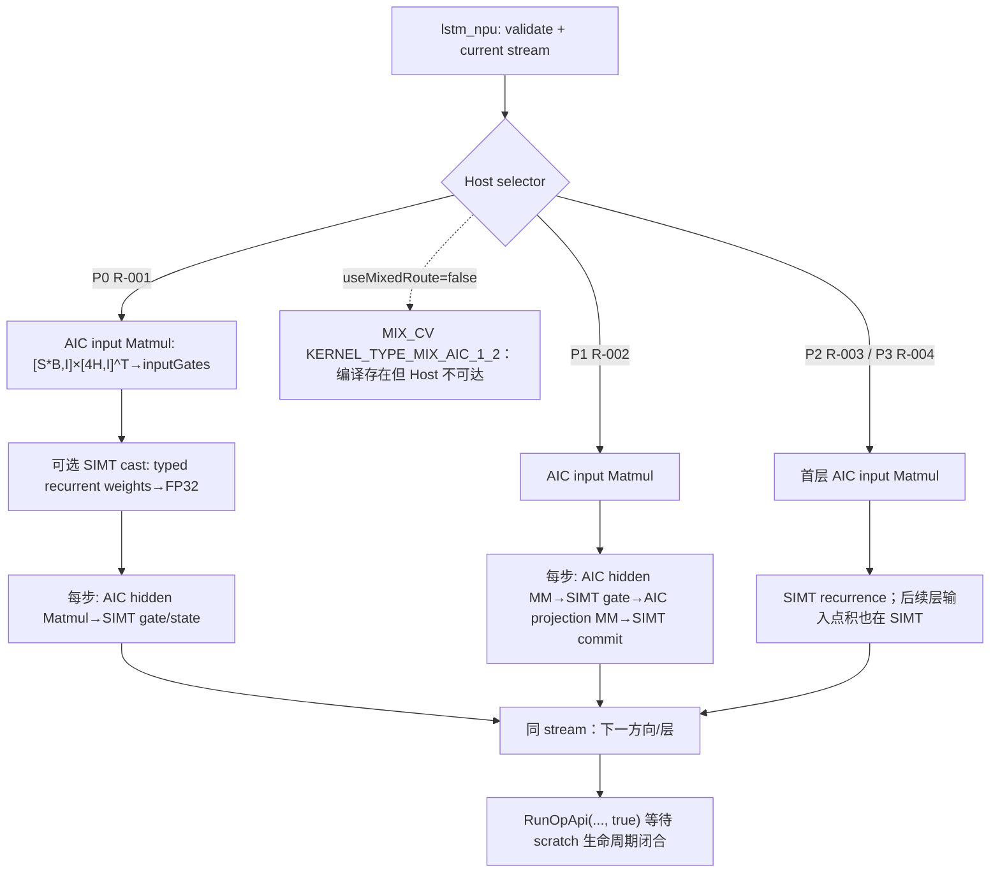
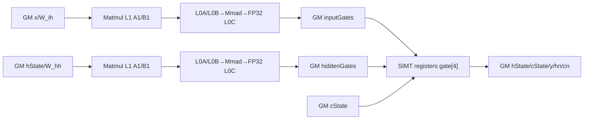
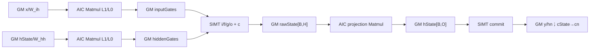
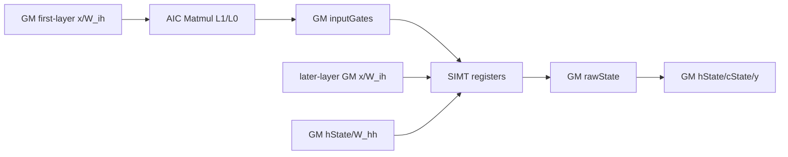

# LSTM 950 Direct Invoke 算子知识

## 算子速览

| 项目 | 内容 |
|---|---|
| 实际入口 | `lstm_npu`（框架侧 Direct Invoke）→ 静态 `launch_lstm_*` C launcher → dav-3510 kernel entry；不是 `aclnnLSTM`。 |
| 计算语义 | 按层、按方向、按时间步计算 `i/f/g/o` 四门，更新 FP32 `c_t` 与 raw hidden；可选再做 `raw_h_t @ weight_hr^T` 投影。 |
| 输入输出 | `x` 为三维 ND、FP32/FP16/BF16；权重为 `[4H,K]`/`[4H,O]`，输出 `y`、`hn`、`cn`，其中 `O=projSize>0 ? projSize : H`。 |
| 执行类型 | 可达节点包含 `AIC_CUBE`（AscendC Matmul）、`SIMT`（`__vector__` entry 内 `VF_CALL`）；多 Kernel 是启动拓扑。源码含 `MIX_CV` entry，但 Host 的 `useMixedRoute=false`，不属于可达 Route。 |
| Kernel 路线 | 四条生产可达 Route：P0 R-001 无投影 staged；P1 R-002 FP32 投影 staged；P2 R-003 小型 typed SIMT；P3 R-004 typed 投影 SIMT。编译存在的 MIX_CV 是 dormant body，不计入生产 Route。 |
| 核心资源 | GM 输入/输出与 Host 持有的 FP32 scratch；Matmul 内部 GM→L1→L0A/L0B→L0C→GM；SIMT body 没有显式 LocalTensor/UB 队列，门值在寄存器。launcher 的第二控制实参为 `nullptr`，不能据此虚构 UB allocation。 |
| 来源闭包 | `direct_implementation_closed`：Direct selector、两个 by-value POD、全部可达 launcher/entry/body、Matmul specialization、跨 Kernel GM 边、同 stream 顺序和生命周期均闭合；官方源码仅作为固定算法/Matmul 转换依据。 |

### 来源与转换关系

- **官方原生事实**：Frontmatter 中固定到 40 位 commit 的 `aclnnLSTM`、DynamicRNN Host/Tiling/Kernel 文件，只支撑 LSTM 门序、层/方向递推、输入与 hidden Matmul 分离、Cube→workspace→Vector 交接、尾块和 910B/910_93 构建边界。
- **Direct Invoke 适配**：Torch schema、Meta/NPU 注册、current-stream 获取、两个 by-value POD、静态 launcher、950 `dav-3510` entry 和 Host selector 是交付实现的适配层，不是官方 ACLNN/OPP 原生链路。
- **Device 派生补充**：FP16/BF16 的 typed SIMT、LSTMP 投影、FP32 staged projection、多 kernel GM 交接以及 dormant MIX_CV body 用来补齐目标接口；固定官方源码不单独证明这些补充语义或等价性。

## 接口与语义

### 计算语义

令 `S=seqLength`、`B=batch`、`I=inputWidth`、`H=hiddenWidth`，投影宽度 `O=outputWidth`。每个层/方向的权重按行存储为 `W_ih∈R^(4H×I)`、`W_hh∈R^(4H×O)`；门行序固定为 `i,f,g,o`：

```text
Gx_t = x_t · W_ih^T                       # staged Route 预计算全序列
Gh_t = h_(t-1) · W_hh^T
z_t  = Gx_t + Gh_t + b_ih + b_hh
i_t  = sigmoid(z_t[0:H])
f_t  = sigmoid(z_t[H:2H])
g_t  = tanh(z_t[2H:3H])
o_t  = sigmoid(z_t[3H:4H])
c_t  = f_t * c_(t-1) + i_t * g_t
r_t  = o_t * tanh(c_t)
h_t  = r_t                              # projSize == 0
h_t  = r_t · W_hr^T                    # projSize > 0, W_hr∈R^(O×H)
```

正向令 `timeIndex=step`，反向令 `timeIndex=S-1-step`。每层的两个方向写入 `y[..., direction*O:(direction+1)*O]`；中间层输出为 FP32，最后一层输出转换回 `x` 的 dtype。所有门加法、激活、cell、hidden 与 Matmul 输出/累加均为 FP32；FP16/BF16 权重在 staged recurrent route 先逐元素提升为 FP32。

### 输入、输出与属性

| 参数 | shape/layout | dtype | 约束、默认值与语义 |
|---|---|---|---|
| `x` | `batchFirst=false:[S,B,I]`；`true:[B,S,I]`，ND contiguous | FP32/FP16/BF16 | 必须 rank 3 且 contiguous；首层输入。Host 以属性 `inputSize` 作为物理行宽，不核对 `x.size(-1)==inputSize`，因此二者相等是调用前提。 |
| `weight_ih[l,d]` | `[4H, I_l]`，`I_0=I`，后续层 `I_l=D*O` | 与逻辑输入家族一致 | B 矩阵以 transpose-B 方式参与 `A·B^T`。 |
| `weight_hh[l,d]` | `[4H,O]` | 同上 | staged 非投影路线要求 `O=H`；typed `W_hh` 会提升到 FP32 后进入 recurrent Matmul。R-001 首层 `W_ih` 保持 FP16/BF16 进入 typed Cube，只有后续层 `W_ih` 因输入已是 FP32 才提升到 FP32。 |
| `bias_ih/bias_hh` | `[4H]` | 同权重 | `bias=true` 时两列表必须存在、长度为 `L*D` 且元素非空；否则 dummy GM 指针传入但由 flag 禁止读取。 |
| `weight_hr[l,d]` | `[O,H]` | 同权重 | `projSize>0` 时必需；FP32 走 AIC 投影，typed 走单核 SIMT 投影。 |
| `h0` | `[L*D,B,O]` | 与 `x` 相同 | 可缺省；缺省为 0。每层/方向通过字节 offset 取片。 |
| `c0` | `[L*D,B,H]` | 与 `x` 相同 | 可缺省；缺省为 0。 |
| `numLayers` | 标量 | int64 Host | 必须 `>0`。 |
| `bias/batchFirst/bidirectional` | 标量 | bool Host | 决定偏置读取、地址公式、方向数 `D∈{1,2}`。 |
| `dropout` | 标量 | double Host | 被接口接收但 Direct 实现未消费，固定源码中没有 dropout kernel。 |
| `projSize` | 标量 | int64 Host | `0` 表示普通 LSTM；正值令 `O=projSize`。负值不会开启投影，却因 `projSize==0 \|\| weightHr` 检查而仍要求完整 `weight_hr` 列表，随后又不读取它；这是非法输入边界，调用方必须保证 `projSize>=0`。 |
| `y` | 与 `x` 前两轴一致，末轴 `D*O` | 与 `x` 相同 | 每层最后一层直接提交；中间层暂存 FP32。 |
| `hn` | `[L*D,B,O]` | 与 `x` 相同 | 仅时间循环最后一步写当前层/方向切片。 |
| `cn` | `[L*D,B,H]` | 与 `x` 相同 | 仅最后一步写。 |

### 入口与版本

本卡入口是交付中的静态 Direct Invoke `lstm_npu`，再调用 `launch_lstm_input_mm_*`、`launch_lstm_staged_*` 或 `launch_lstm_*`；POD 直接按值进入 kernel，不经过官方 `aclnnLSTMGetWorkspaceSize/aclnnLSTM`、GE OpDef 或 OPP tiling registry。

转换依据冻结为 CANN 9.1.0、ops-nn commit `955f8b33985b6d72989ebff341bb9c2c564a51bc`。官方 `aclnnLSTM` 在该 commit 的产品表明确把 Ascend 950PR/950DT 标为不支持，且官方 `dynamic_rnn_910b.cpp` 的构建只接 `ascend910b/ascend910_93`。因此 950 支持结论只属于本 Direct Invoke 实现，不能外推成官方 ACLNN/OPP 支持。官方实现提供公式、分层/方向组合、序列输入 Matmul、逐步 hidden Matmul、workspace 交接、Vector 门控与 tail 处理的转换依据；投影、BF16 950 路径和 Direct selector 是补充实现。

## Host/Launcher 执行流程

### 参数校验与前处理

`lstm_npu` 顺序为：设备 guard → 检查 `x.dim()==3`、正层数/特征宽度、权重列表长度、可选 bias/projection 列表存在性、`x.is_contiguous()` → 按 `batchFirst` 解出 `S/B` → 创建 `y/hn/cn` 和 FP32 中间层输出 → 取当前 NPU stream → 计算 Route。

它不做 Contiguous、Transpose 或权重 concat；`[4H,K]` 权重由 Matmul 的 transpose-B 语义直接使用。Host 逐 `layer`、逐 `direction` 启动节点，方向内时间步严格串行。若可选 tensor 不活动，launcher 仍接收一个有效 dummy GM 地址，但 Device 仅在对应 `has*` flag 为真时读取。

| Host 检查层 | 已检查 | 未检查但 Device 地址公式依赖 |
|---|---|---|
| 结构 | `x.rank==3`、`numLayers/inputSize/hiddenSize>0`、`weight_ih/weight_hh` 列表长度为 `L*D` | `S>0`、`B>0`、`x.size(-1)==inputSize`、`projSize>=0` |
| dtype/device/layout | 仅 `x.is_contiguous()` | `x∈{FP32,FP16,BF16}` 的早期检查；所有权重、bias、`h0/c0` 与 `x` 的 dtype/device/contiguous 一致性 |
| shape | 活动的 bias/projection 列表存在且长度正确 | 每个 tensor 的 rank/shape；`h0=[LD,B,O]`、`c0=[LD,B,H]` 的容量；`weight_ih=[4H,I_l]`、`weight_hh=[4H,O]`、`weight_hr=[O,H]` |
| 算术 | 无 checked multiply/narrow | `S*B*H*L*D`、scratch numel、字节 offset、`4H`、kernel 内 `B*H/B*O` 及所有 int64→int32 窄化 |

`elementSize=x.element_size()` 同时用于切 `h0/c0` 的层方向片；若初始状态 dtype 与 `x` 不同，不仅 Device 会按权重类型解释数据，Host 字节 offset 也会错误。`B==0` 还会令 `simtThreads==0` 并进入 blockDim 除零；`S==0` 即使未立即失败也没有任何时间步写 `y/hn/cn`。这些都不是可用的空张量语义。

### 参数、Workspace 与生命周期

每层/方向创建以下 Host-owned scratch，并逐个压入 `keepAlive`，所以先处理完的层/方向也不会提前释放；全部保持到 `OpCommand::RunOpApi(..., true)` 返回：

```text
hState       = B*O*4 bytes (FP32)
cState       = B*H*4 bytes (FP32)
rawState     = B*5H*4 bytes (FP32 physical allocation)
inputGates   = S*B*4H*4 bytes (使用输入 AIC Matmul的 Route)
hiddenGates  = B*4H*4 bytes (staged Route)
hiddenWfp32  = 4H*H*4 bytes (R-001 且输入 dtype 非 FP32)
inputWfp32   = 4H*I_l*4 bytes (R-001 typed 后续层)
layerOutput  = S*B*D*O*4 bytes/中间层
```

以 `q=(layer,direction)` 表示一个提交单元，实际峰值不是“当前方向 scratch”，而是同步返回前所有已分配对象之和：

```text
base(q) = 4*B*O + 4*B*H + 20*B*H
input_gates(q) = useInputMatmul(q) ? 16*S*B*H : 0
hidden_gates(q) = (R-001 or R-002) ? 16*B*H : 0
cast(q) = R-001 && typed ? 16*H*H + (layer>0 ? 16*H*I_l : 0) : 0
peak_scratch = Σ_q [base + input_gates + hidden_gates + cast]
             + (L-1) * 4*S*B*D*O
```

式中 `rawState` 的 `20*B*H` 即 `B*5H` 个 FP32；R-001 虽不消费它，Host 仍统一分配并保活。`y/hn/cn` 和调用方输入不计入 scratch。

Direct Matmul launcher 的 `workspace` 实参被传成输出 buffer 本身，但 `LstmInputMatmul::Process` 不读取该形参；因此可达 AIC-only Matmul 节点没有额外显式算子 workspace。源码中的 24 MiB KFC allocation 只位于 `if (useMixedRoute)`，而该 selector 常量为 `false`，运行时不分配，也不计入可达 workspace。

### 启动图与失败传播



所有 launch 使用同一个 current stream；GM producer→consumer 可见性由同 stream 提交顺序保证，无跨 stream event。入口阶段的 `TORCH_CHECK` 在进入 launch 图前抛错；launcher 是 `void` 且 lambda 固定返回 0，单次异步 launch 无显式返回码，错误由同步执行边界传播。任一入口前置检查失败不会启动后继节点。

这里的“前置 Host 检查”只指进入 `aclCall` 之前的检查。dtype 不是完整的前置检查：公共 input-MM producer 位于 direct fallback 的 `TORCH_CHECK(dtype==FP32)` 之前。对合法 dtype 不影响四条 Route；对未知 dtype，小 work 路径可能先提交一个按 BF16 解释的首层 input-MM 再抛错，大 work 无投影甚至会被原始 staged 谓词吸收而按错误模板继续。因此不能把“不支持 dtype”描述成无副作用的 launch 前失败，也不能把 direct fallback 当作 kernel 失败后的重试。

按单个 `(layer,direction)` 计，`1[cond]` 表示条件成立时有一个节点，`N_h=S-(h0?0:1)`（要求 `S>0`）：

| Route | 前导节点 | 时间循环节点 | 收尾/同步边界 |
|---|---|---|---|
| R-001 | `1[typed&&layer>0]` 次 W_ih cast + 1 次 input MM + `1[typed]` 次 W_hh cast + `1[h0\|\|c0]` 次 init | `N_h` 次 hidden MM + `S` 次 staged step | 下一方向/层仍在同 stream；最终 `RunOpApi(...,true)` |
| R-002 | 1 次 input MM + `1[h0\|\|c0]` 次 init | `N_h` 次 hidden MM + `S` 次 gate + `S` 次 projection MM + `S` 次 commit | 同上 |
| R-003 | `1[layer==0]` 次 typed input MM | 1 次 direct recurrent kernel，内部循环全部 `S` 步 | kernel 内 barrier；返回后同 stream 下一节点 |
| R-004 | `1[layer==0]` 次 typed input MM | 1 次单核 direct recurrent+projection kernel | kernel 内 barrier；返回后同 stream 下一节点 |

## Route 与参数设计

### 分核与资源计算

输入/hidden/投影 Matmul 均令 `M=行数`、`N=输出宽度`、`K=输入宽度`。静态 Matmul specialization 为：GM ND A、GM ND transpose-B、GM ND FP32 C、`CONFIG_MDL`，shape 上界/基本块 `(M,N,K;baseM,baseN,baseK)=(2048,1024,512;64,128,64)`，`enUnitFlag=true`，FP32 时显式 `SetHF32(false,0)`。

Host 的输入 MM：`singleCoreN=min(128,4H)`，`nCores=ceil(4H/singleCoreN)`，`mCores=min(max(1,20/nCores), max(1,ceil(SB/64)))`，`singleCoreM=ceil(SB/mCores)`，`blockDim=mCores*nCores`。Device 用 `block%mCoreCount` 取 M 分片、`block/mCoreCount` 取 N 分片，再以 `tailM=min(singleCoreM,M-mOffset)`、`tailN=min(singleCoreN,N-nOffset)` 调 `SetTail(tailM,tailN,K)`；K 不跨核切分，完整 K 交给 Matmul 库处理尾部。

hidden MM 固定 `M=B,N=4H,K=H`（R-002 投影 recurrent product 为 `K=O`），`mCoreCount=1,singleCoreM=B`；`singleCoreN=min(H>=64?64:128,4H)`，`blockDim=ceil(4H/singleCoreN)`。投影 MM 为 `M=B,N=O,K=H`，`singleCoreN=min(128,O)`，`blockDim=ceil(O/singleCoreN)`。

SIMT 分核不能用一个公式概括全部 Route：

```text
directThreads = BH <= 256 or proj>0 ? min(1024, align_up(4BH,32)) : 256
directBlocks  = proj>0 ? 1 : min(20, ceil(BH/directThreads))
stagedBlocks(R-001) = directBlocks                 # body固定 VF_CALL Dim3(256)
stagedBlocks(R-002) = min(20, ceil(BH/256))        # body固定 VF_CALL Dim3(256)
castBlocks(count)   = min(20, ceil(count/256))
```

因此 R-003 在 `BH<=256` 时进入单核 `ThreadBarrier` body，在 `BH>256` 时进入多核 `SyncAll` body；R-004 无论大小都强制一个 block，并以最多 1024 threads 做 grid-stride。R-001 的 `params.simtThreads` 只参与 Host block 数公式，staged entry 本身固定启动 256 个 SIMT threads，不能误写成动态线程数。

### Route 选择

下表按实现重要性降序，而“Host 顺序、短路与 fallback”列保留源码中的实际控制流位置。优先级不是 Host `if` 次序；实现复用必须同时遵守两列。四条均为 `active`：在声明的合法 dtype/shape 域内可由生产 selector 到达；本实现没有额外 `conditional` Route，也没有 kernel 失败后的运行时重试。

| 重要性 | 状态 | Route | Route 特征 | 合法适用域 | 源码原始谓词/实现前提 | Host 顺序、短路与 fallback |
|---:|---|---|---|---|---|---|
| P0 | active | R-001 无投影 staged | 全序列 input AIC Matmul；每步 hidden AIC Matmul→SIMT 门控/状态 | `projSize==0 && dtype∈{FP32,FP16,BF16} && (dtype==FP32 \|\| S*B*H*L*D>=512)` | 原始 `useStagedRoute` 没有 dtype 白名单；合法域还要求 Matmul 静态上界成立。typed `W_hh` 与后续层 `W_ih` 提升到 FP32；首层 `W_ih` 保持 FP16/BF16 进入 typed Cube | live 分支第 2 个：恒 false MIX、R-002 均未命中后检查；命中 `continue`。合法 typed 小 work 走 R-003；未知 dtype 大 work 是错误吸收，不是新 Route。 |
| P1 | active | R-002 FP32 投影 staged | 每步 hidden AIC→SIMT gate→projection AIC→SIMT commit | `dtype==FP32 && projSize>0` | `weight_hr[O,H]` 存在；hidden/projection 两组 MM POD 合法；`rawState/hState/cState` 覆盖整段递推 | live 分支第 1 个：恒 false MIX 后首先检查；命中 `continue`，短路 R-001/direct。typed 投影落到 R-004。 |
| P2 | active | R-003 小型 typed SIMT | 首层 input AIC；无投影递推由单核或多核 SIMT 完成 | `projSize==0 && dtype∈{FP16,BF16} && S*B*H*L*D<512` | 首层 `inputPrecomputed=1`；后续层 `inputPrecomputed=0` 并直接做输入点积；kernel 内 barrier 覆盖 GM 状态复用 | R-002/R-001 selector miss 后的选择期 fallback；dtype function pointer 成功后 launch。不是先执行 staged 再失败重试。 |
| P3 | active | R-004 typed 投影 SIMT | 首层 input AIC；单核 SIMT 内完成门控、cell 与投影 | `projSize>0 && dtype∈{FP16,BF16}` | `weight_hr[O,H]` 存在；`forceSingleCore=true`；`rawState` 覆盖四门与 raw hidden | R-002 miss 且 R-001 因投影为 false 后的选择期 fallback；由 `hasProjection=1` 进入投影 body。 |

```text
# selector producer
useStagedRoute      = projSize == 0 && (dtype == FP32 || recurrentWork >= 512)
useStagedProjection = dtype == FP32 && projSize > 0
useMixedRoute       = false

# 合法调用域必须先保证 dtype in {FP32,FP16,BF16}；交付 Host 没有这条早检

# 每层/方向的公共 producer；发生在 Route continue 链之前
if useStagedRoute && dtype != FP32 && layer > 0:
    cast W_ih to FP32
useInputMatmul = !useMixedRoute && (useStagedRoute || dtype == FP32 || layer == 0)
if useInputMatmul:
    if dtype == FP32 || (useStagedRoute && layer > 0): launch FP32 input AIC MM
    else if dtype == FP16:                            launch FP16 input AIC MM
    else:                                             launch BF16 input AIC MM
build LstmLaunchParams, blockDim and active/dummy GM pointers

# 真正的短路链
if useMixedRoute:                       # 恒 false；编译存在但不可达
    launch MIX_CV
    continue
if useStagedProjection:                 # Host live 顺序 1
    execute R-002
    continue
if useStagedRoute:                      # Host live 顺序 2
    execute R-001
    continue

# direct fallback；Host live 顺序 3
select TX/TW/TY entry from dtype, layer>0 and layer+1<numLayers
if dtype not in {FP32,FP16,BF16}: fail             # 位置晚于公共 input-MM producer
if hasProjection == 0: execute R-003
else:                  execute R-004 with blockDim=1
```

### Dormant 编译体

| 编译体 | 生产可达性 | 现有 body | 重新启用前必须补齐 |
|---|---|---|---|
| `lstm_mixed_*` / `RunLstmMixed` | dormant；唯一 Host key `useMixedRoute` 是字面量 `false`，无 selector 入边 | `KERNEL_TYPE_MIX_AIC_1_2`，两个 AIV client 与 AIC Matmul server；GM KFC workspace；序列 input MM、逐步 hidden MM、Vector gate/可选 SIMT projection | 不能只把 bool 改 true：Host 当前固定调用 `launch_lstm_mixed_float`，未按 dtype 选九个 entry；`inputNeedsCast` 固定 0、`typedInput` 与 layer input 别名；还需验证 `N<=512` 静态上界、双 sub-block `splitN/tailN` 对小 H 的合法性、typed state ABI、24 MiB workspace 和 KFC 同步。全部闭合后才能升级为 active/conditional Route。 |

Dormant body 只说明源码库存与恢复门槛；它不分担四条 active Route 的合法域，也不是它们的 fallback。

### 模板/实现执行矩阵

| 重要性 | Route | key/selector | dtype/shape/platform 完整命中条件 | 执行族与 kernel 节点 | 实际模板/body | 内存与同步特征 | tail/fallback |
|---:|---|---|---|---|---|---|---|
| P0 | R-001 无投影 staged | `useStagedRoute` | 950；三种合法 dtype；`proj=0`；FP32 或 work≥512 | 可选 SIMT cast → AIC input MM → 可选 SIMT init → 每步 AIC hidden MM → SIMT step | `LstmInputMatmul<T>::Process`；`CastStagedWeight<T>`；`StepStaged<TW,TY,*>` | `inputGates/hiddenGates/hState/cState` 由 GM 交接；同 stream | MM M/N/K tail；首步按 h0/c0 选择零隐藏/零状态 specialization；Host短路位置在R-002之后，未命中落到direct |
| P1 | R-002 FP32 投影 staged | `useStagedProjection` | 950；FP32；`proj>0` | AIC input MM → 可选 SIMT init → 每步 AIC hidden MM → SIMT gate → AIC projection MM → SIMT commit | `GateStagedProjectionFloat<*>`、同一 `LstmInputMatmul<float>` specialization、`CommitStagedProjectionFloat` | `rawState[B,H]` 是 gate→projection 边；`hState[B,O]` 是 projection→commit/下一步边 | hidden/projection N tail；首步零隐藏/零 cell specialization；live分支首先短路，typed落到R-004 |
| P2 | R-003 小型 typed SIMT | small-work predicate | 950；FP16/BF16；`proj=0`；work<512 | 首层 AIC input MM → 一个/多个 `__vector__` SIMT recurrent kernel；后续层输入点积在 SIMT | `RunLstmSingleCore` 或 `RunLstm→ComputeGates/CommitHidden` | `rawState`、`hState`、`cState` 全在 GM；单核用 `ThreadBarrier`，多核用 `SyncAll` | 线程 grid-stride tail；是staged分支均未命中的direct fallback |
| P3 | R-004 typed 投影 SIMT | typed projection | 950；FP16/BF16；`proj>0` | 首层 AIC input MM → 单核 SIMT recurrence+projection | `RunLstmSingleCore<TX,TW,TY>` | `rawState[0:4BH]` 为 gates，`rawState[4BH:5BH]` 为 raw hidden；每阶段 `ThreadBarrier` | `blockDim=1`；线程 grid-stride tail；是R-002未命中的typed投影fallback |

### 性能与资源 Guard

| Guard | Host/Tiling 条件 | Device/资源原因 | 影响 Route | 不满足时去向 | 源码符号 |
|---|---|---|---|---|---|
| staged 阈值 | `S*B*H*L*D>=512`（FP32 无条件 staged） | amortize 每步 AIC+SIMT launch；不用于数据值分流 | R-001/R-003 | R-003 | `lstm_npu::recurrentWork/useStagedRoute` |
| projection dtype | `dtype==FP32 && projSize>0` | staged projection的 gate/Matmul/commit specialization全为 FP32 | R-002/R-004 | typed 走 R-004 | `useStagedProjection` |
| Matmul 静态上界 | `M<=2048,N<=1024,K<=512` 应由调用域保证 | `MatmulShapeParams` 的编译期上界 | R-001/R-002及R-003/R-004首层 | 固定实现无运行 fallback | `LSTM_INPUT_MM_SHAPES` |
| N 分片 | `singleCoreN<=128`；hidden `H>=64` 时取 64 | 控制基本 N tile 与核数 | R-001/R-002 | tail 由 `SetTail` | `singleCoreN` producer |
| 核数 | SIMT/cast clamp 到 20，投影 direct 强制 1；AIC MM 在静态 `N<=1024` 域内 input≤20、hidden≤16、projection≤8 | 防止状态依赖跨核无序并限制计算核；AIC 超静态域时公式本身不再保证≤20 | 全部 | 无资源查询 fallback；先满足 Matmul envelope | `blockDim/forceSingleCore` |
| 首步代数消除 | `step==0 && !h0`；再按 `c0` 区分 | 不读未初始化 `hiddenGates/hState/cState` | R-001/R-002 | 选择 full/zero/zero_state body | `useHiddenProduct`、`UseHiddenGates/UseCellState` |
| MIX 可达性 | `useMixedRoute=false` | KFC MIX workspace/同步路线未进入交付 Host 图 | 全部 | 永不进入 MIX；继续四条正式 Route | `useMixedRoute` |
| dtype 检查位置 | common input MM 前无白名单；direct fallback 末端才检查 | 避免把未知 dtype 按 BF16/FP16/FP32 模板重解释 | 全部 | 合法调用方必须预先限制三种 dtype；固定实现没有安全 Route | `dtype` 分支、`launchWeightCast` 默认值 |
| POD 窄化 | 所有 shape/stride/count 在 launch 前转 `int32_t` | Device ABI 为 32 位有符号整数 | 全部 | 固定实现无溢出检查 | `LstmLaunchParams/LstmMatmulParams` 赋值 |

### POD/ABI

两个结构均只含 `int32_t`，天然 `alignof=4`。`LstmLaunchParams sizeof=64`，`LstmMatmulParams sizeof=24`；按 C++ 标准布局可确定以下 offset。

| 结构 | 字段 | 类型/位宽 | ABI 布局 | 单位 | Host/launcher producer | Device consumer | 边界 |
|---|---|---|---|---|---|---|---|
| `LstmLaunchParams` | `seqLength` | int32/32 | off 0, size 4 | 时间步 | `seq` | 时间循环/地址 | `>0` 未单独检查 |
| 同上 | `batch` | int32/32 | off 4 | 元素行数 | `batch` | cells/outputs | 需可乘且不溢出 |
| 同上 | `inputWidth` | int32/32 | off 8 | 元素 | `layerInputWidth` | SIMT input dot | 正数 |
| 同上 | `hiddenWidth` | int32/32 | off 12 | 元素 | `hiddenSize` | gate/cell/stride | 正数 |
| 同上 | `outputWidth` | int32/32 | off 16 | 元素 | `O` | h/projection/output | `proj>0?proj:H` |
| 同上 | `xStride` | int32/32 | off 20 | 元素/行 | `layerInputWidth` | x 地址 | 等于当前层输入宽度 |
| 同上 | `yStride` | int32/32 | off 24 | 元素/行 | `D*O` | y 地址 | 双向含两向 |
| 同上 | `batchFirst` | int32/32 | off 28 | bool 0/1 | 属性 | x/y/inputGates 地址 | 仅 0/1 |
| 同上 | `direction` | int32/32 | off 32 | 方向 0/1 | direction loop | 时间反转/y offset | 仅 0/1 |
| 同上 | `hasBias` | int32/32 | off 36 | bool 0/1 | `bias` | bias 读取 guard | false 时 dummy ptr 不读 |
| 同上 | `hasH0` | int32/32 | off 40 | bool 0/1 | `h0.has_value()` | 初始化/首步 selector | false 为零 |
| 同上 | `hasC0` | int32/32 | off 44 | bool 0/1 | `c0.has_value()` | 初始化/首步 selector | false 为零 |
| 同上 | `hasProjection` | int32/32 | off 48 | bool 0/1 | `projSize>0` | direct projection branch | staged Route 已由 Host 分流 |
| 同上 | `simtThreads` | int32/32 | off 52 | threads/block | Host 公式 | `VF_CALL Dim3` | 32 对齐、≤1024 |
| 同上 | `inputPrecomputed` | int32/32 | off 56 | bool 0/1 | `useInputMatmul` | SIMT x 解释为 FP32 gates | true 时禁止按 TX 读 |
| 同上 | `inputNeedsCast` | int32/32 | off 60 | bool 0/1 | 固定 0 | dormant MIX prepare | 正式 Route inactive |
| `LstmMatmulParams` | `m` | int32/32 | off 0 | 行 | Host M | `SetOrgShape/SetTail` | 正数、≤静态上界 |
| 同上 | `n` | int32/32 | off 4 | 列 | Host N | 同上 | 正数、≤静态上界 |
| 同上 | `k` | int32/32 | off 8 | reduction 元素 | Host K | 同上 | 正数、≤静态上界 |
| 同上 | `singleCoreM` | int32/32 | off 12 | 行/core | ceil 公式 | M offset/tail | `>=1` |
| 同上 | `singleCoreN` | int32/32 | off 16 | 列/core | min 公式 | N offset/tail | `1..128` |
| 同上 | `mCoreCount` | int32/32 | off 20 | cores | Host | block→M/N 映射 | `>=1` |

### Route 源码闭包

| 重要性 | Route | Key/selector | Host/Tiling producer | POD/参数 | Kernel entry/router | Kernel body/直接依赖 | 构建接线 |
|---:|---|---|---|---|---|---|---|
| P0 | R-001 | `useStagedRoute` | `lstm_npu` | 两 POD；dtype/first-step function pointers | `lstm_input_mm_*`、`lstm_staged_*` | `LstmInputMatmul::Process`、`CastStagedWeight`、`InitStaged`、`StepStaged` | Direct target `ascend950`/`dav-3510` 静态 kernel+plugin sources |
| P1 | R-002 | `useStagedProjection` | `lstm_npu` | hidden/projection 两组 MM POD | input MM + projection gate/commit entries | `GateStagedProjectionFloat`、`LstmInputMatmul<float>`、`CommitStagedProjectionFloat` | 同上 |
| P2 | R-003 | typed small work | `lstm_npu` | `inputPrecomputed`、SIMT threads/block | input MM + `lstm_kernel_*` | `RunLstmSingleCore` 或 `RunLstm/ComputeGates/CommitHidden` | 同上 |
| P3 | R-004 | typed `projSize>0` | `lstm_npu` | `hasProjection=1, blockDim=1` | input MM + `lstm_kernel_*` | `RunLstmSingleCore` projection branch | 同上 |

## Kernel 实现

### 公共执行流程

四条 Route 都按 `layer-major → direction-major` 提交到同一 stream。R-001/R-002 每层都先以 AIC Matmul 形成物理 `[S*B,4H]` 的 `inputGates`，R-003/R-004 仅第 0 层这样做；其逻辑前两轴顺序与 contiguous `x` 一致，即 time-major 时 `[S,B]`、batch-major 时 `[B,S]`。staged Route 每个时间步再用 AIC hidden product 形成 `hiddenGates[B,4H]`，随后由 SIMT 激活门和更新状态。跨 kernel 没有 flag/event；producer kernel 完成后，同 stream 的 consumer 才可读取相同 Host-owned GM tensor。中间层 `layerOutput` 是下一层输入，方向片通过 `yStride=D*O` 隔离。

Matmul specialization 从 GM ND A/B 进入库管理的 L1(A1/B1)、L0A/L0B，Mmad 在 L0C 以 FP32 累加，再写 GM ND C。A、B 基本 tile 为 `64×64` 与 `64×128`，C tile 为 `64×128`；具体 step/depth 和双缓冲由 CANN 9.1 Matmul 库在 `CONFIG_MDL` 下决定，Direct 源码未手工分配这些局部 buffer，不能把逻辑 tile 误写成完整物理 allocation。

| entry 类别 | 声明/任务 | block ownership | 局部资源与同步 |
|---|---|---|---|
| `lstm_input_mm_*` | `__global__ __aicore__ __cube__`，AIC_CUBE | `block -> (mIndex=block%mCoreCount,nIndex=block/mCoreCount)`，每 block 独占一个 C 矩形 | Matmul 库管理 L1/L0；block 间无共享写；`SetTail` 处理末块 |
| `lstm_staged_*`、cast、projection gate/commit | `__global__ __aicore__ __vector__`，entry 内 `VF_CALL Dim3(256)` | `linear=tid+block*256; linear+=blockNum*256` | 标量/四门在 SIMT 寄存器，直接访问 GM；单 entry 内无需跨 block 交换 |
| `lstm_kernel_*` | `__global__ __aicore__ __vector__`，entry 内动态 `VF_CALL Dim3(p.simtThreads)` | 单核用 block 内 grid-stride；多核用 `tid+core*threads` 全局 grid-stride | 单核 `ThreadBarrier`；多核 `SyncAll` 保护跨 block 的 h/c/raw 状态 |
| `lstm_mixed_*` | `KERNEL_TYPE_MIX_AIC_1_2` | 一个 MIX block 的 1 个 AIC server + 2 个 AIV sub-block | GM KFC workspace；生产 selector 不可达 |

### Route R-001（P0）：无投影 staged

#### 适用条件

##### 选择证据

| 层级 | 文件 | 符号 | 源码谓词/参数 | 结果/下一跳 |
|---|---|---|---|---|
| Host短路 | Direct plugin | `if (useMixedRoute)`→`if (useStagedProjection)`→`if (useStagedRoute)` | 前两项均为 false，第三项为 true | R-001并`continue`；不进入direct |
| Host | Direct plugin | `useStagedRoute` | `projSize==0 && (dtype==FP32 \|\| recurrentWork>=512)` | R-001 |
| Host | Direct plugin | `useInputMatmul` | staged 为真 | 每层启动 input MM |
| Host | Direct plugin | `useHiddenProduct` | `step>0 \|\| h0.has_value()` | full step；否则 zero step |
| Router | Direct kernel | dtype function pointers | FP32/FP16/BF16；中间层 `outputIsFloat` | 选择 input MM、init、step specialization |

#### Device 数据流

##### 函数级调用链

```text
lstm_npu
  -> [typed && layer>0] launch_lstm_cast_* (W_ih -> FP32)
  -> launch_lstm_input_mm_{float,half,bfloat16}
    -> lstm_input_mm_* -> LstmInputMatmul<T>::Process
  -> [typed] launch_lstm_cast_* (W_hh -> FP32) -> CastStagedWeight<T>
  -> [h0/c0] launch_lstm_staged_init_* -> InitStaged<T>
  -> for step:
       [step>0 || h0] launch_lstm_input_mm_float(hState, W_hh) -> hiddenGates
       launch_lstm_staged_{step|zero_step|zero_state_step}_*
         -> StepStaged<TW,TY,UseHiddenGates,UseCellState>
```

##### 源码等价伪码

```text
if typed and layer==0:
    inputGates = MM_typed(x, W_ih^T)             # C 为 FP32
if typed and layer>0:
    W_ih_fp32 = cast(W_ih)
    inputGates = MM_fp32(layerOutput, W_ih_fp32^T)
if FP32:
    inputGates = MM_fp32(layerInput, W_ih^T)
if typed:
    W_hh_fp32 = cast(W_hh)
if h0 or c0: hState = h0 or 0; cState = c0 or 0
for step in [0,S):
    t = direction ? S-1-step : step
    if step>0 or h0: hiddenGates = MM_fp32(hState, W_hh_fp32^T)
    for linear in grid_stride(B*H):
        z[0:4] = inputGates[t,b,i/f/g/o] + (hidden valid ? hiddenGates[b,*] : 0)
        if bias: z += b_ih + b_hh
        c = sigmoid(f)*old_c + sigmoid(i)*tanh(g)
        h = sigmoid(o)*tanh(c)
        write cState,hState,y[t,b,d*H+h]
        if last step: write hn,cn
```

#### 内存与数据搬运

##### 资源与搬运表

| 层级/缓冲区 | offset/地址公式 | extent/容量公式 | dtype/layout | producer | consumer | owner/lifetime | 对齐/复用 |
|---|---|---|---|---|---|---|---|
| GM `inputGates` | `((t*B+b)*4H+row)*4` 或 batch-first 等价地址 | `S*B*4H*4` bytes | FP32 ND | input AIC MM | every staged step | Host tensor；当前层/方向 | input MM `workspace` 参数别名此 buffer但不读 |
| GM `hiddenGates` | `(b*4H+row)*4` | `B*4H*4` | FP32 ND | hidden AIC MM | current step SIMT | Host tensor；跨全部 step复用 | 下步覆盖前由同 stream current step 消费完 |
| GM `hState` | `(b*H+h)*4` | `B*H*4` | FP32 ND | init/step | hidden MM/下一步 | Host tensor | recurrent loop-carried |
| GM `cState` | 同上 | `B*H*4` | FP32 ND | init/step | next step/final | Host tensor | loop-carried |
| GM `rawState` | physical `b*5H*4` | `B*5H*4` | FP32 | 未由 R-001 body 使用 | N/A | Host tensor；为统一 ABI 分配 | N/A |
| L1 A1/B1 | Matmul库内部 | 至少当前 `baseM*baseK*sizeof(T)` / `baseK*baseN*sizeof(T)` logical tile | ND→内部格式 | MTE | L0A/L0B | Matmul object | depth/双缓冲固定库不可见 |
| L0A/L0B | 当前 K tile | `64*64*sizeof(T)` / `64*128*sizeof(T)` logical tile | Cube internal | LoadData | Mmad | Matmul invocation | K tail由 `SetTail(...,K)` |
| L0C | current M×N tile | `64*128*4=32768` logical bytes | FP32 | Mmad | Fixpipe/GM C | Matmul invocation | M/N tail屏蔽无效区 |
| 显式 UB | N/A | 0 | N/A | N/A | N/A | SIMT body 无 LocalTensor/队列 | Matmul 库内部资源不由此行推断 |
| registers | per thread `gate[4]` | 16 bytes/thread + scalar temporaries | FP32 | GM loads | sigmoid/tanh/update | SIMT thread | grid-stride tail |

##### 分层内存布局



##### 字节账、交接边与复用顺序

```text
workspace_explicit = 0
scratch_per_direction = 16*S*B*H + 16*B*H + 4*B*H + 4*B*H + 20*B*H
                      + (typed ? 16*H*H : 0)
                      + (typed && layer>0 ? 16*H*I_l : 0)
L0 logical tile = 64*64*sizeof(T) + 64*128*sizeof(T) + 64*128*4
SIMT explicit UB = 0
```

| 边/复用子区 | producer | offset/extent | dtype/layout | consumer | ordering/sync | owner/lifetime | 安全条件 |
|---|---|---|---|---|---|---|---|
| input MM→step | `LstmInputMatmul` | 全 `S*B*4H` elems | FP32 ND | `StepStaged` | same stream | `inputGates` tensor | producer完成后只读 |
| hidden MM→step | `LstmInputMatmul<float>` | `B*4H` elems | FP32 ND | current `StepStaged` | same stream | `hiddenGates` | consumer提交后下一步方可覆盖 |
| step→next hidden MM | `StepStaged` | `hState[0:B*H]` | FP32 ND | next hidden MM | same stream | `hState` | 时间步严格串行 |
| step→step | `StepStaged` | `cState[0:B*H]` | FP32 ND | next step | same stream | `cState` | zero-state body首步不读取未初始化内容 |

#### 同步、精度与尾块

##### 同步与数值边界表

| 阶段 | primitive/机制 | producer | consumer/等待点 | 保护对象 | 精度/尾块 |
|---|---|---|---|---|---|
| 跨 kernel | same stream ordering | input/hidden MM | staged step | gate GM | FP32 output |
| Matmul | `SetHF32(false,0)` | A/B loads | FP32 L0C/GM | accumulation mode | 禁止继承 HF32；M/N/K tail显式 |
| SIMT | 每元素独占写 | gate loads | state update | h/c/y disjoint index | FP32 activation/update，final cast TY/TW |
| 首步 | compile-time bool specialization | Host selector | zero bodies | uninitialized hidden/cell scratch | 不读取 inactive GM |
| 最后一步 | `finish` | current step | `hn/cn` writes | final states | 仅最后步转换到 weight dtype |

#### 关键实现

##### 符号证据表

| 阶段 | 文件 | 符号/模板实例 | 实现事实 |
|---|---|---|---|
| Host/Tiling producer | Direct plugin | `lstm_npu` | 生成两 POD、scratch、blockDim和 function pointer |
| Kernel entry/router | Direct kernel | `lstm_input_mm_*`、`lstm_staged_*` | AIC MM与SIMT step静态 entry |
| Device body/helper | Direct kernel | `LstmInputMatmul<T>::Process` | transpose-B、FP32 C、M/N/K tail、HF32关闭 |
| Device body/helper | Direct kernel | `StepStaged<TW,TY,*>` | i/f/g/o、FP32 state、zero specialization、tail |

### Route R-002（P1）：FP32 投影 staged

#### 适用条件

##### 选择证据

| 层级 | 文件 | 符号 | 源码谓词/参数 | 结果/下一跳 |
|---|---|---|---|---|
| Host短路 | Direct plugin | `if (useMixedRoute)`→`if (useStagedProjection)` | MIX恒 false，首个live分支为 true | R-002并`continue`；不检查R-001/direct |
| Host | Direct plugin | `useStagedProjection` | `dtype==FP32 && projSize>0` | R-002 |
| Host | Direct plugin | projection POD | hidden `(B,4H,O)`；projection `(B,O,H)` | 两类 AIC MM |
| Host | Direct plugin | first-step selector | `step>0 \|\| h0`，再看 `c0` | full/zero/zero_state gate |

#### Device 数据流

##### 函数级调用链

```text
input AIC MM
-> optional InitStaged<float>
-> each step:
     optional hidden AIC MM(hState[B,O], W_hh[4H,O]^T)
     GateStagedProjectionFloat<UseHiddenGates,UseCellState>
     projection AIC MM(rawState[B,H], W_hr[O,H]^T)
     CommitStagedProjectionFloat(hState[B,O] -> y/hn; cState -> cn)
```

##### 源码等价伪码

```text
inputGates = MM(x, W_ih^T)
for t:
    hiddenGates = MM(hState, W_hh^T) when hidden state exists
    rawState,cState = gates_and_cell(inputGates, hiddenGates?, cState?)
    hState = MM(rawState, W_hr^T)
    commit hState to y; on last step commit hn and cState to cn
```

#### 内存与数据搬运

##### 资源与搬运表

| 层级/缓冲区 | offset/地址公式 | extent/容量公式 | dtype/layout | producer | consumer | owner/lifetime | 对齐/复用 |
|---|---|---|---|---|---|---|---|
| `inputGates` | time/batch row×`4H` | `S*B*4H*4` | FP32 ND | input AIC | gate SIMT | Host tensor | read-only loop |
| `hiddenGates` | `b*4H+row` | `B*4H*4` | FP32 ND | hidden AIC | gate SIMT | Host tensor | per-step覆盖 |
| `rawState` | `b*H+h` | logical `B*H*4`，physical `B*5H*4` | FP32 ND | gate SIMT | projection AIC A | Host tensor | projection消费后下步覆盖 |
| `hState` | `b*O+o` | `B*O*4` | FP32 ND | projection AIC | commit和下步hidden AIC | Host tensor | loop-carried |
| `cState` | `b*H+h` | `B*H*4` | FP32 ND | gate SIMT | next gate/commit | Host tensor | loop-carried |
| L1/L0 input/hidden/projection | 按各 POD M/N/K | 与 R-001 同一 base tile公式 | FP32 | Matmul library | GM C | Matmul object | 三类调用串行复用物理资源 |
| 显式 UB | N/A | 0 | N/A | N/A | N/A | SIMT 寄存器路线 | Matmul 库内部资源不由此行推断 |

##### 分层内存布局



##### 字节账、交接边与复用顺序

```text
workspace_explicit = 0
scratch = 4*(S*B*4H + B*4H + B*O + B*H + B*5H)
L0 logical tile/call = 64*64*4 + 64*128*4 + 64*128*4 bytes (FP32 A/B/C)
SIMT explicit UB = 0
```

| 边/复用子区 | producer | offset/extent | dtype/layout | consumer | ordering/sync | owner/lifetime | 安全条件 |
|---|---|---|---|---|---|---|---|
| gate→projection | `GateStagedProjectionFloat` | `0 / B*H*4` | FP32 ND | projection AIC MM | same stream | `rawState` | 全 cells写完后projection启动 |
| projection→commit | AIC MM | `0 / B*O*4` | FP32 ND | commit SIMT | same stream | `hState` | commit后方作为下步 hidden A |
| cState→next/finish | gate SIMT | `0 / B*H*4` | FP32 ND | next gate/commit | same stream | `cState` | 时间步串行 |

#### 同步、精度与尾块

##### 同步与数值边界表

| 阶段 | primitive/机制 | producer | consumer/等待点 | 保护对象 | 精度/尾块 |
|---|---|---|---|---|---|
| hidden→gate | stream order | AIC | SIMT gate | hiddenGates | FP32 |
| gate→projection | stream order | SIMT gate | AIC | rawState | FP32，无中间 cast |
| projection→commit | stream order | AIC | SIMT | hState | FP32 |
| Matmul tail | `SetTail` | Host POD | Matmul body | M/N/K edge | projection O tail安全 |
| finish | flag | last commit | hn/cn | output slices | 无 rounding（全 FP32） |

#### 关键实现

##### 符号证据表

| 阶段 | 文件 | 符号/模板实例 | 实现事实 |
|---|---|---|---|
| Host/Tiling producer | Direct plugin | `useStagedProjection`、两组 `LstmMatmulParams` | hidden/projection维度和 blockDim |
| Kernel entry/router | Direct kernel | `lstm_staged_projection_*` | 三个首步 gate实例和 commit |
| Device body/helper | Direct kernel | `GateStagedProjectionFloat` | FP32门控/cell/raw hidden |
| Device body/helper | Direct kernel | `LstmInputMatmul<float>::Process` | 同一 transpose-B AIC body复用于投影 |

### Route R-003（P2）：小型 typed SIMT

#### 适用条件

##### 选择证据

| 层级 | 文件 | 符号 | 源码谓词/参数 | 结果/下一跳 |
|---|---|---|---|---|
| Host fallback | Direct plugin | MIX→projection→staged→direct | 前三项均为 false；direct按dtype选entry | 合法 FP16/BF16 且 `hasProjection=0` 进入 R-003；未知 dtype 的失败检查过晚，不属于 Route |
| Host | Direct plugin | staged predicate反面 | FP16/BF16、`proj=0`、work<512 | R-003 |
| Host | Direct plugin | `useInputMatmul` | `layer==0`（非 staged typed） | 仅首层 AIC input MM |
| Router | Direct kernel | `cores==1` | `BH<=256` 时 blockDim=1；`BH>256` 时为 `min(20,ceil(BH/256))` | 单核 barrier body；否则多核 body |

#### Device 数据流

##### 函数级调用链

```text
first layer: LstmInputMatmul<T>::Process -> inputGates
launch_lstm_* -> lstm_kernel_* -> DispatchLstm -> RunLstm
  -> cores==1: VF_CALL<RunLstmSingleCore>
  -> cores>1: InitState -> SyncAll -> [ComputeGates -> SyncAll -> CommitHidden -> SyncAll]* -> FinishState
later layers: same RunLstm, but input dot is computed directly from FP32 layer output and typed W_ih
```

##### 源码等价伪码

```text
if one core:
  init h/c; ThreadBarrier
  for t:
    parallel gateLinear in B*4H:
      gate = bias + serial_dot(input, W_ih[row,:])
                    + serial_dot(hState, W_hh[row,:])
      rawState[gateLinear] = gate
    ThreadBarrier
    parallel cells: activate i/f/g/o; update cState,hState,y
    ThreadBarrier
else:
  InitState: global_thread grid-stride initializes h/c; SyncAll
  for t:
    ComputeGates: each global_thread owns cells; four input/recurrent dots;
                  writes cState and rawState[B,H]
    SyncAll
    CommitHidden: rawState -> hState and y
    SyncAll
  FinishState: hState/cState -> hn/cn
```

当 `layer==0` 时 `x` 实参实际指向 FP32 `inputGates`，`inputPrecomputed=1`，Device 不读取 `weightIh` 做输入 dot；当 `layer>0` 时 `x` 指向前层 FP32 `layerOutput`，`inputPrecomputed=0`，模板组合是 `TX=float,TW=half/bfloat16`。这两个状态必须与 Host 的 function pointer 同时切换，不能只改指针。

#### 内存与数据搬运

##### 资源与搬运表

| 层级/缓冲区 | offset/地址公式 | extent/容量公式 | dtype/layout | producer | consumer | owner/lifetime | 对齐/复用 |
|---|---|---|---|---|---|---|---|
| first-layer inputGates | `time/batch*4H` | `S*B*4H*4` | FP32 ND | AIC MM | SIMT | Host tensor | `inputPrecomputed=1` |
| later-layer x | normal x address | `S*B*D*H*4` | FP32 ND | previous layer | SIMT dot | layerOutput tensor | `inputPrecomputed=0` |
| rawState | single-core gates `B*4H`; multi-core raw hidden `B*H` | physical `B*5H*4` | FP32 GM | SIMT | same kernel later phase | Host tensor | barriers防止阶段覆盖 |
| hState/cState | B*H each | `2*B*H*4` | FP32 GM | SIMT | next time step | Host tensor | loop carried |
| 显式 UB | N/A | 0 | N/A | N/A | N/A | 无 LocalTensor/队列 | 寄存器与 GM 实现 |
| registers | multi-core `gate[4]` 或 single-core scalar gate | 16 bytes/thread 或 4 bytes/thread，加标量临时值 | FP32 | GM dot | activation | thread | K loop serial tail |

##### 分层内存布局



##### 字节账、交接边与复用顺序

```text
inputGates(layer) = layer==0 ? 16*S*B*H : 0
state_scratch = 4*(B*H + B*H + B*5H)
SIMT explicit UB = 0
```

| 边/复用子区 | producer | offset/extent | dtype/layout | consumer | ordering/sync | owner/lifetime | 安全条件 |
|---|---|---|---|---|---|---|---|
| input MM→SIMT | AIC | all inputGates | FP32 ND | direct SIMT | same stream | Host tensor | `inputPrecomputed=1` |
| gate raw→activation | SIMT gate phase | `0/B*4H*4` | FP32 GM | activation phase | `ThreadBarrier` | rawState | single core only |
| h/c→next step | SIMT current step | B*H each | FP32 GM | next step | `ThreadBarrier` or `SyncAll` | state tensors | all writers complete |

#### 同步、精度与尾块

##### 同步与数值边界表

| 阶段 | primitive/机制 | producer | consumer/等待点 | 保护对象 | 精度/尾块 |
|---|---|---|---|---|---|
| single-core gate | `ThreadBarrier` | gate lanes | activation lanes | rawState gate region | serial K accumulation FP32 |
| single-core update | `ThreadBarrier` | activation | next timestep | h/c | FP32 |
| multi-core | `SyncAll` | all cores | commit/next step | GM state | `gate[4]` 同线程更新；grid-stride `idx<count` tail |
| output | `static_cast<TY/TW>` | FP32 state | y/hn/cn | typed outputs | C++ cast，固定源码未指定显式 round mode |

单核按“一个 gate row 一个线程”先完成 input dot 再完成 recurrent dot；多核按“一个 cell 一个线程”保存 `gate[4]`，input 部分逐门归约、recurrent 部分逐 `k` 更新四门。二者都用 FP32，但加法顺序不同，不应承诺 bitwise 一致。

#### 关键实现

##### 符号证据表

| 阶段 | 文件 | 符号/模板实例 | 实现事实 |
|---|---|---|---|
| Host/Tiling producer | Direct plugin | small-work predicate | typed small route和blockDim |
| Kernel entry/router | Direct kernel | `lstm_kernel_*`、`RunLstm` | one/multi-core分支 |
| Device body/helper | Direct kernel | `RunLstmSingleCore` | gate-parallel、barrier、typed commit |
| Device body/helper | Direct kernel | `ComputeGates/CommitHidden` | multi-core cell映射、SyncAll依赖 |

### Route R-004（P3）：typed 投影 SIMT

#### 适用条件

##### 选择证据

| 层级 | 文件 | 符号 | 源码谓词/参数 | 结果/下一跳 |
|---|---|---|---|---|
| Host fallback | Direct plugin | MIX→projection→staged→direct | typed令projection staged为 false，`projSize>0`令普通staged为 false | direct entry读取`hasProjection=1`进入R-004 |
| Host | Direct plugin | `projSize>0 && !useStagedProjection` | dtype FP16/BF16 | R-004 |
| Host | Direct plugin | `forceSingleCore` | `projSize>0` | `blockDim=1` |
| Router | Direct kernel | `cores==1` | always true | `RunLstmSingleCore` projection branch |

#### Device 数据流

##### 函数级调用链

```text
first layer: typed input AIC MM -> FP32 inputGates, inputPrecomputed=1
later layer: previous FP32 layerOutput, inputPrecomputed=0, SIMT input dot
-> launch_lstm_* -> RunLstm -> RunLstmSingleCore
   -> gate dot -> ThreadBarrier
   -> i/f/g/o + c + rawHidden -> rawState[4BH:5BH] -> ThreadBarrier
   -> SIMT projection rawHidden @ W_hr^T -> hState/y -> ThreadBarrier
-> finish hn/cn
```

##### 源码等价伪码

```text
for t:
  rawState[0:4BH] = input/recurrent gate dots
  barrier
  cState = f*c + i*g
  rawState[4BH:5BH] = o*tanh(cState)
  barrier
  for each (b,o): hState[b,o] = sum_h rawState[4BH+bH+h] * W_hr[o,h]
  write y; barrier
```

#### 内存与数据搬运

##### 资源与搬运表

| 层级/缓冲区 | offset/地址公式 | extent/容量公式 | dtype/layout | producer | consumer | owner/lifetime | 对齐/复用 |
|---|---|---|---|---|---|---|---|
| rawState gate区 | `0` | `B*4H*4` | FP32 GM | gate dot | activation | Host tensor | barrier后可读 |
| rawState raw-hidden区 | `B*4H*4` | `B*H*4` | FP32 GM | activation | projection | Host tensor | 投影结束后下步覆盖 |
| hState | `0` | `B*O*4` | FP32 GM | projection | next recurrent dot/finish | Host tensor | loop carried |
| cState | `0` | `B*H*4` | FP32 GM | activation | next step/finish | Host tensor | loop carried |
| W_hr | `(o*H+h)*sizeof(TW)` | `O*H*sizeof(TW)` | typed ND | Host input | SIMT projection | caller | serial H reduction |
| UB/L1/L0 for projection | N/A | N/A | N/A | N/A | N/A | projection在SIMT寄存器 | 首层input MM仍按Cube层级 |

##### 分层内存布局


##### 字节账、交接边与复用顺序

```text
rawState = 4*(B*4H + B*H) = B*5H*4
hState+cState = 4*(B*O + B*H)
inputGates = layer==0 ? 16*S*B*H : 0
SIMT explicit UB = 0; blockDim = 1
simtThreads = min(1024, align_up(4BH,32))
```

| 边/复用子区 | producer | offset/extent | dtype/layout | consumer | ordering/sync | owner/lifetime | 安全条件 |
|---|---|---|---|---|---|---|---|
| gate→activation | gate phase | `0/B*4H*4` | FP32 | activation | `ThreadBarrier` | rawState | all gate lanes finish |
| activation→projection | activation | `B*4H*4/B*H*4` | FP32 | projection | `ThreadBarrier` | rawState | no premature overwrite |
| projection→next step | projection | `0/B*O*4` hState | FP32 | next recurrent dot | `ThreadBarrier` | hState | single block全线程同步 |

#### 同步、精度与尾块

##### 同步与数值边界表

| 阶段 | primitive/机制 | producer | consumer/等待点 | 保护对象 | 精度/尾块 |
|---|---|---|---|---|---|
| gate/update/projection | `ThreadBarrier` | prior phase lanes | next phase | rawState/hState/cState | dot与state均FP32 |
| projection reduction | per-thread serial H loop | weight/raw loads | scalar result | one output element | 无跨线程atomic；`linear<outputs` tail |
| output cast | `static_cast<TY/TW>` | FP32 result | typed y/hn/cn | outputs | 未显式指定 round mode |

#### 关键实现

##### 符号证据表

| 阶段 | 文件 | 符号/模板实例 | 实现事实 |
|---|---|---|---|
| Host/Tiling producer | Direct plugin | `forceSingleCore` | typed projection强制单核 |
| Kernel entry/router | Direct kernel | typed `lstm_kernel_*` | TX/TW/TY组合静态化 |
| Device body/helper | Direct kernel | `RunLstmSingleCore` projection branch | rawState双区、barrier、投影dot |

## 算子特定优化

### Trick T-001：全序列输入 Matmul 与逐时间步 hidden Matmul 分离

#### 触发与源码依据

- 适用 Route：R-001、R-002；R-003/R-004首层也复用输入 Matmul。
- 触发条件：输入可按 `[S*B,I]×[4H,I]^T` 预计算；hidden product仍依赖前一步状态。
- 固定官方源码：[`LstmFP32.cpp:19-63`](../../../../../../../cann-ops-raw/ascendc/ops-nn/955f8b33985b6d72989ebff341bb9c2c564a51bc/rnn/dynamic_rnn/op_kernel/LstmFP32.cpp#L19-L63)

**官方源码（固定 Commit 连续逐字摘录）**：

```cpp
template <typename T>
__aicore__ inline void LstmMmSplitNDNDFP32<T>::ProcessInputMM()
{
    if (GetBlockIdx() < this->inputMMTiling.usedCoreNum) {
        this->inputMM.SetTensorA(this->inputGm.xGm[this->inputOffsets.AOffset]);
        this->inputMM.SetTensorB(this->inputGm.weightInputGm[this->inputOffsets.BOffset]);
```

#### 机制与设计原因

输入项不依赖 `h_(t-1)`，可一次物化整个 `inputGates`；hidden项必须在每步 state更新后再算。Direct 路线保留该依赖分割，但用 `[4H,K]` transpose-B specialization替代官方预处理后的权重方向。

#### 迁移边界

- 适用：定长 ND LSTM，输入项跨时间步独立。
- 前提：`S*B/N/K` 在静态 Matmul上界内，权重行序与门序一致。
- 失效：不能容纳静态 shape上界时需重新生成 Matmul配置；小型 typed 后续层可走 direct SIMT输入点积。
#### 错误做法

把 hidden product 也搬到时间循环外会读取旧状态并改变递推语义。

### Trick T-002：M/N 尾核显式 SetTail

#### 触发与源码依据

- 适用 Route：所有可达 AIC Matmul节点。
- 触发条件：`M` 或 `N` 不能被每核分片整除。
- 固定官方源码：[`LstmFP32.cpp:29-37`](../../../../../../../cann-ops-raw/ascendc/ops-nn/955f8b33985b6d72989ebff341bb9c2c564a51bc/rnn/dynamic_rnn/op_kernel/LstmFP32.cpp#L29-L37)

**官方源码（固定 Commit 连续逐字摘录）**：

```cpp
        if (this->inputTail.nCoreIndx == this->inputTail.notTailNCoreCount &&
            this->inputTail.mCoreIndx == this->inputTail.notTailMCoreCount) {
            this->inputMM.SetTail(this->inputTail.tailSingleCoreM, this->inputTail.tailSingleCoreN);
        } else if (this->inputTail.nCoreIndx == this->inputTail.notTailNCoreCount) {
            this->inputMM.SetTail(this->inputMMTiling.singleCoreM, this->inputTail.tailSingleCoreN);
```

#### 机制与设计原因

Direct body直接从 POD计算每块 `tailM/tailN` 并把 K原值一起交给 `SetTail`，防止末核读取/写出逻辑矩阵外元素；block到M/N tile的映射保持独立。

#### 迁移边界

- 适用：transpose-B ND Matmul的 M/N边界。
- 前提：Host `mCoreCount/singleCoreM/singleCoreN` 与 Device offset公式一致。
- 失效：若引入 split-K，还必须增加K分片累加与同步，当前 Route不能直接套用。
#### 错误做法

固定用整块 M/N 会令最后一块越过 GM 有效域或污染输出尾部。

### Trick T-003：Cube→GM workspace→门控的时间步同步闭环

#### 触发与源码依据

- 适用 Route：R-001、R-002的 AIC/SIMT 多 Kernel转换；固定官方源码中的单 kernel AIC/AIV 流程是同步映射依据。
- 触发条件：input/hidden Matmul结果由门控阶段读取，且 `h_t/c_t` 是下步生产者输入。
- 固定官方源码：[`LstmFP32.cpp:574-614`](../../../../../../../cann-ops-raw/ascendc/ops-nn/955f8b33985b6d72989ebff341bb9c2c564a51bc/rnn/dynamic_rnn/op_kernel/LstmFP32.cpp#L574-L614)

**官方源码（固定 Commit 连续逐字摘录）**：

```cpp
    for (tIdx; tIdx < this->tiling->timeStep; tIdx++) {
        SyncAll();

        this->ProcessHiddenMM(tIdx);

        SyncAll();

        this->ProcessVector(tIdx);

        SyncAll();
```

#### 机制与设计原因

官方同 kernel用 `SyncAll` 保护 Cube workspace、Vector门控与下一步状态。Direct 转换把它拆成多个 kernel：同一 current stream给出等价的 kernel completion可见性，Host-owned `hiddenGates/hState/cState` 则承担显式 GM交接；不能仅凭 launcher调用顺序跨 stream复用。

#### 迁移边界

- 适用：单 stream、时间步串行的多 Kernel递推。
- 前提：所有 producer/consumer提交到同一 stream，scratch活到 stream完成。
- 失效：跨 stream时必须补 event；异步返回时必须把 scratch owner延长到完成事件。
#### 错误做法

在 producer完成前覆盖 `hiddenGates`，或在异步 stream未完成时释放 scratch，都会形成读后写/悬空GM地址。

### Trick T-004：首步零隐藏/零 cell 编译期 specialization

#### 触发与源码依据

- 适用 Route：R-001、R-002。
- 触发条件：`step==0 && !h0`；按 `c0` 存在性继续分流。
- 固定官方源码：[`LstmFP32.cpp:574-593`](../../../../../../../cann-ops-raw/ascendc/ops-nn/955f8b33985b6d72989ebff341bb9c2c564a51bc/rnn/dynamic_rnn/op_kernel/LstmFP32.cpp#L574-L593)

**官方源码（固定 Commit 连续逐字摘录）**：

```cpp
    this->ProcessInputMM();
    if (this->tiling->isInithc == 0) {
        SyncAll();
        this->ProcessInitalT();
```

#### 机制与设计原因

Direct 路线用 `UseHiddenGates/UseCellState` 模板布尔量消除首步 hidden Matmul，并确保缺省状态时不读 `torch::empty` scratch。若仅有 `c0`，zero-hidden body仍读取已初始化 cell；若两者均缺省，zero-state body把 old cell视为0。

#### 迁移边界

- 适用：初始状态严格为缺省零值的代数特化。
- 前提：selector只依据 optional state是否存在，不检查 tensor数据值。
- 失效：显式传入全零 `h0` 仍按有状态路线执行；不可通过扫描数据值改Route。
#### 错误做法

缺省 `h0/c0` 时直接复用 full body会读取未初始化 scratch；只跳过初始化而不选零 specialization不正确。

## 模板与实现对比

| 对比维度 | P0 R-001 无投影 staged | P1 R-002 FP32投影 staged | P2 R-003 / P3 R-004 direct SIMT | 设计选择依据 |
|---|---|---|---|---|
| 命中条件/优先级 | `proj=0`且FP32或work≥512 | FP32且`proj>0` | typed小无投影或任意typed投影 | dtype、投影和语义work量 |
| 执行族/节点图 | input AIC；每步hidden AIC→SIMT | 每步AIC→SIMT→AIC→SIMT | 首层AIC；SIMT递推/投影 | 依赖图与启动粒度 |
| M/N/K、tile 与 scheduler | `(SB,4H,I)`、`(B,4H,H)`；64/128/64 | 再加 `(B,O,H)` | 首层同左；其余serial K loop | 固定Matmul配置与单核投影 |
| workspace/L1/L0/UB | GM gates/state；库内L1/L0；UB 0 | 另有rawState/hState交接 | GM raw/state；UB 0 | Direct source无手工UB队列 |
| AIC/AIV 或 kernel 交接 | same stream GM | 两条额外projection边 | kernel内barrier/SyncAll | producer可见性 |
| 同步、精度与 tail | FP32 MM/state；M/N/K tail | 全FP32；O tail | FP32 accum，typed final cast，线程tail | 数值契约 |
| fallback/失败边界 | 合法 typed 小 work 走R-003 | typed投影走R-004 | 已在合法 dtype 域穷尽 | MIX固定不可达；未知 dtype 无安全 fallback，也无动态重试 |

## 平台差异

| 项目 | A2 | A3 | 950 |
|---|---|---|---|
| 支持状态 | 官方 `aclnnLSTM` 文档支持；非本卡 Direct目标 | 官方 `aclnnLSTM` 文档支持；非本卡 Direct目标 | 本 Direct Invoke支持；官方同 commit `aclnnLSTM` 明确不支持950 |
| Host/Launcher | 固定仓官方 ACLNN分解/OPP | 固定仓官方 ACLNN分解/OPP | 静态 Direct launcher，当前stream，POD by value |
| Kernel/资源 | 官方 `dynamic_rnn_910b` 构建路线不作为A2事实外推 | 官方 910B/910_93 Cube+Vector 固定实现 | dav-3510 AIC Matmul + SIMT多Kernel；MIX entry Host不可达 |

## 限制与失败边界

- 该 Direct接口只显式检查 rank、正层数/特征宽度、列表长度、可选列表存在和 `x` contiguous；未检查 `x.size(-1)==inputSize`，也未逐个检查权重/状态的 shape、contiguous、device、dtype。
- dtype 白名单检查过晚：未知 dtype 的 common producer 可能先按 BF16 entry launch；`proj=0 && recurrentWork>=512` 时还会被 staged 原始谓词吸收。安全调用域必须在入口外保证 `x∈{FP32,FP16,BF16}` 且相关 tensor 同族。
- 未检查 `projSize>=0`、`S/B>0` 与 int64 乘法、字节 offset、int32 窄化和 Device 内计数乘法；`B==0` 可形成 `simtThreads==0` 的除零，不能作为空 batch 支持。
- Matmul compile-time上界为 `M<=2048,N<=1024,K<=512`，Host selector没有越界fallback；迁移到更大shape必须重新生成配置或增加Route。
- `dropout` 被接收但不执行；无 packed sequence/`batchSizes`、peephole、cell clip、training中间门输出。
- 950支持是 Direct实现边界；官方 9.1.0 `aclnnLSTM` 产品表不支持950，不能将本卡用于调用官方ACLNN。
- R-001 的 typed `W_hh` 与后续层 `W_ih` 先 cast 到 FP32；首层 `W_ih` 保持 FP16/BF16，由 typed Cube 生成 FP32 `inputGates`。R-003/R-004 typed 权重逐元素转 FP32 参与累加；最终 `static_cast` 的显式 round mode 在固定源码不可见。
- MIX_CV函数和24 MiB KFC workspace分支编译存在但 Host selector恒false，不是fallback、也不是正式Route。
- fallback 只发生在 Host selector 阶段；任一 launcher 都无逐次错误码，异步故障依赖同步执行边界传播，不会自动切换到另一 Route。
- 验证边界：固定源码只闭合静态实现关系；编译可用性、设备数值行为与性能结论不在已确认范围内。

## 源码索引

### 链路索引

| 链路阶段 | 文件 | 关键符号 | 支撑内容 |
|---|---|---|---|
| 入口声明/约束 | `rnn/dynamic_rnn/docs/aclnnLSTM.md` | 产品表、公式、shape | 官方算法与950不支持边界 |
| 入口实现 | `rnn/dynamic_rnn/op_host/op_api/aclnn_lstm.cpp` | `LstmSingleLayerDirec` | 层/方向分解、权重concat/transpose与DynamicRNN调用 |
| Host/Tiling/Launcher | `rnn/dynamic_rnn/op_host/dynamic_lstm_tiling.h` | `DynamicRNNTilingData` | 官方POD字段、两组TCubeTiling |
| Host/Tiling/Launcher | `rnn/dynamic_rnn/op_host/dynamic_lstm_tiling.cpp` | `GetMMTilingDataSplit` | 输入/hidden M/N/K、workspace、blockDim |
| Kernel entry/body | `rnn/dynamic_rnn/op_kernel/dynamic_rnn_910b.cpp` | `dynamic_rnn` | dtype key→Matmul+LSTM body |
| Kernel entry/body | `rnn/dynamic_rnn/op_kernel/dynamic_rnn_common.h` | `LstmMmSplitNDNDBase` | GM/workspace、offset、UB队列与门序 |
| Kernel entry/body | `rnn/dynamic_rnn/op_kernel/LstmFP32.h` | `LstmMmSplitNDNDFP32` | GM/VECCALC Matmul type traits |
| Kernel entry/body | `rnn/dynamic_rnn/op_kernel/LstmFP32.cpp` | `ProcessInputMM/ProcessHiddenMM/ProcessVector/Process` | Cube→workspace→Vector时序、tail与门控 |
| Kernel entry/body | `rnn/dynamic_rnnv2/op_kernel/dynamic_rnn_v2_910b.cpp` | `dynamic_rnn_v2` | split input/hidden weights的直接入口依据 |
| 构建接线 | `rnn/dynamic_rnn/op_kernel/CMakeLists.txt` | `add_kernel_sources` | 官方仅接 ascend910b/910_93，界定950转换边界 |

每行只写一个文件，并确保该文件存在于 Frontmatter `sources`。

### 实现复用检查

| 检查项 | 可复用事实 | 不得改变的约束 | 源码符号 |
|---|---|---|---|
| ABI/POD | 两个全int32标准布局POD | 字段顺序、offset、单位、by-value语义 | `LstmLaunchParams/LstmMatmulParams` |
| 调用顺序 | layer→direction→time；input MM在循环外 | hidden/gate/projection/commit依赖序 | `lstm_npu`、官方 `Process` |
| workspace/内存 | FP32 gates/state的GM切片公式 | extent、owner、同buffer覆盖时机 | `inputGates/hiddenGates/hState/cState/rawState` |
| 同步 | 同stream跨kernel；kernel内ThreadBarrier/SyncAll | 跨stream必须event；scratch不得提前释放 | launcher和`RunLstm*` |
| 精度与尾块 | FP32 accumulation/state，typed final output，SetTail | 禁止继承HF32；M/N/K和线程tail必须保留 | `LstmInputMatmul::Process`、`StepStaged` |
| 失败边界 | shape/列表入口错误终止；dtype 晚检存在已提交 producer/错误吸收风险 | MIX不可当 fallback；Matmul上界无自动 fallback；不宣称未知 dtype 无副作用失败 | Host selector/TORCH_CHECK |