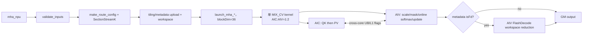
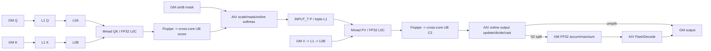

# MHA 950 Direct Invoke 算子知识

## 算子速览

| 项目 | 内容 |
|---|---|
| 实际入口 | Python `mha` → dispatcher `cann_bench::mha` → `mha_npu` → `launch_mha_{fp16,bf16}_{mask,nomask}` → `mha_*_c0..c4`；Direct Invoke。 |
| 计算语义 | BSND dense MHA：`O=softmax(scale·QK^T+mask)V`；causal 使用右下对齐规则 `j<=i+(S_kv-S)`。 |
| 输入输出 | 连续 rank-4 BSND；Q `[B,S,N,D]`，K/V `[B,S_kv,N,D]`；统一 FP16/BF16，`D∈{64,128,256}`；输出同 Q。 |
| 执行类型 | 单节点 `MIX_CV`，entry 标注 `KERNEL_TYPE_MIX_AIC_1_2`：AIC_CUBE 做 QK/PV，AIV_VECTOR 做 scale、mask、online softmax、P/状态交接、归一化与输出；SectionStreamK 需要时同一 launch 追加 AIV FlashDecode 归并。 |
| Kernel 路线 | P0：R-013、R-009、R-010、R-012、R-017、R-018；P1：R-001、R-002、R-004、R-011、R-014、R-015、R-016；P2：R-003、R-005、R-006、R-007、R-008、R-019、R-020。Host 仍按源码 config→dtype→causal 顺序分发。 |
| 核心资源 | GM Q/K/V/mask/output、runtime metadata、workspace；512 KiB L1、64 KiB L0A、64 KiB L0B、256 KiB L0C，以及 AIC/AIV 共用 UB 与 AIV 私有 UB。 |
| 来源闭包 | `direct_implementation_closed`：schema/校验、POD、SectionStreamK metadata、workspace、全部 Host 可达 entry、AIC/AIV body、同步、精度、tail 与构建接线均闭合。 |

## 接口与语义

### 计算语义

令 `Q∈R[B,S,N,D]`、`K,V∈R[B,S_kv,N,D]`。每个 `(b,i,h)` 独立计算：

```text
score[i,j] = scale * dot(Q[b,i,h,:], K[b,j,h,:])
scale = 1 / sqrt(D)                        if scaleValue <= 0
      = fp32(scaleValue)                   otherwise
causal valid(i,j) = (j <= i + S_kv - S)
p[i,:] = softmax(score[i,:] with invalid positions set to negative large)
O[b,i,h,:] = cast_input_dtype(sum_j p[i,j] * V[b,j,h,:])
```

QK 与 PV 都以 FP32 L0C 累加。AIV 按 S2 tile 维护 FP32 max、sum 和输出累计：新 tile 的 max 改变时先用 `exp(oldMax-newMax)` 重标度旧 sum/旧输出，再合入新概率。未分核的 S2 路径在最后一个有效 tile 除以总 sum，并以 `CAST_ROUND` 输出；S2 split 路径的 local-last 只写 FP32 accum/max/sum workspace，由 FD 全局归并、归一化后再转换，其中 FP16 用 `CAST_ROUND`、BF16 用 `CAST_RINT`。概率 P 在 FP32 softmax 后转换为输入 dtype，再通过 L1 交给 PV Cube。

causal mask 在 Host 物化为 2048×2048 的上三角 uint8 表，Device 结合 `sparseMode=RIGHT_DOWN_CAUSAL` 和 `S_kv-S` 进行右下语义的块裁剪与边界 mask；不能把最终规则简化成固定 `j<=i`。

### 输入、输出与属性

| 参数 | shape/layout | dtype | 约束、默认值与语义 |
|---|---|---|---|
| `query` | `[B,S,N,D]`, contiguous BSND | FP16/BF16 | rank 4；`B,S,N>0`；决定 device guard、dtype、输出与 route。 |
| `key` | `[B,S_kv,N,D]`, contiguous BSND | 同 Q | B/N/D 与 Q 一致；`S_kv>0`；Host 没有检查与 Q 同 device。 |
| `value` | `[B,S_kv,N,D]`, contiguous BSND | 同 Q | shape 与 K 一致；Host 没有检查与 Q/K 同 device。 |
| `scaleValue` | scalar | double→FP32 | 默认 -1；double 值先按 `<=0` 判默认分支，否则直接窄化 FP32；没有 finite/range 检查。 |
| `is_causal` | scalar | bool | 默认 false；true 时要求 `S<=S_kv`。 |
| 返回值 | `[B,S,N,D]`, BSND | 同 Q | `empty_like(query)`，由最后一次 AIV Vec2 提交有效行。 |

不支持 GQA/MQA、BNSD/TND、paged KV、PSE、RoPE、dropout、量化、sink 或 LSE 输出；这些能力虽存在于官方公共模板，Direct Host 没有 producer。

### 入口与版本

`TORCH_LIBRARY_FRAGMENT` 声明 schema，Meta 入口 `mha_meta` 只执行同一组校验并返回 `empty_like(query)`；PrivateUse1 入口 `mha_npu` 取得当前 NPU stream，直接调用 C ABI launcher。它不是 ACLNN 两段式入口，也不调用 OPP 中的 PromptFlashAttention、FusedInferAttentionScore、IncreFlashAttention 或 SparseFlashAttention。

固定官方仓中的上述四个家族分别提供 prefill、融合推理、decode 与 sparse/mask 的相关实现边界；本转换实际 Device body 对应 `flash_attn` arch35 no-quant GQA 家族及 `attention/common`。本文不会把 sibling family 的公开接口、支持域或 tiling ABI套到 Direct Invoke。

## Host/Launcher 执行流程

### 参数校验与前处理

`mha_npu` 先用 `OptionalDeviceGuard(query.device())` 绑定设备，再检查 rank、dtype 集合、Q/K/V dtype 相同、连续 BSND、B/N/D 一致、K/V 序列一致、非空 B/S/N/S_kv、`D∈{64,128,256}`，以及 causal 的 `S<=S_kv`。没有 Contiguous、ViewCopy、TransData 或隐式 cast；失败由 `TORCH_CHECK` 在 launch 前终止。

随后分配输出并把非正 scale 变为 `1/sqrt(D)`。route cache 的 key 包含 Q device、B、S、S_kv、N、D、scale 的 float bit pattern与 causal；它不含 dtype，因为 FP16/BF16 都是 2 B 且本实现的 metadata 成本模型固定填写 FP16，真实 entry 仍由后续 dtype selector 区分。cache key 也不含 K/V device，不能据此补足缺失的同设备检查。miss 时构造 tiling、运行 SectionStreamK、将 tiling/runtime metadata 上传到 device；causal mask 按 Q device 缓存；workspace 每次调用新分配。

### Host 整数、标量与所有权契约

shape 来自有符号 `int64_t`，但在 `mha_npu` 中直接窄化为 `uint32_t` 后进入 `make_route_config/build_metadata`。非空与 D 集合检查并不证明其余维度、乘积、字节数或 metadata index 可表示；当前实现也没有 checked arithmetic。复用 Host producer 时至少需要闭合下表，而不能只复用 20 个 entry。

| 需闭合的量 | producer→consumer | 必须成立的不变量 | 当前源码状态 |
|---|---|---|---|
| B/S/S_kv/N | `Tensor::size(int64)`→`uint32_t` POD/SectionStreamK | 每维 `<=UINT32_MAX`，所有 `B*N`、M/S2 block 计数和 record index 可表示 | 直接 `static_cast<uint32_t>`，无拒绝 |
| tensor 元素/字节 offset | BSND GM calculator、Q/K/V/output copy | `(b*S*N+s*N+n)*D+d` 及乘 dtype 字节数不溢出对应地址类型 | Host 只检查 shape 相等与正值 |
| metadata extent | `16 + sectionNum*(36+72)*16` 个 u32 | `sectionNum`、vector size、Device 的 u32 index 与 H2D byte count 一致 | `size_t` 分配后 Device 以 u32 索引；无统一上界证明 |
| workspace element count | `72*2*M*D`、`72*2*M*8`→u32 POD | 两个计数先以宽类型计算并证明 `<=UINT32_MAX` | 以含 `uint64_t M` 的表达式计算后直接 cast u32；当前五个 config 可表示，但泛化不安全 |
| scale | double 比较→float POD→Vec1 | 有限且窄化后仍符合调用语义 | NaN 走显式 scale 分支；正 subnormal 可窄化为 0；`+inf` 原样进入 |
| Q/K/V device | Q device guard + 三个裸 GM pointer | 三个 tensor 与输出/workspace/stream 属于同一 device | 未检查 K/V device；契约外不能 launch |

mutex 的作用域覆盖 cache lookup/build、mask lookup/build、workspace 分配、current-stream 获取和 `RunOpApi` 调用，因此同进程中的 MHA Host 提交被串行化；mutex 在函数返回时释放，不等待 Device 完成。cache tensor 是进程静态所有者且内容只读。output 由返回 tensor 持有，输入由调用方持有；workspace 是局部 tensor，源码没有显式 `recordStream` 或 event，异步安全依赖 torch_npu allocator 对当前 stream 分配/释放的语义。跨 stream 或替换 allocator 时必须重新证明这一生命周期，不能把 Host mutex 当成 Device 可见性机制。

### 参数、Workspace 与生命周期

Host 固定 `AIC=36`、`AIV=72`，SectionStreamK 参数为 `l2Byte=96 MiB`、`fdTolerance=10`、`fdLeastBlock=3`、`fdOn=true`。runtime metadata 的物理布局为：

```text
header = 16 * uint32                         # [sectionNum,isFd,mBase,s2Base,...]
FA     = sectionNum * 36 * 16 * uint32      # 每 AIC 的 BN2/M/S2 起止与首个 FD workspace index
FD     = sectionNum * 72 * 16 * uint32      # 每 AIV 的 BN2/M/workspace/split/start/len
metadata_bytes = 64 + sectionNum * 6912
```

route tiling 与 metadata tensor 由静态 cache 持有；causal mask tensor 也由 per-device cache 持有。tiling 和 metadata 的 H2D 拷贝必须在首次 launch 前可见；代码使用同步 `aclrtMemcpy`。workspace/output/输入的差异化所有权与 stream 风险见上一节；cache mutex 只保护 Host map、创建与提交临界区，不是 Device stream event。

记 `M=mBase`。Host workspace 公式为：

```text
reserved_bmm2 = (D>128 ? M*256*4 : 0) * 3 * 72
accumOutSize  = 72 * 2 * M * D             # FP32 element
logSumExpSize = 72 * 2 * M * 8             # FP32 element
workspace = align4096(reserved_bmm2 + (accumOutSize + 2*logSumExpSize)*4)
```

当前五个 config 的 BMM2 都由 `GetC2Position` 选为 UB：D≤128 直接命中，D256 因 `(S1Template,S2Template)=(64,256)` 命中 `isNdS2Size256`。因此 `reserved_bmm2` 只是 workspace 总容量中的过量份额，不构成当前 Device 地址布局中的前缀。FD 从 workspace base 起依次解释 `accumOut[accumOutSize]`、`sum[logSumExpSize]`、`max[logSumExpSize]`；三者的 byte offset 分别为 `0`、`4*accumOutSize`、`4*(accumOutSize+logSumExpSize)`。若 metadata `isFd=0`，这些 FP32 slice 也不被 Device 访问。

### 启动图与失败传播



launcher 的 `switch(config)` 对 0..3 显式分发，default 发 c4；`make_route_config` 只产生 0..4。每个 entry 以 `<<<36,nullptr,currentStream>>>` 启动，MIX 标注编码 1:2，因此逻辑 block `aicIdx` 对应 AIV `2*aicIdx` 与 `2*aicIdx+1`。launcher 返回 `void`，`RunOpApi` lambda 固定返回 0；源码没有同步检查异步 launch 状态，也没有后续 Host kernel gate 或 cleanup 节点。

## Route 与参数设计

### 分核与资源计算

```text
默认: sOuter=64, sInner=128
if D<=128 && S<=64 && S_kv>128: sOuter=32, sInner=256
if D==256:                     sOuter=32, sInner=256
mBase = 2*sOuter

c0: M128, S2Base128, D64
c1: M64,  S2Base256, D64
c2: M128, S2Base128, D128
c3: M64,  S2Base256, D128
c4: M64,  S2Base256, D256
```

SectionStreamK 把 `(B,N,M-block,S2-block)` 的区间写入每 section 的 FA metadata；每 AIC 按 metadata 的半开起止坐标遍历。AIV 用 `aicIdx=GetBlockIdx()/2`、`subBlockIdx=GetSubBlockIdx()` 将每个 M tile 分成 `ceil(actM/2)` 与余数两半。S2 tail 为 `actSingleLoopS2Size`，并对齐到 `32B/sizeof(INPUT_T)=16` 元素；M tail 由 `actMSize` 与两个 AIV 的 `actVecMSize` 保护。

### Route 特征、可达性与重要性

P0～P2 按合法输入域覆盖、selector 代表性、资源/同步风险和安全兜底价值综合排序；只决定本文阅读和复用顺序，不改变 Route ID 或运行时 selector。20 条 Route 全部是 `active`：每条都能由 `validate_inputs → make_route_config → dtype/causal` 的生产链命中，且各自的 launcher entry 与 Device body 均已接线。包内没有仅能由裸 launcher 触发的 `conditional-direct` 叶，也没有 production selector 不可达的 `dormant` entry；launcher 的非法 config→c4 default 是错误边界，不另立 Route。

| 优先级 | Route | Route 特征 | Host顺序 | 不适用去向 |
|---|---|---|---|---|
| P0 | R-013 | FP16、non-causal、D128、短 query/长 KV；c3 M64×S2 256 | H1 默认 tile→短长谓词真→c3；H2 FP16真→causal假→nomask | H1谓词假去c2；dtype或属性改变去对应 Route |
| P0 | R-009 | FP16、non-causal、D128 general；c2 M128×S2 128、DN | H1 默认 tile→短长谓词假→c2；H2 FP16真→causal假 | 短长谓词真去R-013 |
| P0 | R-010 | FP16、causal、D128 general；c2、ND+mask | H1同R-009；H2 FP16真→causal真 | 短长谓词真去R-014；causal域失败终止 |
| P0 | R-012 | BF16、causal、D128 general；c2、ND+mask | H1同R-009；H2 FP16假→BF16→causal真 | 短长谓词真去R-016；causal域失败终止 |
| P0 | R-017 | FP16、non-causal、D256；c4 M64×S2 256 | H1 D256覆盖 tile→config else分支c4；H2 FP16真→causal假 | dtype/属性改变去对应 c4 Route |
| P0 | R-018 | FP16、causal、D256；c4、ND+mask | H1同R-017；H2 FP16真→causal真 | causal域失败终止 |
| P1 | R-001 | FP16、non-causal、D64 general；c0 M128×S2 128、DN | H1 默认 tile→短长谓词假→c0；H2 FP16真→causal假 | 短长谓词真去R-005 |
| P1 | R-002 | FP16、causal、D64 general；c0、ND+mask | H1同R-001；H2 FP16真→causal真 | 短长谓词真去R-006；causal域失败终止 |
| P1 | R-004 | BF16、causal、D64 general；c0、ND+mask | H1同R-001；H2 FP16假→BF16→causal真 | 短长谓词真去R-008；causal域失败终止 |
| P1 | R-011 | BF16、non-causal、D128 general；c2、DN | H1同R-009；H2 FP16假→BF16→causal假 | 短长谓词真去R-015 |
| P1 | R-014 | FP16、causal、D128短长；c3、ND+mask | H1默认→短长谓词真→c3；H2 FP16真→causal真 | causal假去R-013；域失败终止 |
| P1 | R-015 | BF16、non-causal、D128短长；c3、ND | H1同R-013；H2 FP16假→BF16→causal假 | causal真去R-016 |
| P1 | R-016 | BF16、causal、D128短长；c3、ND+mask | H1同R-013；H2 FP16假→BF16→causal真 | causal域失败终止 |
| P2 | R-003 | BF16、non-causal、D64 general；c0、DN | H1同R-001；H2 FP16假→BF16→causal假 | 短长谓词真去R-007 |
| P2 | R-005 | FP16、non-causal、D64短长；c1 M64×S2 256、ND | H1默认→短长谓词真→c1；H2 FP16真→causal假 | causal真去R-006 |
| P2 | R-006 | FP16、causal、D64短长；c1、ND+mask | H1同R-005；H2 FP16真→causal真 | causal域失败终止 |
| P2 | R-007 | BF16、non-causal、D64短长；c1、ND | H1同R-005；H2 FP16假→BF16→causal假 | causal真去R-008 |
| P2 | R-008 | BF16、causal、D64短长；c1、ND+mask | H1同R-005；H2 FP16假→BF16→causal真 | causal域失败终止 |
| P2 | R-019 | BF16、non-causal、D256；c4、ND | H1同R-017；H2 FP16假→BF16→causal假 | causal真去R-020 |
| P2 | R-020 | BF16、causal、D256；c4、ND+mask | H1同R-017；H2 FP16假→BF16→causal真 | causal域失败终止 |

### Host selector 顺序

Host 先完成全部校验，再按两个相互独立但固定先后的选择层生成唯一 entry。H1 只决定 config/template；H2 在该 config 内决定 dtype×mask entry，不回看 H1。任何 `TORCH_CHECK`、SectionStreamK 失败、H2D 拷贝失败都会阻止 launch；合法输入没有 CPU、另一 Device kernel 或 ACLNN fallback。

| Host顺序 | producer | 判断与短路 | 结果/下一跳 |
|---:|---|---|---|
| 0 | `validate_inputs` | rank/dtype/contiguous/shape/non-empty/D；causal 额外 `S<=S_kv` | 失败抛错；成功→H1 |
| H1.1 | `make_route_config` | 初值 `sOuter=64,sInner=128` | 继续 H1.2 |
| H1.2 | 同上 | `D<=128 && S<=64 && S_kv>128` | 真→32/256；假保留64/128 |
| H1.3 | 同上 | `D==256` | 真→无条件覆盖32/256 |
| H1.4 | 同上 | D64→c0/c1；D128→c2/c3；其余合法 D256→c4 | 唯一 config→metadata/workspace |
| H1.5 | `build_metadata` | SectionStreamK 返回成功且 `sectionNum>0` | 失败抛错；成功上传 tiling/metadata |
| H2.1 | `mha_npu` | dtype==FP16 | 真→FP16 launcher；假因前置校验必为 BF16 |
| H2.2 | 同上 | `is_causal` | 真→mask launcher；假→nomask launcher |
| H2.3 | `DEFINE_LAUNCHER` | switch c0/c1/c2/c3/default c4 | 合法 producer 精确发 c0..c4；非法 key 会误入 c4 |

```text
validate_inputs；失败立即终止
  -> sOuter=64,sInner=128
  -> if D<=128 && S<=64 && S_kv>128: overwrite 32,256
  -> if D==256: overwrite 32,256
  -> if D==64: config=(sOuter==64 ? c0 : c1)
     else if D==128: config=(sOuter==64 ? c2 : c3)
     else: c4
  -> if dtype==FP16:
       if causal: launch_fp16_mask else launch_fp16_nomask
     else:
       if causal: launch_bf16_mask else launch_bf16_nomask
  -> launcher switch c0,c1,c2,c3；default发c4
```

### 逐 Route 关键关系与可落地伪码

下表把每条保留 Route 的完整选择关系压缩为可移植伪码。`FA<T,mask,cN,layout>` 不是新接口，而是 `mha_*_cN → run_mha<T,mask,N> → flash_attn_kernel_run` 的缩写；其 body 均执行 `QK(FP32) → scale/mask/online-softmax(FP32) → cast P(T) → PV(FP32) → output/FD`。`shortlong = (S<=64 && S_kv>128)`；`general = !shortlong`。

| 优先级/Route | 精确 Host 谓词 | 关键关系/伪码 | 不命中或失败出边 |
|---|---|---|---|
| P0 R-013 | `D==128 && shortlong && FP16 && !causal` | `c3=(M64,K256,D128); FA<half,false,c3,ND>(Q,K,V,null)` | general→R-009；causal→R-014；dtype→R-015 |
| P0 R-009 | `D==128 && general && FP16 && !causal` | `c2=(M128,K128,D128); FA<half,false,c2,DN>(Q,K,V,null)` | shortlong→R-013；causal→R-010；dtype→R-011 |
| P0 R-010 | `D==128 && general && FP16 && causal` | `guard(S<=S_kv); FA<half,true,c2,ND>(Q,K,V,mask2048)` | shortlong→R-014；noncausal→R-009；guard失败→终止 |
| P0 R-012 | `D==128 && general && BF16 && causal` | `guard(S<=S_kv); FA<bf16,true,c2,ND>(Q,K,V,mask2048)` | shortlong→R-016；noncausal→R-011；guard失败→终止 |
| P0 R-017 | `D==256 && FP16 && !causal` | `c4=(M64,K256,D256); FA<half,false,c4,ND>(Q,K,V,null)` | causal→R-018；dtype→R-019 |
| P0 R-018 | `D==256 && FP16 && causal` | `guard(S<=S_kv); FA<half,true,c4,ND>(Q,K,V,mask2048)` | noncausal→R-017；dtype→R-020；guard失败→终止 |
| P1 R-001 | `D==64 && general && FP16 && !causal` | `c0=(M128,K128,D64); FA<half,false,c0,DN>(Q,K,V,null)` | shortlong→R-005；causal→R-002；dtype→R-003 |
| P1 R-002 | `D==64 && general && FP16 && causal` | `guard(S<=S_kv); FA<half,true,c0,ND>(Q,K,V,mask2048)` | shortlong→R-006；noncausal→R-001；guard失败→终止 |
| P1 R-004 | `D==64 && general && BF16 && causal` | `guard(S<=S_kv); FA<bf16,true,c0,ND>(Q,K,V,mask2048)` | shortlong→R-008；noncausal→R-003；guard失败→终止 |
| P1 R-011 | `D==128 && general && BF16 && !causal` | `FA<bf16,false,c2,DN>(Q,K,V,null)` | shortlong→R-015；causal→R-012；dtype→R-009 |
| P1 R-014 | `D==128 && shortlong && FP16 && causal` | `FA<half,true,c3,ND>(Q,K,V,mask2048)` | general→R-010；noncausal→R-013；dtype→R-016 |
| P1 R-015 | `D==128 && shortlong && BF16 && !causal` | `FA<bf16,false,c3,ND>(Q,K,V,null)` | general→R-011；causal→R-016；dtype→R-013 |
| P1 R-016 | `D==128 && shortlong && BF16 && causal` | `FA<bf16,true,c3,ND>(Q,K,V,mask2048)` | general→R-012；noncausal→R-015；dtype→R-014 |
| P2 R-003 | `D==64 && general && BF16 && !causal` | `FA<bf16,false,c0,DN>(Q,K,V,null)` | shortlong→R-007；causal→R-004；dtype→R-001 |
| P2 R-005 | `D==64 && shortlong && FP16 && !causal` | `c1=(M64,K256,D64); FA<half,false,c1,ND>(Q,K,V,null)` | general→R-001；causal→R-006；dtype→R-007 |
| P2 R-006 | `D==64 && shortlong && FP16 && causal` | `FA<half,true,c1,ND>(Q,K,V,mask2048)` | general→R-002；noncausal→R-005；dtype→R-008 |
| P2 R-007 | `D==64 && shortlong && BF16 && !causal` | `FA<bf16,false,c1,ND>(Q,K,V,null)` | general→R-003；causal→R-008；dtype→R-005 |
| P2 R-008 | `D==64 && shortlong && BF16 && causal` | `FA<bf16,true,c1,ND>(Q,K,V,mask2048)` | general→R-004；noncausal→R-007；dtype→R-006 |
| P2 R-019 | `D==256 && BF16 && !causal` | `FA<bf16,false,c4,ND>(Q,K,V,null)` | causal→R-020；dtype→R-017 |
| P2 R-020 | `D==256 && BF16 && causal` | `guard(S<=S_kv); FA<bf16,true,c4,ND>(Q,K,V,mask2048)` | noncausal→R-019；dtype→R-018；guard失败→终止 |

短长 causal 的 `S<=S_kv` 已由 `S<=64 && S_kv>128` 蕴含，但 Host 仍统一先执行 causal guard；表中省略重复 `guard` 只表示逻辑冗余，不表示绕过校验。所有伪码的 mask、tiling、metadata、workspace 与 stream 都由同一次 Host 调用生产，不能跨 Route 拼接。

### 模板/实现执行矩阵

| 优先级 | Route | Host顺序 | key/selector 与完整命中条件 | 执行族与实际模板/body | 内存、同步、tail/fallback |
|---|---|---|---|---|---|
| P0 | R-013 | H1 c3；H2 FP16→nomask | `mha_fp16_nomask_c3`；950、D128、`S<=64&&S_kv>128` | MIX；`<half,false,c3>`；ND Cube/Vec/FD | c3资源；M/S2 tail；无Device fallback |
| P0 | R-009 | H1 c2；H2 FP16→nomask | `mha_fp16_nomask_c2`；950、D128、短长谓词假 | MIX；`<half,false,c2>`；DN | c2资源；M/S2 tail；谓词真去R-013 |
| P0 | R-010 | H1 c2；H2 FP16→mask | `mha_fp16_mask_c2`；同R-009且causal | MIX；`<half,true,c2>`；ND+mask | c2资源；right-down tail；域失败终止 |
| P0 | R-012 | H1 c2；H2 BF16→mask | `mha_bf16_mask_c2`；同R-009、BF16、causal | MIX；`<bfloat16_t,true,c2>`；ND+mask | c2资源；FP32 state；域失败终止 |
| P0 | R-017 | H1 D256→c4；H2 FP16→nomask | `mha_fp16_nomask_c4`；950、D256、non-causal | MIX；`<half,false,c4>`；ND | c4 K/V single L1；M/S2 tail |
| P0 | R-018 | H1 D256→c4；H2 FP16→mask | `mha_fp16_mask_c4`；950、D256、causal | MIX；`<half,true,c4>`；ND+mask | c4资源；right-down tail；域失败终止 |
| P1 | R-001 | H1 c0；H2 FP16→nomask | `mha_fp16_nomask_c0`；950、D64、短长谓词假 | MIX；`<half,false,c0>`；DN | c0资源；M/S2 tail；谓词真去R-005 |
| P1 | R-002 | H1 c0；H2 FP16→mask | `mha_fp16_mask_c0`；同R-001且causal | MIX；`<half,true,c0>`；ND+mask | c0资源；域失败终止 |
| P1 | R-004 | H1 c0；H2 BF16→mask | `mha_bf16_mask_c0`；同R-001、BF16、causal | MIX；`<bfloat16_t,true,c0>`；ND+mask | c0资源；FP32 state；域失败终止 |
| P1 | R-011 | H1 c2；H2 BF16→nomask | `mha_bf16_nomask_c2`；D128 general、BF16 | MIX；`<bfloat16_t,false,c2>`；DN | c2资源；M/S2 tail；谓词真去R-015 |
| P1 | R-014 | H1 c3；H2 FP16→mask | `mha_fp16_mask_c3`；D128短长、causal | MIX；`<half,true,c3>`；ND+mask | c3资源；域失败终止 |
| P1 | R-015 | H1 c3；H2 BF16→nomask | `mha_bf16_nomask_c3`；D128短长、BF16 | MIX；`<bfloat16_t,false,c3>`；ND | c3资源；M/S2 tail |
| P1 | R-016 | H1 c3；H2 BF16→mask | `mha_bf16_mask_c3`；D128短长、BF16、causal | MIX；`<bfloat16_t,true,c3>`；ND+mask | c3资源；域失败终止 |
| P2 | R-003 | H1 c0；H2 BF16→nomask | `mha_bf16_nomask_c0`；D64 general、BF16 | MIX；`<bfloat16_t,false,c0>`；DN | c0资源；谓词真去R-007 |
| P2 | R-005 | H1 c1；H2 FP16→nomask | `mha_fp16_nomask_c1`；D64短长、FP16 | MIX；`<half,false,c1>`；ND | c1资源；M/S2 tail |
| P2 | R-006 | H1 c1；H2 FP16→mask | `mha_fp16_mask_c1`；同R-005且causal | MIX；`<half,true,c1>`；ND+mask | c1资源；域失败终止 |
| P2 | R-007 | H1 c1；H2 BF16→nomask | `mha_bf16_nomask_c1`；D64短长、BF16 | MIX；`<bfloat16_t,false,c1>`；ND | c1资源；M/S2 tail |
| P2 | R-008 | H1 c1；H2 BF16→mask | `mha_bf16_mask_c1`；D64短长、BF16、causal | MIX；`<bfloat16_t,true,c1>`；ND+mask | c1资源；域失败终止 |
| P2 | R-019 | H1 D256→c4；H2 BF16→nomask | `mha_bf16_nomask_c4`；D256、BF16 | MIX；`<bfloat16_t,false,c4>`；ND | c4资源；M/S2 tail |
| P2 | R-020 | H1 D256→c4；H2 BF16→mask | `mha_bf16_mask_c4`；D256、BF16、causal | MIX；`<bfloat16_t,true,c4>`；ND+mask | c4资源；域失败终止 |

完整模板还固定 BSND、`PSE_NONE`、no-quant、no-RoPE、continuous KV、`KvLayoutType=0`、`splitD=false`；`bmm2Write2Ub=true` 对所有 Route 成立。

### 性能与安全 Guard

| Guard | Host/Tiling 条件 | Device/资源原因 | 影响 Route | 不满足时去向 | 源码符号 |
|---|---|---|---|---|---|
| dtype/layout | FP16/BF16、三输入同 dtype、contiguous rank-4 BSND | 仅对应 entry 与 GM offset specialization | 全部 | `TORCH_CHECK` | `validate_inputs` |
| device identity | Q/K/V 必须在同一 NPU device，stream/output/workspace 跟随 Q | 三个裸 GM pointer 由同一 kernel/stream 解引用 | 全部 | Host 未检查；契约外终止，不存在安全 fallback | `mha_npu` |
| head dim | D=64/128/256 | `ConfigValue` 只有五组 D specialization | 全部 | `TORCH_CHECK` | `make_route_config`, `ConfigValue` |
| short-long tile | `D<=128 && S<=64 && S_kv>128` | M64/S2 256 将短 query 与长 KV 配对 | c1/c3 | 否则 c0/c2 | `make_route_config` |
| scale finite/range | 应为有限 double，正值窄化 FP32 后仍为正；非正走默认 | Vec1 直接乘 FP32 scale，cache 以窄化 bit pattern区分 | 全部 | 源码未检查；无数值 fallback | `mha_npu`, `route_key` |
| causal domain | `!causal \|\| S<=S_kv` | right-down offset 非负 | causal | `TORCH_CHECK` | `validate_inputs` |
| causal mask extent | 固定 2048×2048，Host 未校验 `S,S_kv<=2048` | mask GM 物理边界与 stride 均固定 2048 | causal | 无 fallback | `get_causal_mask`, `make_route_config` |
| causal mask batch | Host 留 `attenMaskBatch=0`；Device 仅值为1时强制 batch0 | 当前仅物化一张共享 mask，B>1 会按 batch stride寻址 | causal | 无 Host guard/fallback | `AttenMaskCopyIn` |
| AIC/AIV 数 | 固定 36/72 | metadata 数组与 MIX 1:2 ABI 固定 | 全部 | 无资源查询/fallback | `kAicCoreNum`, `kAivCoreNum` |
| C2 position | D≤128 或 M64/S2 256 | `GetC2Position` 令五组 route 全部 C2→UB | 全部 | dormant GM body | `GetC2Position`, `bmm2Write2Ub` |
| UB peak | c2-DN 252672 B，c2-ND/c4-ND 253184 B，其余更低 | cross-core C1/C2 与 AIV shared/private buffers 同占 UB | 全部 | 无 Host capacity guard | `InitMMResBuf`, `InitBuffers` |
| metadata width | shape int64→uint32；offset/cost再混用 uint64 | POD 与 SectionStreamK ABI | 全部 | 无显式溢出 fallback | `make_route_config`, `build_metadata` |
| cache/stream | 静态 tiling/metadata/mask 只读；首次同步 H2D 完成后复用 | cached GM pointer 可跨调用，workspace 仅本次调用 | 全部 | Host mutex 只串行提交；不替代 allocator stream lifetime | `get_route_buffers`, `get_causal_mask`, `mha_npu` |
| FD workspace | metadata 任一 section `usedVecNum>0` | S2 跨核 split 需 FP32 reduction | 动态子路径 | `isFd=0` 直接输出 | `build_metadata`, `FlashDecode` |

### POD/ABI

Direct POD 在 LP64 自然对齐下：`FlashAttnBaseParams` 76 B/align4，Mask 28 B/align4，Page 12 B/align4，Workspace 8 B/align4，S1OuterSplit 16 B/align8，`FlashAttnNoQuantTilingArch35` 144 B/align8，`FlashAttnMetaData` 6912 B，`FlashAttnTilingData` 7056 B/align8，`RouteConfig` 7080 B/align8。源码未提供 `static_assert(sizeof/offsetof)`，迁移时必须重新核验；Device 只解析上传对象的 `baseTiling`，内嵌 metadata 为零，实际调度 metadata 通过独立 GM 参数传入。

| 结构 | 字段 | 类型/位宽 | ABI 布局 | 单位 | Host/launcher producer | Device consumer | 边界 |
|---|---|---|---|---|---|---|---|
| `RouteConfig` | `config` | uint8/8 | off0 | key | `make_route_config` | launcher switch | 0..4 |
| 同上 | `sOuter/sInner/mBase` | uint32/32 | off4/8/12 | row/token | tile selector | metadata producer | 32/64；128/256；64/128 |
| 同上 | `workspaceBytes` | uint64/64 | off16 | byte | workspace formula | Host allocation | 4096B aligned |
| 同上 | `tiling` | struct/7056 B | off24 | byte blob | `make_route_config` | 仅 `.tiling` 被 H2D，`RouteConfig` 外壳不上传 | LP64 size7080 |
| `FlashAttnTilingData` | `baseTiling` | struct/144 B | off0 | POD | Host机械 producer | Device `InitConstInfo` | 当前所有有效字段均在此 |
| 同上 | `flashAttnMetaData` | struct/6912 B | off144 | 36×16+72×16 u32 | 零初始化 | 当前 Device scheduler不读取 | 实际 metadata 由独立 GM 参数提供 |
| `FlashAttnBaseParams` | `bSize` | uint32/32 | off0 | batch | B | scheduler/offset | >0，窄化未 guard |
| 同上 | `t1Size/t2Size` | uint32/32 | off4/off8 | token | 零初始化 | 固定 BSND route 不依赖 | inactive |
| 同上 | `n2Size/gSize` | uint32/32 | off12/off16 | head | N/1 | scheduler/offset | MHA 无 GQA |
| 同上 | `s1Size/s2Size` | uint32/32 | off20/off24 | token | S/S_kv | task/tail/mask | >0 |
| 同上 | `dSize/dSizeV/dSizeRope` | uint32/32 | off28/off32/off36 | element | D/D/0 | QK/PV/offset | 64/128/256；no RoPE |
| 同上 | `cuSeqLensQSize/cuSeqLensKVSize` | uint32/32 | off40/off44 | element | 0 | TND parser | inactive |
| 同上 | `seqUsedQSize/seqUsedKvSize` | uint32/32 | off48/off52 | element | 0 | BY_BATCH parser默认 S | inactive backing，不得传非空语义 |
| 同上 | `scaleValue` | float/32 | off56 | scalar | explicit/default scale | Vec1 | FP32 |
| 同上 | `iscuSeqLengthsNull/iscuSeqLengthsKVNull` | uint8/8 | off60/off61 | bool | 1/1 | parser | 固定长度 |
| 同上 | `isKvContinuous/isSoftMaxLseEnable` | uint8/8 | off62/off63 | bool | 1/0 | KV/LSE path | continuous；无 LSE |
| 同上 | `coreNum/outputLayout` | uint32/32 | off64/off68 | core/enum | 36/0 | scheduler/CopyOut | BSND |
| 同上 | `needInitOutput` | bool/8 | off72 | bool | 0 | `ClearOutput` | 不预清零 |
| `FlashAttnAttenMaskParams` | `sparseMode` | uint8/8 | off0 | enum | causal?3:0 | sparse range/Vec | right-down/none |
| 同上 | `winLefts/winRights` | int32/32 | off4/off8 | token | INT32_MAX | sparse range | 无限窗 |
| 同上 | `attenMaskBatch` | uint32/32 | off12 | batch | 0 | mask offset | Device 仅值为1时复用 batch0；当前值0使 causal B>1 边界不闭合 |
| 同上 | `attenMaskS1Size/attenMaskS2Size` | uint32/32 | off16/off20 | row/stride | causal?2048:0 | mask copy | causal 固定 2048 |
| 同上 | `isExistRowInvalid` | uint8/8 | off24 | bool | 0 | row-invalid/output | false |
| `FlashAttnPageAttentionParams` | `paLayoutType/blockSize/maxBlockNumPerBatch` | uint8+2×uint32 | off0/4/8 | enum/element/block | 0 | PA path | inactive |
| `FlashAttnWorkspaceParams` | `accumOutSize/logSumExpSize` | uint32/32 | off0/off4 | FP32 element | workspace formula | FA/FD Vec | uint32 narrowing未 guard |
| `FlashAttnS1OuterSplitCoreParams` | `enableS1OutSplit/totalSize` | bool+uint64 | off0/off8 | bool/task | 0/0 | alternative scheduler | inactive；runtime metadata接管 |
| runtime metadata header | `[0]/[1]/[2]/[3]` | uint32/32 | off0/4/8/12 | section/bool/row/token | `build_metadata` | Kernel init | sectionNum/isFd/M/S2 |
| FA metadata record | `[0..6]` | 7×uint32 | record off0..24 | coord/index | SectionStreamK result | `GetFASectionInfo` | 每 section×36，余 9 字段清零 |
| FD metadata record | `[0..5]` | 6×uint32 | record off0..20 | coord/index/count | SectionStreamK result | `GetFDSectionInfo` | 每 section×72，`mLen=0` 禁用 |

### Route 源码闭包

| Route | Key/selector | Host/Tiling producer | POD/参数 | Kernel entry/router | Kernel body/直接依赖 | 构建接线 |
|---|---|---|---|---|---|---|
| P0：R-013、R-009、R-010、R-012、R-017、R-018 | c3/c2/c4 的精确 dtype×mask key | `mha_npu`, `make_route_config`, `build_metadata` | `RouteConfig`, base tiling, runtime metadata | 对应 `mha_*_cN` → `flash_attn_kernel_run` | noquant GQA Cube/Vec/FD + common buffer/matmul/mask/VF | MHA 注册，950 `dav-3510` |
| P1：R-001、R-002、R-004、R-011、R-014、R-015、R-016 | c0/c2/c3 的精确 dtype×mask key | 同上 | 同上 | 同上 | 同上 | 同上 |
| P2：R-003、R-005、R-006、R-007、R-008、R-019、R-020 | c0/c1/c4 的精确 dtype×mask key | 同上 | 同上 | 同上 | 同上 | 同上 |

官方 `flash_attn` Host tiling、entry、三类 block 与 SectionStreamK 是转换依据；Direct schema、机械 POD、cache 与 C ABI launcher 是独立适配，不能反向声称为官方公开 API。

## 跨 Route 数值、mask 与尾块契约

### 数值阶段与特殊值边界

所有 20 条 Route 共享同一数值阶段，只由 INPUT_T、mask、tile config 与 DN/ND 编译期选择改变搬运/矩阵朝向：

```text
Q(INPUT_T) x K(INPUT_T) -> QK(float L0C)
QK(float) * scale(float) -> masked online max/sum/exp(float)
probability(float) -> P(INPUT_T L1)
P(INPUT_T) x V(INPUT_T) -> PV(float L0C)
online output update -> if unsplit: divide -> CAST_ROUND -> O(INPUT_T)
                     -> if S2 split: FP32 workspace -> FD merge/divide
                                      -> FP16 CAST_ROUND / BF16 CAST_RINT -> O(INPUT_T)
```

有限输入下，分块 online softmax 维持 `m=max score`、`l=sum exp(score-m)` 与未归一化 FP32 输出；新块最大值变化时，以 `alpha=exp(m_old-m_new)` 同时重标度旧 `l` 和旧输出。S2 被 SectionStreamK 拆到多核时，每份 workspace 保存 `(accum,max,sum)`，FD 先取全局 max，再以相同指数差重标度各份并归并，最后除以总 sum。

源码没有拒绝 Q/K/V 中的 NaN/Inf，也没有检查 scale 的 finite 性。NaN、`inf-inf`、全局 max/sum 的非有限状态都按 VF/Matmul 原始算术传播，不能套用有限输入的稳定性结论。合法 causal 域 `S<=S_kv` 保证每个 query 行按右下规则至少有一个有效 key；这只避免语义上的全 mask 行，不修复 2048 extent、batch stride 或非有限数据问题。

### Causal mask 双层裁剪

causal 不是“先生成 `[S,S_kv]` mask 再逐元素读取”。Host 只缓存一张 2048×2048 上三角 uint8 表（对角及以下为0、上方为1），Device 分两层消费：

1. scheduler/Kernel 以 `nextTokenLeftUp=S_kv-S` 算每个 M tile 可达的 S2 block 半开区间，整块无效区不创建 task；
2. 对边界 block，`AttenMaskCopyIn` 以 `(batchIdx,gs1,s2)`、固定 row stride 2048 和 right-down offset 复制实际 `M_half×S2_tail`，Vec1 将值1 lane替换成约 `-1e12` 后再 softmax。

```text
valid(i,j) = (j <= i + S_kv - S)
s2BlockRange(iTile) = blocks intersecting any valid j
boundaryMask = upperTri2048[right_down_shift(iTile,jTile)]
```

因此 sparse block pruning 与 uint8 boundary mask 缺一不可：只保留前者会把边界块中的未来 token 当有效，只保留后者则会为完全无效块继续做 QK/PV。当前 `attenMaskBatch=0` 令 Device 使用 `runInfo.bIdx` 形成 4 MiB batch stride，而 Host 只分配一张表；若要共享单 mask，producer 应把该字段改成 Device 约定的 `attenMaskBatch=1`（强制 batch0）并重新核验 offset，而不是仅扩大 Host tensor。

### 任务、尾块与输出唯一性

| 维度/状态 | 生产方式 | Device 收尾 | 必须保持的不变量 |
|---|---|---|---|
| B×N | SectionStreamK 展平为 BN2，record 用半开起止坐标 | AIC 逐 BN2 前进，BSND calculator 恢复 b/head | 一个 `(b,n,M,S2)` task 只属于一个 section/core |
| M tail | `actMSize=min(M,S*G-gS1)`，G固定1 | ND 路线两 AIV 按 ceil/floor 半分；DN 路线用 align32 后半分，允许一侧 `actVecMSize=0` | 两 AIV 覆盖不重不漏，空半块仍遵守同步协议 |
| S2 tail | `actSingleLoopS2Size=min(S2Base,S_kv-s2Idx)`，再向16元素对齐供 DMA | VF 按有序分支 `==128`、`<=64`、`64<x<128`、`128<x<=256` 选 specialization mask；PV 的真实 K 取 tail | padding lane不进入 sum/output，DMA extent仍满足32B |
| D | 只允许64/128/256 | D均为64元素整数倍并精确命中Cube编译期模板，无逻辑D tail；c4 的 N 分块由 MatmulN处理 | 不能把 dormant `splitD`/GM-C2 body当作现有 D tail |
| local S2 split | metadata 的 head/tail区间令 `isS2SplitCore=true` | Vec2 写 FP32 state，不直接写最终 O | split 份数、`workspaceIdx`、`firstFdDataWorkspaceIdx`必须同源；accum 起点=`idx*M*D`，max/sum 起点=`idx*M*8`（均为 FP32 元素索引） |
| FD M tail | FD record 给每 AIV `mStart/mLen` | `mLen==0` 跳过 body但仍参加前后 `SyncAll` | 只有 assigned AIV写其行，最终 O 每行唯一写者 |
| unsplit output | `isLastS2Loop && !isS2SplitCore` | Vec2 divide/cast/copy valid M×D | 前面块只更新 state，不提前写最终 O |

task 描述 ring 的实际容量是4，索引为 `loop & 3`，用于保存当前与两拍前的 `RunInfoX` 并满足 power-of-two 静态断言；P 的 L1 buffer 深度独立为3，索引按 `%3`，恰好覆盖 `PRELOAD_N=2` 的在途概率。两者都不能简写成同一个“三槽流水”。

## Kernel 实现

### 公共执行流程

`run_mha<T,HasMask,Config>` 固定 BSND input/output、continuous KV、no quant/PSE/RoPE、无 LSE。`flash_attn_kernel_run` 从 config 取 M/S2/D/DV，推导 `useDn`、C2位置和模板别名；CUBE pass 实例化真实 `FANoQuantGqaBlockCube` + dummy Vector，AIV pass 实例化 dummy Cube + 真实 `FANoQuantGqaBlockVec/FiaBlockVecFlashDecode`。双方读取同一 base tiling 与 runtime metadata。

每 section 先执行 FlashAttention。4 槽 `RunInfoX` ring 中，task t 的 AIC 做 BMM1、两个 AIV 分别做 Vec1；延迟 `PRELOAD_N=2` 后，task t-2 的 AIC 做 BMM2、两个 AIV 做 Vec2。section 结束后，若 `isFd`，AIV 进入 `FlashDecode`，在前后各一次 `SyncAll()` 之间归并 workspace split；AIC 不执行 FD body。

### 公共 Route 闭包：FlashAttn no-quant GQA MIX_CV

#### 适用条件

##### 选择证据

| 层级 | 文件 | 符号 | 源码谓词/参数 | 结果/下一跳 |
|---|---|---|---|---|
| Host | `op_plugin/mha_plugin.cpp` | `validate_inputs` | rank/dtype/contiguous/shape/D/causal | 失败终止或继续 |
| Launcher tiling | `op_kernel/mha_launch.h` | `make_route_config` | D、`S<=64&&S_kv>128` | config 0..4 |
| Host selector | `op_plugin/mha_plugin.cpp` | `mha_npu` | dtype→causal | 四类 launcher |
| Launcher | `op_kernel/mha_kernel.cpp` | `DEFINE_LAUNCHER` | config 0..3/default c4 | 精确 entry，blockDim36 |
| Router | 同上 | `flash_attn_kernel_run` | config/mask/type | 完整 Cube/Vec/FD specialization |

#### Device 数据流

##### 函数级调用链

```text
mha_{dtype}_{mask}_cN
  -> run_mha<T,HasMask,N>
    -> flash_attn_kernel_run<...,BSND,NO_PA,...>
      -> FlashAttentionNoQuantGqaKernel::Init
      -> Process -> for section: FlashAttention
        -> ExecuteTask
          -> AIC FANoQuantGqaBlockCube::IterateBmm1
          -> AIV FANoQuantGqaBlockVec::ProcessVec1
          -> AIC FANoQuantGqaBlockCube::IterateBmm2
          -> AIV FANoQuantGqaBlockVec::ProcessVec2
      -> optional AIV FiaBlockVecFlashDecode::FlashDecode
```

##### 源码等价伪码

```text
for section in runtime_metadata:
  for each assigned (b, head, M_tile, reachable S2_tile):
    split M_tile between AIV subBlock 0/1
    AIC:
      Q GM -> L1 -> L0A
      K GM -> L1 -> L0B
      QK, accumulate FP32 in L0C
      Fixpipe each AIV half to double-buffered cross-core UB
    AIV:
      wait score; multiply FP32 scale; optional uint8 mask select
      online softmax update FP32 max/sum in persistent slot mloop%3
      write task-delayed rescale exp in slot loop%3
      cast P to INPUT_T; MTE3 P -> triple-buffered L1; signal AIC
    after two-task preload:
      AIC waits P; V GM -> L1 -> L0B; PV -> FP32 L0C
      Fixpipe C2 to double-buffered cross-core UB
      AIV waits C2; rescale/accumulate FP32 output
      if last local S2 and not split: divide by sum, CAST_ROUND, copy valid D to GM
      if S2 split: write FP32 accum/max/sum workspace
  if metadata isFd:
    all AIV SyncAll; assigned AIV combines split states; SyncAll; final output
```

#### 内存与数据搬运

##### 资源与搬运表

| 层级/缓冲区 | offset/地址公式 | extent/容量公式 | dtype/layout | producer | consumer | owner/lifetime | 对齐/复用 |
|---|---|---|---|---|---|---|---|
| GM Q/K/V | Q：`(((b*S+i)*N+n)*D+d)`；K/V：`(((b*S_kv+j)*N+n)*D+d)` | 逻辑 tensor | INPUT_T, BSND | caller | Cube copy | caller/stream | contiguous |
| GM output | `(((b*S+i)*N+n)*D+d)` | 逻辑 tensor | OUTPUT_T, BSND | AIV Vec2 / FD | caller | output tensor/stream | valid M×D 唯一写者 |
| GM mask | fixed matrix row stride 2048 | 4,194,304 B | uint8 ND | Host cache upload | Vec1 mask copy | static cache | 32B block |
| GM metadata | header+FA+FD | `64+6912*sections` B | uint32 records | Host SectionStreamK | scheduler/FD | route cache | 16-word record |
| GM workspace | accum=`idx*M*D`；max/sum=`idx*M*8`（FP32 元素索引） | route-specific reserved bytes | FP32 accum 与 8-lane/row max/sum slices | Vec2 split | FD Vec | per call/stream | total 4096B aligned；三平面基址由 POD size 分开 |
| L1 P | first manager allocation | `3*M*S2Base*2` = 98304 B | INPUT_T, NZ-like | AIV MTE3 | AIC BMM2 | MIX launch/task t..t+2 | triple buffer |
| L1 Q/K/V | sequential manager allocations | 见字节账 | INPUT_T, NZ | MTE2 | MTE1/Matmul | AIC/section | Q/K/V DB；c4 K/V single |
| L0A | manager | 65536 B physical | INPUT_T | L1 load | Mmad | AIC launch | 2×32KiB |
| L0B | manager | 65536 B physical；c4 分配32768 B active，其余分配65536 B | INPUT_T | L1 load | Mmad | AIC launch | c4 single，其余 DB |
| L0C | manager | 262144 B physical | FP32 | Mmad QK/PV | Fixpipe | AIC launch | 4×64KiB |
| cross-core UB score | DB slot | `2*(M/2*S2Base*4)=65536` B | FP32 row | AIC Fixpipe | AIV Vec1 | task | 双向 flag |
| cross-core UB C2 | DB slot | `2*(M/2*align64(D)*4)` | FP32 row | AIC Fixpipe | AIV Vec2 | task | 双向 flag |
| AIV shared/private UB | stage1/mask/stage2/state；conditional common | DN c0/c2 为121600 B，其余为122112 B | mixed | copy/Vec | Vec/copy | AIV launch | DB + 3-state slots；common仅特定分支512 B |
| 寄存器/VF | 当前 Vec1/Vec2 microkernel tile | 固定提交源码不暴露独立物理容量 | FP32/INPUT_T | UB load | VF store | VF call | mask按实际 S2 tail |

##### 分层内存布局



##### 字节账、交接边与复用顺序

```text
route/config           c0-DN      c0-ND      c1-ND      c2-DN      c2-ND      c3-ND      c4-ND
Route                   001/003    002/004    005..008   009/011    010/012    013..016   017..020
L1 allocated            196608     196608     245760     294912     294912     393216     425984
L0 active               393216     393216     393216     393216     393216     393216     360448
L0 physical             393216     393216     393216     393216     393216     393216     393216
C1 UB                    65536      65536      65536      65536      65536      65536      65536
C2 UB                    32768      32768      16384      65536      65536      32768      65536
AIV other                121600     122112     122112     121600     122112     122112     122112
UB total                 219904     220416     204032     252672     253184     220416     253184
workspace                5898240    5898240    2949120    10616832   10616832   5308416    24182784 bytes
FD used cap              5898240    5898240    2949120    10616832   10616832   5308416    10027008 bytes
```

`AIV other` 包含 stage1/mask/stage2、三组 max/sum/exp 和 broadcast 等私有区。512 B `commonTBuf` 只在 `!useDn` 或 `S2Base=256 && MBase=64` 初始化：四条 DN Route（R-001/R-003/R-009/R-011）均不含它；ND 与 S2=256 分支含它，因而不能只按 config 给 c0/c2 写一个 UB 总数。

| 边/复用子区 | producer | offset/extent | dtype/layout | consumer | ordering/sync | owner/lifetime | 安全条件 |
|---|---|---|---|---|---|---|---|
| QK→Vec1 | AIC Fixpipe | DB slot；每 AIV `(M/2)*S2Base*4` | FP32 row | AIV Vec1 | cross-core BOTH：AIC set，AIV wait/ack | MIX launch | 两 AIV ack 后覆盖 |
| Vec1→PV | AIV MTE3 | slot=`loop%3`；总每 slot `M*S2Base*2` | INPUT_T NZ-like | AIC MTE1 | CROSS_CORE_SYNC_FORWARD | t 到 t+2 | preload2/三槽不可分离 |
| PV→Vec2 | AIC Fixpipe | DB slot；每 AIV `(M/2)*align64(D)*4` | FP32 row | AIV Vec2 | cross-core BOTH | MIX launch | ack 后覆盖 |
| persistent max/sum | AIV Vec1/Vec2 | slot=`mloop%3`，max、sum 各256 B | FP32 | 同一 M group 的后续 S2 与最终 Vec2 | 同 AIV程序序+HardEvent | 跨 S2、直到该 M group 完成 | 首 S2 初始化，后续 S2 更新；`mloop` 不随同组 S2 task 改槽 |
| delayed exp | AIV Vec1 | slot=`loop%3`，每槽256 B | FP32 | 两拍后的 Vec2 | task 流水程序序+HardEvent | task t 到 t+2 | 保存当前 online 更新对旧 accum 的 rescale；必须与 `PRELOAD_N=2` 对齐 |
| split accum→FD | AIV Vec2 | `idx*M*D + row*D` | FP32 accum | assigned FD AIV | section内 `SyncAll` | per-call workspace | metadata split count/extent一致 |
| split max/sum→FD | AIV Vec2 | `idx*M*8 + row*8` | FP32 max/sum（每行8个重复元素） | assigned FD AIV | section内 `SyncAll` | per-call workspace | 不能沿用 accum 的 D pitch |
| FD→output | FD AIV | assigned `(BN2,M range)` | FP32→OUTPUT_T BSND | caller | 第二次 `SyncAll` 后可提交 | output tensor | `mLen>0` 才执行 |

#### 同步、精度与尾块

##### 同步与数值边界表

| 阶段 | primitive/机制 | producer | consumer/等待点 | 保护对象 | 精度/尾块 |
|---|---|---|---|---|---|
| GM→L1→L0 | `MTE2_MTE1`, `MTE1_M`, buffer wait/set | copy | Mmad | Q/K/V slot | K/D/S2 tail按真实长度 |
| L0C→UB | `M_FIX/FIX_M` + cross-core BOTH | AIC | AIV | QK/PV DB | L0C FP32；Fixpipe row-major |
| Vec1→L1 P | `V_MTE3/MTE3_V` + forward flag | AIV | AIC | P triple slot | softmax FP32，P cast INPUT_T |
| online softmax | `ProcessVec1Vf` first/update specialization | AIV Vec1 | AIV Vec2/next S2 | max/sum 用 `mloop%3` 跨 S2 持久化；exp 用 `loop%3` 延迟两 task | S2 tail 按顺序分 `==128`、`<=64`、`64<x<128`、`128<x<=256` |
| causal | sparse block range + uint8 mask select | metadata/mask | Vec1 | invalid logits | right-down；负大值；边界 block逐元素 |
| output | 非 split：FlashUpdate/divide + `CAST_ROUND`；split：local-last 写 FP32 workspace，FD 全局归并/divide 后 FP16 用 `CAST_ROUND`、BF16 用 `CAST_RINT` | AIV | GM output | valid M×D | FP32 state，最终 FP16/BF16 |
| section FD | `SyncAll(); FlashDecode(); SyncAll()` | FA AIV | FD AIV/output | workspace states | FP32归并；mLen tail |
| teardown | `CrossCoreBufferUnInit` wait | AIV/AIC | buffer release | score/C2 DB | 防止末尾未消费覆盖 |

#### 关键实现

##### 符号证据表

| 阶段 | 文件 | 符号/模板实例 | 实现事实 |
|---|---|---|---|
| Host/Tiling producer | `op_kernel/mha_launch.h`, `op_plugin/mha_plugin.cpp` | `make_route_config`, `build_metadata`, `mha_npu` | config、POD/workspace、SectionStreamK、cache、完整分发 |
| Kernel entry/router | `op_kernel/mha_kernel.cpp` | `DEFINE_MHA_KERNEL`, `flash_attn_kernel_run` | MIX 1:2、全部可达 entry、CUBE/AIV pass specialization |
| Cube body | official mapped cube block | `FANoQuantGqaBlockCube`, `IterateBmm1`, `IterateBmm2` | GM→L1→L0A/B→Mmad→L0C→Fixpipe |
| Vector body | official mapped vec block | `ProcessVec1`, `ProcessVec2` | scale/mask/online softmax、P交接、累计/除法/cast |
| FD body | official mapped flashdecode block | `FiaBlockVecFlashDecode::FlashDecode` | split-S2 FP32状态归并与最终输出 |

### 公共 body 与逐 Route 差分闭包

20 条 Route 不再重复展开同一 Device body。每条的精确 Host 谓词、模板伪码和不命中/失败出边见“逐 Route 关键关系与可落地伪码”，精确 entry 与实现模板见“模板/实现执行矩阵”；两表逐行同序且共同构成 Route 闭包。进入任一 entry 后均执行本节公共 Cube→Vector→Cube→Vector/FD 流程，差分仅来自下表，不得把一条 Route 的 mask、tile、DN/ND、dtype 或资源账拼到另一条。

| 差分维度 | R-001/R-003 | R-002/R-004 | R-005/R-007 | R-006/R-008 | R-009/R-011 | R-010/R-012 | R-013/R-015 | R-014/R-016 | R-017/R-019 | R-018/R-020 |
|---|---|---|---|---|---|---|---|---|---|---|
| config；M×S2×D | c0；128×128×64 | c0；128×128×64 | c1；64×256×64 | c1；64×256×64 | c2；128×128×128 | c2；128×128×128 | c3；64×256×128 | c3；64×256×128 | c4；64×256×256 | c4；64×256×256 |
| body/mask | DN；无 mask | ND；right-down | ND；无 mask | ND；right-down | DN；无 mask | ND；right-down | ND；无 mask | ND；right-down | ND；无 mask | ND；right-down |
| dtype 对 | FP16/BF16 | FP16/BF16 | FP16/BF16 | FP16/BF16 | FP16/BF16 | FP16/BF16 | FP16/BF16 | FP16/BF16 | FP16/BF16 | FP16/BF16 |
| workspace B | 5898240 | 5898240 | 2949120 | 2949120 | 10616832 | 10616832 | 5308416 | 5308416 | 24182784 | 24182784 |
| L1/L0/UB B | 196608/393216/219904 | 196608/393216/220416 | 245760/393216/204032 | 245760/393216/204032 | 294912/393216/252672 | 294912/393216/253184 | 393216/393216/220416 | 393216/393216/220416 | 425984/360448/253184 | 425984/360448/253184 |
| 特有边界 | general；短长改选 c1 | general；短长改选 c1；causal guard | shortlong；属性/dtype换同 c1 entry | shortlong；causal guard | general；短长改选 c3 | general；短长改选 c3；causal guard | shortlong；属性/dtype换同 c3 entry | shortlong；causal guard | D256 强制 c4 | D256 强制 c4；causal guard |

每个双 Route 单元的前/后项分别是 FP16/BF16，完整 entry 名仍是前表中的 `mha_{fp16|bf16}_{nomask|mask}_cN`。所有 general/shortlong、dtype、causal 改变都回到 Host selector 重新选择；校验、metadata 构建、H2D 或 mask 边界失败时终止，没有 Device fallback。

## 算子特定优化

### Trick T-001：C1-C1-C2 两拍预取与 MIX_CV 分工

#### 触发与源码依据

- 适用 Route：全部 Route，按 P0→P1→P2、组内顺序同 Route 特征表。
- 触发条件：`PRELOAD_N=2`、MIX AIC:AIV=1:2、实际 `RunInfoX` task ring 为4槽（`loop&3`），P 的 L1 policy为3槽（`loop%3`）。
- 固定官方源码：[`flash_attn_kernel_noquant_gqa.h:617`](../../../../../../../cann-ops-raw/ascendc/ops-transformer/be33d95bb755cedec3108f70805c1874d1792540/attention/flash_attn/op_kernel/arch35/flash_attn_kernel_noquant_gqa.h)

**官方源码（固定 Commit 连续逐字摘录）**：

```cpp
if (runInfo0.isValid) {
    if ASCEND_IS_AIC {
        ComputeMm1(runInfo0);
    } else {
        ComputeVec1(runInfo0);
    }
}
if (loop >= PRELOAD_N) {
    RunInfoX &runInfoNegN = taskRunInfo[(loop - PRELOAD_N) & PRELOAD_TASK_CACHE_MASK]; // 上PRELOAD_N轮任务
```

#### 机制与设计原因

当前 task 并行执行 QK/softmax，早两拍 task 同时执行 PV/output；两只 AIV 各处理一半 M 行。4槽描述 ring消除内循环取模且留出当前/在途描述，P 的三槽 L1 与两拍距离匹配；QK/C2 的双向 cross-core buffer则保证 producer 不覆盖未消费 slot。

#### 迁移边界

- 适用：相同 1:2 配比、相同 task 顺序和三槽 P。
- 前提：AIC/AIV 对同一 metadata task 解释一致，4槽描述索引、3槽 P 索引、DB flag ID 与 buffer轮次各自一致。
- 失效：改变 preload、slot 数、core ratio 或让任一侧提前退出时必须重做同步图。

#### 错误做法

只保留三缓冲而删除 cross-core wait/set 会产生可见性和覆盖错误；三缓冲不是内存栅栏。

### Trick T-002：FP32 online softmax 与 P 降精度交接

#### 触发与源码依据

- 适用 Route：全部 Route，按 P0→P1→P2、组内顺序同 Route 特征表。
- 触发条件：S2 按 128/256 分块；首块与 update 块分别实例化；max/sum 以 `mloop%3` 跨 S2 持久化，exp 以 `loop%3` 保存两拍 task 状态；P dtype 等于 INPUT_T。
- 固定官方源码：[`flash_attn_block_vec_noquant_gqa.h:551`](../../../../../../../cann-ops-raw/ascendc/ops-transformer/be33d95bb755cedec3108f70805c1874d1792540/attention/flash_attn/op_kernel/arch35/flash_attn_block_vec_noquant_gqa.h)

**官方源码（固定 Commit 连续逐字摘录）**：

```cpp
ProcessVec1Vf<T, INPUT_T, INPUT_T /*pseShiftType*/, false, mBaseSize, s2BaseSize, EQ_128, hasAtten,
              PseTypeEnum::PSE_NONE_TYPE, hasDrop, false, false>(
    stage1CastTensor, this->vselrIndexesBuf, sumUb, maxUb, mm1Res, expUb, sumUb, maxUb, attenMaskUb,
    nonePseUb, dropMaskUb, apiTmpBuffer, pScaleUb, runInfo.actVecMSize, runInfo.actSingleLoopS2Size,
```

#### 机制与设计原因

QK、scale、max/sum/exp 与跨 S2 输出状态保持 FP32；max/sum 槽由 `mloop%3` 选择，在同一 M group 的全部 S2 块间延续，exp 槽由 task 的 `loop%3` 选择，供延迟两拍的 Vec2 重标定旧 accum。只有传给 PV 的概率矩阵转成 FP16/BF16，既压缩 L1 P 流量与容量，又保留 softmax/归一化的关键中间精度。两类时钟不可互换，首块初始化与后续 update 也不能交换。

#### 迁移边界

- 适用：FP16/BF16 no-quant attention。
- 前提：PV Matmul 的 A 输入 dtype 与 P cast 一致，softmax state 仍为 FP32。
- 失效：量化 P、FP8 输入、PSE/dropout 或不同概率布局需另选 VF specialization。

#### 错误做法

提前把 max/sum 或输出累计降成输入 dtype 会改变 online update；固定提交源码的模板参数明确区分 `T=float` 与 `INPUT_T`。

### Trick T-003：五组 tile 统一令 PV C2 驻留 UB

#### 触发与源码依据

- 适用 Route：全部 Route，按 P0→P1→P2、组内顺序同 Route 特征表。
- 触发条件：D≤128，或 D256 配 M64/S2Base256。
- 固定官方源码：[`flash_attention_score_common_regbase.h:204`](../../../../../../../cann-ops-raw/ascendc/ops-transformer/be33d95bb755cedec3108f70805c1874d1792540/attention/common/op_kernel/arch35/flash_attention_score_common_regbase.h)

**官方源码（固定 Commit 连续逐字摘录）**：

```cpp
if ((uint16_t)dTemplateType <= (uint16_t)regbaseutil::DTemplateType::Aligned128 ||
    (ubOutCondition && (uint16_t)dTemplateType <= (uint16_t)regbaseutil::DTemplateType::Aligned192) ||
    (ubOutCondition && isMlaFullQuant) ||
    isNdS2Size256) {
    return TPosition::VECCALC;
}
```

#### 机制与设计原因

D64/D128 由维度条件选 UB，D256 由 ND S2=256 条件选 UB；PV 的 FP32 L0C 经 Fixpipe 直接进入 cross-core UB，AIV 就地完成 FlashUpdate/除法/cast，避免常规 FA 阶段的 GM C2 往返。Host 对 D256 保留的三份 BMM2 workspace 因而是预留而非当前可达数据边。

#### 迁移边界

- 适用：卡中五个 config 的 UB 字节账。
- 前提：AIV UB 至少覆盖 route peak，C2 row pitch 与 DTemplate 一致。
- 失效：增大 M/D、增加 PSE/dropout buffer 或改变 S2 tile 时 `GetC2Position` 可能转 GM。

#### 错误做法

按 Host `reserved_bmm2` 推断当前 AIC→AIV 经过 GM 会画错交接图；当前模板的 `BMM2_TOUB` 为 true。

### Trick T-004：SectionStreamK 让 S2 split 与 FlashDecode 共用一次 launch

#### 触发与源码依据

- 适用 Route：全部 Route 中 metadata 产生 FD task 的动态子路径，按 P0→P1→P2、组内顺序同 Route 特征表。
- 触发条件：SectionStreamK 选择 `usedVecNum>0`，Host 写 `isFd=1` 与 FA/FD records。
- 固定官方源码：[`section_stream_k.h:32`](../../../../../../../cann-ops-raw/ascendc/ops-transformer/be33d95bb755cedec3108f70805c1874d1792540/attention/common/op_kernel/load_balance/section_stream_k/section_stream_k.h)

**官方源码（固定 Commit 连续逐字摘录）**：

```cpp
auto implResult = impl.Compute(deviceInfo, baseInfo);

result.sectionNum = implResult.size();
for (size_t i = 0; i < result.sectionNum; ++i) {
    SectionStreamKFaResult tmpFa(deviceInfo.aicCoreMaxNum);
    tmpFa.usedCoreNum = implResult[i].usedCoreNum;
```

#### 机制与设计原因

Host 把 FA 区间与 FD 归并任务一起编码。Device 每 section 先让 MIX 产生 FP32 accum/max/sum，再在同一 kernel 内用 AIV `SyncAll` 建立全核可见性并执行 FlashDecode；无需额外 Host launch 或跨 kernel event。

#### 迁移边界

- 适用：相同 36/72 上界、metadata record 和 workspace index 解释。
- 前提：所有 AIV 都参与两次 `SyncAll`，即使本核 `mLen=0` 也不能提前离开 section协议。
- 失效：改变 core 数、record stride、workspace布局或拆成多 kernel 时必须新增显式 ordering。

#### 错误做法

仅启动有 FD task 的 AIV 或在第一次 `SyncAll` 前读取 workspace 会破坏归并可见性。

## 模板与实现对比

| 优先级 | Route（组内保持降序） | Host顺序与模板 | 资源、同步与 tail | 不命中/失败去向 |
|---|---|---|---|---|
| P0 | R-013、R-009、R-010、R-012、R-017、R-018 | c3 FP16 nomask；c2 FP16 nomask/mask、BF16 mask；c4 FP16 nomask/mask。H1始终先 tile/config，H2再 dtype→causal | c3/c2/c4 精确资源；DN仅 R-009，其余ND；公共 C1-C1-C2、FP32 state、M/S2 tail | 短长谓词在 c2/c3 间切换；dtype/causal 转对应 Route；校验失败终止 |
| P1 | R-001、R-002、R-004、R-011、R-014、R-015、R-016 | c0 FP16 nomask/mask、BF16 mask；c2 BF16 nomask；c3 FP16 mask、BF16 nomask/mask；Host顺序不变 | c0/c2/c3 精确资源；DN为 R-001/R-011，其余ND；同步与精度闭包复用公共 body | 谓词在 c0/c1 或 c2/c3 间切换；属性改变转对应 Route；非法 causal 域终止 |
| P2 | R-003、R-005、R-006、R-007、R-008、R-019、R-020 | c0 BF16 nomask；c1 FP16/BF16×nomask/mask；c4 BF16 nomask/mask；Host顺序不变 | c0/c1/c4 精确资源；DN仅 R-003；c4 K/V single L1；公共 flag/barrier 与 FP32 state | 谓词、dtype、causal 转对应 Route；launcher default 不作为合法 fallback |

FP16/BF16 只改变 Q/K/V/P/output dtype，Cube 与 online state仍为 FP32；causal route增加 mask pointer、sparse block裁剪和 Vec mask选择，并使 c0/c2 不再走 DN，因此均保留独立 Route。

## 平台差异

| 项目 | A2 | A3 | 950 |
|---|---|---|---|
| 支持状态 | 本 Direct Invoke 未闭合 | 本 Direct Invoke 未闭合 | 目标实现固定 Ascend 950、CANN 9.1.0 |
| Host/Launcher | 未提取 | 未提取 | 36 AIC/72 AIV、5 config、全部 Direct entry、SectionStreamK |
| Kernel/资源 | 未提取 | 未提取 | dav-3510/arch35，MIX 1:2，RegBase/Fixpipe/512KiB L1 |

Prompt/Fused/Incre/Sparse FlashAttention 的公开平台支持不能替代本 Direct Invoke 的平台证明；本卡 950 结论来自独立 950 构建目标与 arch35/C310 适配接线。

## 限制与失败边界

- 不支持 rank/layout/dtype/D/shape 约束外输入；没有内部复制、cast、layout转换、CPU或 Device fallback。
- causal mask 固定 2048×2048，Host 未检查 S/S_kv 上界；超出时 mask stride/extent 与真实访问域不闭合。
- causal 只物化一张共享 mask，却把 `attenMaskBatch` 留为0；Device 仅在该字段等于1时固定 batch0，因此 causal `B>1` 会按 4 MiB batch stride访问未分配区域，当前 Host没有 guard。
- causal cache 只按 device，不按 stream；首次同步 H2D 上传后可见，但本实现没有为未来异步 mask构造提供跨 stream event。
- route cache 将 int64 shape 窄化为 uint32，workspace字段再窄化为 uint32 element count；没有显式溢出检查。
- 修复共享 causal mask时应把 `attenMaskBatch` 与真实一张 mask 的语义对齐；不得只扩大 batch或直接接入任意 per-batch mask而不重做 extent与offset。
- 固定 36/72 core 与 metadata数组上界，没有运行时 AIC/AIV查询或降核 fallback。
- launcher `switch` 的 default 是 c4；若绕过 `make_route_config` 传入非法 config，不会报错而会误入 D256实例。
- launcher 为 void，lambda固定返回0；异步 Device错误仅按运行时/stream机制传播。
- sibling Prompt/Fused/Incre/Sparse 实现只作语义和编程范式参照，不是本 Direct POD、selector或接口来源。

## 源码索引

### 链路索引

| 链路阶段 | 文件 | 关键符号 | 支撑内容 |
|---|---|---|---|
| 入口声明/约束 | `cann_bench/__init__.py` | `mha` | Direct Python 参数与默认值 |
| 入口实现 | `op_plugin/mha_plugin.cpp` | schema、`mha_meta`, `mha_npu` | 校验、cache、workspace、完整 launch 分发 |
| Host/Tiling/Launcher | `op_kernel/mha_launch.h` | POD、`make_route_config`、launcher声明 | 5 config 与机械 tiling ABI |
| Kernel entry/body | `op_kernel/mha_kernel.cpp` | `DEFINE_MHA_KERNEL`, `flash_attn_kernel_run` | MIX entry、官方 header closure、AIC/AIV body |
| 构建接线 | `csrc/ops/mha/CMakeLists.txt` | `register_direct_launch_op` | kernel/plugin对象接线 |
| 官方 Host 映射 | `attention/flash_attn/op_host/arch35/flash_attn_tiling.cpp` | arch35 tiling | base/workspace/metadata来源语义 |
| 官方 Kernel 映射 | `attention/flash_attn/op_kernel/arch35/flash_attn_kernel_noquant_gqa.h` | `FlashAttentionNoQuantGqaKernel` | section/task/MIX图 |
| 官方公共映射 | `attention/common/op_kernel/load_balance/section_stream_k/section_stream_k.h` | `SectionStreamK` | FA/FD调度records |
| sibling 边界 | prompt/fused/incre/sparse attention 的固定官方源码 | 各自 entry/kernel | prefill/infer/decode/sparse相关映射，不替代 Direct ABI |

Frontmatter 仅列固定提交下转换相关的官方 HTTP(S) 文件 blob URL；Direct Host/POD/launcher 是转换实现事实，不伪装成官方公开接口。

### 实现复用检查

| 检查项 | 可复用事实 | 不得改变的约束 | 源码符号 |
|---|---|---|---|
| ABI/POD | 五组 Config 与 no-quant base tiling | 字段顺序/位宽/对齐、runtime metadata独立指针、inactive字段清零 | `RouteConfig`, `FlashAttnTilingData` |
| 调用顺序 | 单 MIX launch内 FA→optional FD | section顺序、所有 AIV参与两次 `SyncAll` | `Process`, `FlashDecode` |
| workspace/内存 | C2 UB；workspace仅承担 FD state并含过量预留 | offset为 FP32 element、metadata index与capacity一致、owner到stream完成 | `InitMMResBuf`, `InitVecInput` |
| 同步 | QK/C2 双向 flag、P forward flag、pipe HardEvent | 1:2 core映射、DB/三槽、preload2与teardown wait | `Buffer`, `ExecuteTask` |
| 精度与尾块 | QK/PV/softmax/state FP32，P与输出回输入dtype | first/update顺序、right-down mask、M/S2/D valid extent；非 split 输出用 `CAST_ROUND`，split 的 FD 最终 FP16 用 `CAST_ROUND`、BF16 用 `CAST_RINT` | `ProcessVec1Vf`, `ProcessVec2`, `CopyFinalResOut` |
| 失败边界 | Host校验后直达精确 entry | 不得让非法 config进入default c4；不得越过2048 mask与uint32边界 | `validate_inputs`, `DEFINE_LAUNCHER` |
