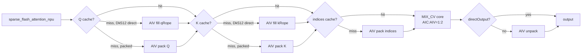

# SparseFlashAttention 950 Direct Invoke 算子知识

## 算子速览

| 项目 | 内容 |
|---|---|
| 实际入口 | Python `cann_bench.sparse_flash_attention` → dispatcher `cann_bench::sparse_flash_attention` → `sparse_flash_attention_npu` → `calc_sfa_launch_config` → `launch_sfa_*`；Direct Invoke，无 ACLNN executor/OPP lookup。 |
| 计算语义 | 对每个 `(B,N2,S1)` task 依 `sparseIndices` 收集 K，计算 `softmax(scaleValue·QKᵀ)K[:Dv]`；causal 按索引实值与 right-down 边界构造有限负偏置。 |
| 输入输出 | 连续 rank-4 FP16/BF16 Q/K/V，INT32 indices，BSND/BNSD；`Dk∈{128,192,512,576}`，`Dv∈{128,512}` 且 `Dv≤Dk`，`topK∈[1,min(1024,S2)]`。 |
| 执行类型 | 多 Kernel 图：0至3个 `AIV_VECTOR` pack/fill/index 节点 → 1个 `MIX_CV` attention 节点（AIC_CUBE QK/PV，两枚 AIV 做 gather/online-softmax/update）→ 可选 `AIV_VECTOR` unpack。 |
| Kernel 路线 | 重要性顺序：P0 R-010、P1 R-009、P2 R-003、P3 R-004、P4 R-005、P5 R-008、P6 R-012、P7 R-011、P8 R-001、P9 R-002、P10 R-007、P11 R-006；Route ID 保持 Host 映射不变。 |
| 核心资源 | Direct 适配 GM tensor/cache；`libapi + aicEff·3·128·576·sizeof(T)` workspace；MIX 内 512 KiB L1 manager、64/64/256 KiB L0 manager、跨 AIC/AIV UB 与 SSBUF/flag。 |
| 来源闭包 | `direct_implementation_closed`：Direct schema/Host selector/POD/所有 launcher、AIV 适配节点、MIX entry、AIC/AIV body、workspace、同步、tail 与构建接线已闭合；官方来源固定于 Commit `be33d95bb755cedec3108f70805c1874d1792540`。 |
| 证据边界 | 固定 Commit 直接支撑官方 arch35 算法/模板与公开约束；Direct Host、POD、launcher、cache、私有 causal mode 与维度扩展是转换交付源中的适配/派生事实，不是官方原生 API 承诺。 |

## 来源与转换关系

| 层次 | 可直接回溯的事实 | 不得外推的结论 |
|---|---|---|
| 官方原生 | 固定 Commit `be33d95bb755cedec3108f70805c1874d1792540` 中的 950 产品范围、CFA/splitG 模板、arch35 `SparseFlashAttentionKernelMla`、Cube/Vector service、Host tiling 字段和官方 `op_host` 编译选项 | 不证明 `cann_bench` schema、BNSD 适配、`Dk/Dv/N2` 扩展、cache 或 current-stream launcher |
| Direct Invoke 适配 | `TORCH_LIBRARY_FRAGMENT`、Meta/PrivateUse1、`parse_and_check`、thread-local packed cache、显式 POD、`RunOpApi`、`launch_sfa_*`、`SetSysWorkspaceForce`、pack/fill/unpack 节点 | 不能称为 ACLNN/OPP 调用，也不能由官方 README 倒推其 ABI、cache 一致性或输入扩展范围 |
| Device 派生补充 | `dimensionCode` 解码、compact carrier、`sparseMode=4`、Dk576 score-UB mask、`G>64` 双 AIC、`value` 参数指向 packed key | 这些是为目标语义增加的 Device 路线；固定官方源仅证明被复用的 arch35 机制，不单独证明派生等价性 |
| 构建转换 | Direct operator CMake 将 kernel/plugin 注册到聚合目标，顶层将 `ascend950` 映射为 `--npu-arch=dav-3510 -xasc`，再与 Torch/Torch-NPU/Ascend 库链接为 `_C.abi3.so` | Direct CMake 没有复制官方 `op_host/CMakeLists.txt` 的 `--cce-auto-sync=off`、VF membar 与 movemask hoist 选项；两套构建接线不得混写 |

## 接口与语义

### 计算语义

令 `G=N1/N2`、`L=B·N2`，`I[b,n2,i,t]` 为第 `t` 个稀疏位置。对 `h∈[0,G)`：

```text
valid_noncausal(t) = 0 <= I[b,n2,i,t] < S2
right_down(i)      = i + S2 - S1
valid_causal(t)    = valid_noncausal(t) && I[b,n2,i,t] <= right_down(i)
score_t            = scaleValue * dot(Q[b,i,n2*G+h,:Dk], K[b,I_t,n2,:Dk])
p                  = softmax(score over valid entries)
Y[b,i,n2*G+h,:Dv] = Σ_t p_t * K[b,I_t,n2,:Dv]
```

Direct 转换将 `(B,N2)` 折叠成物理 batch，把 Q heads 保留为 `G`，并依赖调用契约 `value == key[..., :Dv]`。Host 只检查 value 的 shape/dtype，不验证该数值关系；MIX 节点的 value 实参实际与 packed key 相同。Host pack 保留 `topK` slot 序，但 AIV 成对 DMA 会按较小 GM 地址先写入的方式交换降序 index pair；QK/softmax/PV 对同一 pair 置换不变，causal mask 必须按该物理顺序同步重排。

上述公式是 Direct 设计语义，不是 Host 对任意输入都会强制的数学保证。causal 不是布尔 mask：`Dk<576` 把 query 齐次 lane 设为 1，并对越界 K 行写入 `-60000`；`Dk=576` 在 BMM1 score UB 上加 FP32 极小值。两者都在 softmax scale 链路中，因此需要有限且正的 `scaleValue`；负值或零不保持 mask 方向。六条 causal Route 还要求每个 query row 至少存在一个 slot 满足 `I<=right_down`：`validCounts` 每行固定为 `topK`，不可达的 `zero_empty` 也不会接管全被 mask 的行，因此全 future row 没有可靠空行语义。`S1>S2` 产生负 `right_down` 的早期行对 Dk<576 同样不安全；Dk576 还多一层限制，其 score-UB 分支仅在 `right_down>=0` 时进入。

### 输入、输出与属性

| 参数 | shape/layout | dtype | 约束、默认值与语义 |
|---|---|---|---|
| `query` | BSND `[B,S1,N1,Dk]`；BNSD `[B,N1,S1,Dk]` | FP16/BF16 | rank-4、连续；决定设备/dtype。Host 未检查 `B/S1/N1>0`。 |
| `key` | BSND `[B,S2,N2,Dk]`；BNSD `[B,N2,S2,Dk]` | 同 query | `N2>0`，`N1%N2==0`。 |
| `value` | 与 key 前三轴一致，末轴 `Dv` | 同 query | Direct 数值契约为 key 前 `Dv` 维；Host 未比较内容。 |
| `sparseIndices` | BSND `[B,S1,N2,topK]`；BNSD `[B,N2,S1,topK]` | INT32 | Host 不检查值域。安全调用要求全部 `topK` slot 均在 `[0,S2)`；任意 `-1` tail（部分 tail 或全空行）都会让固定 `topK` BMM 消费未填充的 gather/workspace 行，输出无可靠语义。causal 时每个 query row 还必须至少有一个 slot 满足 `I<=right_down`，全 future row 没有可达的空行处理。`<-1` 会被 `GetkeyOffset` 按内部负数编码解码，`>=S2` 可跨越当前物理 batch。 |
| `scaleValue` | scalar | API double → POD float | 直接窄化为 FP32；不使用 `1/sqrt(Dk)` 默认替换。Host 未检查有限/正值；causal 安全域要求 finite positive。 |
| `inputLayout` | `BSND`/`BNSD` | string | 默认 BSND；pack/unpack 显式转成 core 的 BSND 表面。 |
| `is_causal` | scalar | bool | 默认 false；right-down 边界为 `i+S2-S1`。 |
| 返回 | BSND `[B,S1,N1,Dv]`；BNSD `[B,N1,S1,Dv]` | 同 query | direct-output Route 由 MIX 直写，其余经 unpack。 |

Host 也不校验设备共置。PrivateUse1 路径只依据 `query` 设置 device guard/current stream，随后把 `query`、`key` 与 `sparseIndices` 派生缓冲区的裸地址提交到该 stream；安全调用要求三者位于同一 NPU device。CPU/NPU 混用或跨 NPU device 不会触发保护性 fallback。

Host 只强制 `N2>0 && N1%N2==0`，没有强制 `G=N1/N2`的范围。Device 的 base tile 只容纳 64 行，splitG 也只用相邻两个 AIC 对 G 二分，所以可复用的安全域是 `1<=G<=128`。`G=0` 或 `G>128` 仍会通过 Host selector，但没有第三种 Device 分核或回退。

### 入口与版本

`TORCH_LIBRARY_FRAGMENT` 声明无版本后缀的 Direct schema，Meta 与 PrivateUse1 分别绑定 `sparse_flash_attention_meta` 和 `sparse_flash_attention_npu`。它不调用 `aclnnSparseFlashAttention`，而是将官方 950 arch35 `SFAMatmulService/SFAVectorService/SparseFlashAttentionKernelMla` 的当前实例转为显式 `<<<blocks,nullptr,stream>>>` launcher。固定版本是 CANN 9.1.0，目标架构是 DAV_3510/Ascend 950。

官方入口只支持 `N2=1,D=512,Dr=64`；Direct 适配器扩展到本卡的 `N2/Dk/Dv/BNSD`，但不能倒推为官方公开 API 支持范围。

## Host/Launcher 执行流程

### 参数校验与前处理

`parse_and_check` 按 rank → contiguous → Q dtype → K/V dtype → indices dtype → layout → shape 一致性 → `N1%N2` → Dk/Dv → topK 的顺序失败。`meta` 只建立目标 shape。NPU 路径用 device guard 选中 query 设备，但不检查 `query/key/sparseIndices` 的 device 一致性；随后计算 `L=B*N2`、`carrierWidth`、`SfaPackTiling`和 `SfaLaunchConfig`，再分配输出、适配 tensor 与 byte workspace。

`directDk512Nope = BSND && N2==1 && Dk==512`，命中时 Q/K-nope 直接 alias 输入，只生成 64-lane rope side array。`directOutput = (BSND&&N2==1)||(BNSD&&S1==1)`，命中时不启动 unpack。Q/K/indices 分别按 tensor impl、version、shape、dtype/causal 维持 thread-local cache；某一输入命中仅省略它自己的重建节点，MIX 每次都启动。

`PackIndicesBody` 对每行逐字复制全部 `topK`，并把 sideband 的每行都写成 `topK`；它没有扫描有效前缀。任一 `-1` 会让 gather 在对应分段停止，未填行仍属于固定 `topK` BMM extent，所以部分 tail 和全空行均无可靠输出。该 tensor 的变量名仍是 `validCounts`，但本版本只利用“传给 core 的指针是否非空”区分 causal，不能把其元素解释为真实有效数。`launch_sfa_zero_empty_*`/`sfa_zero_empty_rows` 虽保留在共享头和 kernel TU 中，`sparse_flash_attention_npu` 没有任何可达调用；其 body 还把每个 head 的输出行硬编码为 `512` 个元素，不能直接用于 `Dv=128`，因而不是活动的 empty-row fallback。

### 参数、Workspace 与生命周期

```text
L = B*N2
carrierWidth = Dk>=512 ? 512 : align16(Dk + (causal ? 1 : 0))
qNope  = L*S1*G*carrierWidth*sizeof(T)   (directDk512Nope 时 alias query)
qRope  = L*S1*G*64*sizeof(T)
kNope  = L*S2*carrierWidth*sizeof(T)     (directDk512Nope 时 alias key)
kRope  = L*S2*64*sizeof(T)
indices = L*S1*topK*4
validCounts = L*S1*4
officialOut = L*S1*G*Dv*sizeof(T)        (仅 !directOutput)

aicEff = G>64 ? max(1,aicNum>>1) : aicNum
userWorkspace = aicEff * 3 * 128 * 576 * sizeof(T)
workspaceBytes = libapiWorkspace + userWorkspace
```

Direct workspace tensor 由 Host 强引用捕获到 `RunOpApi` callback；`SetSysWorkspaceForce(workspace)` 先绑定 KFC system-workspace base，再用 `GetUserWorkspace` 跳过 libapi reserve。一次 cache miss 调用内的所有 Device 节点使用同一 current stream，因而 pack 的 GM 写对后继 MIX 可见，unpack 也在 MIX 后。

thread-local cache key 不含 stream，也没有在 cache hit 时记录/等待原 producer stream event。相同 TensorImpl 在同一 Host 线程跨 NPU stream 复用时，packed GM 可能仍由另一 stream 生产；安全条件是继续使用同一 stream，或由调用者在切换前建立显式依赖。allocator 的强引用只保护生命周期，不能替代 producer-consumer 顺序。cache 也只有每类一个槽，shape/version/causal 任一变化都会替换，不是多形状表。

### 启动图与失败传播



pack/unpack blockDim 为 `min(AIV cores,rows)` 且至少 1；MIX 为 `CalcTschBlockDim(2*aic,aic,2*aic)`。launcher 是 `void`，callback 无条件返回 0，未同步查询某个 async launch 失败以取消后继节点；启动前 `TORCH_CHECK` 可立即终止。

Host 中 `coreLaunches` 固定为 1，所以 causal loop 内的 Q/index/output byte offset 都恒为 0；这些公式不是按 query row 多次启动 core。MIX 内部才按 `(logicalBatch,S1)` 分 task。若 `S1>S2`，`ComputeNeedInitSFA` 会先把输出表面分核清零并 `SyncAll`，随后仍执行 attention；这是对可能未覆盖输出的初始化，不是另一条算法 Route。

## Route 与参数设计

### 分核与资源计算

Direct Host 用 `dkCode={128:0,192:1,512:2,576:3}`、`dvCode={128:0,512:1}` 编码 `dimensionCode=1+2*dkCode+dvCode`，Device AIV 通过 `blockSize-1` 解码。`activeM=min(G*S1,128)`，Host compatibility POD 写 `mmResUbSize=align32(min(S2,512))*align16(activeM)`、`bmm2ResUbSize=512*align16(activeM)`；arch35 实际 tile 固定 `s1Base=64,s2Base=128`。

每个 `(logicalBatch,S1)` query row 为一个 task，`M=G`；`G>64` 时相邻两个 AIC 分担前/后半 G，否则一个 AIC 处理该 task。AIV 分工随流水阶段变化：base 的两枚 AIV 在 `ProcessVec0` 二分 topK tile，在 Vec1/Vec2 二分 M；splitG 的相邻两 AIC 各带两枚 AIV，四枚 AIV 先把 topK tile 分成四段，而每个 AIC 的两枚 AIV再二分其本地 M。有效 N 是 `topK`，按 128 分块（Host 已保证 `topK<=S2`）；BMM1 的 K 为 `align16(Dk+1)`（Dk 128/192 causal）、Dk（Dk 128/192 non-causal）、512（Dk512 non-causal）或 576（Dk512 causal/Dk576）；BMM2 N 为 Dv。

### Route 选择

P0→P11 是本卡的重要性顺序，不是 Host 判断序号。源码的 Host 顺序、短路和不命中去向保留在最后一列，Route ID 仍对应原有叶节点。表中谓词先写源码叶条件；所有叶还必须与公共安全前提 `1<=G<=128`、`query/key/sparseIndices` 位于同一 NPU device、全部 `topK` index slot 均在 `[0,S2)` 取交集。六条 causal 叶还要求 narrowed FP32 scale 有限且为正，并且每个 query row 至少存在一个 slot 满足 `I<=right_down`；`validCounts=topK` 与不可达的 `zero_empty` 都不能为全 future row 提供 fallback。尤其 `G>128` 仍命中某个 split 叶，但不属于该叶的可复用域。

| 重要性 | Route | Route 特征 | 适用域 | 实现前提 | Host 顺序、短路与 fallback |
|---:|---|---|---|---|---|
| P0 | R-010 packed-unpack/base/C | 完整 pack→MIX→unpack；base causal | `!directOutput&&isCausal&&1<=G<=64` | 950、FP16/BF16；Dk<576 走 mode4 齐次 lane，Dk576 走 score-UB mask；finite positive scale；每 row 至少一个 `I<=right_down` | H1 得到 false；H2 必为 false；H4/H5/H6 各 cache hit 独立跳过 rebuild；H7 core launcher 的 splitG=false；H8 必做 unpack。`!isCausal`→R-009，`G>64`→R-012，`directOutput`→direct-output 族 |
| P1 | R-009 packed-unpack/base/N | 完整 pack→MIX→unpack；base non-causal | `!directOutput&&!isCausal&&1<=G<=64` | 950、FP16/BF16；normalized packed GM 与 base MIX 资源成立 | H1=false；H4/H5/H6 miss 才 pack，hit 短路；H7 splitG=false；H8 unpack。causal→R-010，`G>64`→R-011 |
| P2 | R-003 direct512/split/N | Q/K 512-nope alias；splitG non-causal | `directDk512Nope&&!isCausal&&64<G<=128` | `BSND&&N2==1&&Dk==512`；相邻 AIC 分担 G，workspace 组数减半 | H1=true 后 H2=true；H4/H5 miss 只 fill rope、不 pack 512 lane；H7 `if(splitG)` 命中 split entry；H8 跳过 unpack。`G<=64`→R-001，causal→R-004；`G>128` 无安全叶 |
| P3 | R-004 direct512/split/C | Q/K alias；splitG causal | `directDk512Nope&&isCausal&&64<G<=128` | 同 R-003，并要求 Dk512 causal 的 576-wide 齐次 lane、finite positive scale、每 row 至少一个 `I<=right_down` 与 splitG flag15 配对 | H1=true、H2=true；rebuild 短路同 R-003；H7 split entry；H8无 unpack。non-causal→R-003，`G<=64`→R-002；`G>128` 无安全叶 |
| P4 | R-005 packed-direct/base/N | Q/K pack；输出表面直写；base non-causal | `directOutput&&!directDk512Nope&&!isCausal&&1<=G<=64` | BSND/N2=1 或 BNSD/S1=1；carrierWidth 对齐；无 officialOut 临时张量 | H1=true、H2=false；H4/H5 miss 走 dtype pack，H6按需 pack indices；H7 base entry；H8短路 unpack。causal→R-006，`G>64`→R-007 |
| P5 | R-008 packed-direct/split/C | Q/K pack；输出直写；splitG causal | `directOutput&&!directDk512Nope&&isCausal&&64<G<=128` | direct-output 表面等价；splitG 两 AIC；finite positive scale；每 row 至少一个 `I<=right_down`；causal lane 或 score mask | H1=true、H2=false；H4/H5/H6 cache 短路；H7 split entry；H8无 unpack。non-causal→R-007，`G<=64`→R-006；`G>128` 无安全叶 |
| P6 | R-012 packed-unpack/split/C | 完整 pack→split MIX→unpack；causal | `!directOutput&&isCausal&&64<G<=128` | normalized officialOut、splitG workspace/flag15、finite positive scale、每 row 至少一个 `I<=right_down` 与 causal mask 同时成立 | H1=false；H4/H5/H6按 cache 决定 pack；H7 split entry；H8 unpack。non-causal→R-011，`G<=64`→R-010；`G>128` 无安全叶 |
| P7 | R-011 packed-unpack/split/N | 完整 pack→split MIX→unpack；non-causal | `!directOutput&&!isCausal&&64<G<=128` | normalized officialOut；splitG 两 AIC 和三份 K/V slot | H1=false；cache hit 分别短路；H7 split entry；H8 unpack。causal→R-012，`G<=64`→R-009；`G>128` 无安全叶 |
| P8 | R-001 direct512/base/N | Q/K 512-nope alias；base non-causal | `directDk512Nope&&!isCausal&&1<=G<=64` | BSND、N2=1、Dk512；单 AIC 覆盖一个 query task 的全部 G | H1=true 后 H2=true；Q/K miss 只 fill rope；H7 splitG=false；H8无 unpack。causal→R-002，`G>64`→R-003 |
| P9 | R-002 direct512/base/C | Q/K alias；base causal | `directDk512Nope&&isCausal&&1<=G<=64` | 同 R-001，并使用 Dk512 causal 齐次 lane、finite positive scale，且每 row 至少一个 `I<=right_down` | H1=true、H2=true；cache/direct-nope/unpack 短路同 R-001；H7 base entry。non-causal→R-001，`G>64`→R-004 |
| P10 | R-007 packed-direct/split/N | Q/K pack；输出直写；splitG non-causal | `directOutput&&!directDk512Nope&&!isCausal&&64<G<=128` | direct-output 表面等价；carrier pack 与 splitG workspace 同时成立 | H1=true、H2=false；cache miss 才 pack；H7 split entry；H8无 unpack。causal→R-008，`G<=64`→R-005；`G>128` 无安全叶 |
| P11 | R-006 packed-direct/base/C | Q/K pack；输出直写；base causal | `directOutput&&!directDk512Nope&&isCausal&&1<=G<=64` | direct-output 表面等价；finite positive scale；每 row 至少一个 `I<=right_down`；causal lane 或 score mask；单 AIC M≤64 | H1=true、H2=false；cache miss 才 pack；H7 base entry；H8无 unpack。non-causal→R-005，`G>64`→R-008 |

```text
H0 parse_and_check -> make_pack_tiling -> calc_sfa_launch_config(causal)
H1 directOutput = (layout==BSND && N2==1) || (layout==BNSD && S1==1)
H2 directDk512Nope = (layout==BSND && N2==1 && Dk==512)
H3 officialOutput = directOutput ? output : normalized temporary; allocate workspace
H4 query cache: hit -> skip; miss -> directDk512Nope ? alias+fill_rope : pack
H5 key cache:   hit -> skip; miss -> directDk512Nope ? alias+fill_rope : pack
H6 index cache: hit -> skip; miss -> pack_indices
H7 dtype selects half/bf16 launcher; launcher tests splitG=(G>64) before base entry
H8 directOutput ? return direct surface : launch dtype-matched unpack

importance leaves:
P0 R-010 -> P1 R-009 -> P2 R-003 -> P3 R-004 -> P4 R-005 -> P5 R-008
-> P6 R-012 -> P7 R-011 -> P8 R-001 -> P9 R-002 -> P10 R-007 -> P11 R-006
```

在 `1<=G<=128` 内，谓词不命中只会落入上表注明的 sibling Route；输入校验或资源参数构造失败在 H0 终止。`G=0/G>128`、任意 `-1` tail 或其它非法 index、CPU/跨 NPU device 裸地址、跨 stream cache hit 与 causal 数值边界不会触发安全 sibling。进入某个叶节点后没有 CPU、ACLNN 或另一 Device Route 的运行时 fallback，cache hit 仅短路对应 producer 节点。

### 模板/实现执行矩阵

| 重要性 | Route | key/selector | dtype/shape/platform 完整命中条件 | 执行族与 kernel 节点 | 实际模板/body | 内存与同步特征 | tail/fallback |
|---:|---|---|---|---|---|---|---|
| P0 | R-010 | packed-unpack/base/C | 950；FP16/BF16；`!directOutput,isCausal,1<=G<=64` | pack?→MIX_CV→unpack | `IS_SPLIT_G=false`；causal mode4/score mask | packed GM + officialOut；base CV flags | topK、Dk/Dv、layout tail；谓词变化落相邻叶 |
| P1 | R-009 | packed-unpack/base/N | 同上但 non-causal | pack?→MIX_CV→unpack | `IS_SPLIT_G=false`；无 causal mask | packed GM + officialOut | 同上 |
| P2 | R-003 | direct512/split/N | BSND,N2=1,Dk512,64<G<=128,non-causal | fill-rope?/index?→MIX_CV | `IS_SPLIT_G=true` | Q/K alias；aicEff减半；flag15补齐 | 奇数G前/后半；G阈值变化→R-001 |
| P3 | R-004 | direct512/split/C | R-003 + causal | 同上 | `IS_SPLIT_G=true`；576-wide QK | 同上 + causal lane | causal切换→R-003 |
| P4 | R-005 | packed-direct/base/N | `directOutput&&!directDk512Nope&&!causal&&1<=G<=64` | pack?→MIX_CV | `IS_SPLIT_G=false` | packed GM；无 officialOut/unpack | carrier tail；G/causal变化落对应叶 |
| P5 | R-008 | packed-direct/split/C | direct-output、非direct512、causal、64<G<=128 | pack?→MIX_CV | `IS_SPLIT_G=true`；causal mask | packed GM；splitG flag15；输出直写 | 奇数G与 causal tail |
| P6 | R-012 | packed-unpack/split/C | `!directOutput&&causal&&64<G<=128` | pack?→MIX_CV→unpack | `IS_SPLIT_G=true`；causal mask | packed GM + officialOut + splitG同步 | layout/Dv/奇数G tail |
| P7 | R-011 | packed-unpack/split/N | 同上但 non-causal | pack?→MIX_CV→unpack | `IS_SPLIT_G=true` | packed GM + officialOut + splitG同步 | 同上 |
| P8 | R-001 | direct512/base/N | BSND,N2=1,Dk512,1<=G<=64,non-causal | fill-rope?/index?→MIX_CV | `IS_SPLIT_G=false` | Q/K alias；base CV flags | Dv/topK tail |
| P9 | R-002 | direct512/base/C | R-001 + causal | 同上 | `IS_SPLIT_G=false`；576-wide QK | Q/K alias + causal lane | 同上 |
| P10 | R-007 | packed-direct/split/N | direct-output、非direct512、non-causal、64<G<=128 | pack?→MIX_CV | `IS_SPLIT_G=true` | packed GM + splitG同步；输出直写 | carrier/奇数G tail |
| P11 | R-006 | packed-direct/base/C | direct-output、非direct512、causal、1<=G<=64 | pack?→MIX_CV | `IS_SPLIT_G=false`；causal mask | packed GM；base CV flags；输出直写 | carrier/causal tail |

`/N` 与 `/C` 的 Device 差异：non-causal 向 core 传空 sideband；causal 以 `validCounts!=nullptr` 作为 marker，但 sideband 元素固定为 `topK`。它不会记录 causal 可见元素数，且不可达的 `zero_empty` 不会修复全 future row，因此每个 `/C` query row 必须至少有一个 slot 满足 `I<=right_down`。`Dk<576` 用齐次偏置 lane，`Dk=576` 用 BMM1 score-UB mask。FP16/BF16 仅切换 IO 模板，两者 BMM 与 softmax 均为 FP32 中间精度；mask 仍受 scale 符号和前述边界制约。

### 性能与安全 Guard

| Guard | Host/Tiling 条件 | Device/资源原因 | 影响 Route | 不满足时去向 | 源码符号 |
|---|---|---|---|---|---|
| direct nope | BSND,N2=1,Dk512 | 输入已是 core BSND 512-nope 表面 | P2 R-003、P3 R-004、P8 R-001、P9 R-002 | pack feature |
| direct output | BSND,N2=1 或 BNSD,S1=1 | normalized output 与用户表面字节等价 | P2 R-003、P3 R-004、P4 R-005、P5 R-008、P8 R-001、P9 R-002、P10 R-007、P11 R-006 | unpack |
| splitG | `64<G<=128` | 相邻 AIC 分前/后 G，每 AIC 仍 M≤64 | P2 R-003、P3 R-004、P5 R-008、P6 R-012、P7 R-011、P10 R-007 | G≤64 普通 route；G>128 无安全 fallback |
| cache | impl/version/shape/dtype/causal 全相等，且 producer-consumer stream 有序 | 避免重建 packed GM | 全部 | 单独重建该输入；stream 不入 key |
| pair gather | 两索引有效，stride 非负且 `<INT32_MAX`，blockSize=1 | 一条 DataCopyPad 合并两个 token | 全部 MIX | 两次 `CopyInSingleKv` |
| causal lane | causal && Dk<576 | 需 1 个不改变真实 dot 的齐次维 | P0 R-010、P3 R-004、P5 R-008、P6 R-012、P9 R-002、P11 R-006 | Dk576 score-UB mask |
| workspace core | G>64 时 `aic>>1` | 两 AIC 共用一组 3-slot K/V cache | splitG | 普通 aic 组数 |
| causal scale | finite positive `scaleValue` | 负偏置经 score scale 链；零/负 scale 会削弱或反转 mask | 全部 `/C` | 无运行时 fallback |
| causal non-empty | 每个 query row 至少一个 `I<=right_down` | `validCounts` 固定为 `topK`，`zero_empty` 不可达；全 future row 仍进入 softmax/输出 | 全部 `/C` | 无运行时 fallback |
| Dk576 boundary | `right_down>=0` | score-UB 分支以 `causalLastVisible>=0` 为 guard | Dk576 的全部 `/C` | 负 boundary 不施加该 mask |

### POD/ABI

Direct 共享头使用显式标量 struct；以 LP64 C++ 自然对齐计算，`SparseFlashAttentionBaseParamsMla sizeof=104, alignof=8`，父 POD `sizeof=136, alignof=8`，`SfaPackTiling sizeof=48, alignof=4`，`SfaLaunchConfig sizeof=152, alignof=8`。

| 结构 | 字段 | 类型/位宽 | ABI 布局 | 单位 | Host/launcher producer | Device consumer | 边界 |
|---|---|---|---|---|---|---|---|
| Base | batchSize/seqSize/qSeqSize | uint32×3 | off 0/4/8 | batch/token | L,S2,S1 | sharedParams | 乘法窄化前 Host 未做 uint32 溢出检查 |
| Base | blockSize | int64 | off 16 | dimension code | `1+2*dkCode+dvCode` | AIV decoder | Direct 非 PA |
| Base | maxBlockNumPerBatch | uint32 | off 24 | reserved | 0 | shared field | POD 字段本身 inactive；Device 随后把解码出的原始 Dk 存入同名 `ConstInfo` 成员，二者不可混同 |
| Base | scaleValue | float | off 28 | scalar | double→float | online softmax | 有限性未检查 |
| Base | nNumOfQInOneGroup | uint32 | off 32 | head | G | core split/BMM M | >0 |
| Base | actualLenDimsQ/actualLenDimsKV | uint32×2 | off 36/40 | element | 0/0 | null flags | inactive |
| Base | outputLayout/sparseMode | uint32×2 | off 44/48 | enum | 0；0/4 | offset/mask | mode4 仅 Direct |
| Base | preTokens/nextTokens | int64×2 | off 56/64 | token | INT64_MAX | kvcache logic | mode0/4 不裁 slot |
| Base | attentionMode/returnSoftmaxLse | uint32×2 | off 72/76 | enum/flag | 2/0 | metadata/LSE guard | LSE inactive |
| Base | sparseBlockSize | int64 | off 80 | token | 1 | gather | 950=1 |
| Base | sparseBlockCount | uint32 | off 88 | slot | topK | S2 loop/index | 1..1024 |
| Base | isActualLenDimsNull/isActualLenDimsKVNull | uint32×2 | off 92/96 | flag | 1/1 | actual-len path | Direct 固定 null |
| SplitKV | s2/accumOutSize/logSumExpSize | uint32×3 | parent off 104 | part/element | 0 | FD path | inactive |
| SingleCore | usedCoreNum | uint32 | parent off 116 | AIC | aicNum | core guard | Device 再按 task 收缩 |
| TensorSize | mmResUbSize/bmm2ResUbSize | uint32×2 | parent off 120 | element | Host 公式 | compatibility | arch35 实分配不读 |
| InnerSplit | mBaseSize/s2BaseSize | uint32×2 | parent off 128 | row/token | G/min(S2,512) | compatibility | arch35 固定 64/128 |
| Pack | B/S1/S2/N1/N2/G/Dk/Dv/topK/layout/kind/causal | uint32×12 | off 0..44 | axis/enum | `make_pack_tiling` | pack/unpack body | kind 0=Q,1=K |
| LaunchConfig | tiling/coreBlockDim/vectorBlockDim/workspaceBytes | POD,u32,u32,u64 | off 0/136/140/144 | mixed | `calc_sfa_launch_config` | Host launchers | total 152B |

### Route 源码闭包

| 重要性 | Route | Key/selector | Host/Tiling producer | POD/参数 | Kernel entry/router | Kernel body/直接依赖 | 构建接线 |
|---:|---|---|---|---|---|---|---|
| P0 | R-010 | packed-unpack/base/C | `parse_and_check/calc_sfa_launch_config` + pack/unpack producer | Base/Pack/Launch POD | pack→base MIX→unpack | arch35 kernel/cube/vector/kvcache/common | Direct TU 注册 + `dav-3510 -xasc`；不继承官方 op_host 专用选项 |
| P1 | R-009 | packed-unpack/base/N | 同上 | 同上 | pack→base MIX→unpack | 同上 | 同上 |
| P2 | R-003 | direct512/split/N | 同上 + direct-nope alias/fill producer | 同上 | fill-rope/index→split MIX | 同上 | 同上 |
| P3 | R-004 | direct512/split/C | 同上 | 同上 | fill-rope/index→split causal MIX | 同上 | 同上 |
| P4 | R-005 | packed-direct/base/N | 同上 + `PackFeaturesBody` | 同上 | pack→base MIX | 同上 | 同上 |
| P5 | R-008 | packed-direct/split/C | 同上 | 同上 | pack→split causal MIX | 同上 | 同上 |
| P6 | R-012 | packed-unpack/split/C | 同上 | 同上 | pack→split causal MIX→unpack | 同上 | 同上 |
| P7 | R-011 | packed-unpack/split/N | 同上 | 同上 | pack→split MIX→unpack | 同上 | 同上 |
| P8 | R-001 | direct512/base/N | 同上 + direct-nope alias/fill producer | 同上 | fill-rope/index→base MIX | 同上 | 同上 |
| P9 | R-002 | direct512/base/C | 同上 | 同上 | fill-rope/index→base causal MIX | 同上 | 同上 |
| P10 | R-007 | packed-direct/split/N | 同上 + `PackFeaturesBody` | 同上 | pack→split MIX | 同上 | 同上 |
| P11 | R-006 | packed-direct/base/C | 同上 | 同上 | pack→base causal MIX | 同上 | 同上 |

## Kernel 实现

### 公共执行流程

逐 Route 章节严格按 P0→P11 排列；P 级不改变 R-ID，也不改变 H0→H8 的 Host selector 顺序。所有 Route 共用一个 `KERNEL_TYPE_MIX_AIC_1_2` core：AIV subblock 0 从 by-value tiling 构造 `CVSharedParams`，写 SSBUF，以 `CrossCoreSetFlag<SYNC_MODE=4,PIPE_S>(15)` 通知 AIC；AIC 等待后读取共享参数。

```text
task t:   AIV ProcessVec0(gather K/V)        || AIC IterateBmm1(Q*K^T)
task t-1: AIV ProcessVec1(online softmax)    || AIC IterateBmm2(P*V)
task t-2: AIV ProcessVec2(update/div/cast/output)
```

三类外层节点图只改变 MIX 前后的 GM 表面；下表仍按逐 Route 重要性排列：

| 重要性/Route | 实现族 | 前置节点 | MIX 输入/输出 | 后置节点 |
|---|---|---|---|---|
| P0 R-010 | packed-unpack/base/C | cache miss 时 pack Q/K/indices | normalized packed GM → officialOut | unpack 到 BSND/BNSD |
| P1 R-009 | packed-unpack/base/N | 同上 | 同上 | 同上 |
| P2 R-003 | direct512/split/N | cache miss 时只 fill Q/K rope；indices 按需 pack | Q/K 512-nope alias → output | 无 |
| P3 R-004 | direct512/split/C | 同上 | 同上 | 无 |
| P4 R-005 | packed-direct/base/N | cache miss 时 pack Q/K/indices | normalized packed GM → output | 无 |
| P5 R-008 | packed-direct/split/C | 同上 | 同上 | 无 |
| P6 R-012 | packed-unpack/split/C | cache miss 时 pack Q/K/indices | normalized packed GM → officialOut | unpack 到 BSND/BNSD |
| P7 R-011 | packed-unpack/split/N | 同上 | 同上 | 同上 |
| P8 R-001 | direct512/base/N | cache miss 时只 fill Q/K rope；indices 按需 pack | Q/K 512-nope alias → output | 无 |
| P9 R-002 | direct512/base/C | 同上 | 同上 | 无 |
| P10 R-007 | packed-direct/split/N | cache miss 时 pack Q/K/indices | normalized packed GM → output | 无 |
| P11 R-006 | packed-direct/base/C | 同上 | 同上 | 无 |

MIX 的公共分层数据链为两支汇合：`GM Q/Q-rope → AIC L1Q`，以及 `GM K/K-rope/indices → AIV gather UB → 三份 workspace GM → AIC L1KV`；随后 `L1 → L0A/L0B → Mmad(FP32 L0C) → Fixpipe FP32 UB → AIV online softmax → shared L1 P → AIC PV → AIV update/output`。`Buffer` 初始 cross-core ID 顺序为 L1 triple 0..2、BMM2 UB 3、BMM1 UB double 4..5、GM gather triple 6..8；producer 在 `SetCrossCore` 后才允许 peer `WaitCrossCore` 消费，BMM2 完成后才释放 K/V slot。

| 公共资源 | 容量/公式 | owner 与复用 |
|---|---|---|
| user workspace | `aicEff*3*128*576*sizeof(T)`，`aicEff=(G>64 ? max(1,aic>>1) : aic)` | invocation；三槽按 task mod 3 |
| L1 manager | `3*147456+73728=516096B` | K/P 三槽 + Q；小于 512 KiB manager |
| L0A/L0B/L0C | 64/64/256 KiB；DB policy 2×16/32/128 KiB | AIC tile/K loop |
| cross-core UB | `2*(32*128*4)+32*512*4=98304B` | BMM1 双槽 + BMM2 单槽 |
| AIV explicit UB | `36864+16896+65536+3072=122368B` | gather、softmax、update/scalar |
| 精度 | QK/PV FP32 accumulate；online max/sum/exp FP32；末段 `CAST_ROUND` 到 T | 全 Route 相同 |
| tail | M 由 G/base或split裁剪；N=`topK` 按 128 tile（且 `topK<=S2`）；Dv 只写有效前缀 | 每 task 最后 tile 提交输出；任意 `-1` tail 会留下未填行而仍被固定 BMM extent 消费，故不在安全域内 |

### 编译存在但不可达/未实例化的分支

| 源码分支 | 本 Direct 实例状态 | 不能视为 fallback 的原因 |
|---|---|---|
| `sfa_zero_empty_rows` 与两个 `launch_sfa_zero_empty_*` | 编译且导出，Host 无调用点 | `validCounts` 固定写 `topK`，全空行不会转入 zero kernel；该 body 又按 `groupSize*512` 硬编码输出行宽，不能直接服务 `Dv=128` |
| `coreLaunches` 的 row offset | loop 常量为 1，所有 causal offset 恒为 0 | 不是逐 row 多 launch 路线 |
| PA/TND/quant/sink/return-LSE/actual-length/FD split-KV | 大量官方 helper 被内联，但模板固定 `BSND/PA=false/quant=false`，POD 写 null/0 | 代码存在不等于本入口可达；Host schema 也不接收这些参数 |
| `GetkeyOffset(s2Idx<-1)` 负数绝对地址解码 | 对任意用户 INT32 值仍可触发，但不是公开输入协议 | 不合法负值不会回退为 `-1`，而会变成 GM offset |
| `needInit` 输出清零 | `S1>S2` 时可达，清零后仍执行同一 MIX | 仅初始化可能未覆盖的输出，不改变 attention Route |
| `G>128` | Host 仍选择 splitG | 两 AIC 二分后单 AIC 的 M 仍大于 64；没有更深切分或替代 kernel |

### P0 / Route R-010：packed-unpack/base/C

#### 适用条件

##### 选择证据

| 层级 | 文件 | 符号 | 源码谓词/参数 | 结果/下一跳 |
|---|---|---|---|---|
| Host H1/H2 | Direct Host | `directOutput/directDk512Nope` | `!directOutput && isCausal && G<=64` | packed-unpack/base/C；不命中：isCausal=false→R-009；G>64→R-012；directOutput=true→packed-direct/direct512 |
| Host H4-H6 | Direct Host | `rebuildQuery/rebuildKey/rebuildIndices` | H4/H5/H6 cache hit分别跳过；miss按dtype pack Q/K并pack indices | 只改变前置节点，不改变Route叶 |
| Launcher H7/H8 | Direct launcher | `launch_sfa_core_half/bf16` | `launch_sfa_core_*`落入base分支；`IS_SPLIT_G=false`，一个AIC处理当前task的全部G；H8命中`!directOutput`并启动unpack | 当前entry与输出提交路径 |
| Tiling/Router | official arch35映射 | `sparseMode/IS_SPLIT_G/SFA_OP_IMPL` | `validCounts!=nullptr`；Dk<576用齐次偏置lane，Dk576对BMM1 score UB施加负偏置 | 950 MIX_CV body |

适用域为 `!directOutput && isCausal && 1<=G<=64`；实现前提是normalized pack 与 officialOut 均存在、scale finite positive；Dk<576 用 mode4 齐次 lane，Dk576 用 score-UB mask。

#### Device 数据流

##### 函数级调用链

```text
pack Q? / pack K? / pack indices? -> sfa_official_core_{dtype} -> officialOut -> unpack_{dtype} -> output
  -> SparseFlashAttentionKernelMla::Init/ProcessMainLoop
    -> AIV ProcessVec0 -> AIC IterateBmm1
    -> AIV ProcessVec1 -> AIC IterateBmm2
    -> AIV ProcessVec2
```

##### 源码等价伪码

```text
先生成normalized packed GM；MIX写normalized officialOut；unpack按BSND/BNSD地址式提交用户输出
for each assigned query task:
  gather sparse K/V by indices into workspace slot[task%3]
  BMM1 FP32 QK -> online softmax FP32 -> BMM2 FP32 PV
  update online state; last S2 tile divide, CAST_ROUND, write Dv
```

#### 内存与数据搬运

##### 资源与搬运表

| 层级/缓冲区 | offset/容量 | dtype/layout | producer | consumer | owner/lifetime | Route差异 |
|---|---|---|---|---|---|---|
| adapter GM | adapter_GM = qNope+qRope+kNope+kRope+indices+validCounts+L*S1*G*Dv*sizeof(T) | T/INT32 normalized | pack/fill或alias | MIX/unpack | cache或invocation | packed qNope/qRope/kNope/kRope/indices/validCounts + officialOut |
| workspace v0[3] | `aicGroup*442368+slot*147456` | T/ND576 | AIV gather | AIC QK/PV | invocation | `aicEff=aic` |
| L1/L0/UB | 公共表的516096B、64/64/256KiB、98304B | T/FP32 | AIV/AIC | AIC/AIV | kernel task | base每AIC一组slot |
| output surface | officialOut后接用户output | T/normalized→用户layout | ProcessVec2/unpack | caller | output tensor | Dv有效前缀 |

##### 分层内存布局


##### 字节账、交接边与复用顺序

```text
workspace_total = libapi + aic*442368
L1_used = 516096 bytes
cross_core_UB = 98304 bytes
explicit_AIV_UB = 122368 bytes
adapter_GM = qNope+qRope+kNope+kRope+indices+validCounts+L*S1*G*Dv*sizeof(T)
```

| 边/复用子区 | producer | offset/extent | dtype/layout | consumer | ordering/sync | owner/lifetime | 安全条件 |
|---|---|---|---|---|---|---|---|
| pack→MIX；MIX→unpack | pack/fill/ProcessVec2 | packed Q/K/indices；officialOut=L*S1*G*Dv*T | T/INT32 normalized | MIX/unpack | same stream | cache或invocation | cache key完整；同stream；unpack只搬Dv有效前缀 |
| AIV gather→AIC | ProcessVec0 | slot·147456/147456 | T/ND576 | IterateBmm1/Bmm2 | cross-core ID6..8 | task mod3 | BMM2后才释放 |
| AIC↔AIV | Fixpipe/ProcessVec1 | BMM1 ID4..5；BMM2 ID3；L1 ID0..2 | FP32/T | ProcessVec1/IterateBmm2/ProcessVec2 | Set/WaitCrossCore + HardEvent | task | 双方Set/Wait对称 |

#### 同步、精度与尾块

##### 同步与数值边界表

| 阶段 | primitive/机制 | producer | consumer/等待点 | 保护对象 | 精度/尾块 |
|---|---|---|---|---|---|
| Host节点 | same stream | pack/fill/MIX | MIX/unpack | GM surface | cache hit可省略producer但保留已持有GM |
| shared params | SSBUF + mode4 flag15 | AIV0 | AIC Init | `CVSharedParams` | by-value字段完整复制 |
| split/base | base task mapping | 当前AIC | 本task | G分段 | M=G<=64 |
| QK/softmax/PV | Mmad FP32 + ProcessVec1Vf | AIC/AIV | AIV/AIC | scores、max/sum、P、PV | `validCounts!=nullptr`；Dk<576用齐次偏置lane，Dk576对BMM1 score UB施加负偏置；S2/topK按128 tail |
| output | `CAST_ROUND` + MTE3 | AIV | GM | Dv前缀 | FP32→FP16/BF16；只写有效Dv |

#### 关键实现

##### 符号证据表

| 阶段 | 文件 | 符号/模板实例 | 实现事实 |
|---|---|---|---|
| Host/Tiling producer | `attention/sparse_flash_attention/op_host/sparse_flash_attention_tiling.cpp` | `GetWorkspaceSize/CalcBlockDim/GenTilingKey` | 950 workspace、1:2 blockDim与splitG依据 |
| Kernel entry/router | `attention/sparse_flash_attention/op_kernel/sparse_flash_attention.cpp` | `sparse_flash_attention/SFA_OP_IMPL` | half/bf16到MIX body |
| Device body/helper | `attention/sparse_flash_attention/op_kernel/arch35/sparse_flash_attention_kernel_mla.h` | `ProcessMainLoop` | 三拍调度与base task |
| Cube/Vector | `attention/sparse_flash_attention/op_kernel/arch35/sparse_flash_attention_service_cube_mla.h` / `sparse_flash_attention_service_vector_mla.h` | `IterateBmm1SFA/IterateBmm2SFA/ProcessVec0/1/2` | QK/PV、gather、softmax与输出 |

### P1 / Route R-009：packed-unpack/base/N

#### 适用条件

##### 选择证据

| 层级 | 文件 | 符号 | 源码谓词/参数 | 结果/下一跳 |
|---|---|---|---|---|
| Host H1/H2 | Direct Host | `directOutput/directDk512Nope` | `!directOutput && !isCausal && G<=64` | packed-unpack/base/N；不命中：isCausal=true→R-010；G>64→R-011；directOutput=true→direct-output 族 |
| Host H4-H6 | Direct Host | `rebuildQuery/rebuildKey/rebuildIndices` | H4/H5/H6 cache hit分别跳过；miss按dtype pack Q/K并pack indices | 只改变前置节点，不改变Route叶 |
| Launcher H7/H8 | Direct launcher | `launch_sfa_core_half/bf16` | `launch_sfa_core_*`落入base分支；`IS_SPLIT_G=false`，一个AIC处理当前task的全部G；H8命中`!directOutput`并启动unpack | 当前entry与输出提交路径 |
| Tiling/Router | official arch35映射 | `sparseMode/IS_SPLIT_G/SFA_OP_IMPL` | `validCounts==nullptr`；不构造causal mask | 950 MIX_CV body |

适用域为 `!directOutput && !isCausal && 1<=G<=64`；实现前提是normalized Q/K/indices 与 officialOut 容量成立；base core 单 AIC 覆盖 M=G。

#### Device 数据流

##### 函数级调用链

```text
pack Q? / pack K? / pack indices? -> sfa_official_core_{dtype} -> officialOut -> unpack_{dtype} -> output
  -> SparseFlashAttentionKernelMla::Init/ProcessMainLoop
    -> AIV ProcessVec0 -> AIC IterateBmm1
    -> AIV ProcessVec1 -> AIC IterateBmm2
    -> AIV ProcessVec2
```

##### 源码等价伪码

```text
先生成normalized packed GM；MIX写normalized officialOut；unpack按BSND/BNSD地址式提交用户输出
for each assigned query task:
  gather sparse K/V by indices into workspace slot[task%3]
  BMM1 FP32 QK -> online softmax FP32 -> BMM2 FP32 PV
  update online state; last S2 tile divide, CAST_ROUND, write Dv
```

#### 内存与数据搬运

##### 资源与搬运表

| 层级/缓冲区 | offset/容量 | dtype/layout | producer | consumer | owner/lifetime | Route差异 |
|---|---|---|---|---|---|---|
| adapter GM | adapter_GM = qNope+qRope+kNope+kRope+indices+validCounts+L*S1*G*Dv*sizeof(T) | T/INT32 normalized | pack/fill或alias | MIX/unpack | cache或invocation | packed qNope/qRope/kNope/kRope/indices/validCounts + officialOut |
| workspace v0[3] | `aicGroup*442368+slot*147456` | T/ND576 | AIV gather | AIC QK/PV | invocation | `aicEff=aic` |
| L1/L0/UB | 公共表的516096B、64/64/256KiB、98304B | T/FP32 | AIV/AIC | AIC/AIV | kernel task | base每AIC一组slot |
| output surface | officialOut后接用户output | T/normalized→用户layout | ProcessVec2/unpack | caller | output tensor | Dv有效前缀 |

##### 分层内存布局


##### 字节账、交接边与复用顺序

```text
workspace_total = libapi + aic*442368
L1_used = 516096 bytes
cross_core_UB = 98304 bytes
explicit_AIV_UB = 122368 bytes
adapter_GM = qNope+qRope+kNope+kRope+indices+validCounts+L*S1*G*Dv*sizeof(T)
```

| 边/复用子区 | producer | offset/extent | dtype/layout | consumer | ordering/sync | owner/lifetime | 安全条件 |
|---|---|---|---|---|---|---|---|
| pack→MIX；MIX→unpack | pack/fill/ProcessVec2 | packed Q/K/indices；officialOut=L*S1*G*Dv*T | T/INT32 normalized | MIX/unpack | same stream | cache或invocation | cache key完整；同stream；unpack只搬Dv有效前缀 |
| AIV gather→AIC | ProcessVec0 | slot·147456/147456 | T/ND576 | IterateBmm1/Bmm2 | cross-core ID6..8 | task mod3 | BMM2后才释放 |
| AIC↔AIV | Fixpipe/ProcessVec1 | BMM1 ID4..5；BMM2 ID3；L1 ID0..2 | FP32/T | ProcessVec1/IterateBmm2/ProcessVec2 | Set/WaitCrossCore + HardEvent | task | 双方Set/Wait对称 |

#### 同步、精度与尾块

##### 同步与数值边界表

| 阶段 | primitive/机制 | producer | consumer/等待点 | 保护对象 | 精度/尾块 |
|---|---|---|---|---|---|
| Host节点 | same stream | pack/fill/MIX | MIX/unpack | GM surface | cache hit可省略producer但保留已持有GM |
| shared params | SSBUF + mode4 flag15 | AIV0 | AIC Init | `CVSharedParams` | by-value字段完整复制 |
| split/base | base task mapping | 当前AIC | 本task | G分段 | M=G<=64 |
| QK/softmax/PV | Mmad FP32 + ProcessVec1Vf | AIC/AIV | AIV/AIC | scores、max/sum、P、PV | `validCounts==nullptr`；不构造causal mask；S2/topK按128 tail |
| output | `CAST_ROUND` + MTE3 | AIV | GM | Dv前缀 | FP32→FP16/BF16；只写有效Dv |

#### 关键实现

##### 符号证据表

| 阶段 | 文件 | 符号/模板实例 | 实现事实 |
|---|---|---|---|
| Host/Tiling producer | `attention/sparse_flash_attention/op_host/sparse_flash_attention_tiling.cpp` | `GetWorkspaceSize/CalcBlockDim/GenTilingKey` | 950 workspace、1:2 blockDim与splitG依据 |
| Kernel entry/router | `attention/sparse_flash_attention/op_kernel/sparse_flash_attention.cpp` | `sparse_flash_attention/SFA_OP_IMPL` | half/bf16到MIX body |
| Device body/helper | `attention/sparse_flash_attention/op_kernel/arch35/sparse_flash_attention_kernel_mla.h` | `ProcessMainLoop` | 三拍调度与base task |
| Cube/Vector | `attention/sparse_flash_attention/op_kernel/arch35/sparse_flash_attention_service_cube_mla.h` / `sparse_flash_attention_service_vector_mla.h` | `IterateBmm1SFA/IterateBmm2SFA/ProcessVec0/1/2` | QK/PV、gather、softmax与输出 |

### P2 / Route R-003：direct512/split/N

#### 适用条件

##### 选择证据

| 层级 | 文件 | 符号 | 源码谓词/参数 | 结果/下一跳 |
|---|---|---|---|---|
| Host H1/H2 | Direct Host | `directOutput/directDk512Nope` | `directDk512Nope && !isCausal && G>64` | direct512/split/N；不命中：G<=64→R-001；isCausal=true→R-004；directDk512Nope=false→packed 族 |
| Host H4-H6 | Direct Host | `rebuildQuery/rebuildKey/rebuildIndices` | H4/H5 cache hit分别跳过；miss仅alias nope并fill rope；H6 indices cache hit跳过 | 只改变前置节点，不改变Route叶 |
| Launcher H7/H8 | Direct launcher | `launch_sfa_core_half/bf16` | `launch_sfa_core_*`先命中`if(splitG)`；`IS_SPLIT_G=true`，相邻AIC分前/后G并用mode0 PIPE_MTE3 flag15补齐；H8因`directOutput`短路unpack | 当前entry与输出提交路径 |
| Tiling/Router | official arch35映射 | `sparseMode/IS_SPLIT_G/SFA_OP_IMPL` | `validCounts==nullptr`；不构造causal mask | 950 MIX_CV body |

适用域为 `directDk512Nope && !isCausal && 64<G<=128`；实现前提是BSND、N2=1、Dk512；Q/K nope 可 alias；相邻 AIC 分担 G。

#### Device 数据流

##### 函数级调用链

```text
fill qRope? / fill kRope? / pack indices? -> sfa_official_core_{dtype}_split -> ProcessMainLoop -> output
  -> SparseFlashAttentionKernelMla::Init/ProcessMainLoop
    -> AIV ProcessVec0 -> AIC IterateBmm1
    -> AIV ProcessVec1 -> AIC IterateBmm2
    -> AIV ProcessVec2
```

##### 源码等价伪码

```text
Q/K nope直接引用输入；按需生成64-lane rope与normalized indices；启动MIX；直接写用户输出
for each assigned query task:
  gather sparse K/V by indices into workspace slot[task%3]
  BMM1 FP32 QK -> online softmax FP32 -> BMM2 FP32 PV
  update online state; last S2 tile divide, CAST_ROUND, write Dv
```

#### 内存与数据搬运

##### 资源与搬运表

| 层级/缓冲区 | offset/容量 | dtype/layout | producer | consumer | owner/lifetime | Route差异 |
|---|---|---|---|---|---|---|
| adapter GM | adapter_GM = qRope + kRope + indices + validCounts | T/INT32 normalized | pack/fill或alias | MIX/unpack | cache或invocation | Q/K nope为输入别名；rope GM + indices/validCounts；无officialOut |
| workspace v0[3] | `aicGroup*442368+slot*147456` | T/ND576 | AIV gather | AIC QK/PV | invocation | `aicEff=max(1,aic>>1)` |
| L1/L0/UB | 公共表的516096B、64/64/256KiB、98304B | T/FP32 | AIV/AIC | AIC/AIV | kernel task | splitG共享一组slot |
| output surface | 用户output直写 | T/normalized→用户layout | ProcessVec2 | caller | output tensor | Dv有效前缀 |

##### 分层内存布局


##### 字节账、交接边与复用顺序

```text
workspace_total = libapi + max(1,aic>>1)*442368
L1_used = 516096 bytes
cross_core_UB = 98304 bytes
explicit_AIV_UB = 122368 bytes
adapter_GM = qRope + kRope + indices + validCounts
```

| 边/复用子区 | producer | offset/extent | dtype/layout | consumer | ordering/sync | owner/lifetime | 安全条件 |
|---|---|---|---|---|---|---|---|
| fill/index→MIX | pack/fill/ProcessVec2 | rope行64*T；indices L*S1*topK*4 | T/INT32 normalized | MIX/unpack | same stream | cache或invocation | cache key含impl/version/shape/dtype/causal；同stream |
| AIV gather→AIC | ProcessVec0 | slot·147456/147456 | T/ND576 | IterateBmm1/Bmm2 | cross-core ID6..8 | task mod3 | BMM2后才释放 |
| AIC↔AIV | Fixpipe/ProcessVec1 | BMM1 ID4..5；BMM2 ID3；L1 ID0..2 | FP32/T | ProcessVec1/IterateBmm2/ProcessVec2 | Set/WaitCrossCore + HardEvent | task | 双方Set/Wait对称 |

#### 同步、精度与尾块

##### 同步与数值边界表

| 阶段 | primitive/机制 | producer | consumer/等待点 | 保护对象 | 精度/尾块 |
|---|---|---|---|---|---|
| Host节点 | same stream | pack/fill/MIX | MIX/unpack | GM surface | cache hit可省略producer但保留已持有GM |
| shared params | SSBUF + mode4 flag15 | AIV0 | AIC Init | `CVSharedParams` | by-value字段完整复制 |
| split/base | mode0 PIPE_MTE3 flag15 | 相邻AIC | idle/active peer | G分段 | 奇数G前半多1 |
| QK/softmax/PV | Mmad FP32 + ProcessVec1Vf | AIC/AIV | AIV/AIC | scores、max/sum、P、PV | `validCounts==nullptr`；不构造causal mask；S2/topK按128 tail |
| output | `CAST_ROUND` + MTE3 | AIV | GM | Dv前缀 | FP32→FP16/BF16；只写有效Dv |

#### 关键实现

##### 符号证据表

| 阶段 | 文件 | 符号/模板实例 | 实现事实 |
|---|---|---|---|
| Host/Tiling producer | `attention/sparse_flash_attention/op_host/sparse_flash_attention_tiling.cpp` | `GetWorkspaceSize/CalcBlockDim/GenTilingKey` | 950 workspace、1:2 blockDim与splitG依据 |
| Kernel entry/router | `attention/sparse_flash_attention/op_kernel/sparse_flash_attention.cpp` | `sparse_flash_attention/SFA_OP_IMPL` | half/bf16到MIX body |
| Device body/helper | `attention/sparse_flash_attention/op_kernel/arch35/sparse_flash_attention_kernel_mla.h` | `ProcessMainLoop` | 三拍调度与splitG补齐 |
| Cube/Vector | `attention/sparse_flash_attention/op_kernel/arch35/sparse_flash_attention_service_cube_mla.h` / `sparse_flash_attention_service_vector_mla.h` | `IterateBmm1SFA/IterateBmm2SFA/ProcessVec0/1/2` | QK/PV、gather、softmax与输出 |

### P3 / Route R-004：direct512/split/C

#### 适用条件

##### 选择证据

| 层级 | 文件 | 符号 | 源码谓词/参数 | 结果/下一跳 |
|---|---|---|---|---|
| Host H1/H2 | Direct Host | `directOutput/directDk512Nope` | `directDk512Nope && isCausal && G>64` | direct512/split/C；不命中：isCausal=false→R-003；G<=64→R-002；directDk512Nope=false→packed 族 |
| Host H4-H6 | Direct Host | `rebuildQuery/rebuildKey/rebuildIndices` | H4/H5 cache hit分别跳过；miss仅alias nope并fill rope；H6 indices cache hit跳过 | 只改变前置节点，不改变Route叶 |
| Launcher H7/H8 | Direct launcher | `launch_sfa_core_half/bf16` | `launch_sfa_core_*`先命中`if(splitG)`；`IS_SPLIT_G=true`，相邻AIC分前/后G并用mode0 PIPE_MTE3 flag15补齐；H8因`directOutput`短路unpack | 当前entry与输出提交路径 |
| Tiling/Router | official arch35映射 | `sparseMode/IS_SPLIT_G/SFA_OP_IMPL` | `validCounts!=nullptr`；Dk<576用齐次偏置lane，Dk576对BMM1 score UB施加负偏置 | 950 MIX_CV body |

适用域为 `directDk512Nope && isCausal && 64<G<=128`；实现前提是Q/K nope alias、scale finite positive；576-wide causal 齐次 lane；splitG task/flag15 对称。

#### Device 数据流

##### 函数级调用链

```text
fill qRope? / fill kRope? / pack indices? -> sfa_official_core_{dtype}_split -> ProcessMainLoop -> output
  -> SparseFlashAttentionKernelMla::Init/ProcessMainLoop
    -> AIV ProcessVec0 -> AIC IterateBmm1
    -> AIV ProcessVec1 -> AIC IterateBmm2
    -> AIV ProcessVec2
```

##### 源码等价伪码

```text
Q/K nope直接引用输入；按需生成64-lane rope与normalized indices；启动MIX；直接写用户输出
for each assigned query task:
  gather sparse K/V by indices into workspace slot[task%3]
  BMM1 FP32 QK -> online softmax FP32 -> BMM2 FP32 PV
  update online state; last S2 tile divide, CAST_ROUND, write Dv
```

#### 内存与数据搬运

##### 资源与搬运表

| 层级/缓冲区 | offset/容量 | dtype/layout | producer | consumer | owner/lifetime | Route差异 |
|---|---|---|---|---|---|---|
| adapter GM | adapter_GM = qRope + kRope + indices + validCounts | T/INT32 normalized | pack/fill或alias | MIX/unpack | cache或invocation | Q/K nope为输入别名；rope GM + indices/validCounts；无officialOut |
| workspace v0[3] | `aicGroup*442368+slot*147456` | T/ND576 | AIV gather | AIC QK/PV | invocation | `aicEff=max(1,aic>>1)` |
| L1/L0/UB | 公共表的516096B、64/64/256KiB、98304B | T/FP32 | AIV/AIC | AIC/AIV | kernel task | splitG共享一组slot |
| output surface | 用户output直写 | T/normalized→用户layout | ProcessVec2 | caller | output tensor | Dv有效前缀 |

##### 分层内存布局


##### 字节账、交接边与复用顺序

```text
workspace_total = libapi + max(1,aic>>1)*442368
L1_used = 516096 bytes
cross_core_UB = 98304 bytes
explicit_AIV_UB = 122368 bytes
adapter_GM = qRope + kRope + indices + validCounts
```

| 边/复用子区 | producer | offset/extent | dtype/layout | consumer | ordering/sync | owner/lifetime | 安全条件 |
|---|---|---|---|---|---|---|---|
| fill/index→MIX | pack/fill/ProcessVec2 | rope行64*T；indices L*S1*topK*4 | T/INT32 normalized | MIX/unpack | same stream | cache或invocation | cache key含impl/version/shape/dtype/causal；同stream |
| AIV gather→AIC | ProcessVec0 | slot·147456/147456 | T/ND576 | IterateBmm1/Bmm2 | cross-core ID6..8 | task mod3 | BMM2后才释放 |
| AIC↔AIV | Fixpipe/ProcessVec1 | BMM1 ID4..5；BMM2 ID3；L1 ID0..2 | FP32/T | ProcessVec1/IterateBmm2/ProcessVec2 | Set/WaitCrossCore + HardEvent | task | 双方Set/Wait对称 |

#### 同步、精度与尾块

##### 同步与数值边界表

| 阶段 | primitive/机制 | producer | consumer/等待点 | 保护对象 | 精度/尾块 |
|---|---|---|---|---|---|
| Host节点 | same stream | pack/fill/MIX | MIX/unpack | GM surface | cache hit可省略producer但保留已持有GM |
| shared params | SSBUF + mode4 flag15 | AIV0 | AIC Init | `CVSharedParams` | by-value字段完整复制 |
| split/base | mode0 PIPE_MTE3 flag15 | 相邻AIC | idle/active peer | G分段 | 奇数G前半多1 |
| QK/softmax/PV | Mmad FP32 + ProcessVec1Vf | AIC/AIV | AIV/AIC | scores、max/sum、P、PV | `validCounts!=nullptr`；Dk<576用齐次偏置lane，Dk576对BMM1 score UB施加负偏置；S2/topK按128 tail |
| output | `CAST_ROUND` + MTE3 | AIV | GM | Dv前缀 | FP32→FP16/BF16；只写有效Dv |

#### 关键实现

##### 符号证据表

| 阶段 | 文件 | 符号/模板实例 | 实现事实 |
|---|---|---|---|
| Host/Tiling producer | `attention/sparse_flash_attention/op_host/sparse_flash_attention_tiling.cpp` | `GetWorkspaceSize/CalcBlockDim/GenTilingKey` | 950 workspace、1:2 blockDim与splitG依据 |
| Kernel entry/router | `attention/sparse_flash_attention/op_kernel/sparse_flash_attention.cpp` | `sparse_flash_attention/SFA_OP_IMPL` | half/bf16到MIX body |
| Device body/helper | `attention/sparse_flash_attention/op_kernel/arch35/sparse_flash_attention_kernel_mla.h` | `ProcessMainLoop` | 三拍调度与splitG补齐 |
| Cube/Vector | `attention/sparse_flash_attention/op_kernel/arch35/sparse_flash_attention_service_cube_mla.h` / `sparse_flash_attention_service_vector_mla.h` | `IterateBmm1SFA/IterateBmm2SFA/ProcessVec0/1/2` | QK/PV、gather、softmax与输出 |

### P4 / Route R-005：packed-direct/base/N

#### 适用条件

##### 选择证据

| 层级 | 文件 | 符号 | 源码谓词/参数 | 结果/下一跳 |
|---|---|---|---|---|
| Host H1/H2 | Direct Host | `directOutput/directDk512Nope` | `directOutput && !directDk512Nope && !isCausal && G<=64` | packed-direct/base/N；不命中：isCausal=true→R-006；G>64→R-007；directDk512Nope=true→direct512 |
| Host H4-H6 | Direct Host | `rebuildQuery/rebuildKey/rebuildIndices` | H4/H5/H6 cache hit分别跳过；miss按dtype pack Q/K并pack indices | 只改变前置节点，不改变Route叶 |
| Launcher H7/H8 | Direct launcher | `launch_sfa_core_half/bf16` | `launch_sfa_core_*`落入base分支；`IS_SPLIT_G=false`，一个AIC处理当前task的全部G；H8因`directOutput`短路unpack | 当前entry与输出提交路径 |
| Tiling/Router | official arch35映射 | `sparseMode/IS_SPLIT_G/SFA_OP_IMPL` | `validCounts==nullptr`；不构造causal mask | 950 MIX_CV body |

适用域为 `directOutput && !directDk512Nope && !isCausal && 1<=G<=64`；实现前提是BSND/N2=1 或 BNSD/S1=1 的输出表面等价；carrierWidth 对齐；无需 officialOut。

#### Device 数据流

##### 函数级调用链

```text
pack Q? / pack K? / pack indices? -> sfa_official_core_{dtype} -> output
  -> SparseFlashAttentionKernelMla::Init/ProcessMainLoop
    -> AIV ProcessVec0 -> AIC IterateBmm1
    -> AIV ProcessVec1 -> AIC IterateBmm2
    -> AIV ProcessVec2
```

##### 源码等价伪码

```text
将用户layout折叠为normalized packed GM；启动MIX；直接写字节等价的用户输出表面
for each assigned query task:
  gather sparse K/V by indices into workspace slot[task%3]
  BMM1 FP32 QK -> online softmax FP32 -> BMM2 FP32 PV
  update online state; last S2 tile divide, CAST_ROUND, write Dv
```

#### 内存与数据搬运

##### 资源与搬运表

| 层级/缓冲区 | offset/容量 | dtype/layout | producer | consumer | owner/lifetime | Route差异 |
|---|---|---|---|---|---|---|
| adapter GM | adapter_GM = qNope+qRope+kNope+kRope+indices+validCounts | T/INT32 normalized | pack/fill或alias | MIX/unpack | cache或invocation | packed qNope/qRope/kNope/kRope/indices/validCounts；无officialOut |
| workspace v0[3] | `aicGroup*442368+slot*147456` | T/ND576 | AIV gather | AIC QK/PV | invocation | `aicEff=aic` |
| L1/L0/UB | 公共表的516096B、64/64/256KiB、98304B | T/FP32 | AIV/AIC | AIC/AIV | kernel task | base每AIC一组slot |
| output surface | 用户output直写 | T/normalized→用户layout | ProcessVec2 | caller | output tensor | Dv有效前缀 |

##### 分层内存布局


##### 字节账、交接边与复用顺序

```text
workspace_total = libapi + aic*442368
L1_used = 516096 bytes
cross_core_UB = 98304 bytes
explicit_AIV_UB = 122368 bytes
adapter_GM = qNope+qRope+kNope+kRope+indices+validCounts
```

| 边/复用子区 | producer | offset/extent | dtype/layout | consumer | ordering/sync | owner/lifetime | 安全条件 |
|---|---|---|---|---|---|---|---|
| pack→MIX | pack/fill/ProcessVec2 | packed Q/K与indices完整物理表面 | T/INT32 normalized | MIX/unpack | same stream | cache或invocation | cache key完整；同stream；padding写0 |
| AIV gather→AIC | ProcessVec0 | slot·147456/147456 | T/ND576 | IterateBmm1/Bmm2 | cross-core ID6..8 | task mod3 | BMM2后才释放 |
| AIC↔AIV | Fixpipe/ProcessVec1 | BMM1 ID4..5；BMM2 ID3；L1 ID0..2 | FP32/T | ProcessVec1/IterateBmm2/ProcessVec2 | Set/WaitCrossCore + HardEvent | task | 双方Set/Wait对称 |

#### 同步、精度与尾块

##### 同步与数值边界表

| 阶段 | primitive/机制 | producer | consumer/等待点 | 保护对象 | 精度/尾块 |
|---|---|---|---|---|---|
| Host节点 | same stream | pack/fill/MIX | MIX/unpack | GM surface | cache hit可省略producer但保留已持有GM |
| shared params | SSBUF + mode4 flag15 | AIV0 | AIC Init | `CVSharedParams` | by-value字段完整复制 |
| split/base | base task mapping | 当前AIC | 本task | G分段 | M=G<=64 |
| QK/softmax/PV | Mmad FP32 + ProcessVec1Vf | AIC/AIV | AIV/AIC | scores、max/sum、P、PV | `validCounts==nullptr`；不构造causal mask；S2/topK按128 tail |
| output | `CAST_ROUND` + MTE3 | AIV | GM | Dv前缀 | FP32→FP16/BF16；只写有效Dv |

#### 关键实现

##### 符号证据表

| 阶段 | 文件 | 符号/模板实例 | 实现事实 |
|---|---|---|---|
| Host/Tiling producer | `attention/sparse_flash_attention/op_host/sparse_flash_attention_tiling.cpp` | `GetWorkspaceSize/CalcBlockDim/GenTilingKey` | 950 workspace、1:2 blockDim与splitG依据 |
| Kernel entry/router | `attention/sparse_flash_attention/op_kernel/sparse_flash_attention.cpp` | `sparse_flash_attention/SFA_OP_IMPL` | half/bf16到MIX body |
| Device body/helper | `attention/sparse_flash_attention/op_kernel/arch35/sparse_flash_attention_kernel_mla.h` | `ProcessMainLoop` | 三拍调度与base task |
| Cube/Vector | `attention/sparse_flash_attention/op_kernel/arch35/sparse_flash_attention_service_cube_mla.h` / `sparse_flash_attention_service_vector_mla.h` | `IterateBmm1SFA/IterateBmm2SFA/ProcessVec0/1/2` | QK/PV、gather、softmax与输出 |

### P5 / Route R-008：packed-direct/split/C

#### 适用条件

##### 选择证据

| 层级 | 文件 | 符号 | 源码谓词/参数 | 结果/下一跳 |
|---|---|---|---|---|
| Host H1/H2 | Direct Host | `directOutput/directDk512Nope` | `directOutput && !directDk512Nope && isCausal && G>64` | packed-direct/split/C；不命中：isCausal=false→R-007；G<=64→R-006；directOutput=false→R-012 |
| Host H4-H6 | Direct Host | `rebuildQuery/rebuildKey/rebuildIndices` | H4/H5/H6 cache hit分别跳过；miss按dtype pack Q/K并pack indices | 只改变前置节点，不改变Route叶 |
| Launcher H7/H8 | Direct launcher | `launch_sfa_core_half/bf16` | `launch_sfa_core_*`先命中`if(splitG)`；`IS_SPLIT_G=true`，相邻AIC分前/后G并用mode0 PIPE_MTE3 flag15补齐；H8因`directOutput`短路unpack | 当前entry与输出提交路径 |
| Tiling/Router | official arch35映射 | `sparseMode/IS_SPLIT_G/SFA_OP_IMPL` | `validCounts!=nullptr`；Dk<576用齐次偏置lane，Dk576对BMM1 score UB施加负偏置 | 950 MIX_CV body |

适用域为 `directOutput && !directDk512Nope && isCausal && 64<G<=128`；实现前提是packed GM、finite positive scale、causal lane/score mask、splitG workspace 与输出直写同时成立。

#### Device 数据流

##### 函数级调用链

```text
pack Q? / pack K? / pack indices? -> sfa_official_core_{dtype}_split -> output
  -> SparseFlashAttentionKernelMla::Init/ProcessMainLoop
    -> AIV ProcessVec0 -> AIC IterateBmm1
    -> AIV ProcessVec1 -> AIC IterateBmm2
    -> AIV ProcessVec2
```

##### 源码等价伪码

```text
将用户layout折叠为normalized packed GM；启动MIX；直接写字节等价的用户输出表面
for each assigned query task:
  gather sparse K/V by indices into workspace slot[task%3]
  BMM1 FP32 QK -> online softmax FP32 -> BMM2 FP32 PV
  update online state; last S2 tile divide, CAST_ROUND, write Dv
```

#### 内存与数据搬运

##### 资源与搬运表

| 层级/缓冲区 | offset/容量 | dtype/layout | producer | consumer | owner/lifetime | Route差异 |
|---|---|---|---|---|---|---|
| adapter GM | adapter_GM = qNope+qRope+kNope+kRope+indices+validCounts | T/INT32 normalized | pack/fill或alias | MIX/unpack | cache或invocation | packed qNope/qRope/kNope/kRope/indices/validCounts；无officialOut |
| workspace v0[3] | `aicGroup*442368+slot*147456` | T/ND576 | AIV gather | AIC QK/PV | invocation | `aicEff=max(1,aic>>1)` |
| L1/L0/UB | 公共表的516096B、64/64/256KiB、98304B | T/FP32 | AIV/AIC | AIC/AIV | kernel task | splitG共享一组slot |
| output surface | 用户output直写 | T/normalized→用户layout | ProcessVec2 | caller | output tensor | Dv有效前缀 |

##### 分层内存布局


##### 字节账、交接边与复用顺序

```text
workspace_total = libapi + max(1,aic>>1)*442368
L1_used = 516096 bytes
cross_core_UB = 98304 bytes
explicit_AIV_UB = 122368 bytes
adapter_GM = qNope+qRope+kNope+kRope+indices+validCounts
```

| 边/复用子区 | producer | offset/extent | dtype/layout | consumer | ordering/sync | owner/lifetime | 安全条件 |
|---|---|---|---|---|---|---|---|
| pack→MIX | pack/fill/ProcessVec2 | packed Q/K与indices完整物理表面 | T/INT32 normalized | MIX/unpack | same stream | cache或invocation | cache key完整；同stream；padding写0 |
| AIV gather→AIC | ProcessVec0 | slot·147456/147456 | T/ND576 | IterateBmm1/Bmm2 | cross-core ID6..8 | task mod3 | BMM2后才释放 |
| AIC↔AIV | Fixpipe/ProcessVec1 | BMM1 ID4..5；BMM2 ID3；L1 ID0..2 | FP32/T | ProcessVec1/IterateBmm2/ProcessVec2 | Set/WaitCrossCore + HardEvent | task | 双方Set/Wait对称 |

#### 同步、精度与尾块

##### 同步与数值边界表

| 阶段 | primitive/机制 | producer | consumer/等待点 | 保护对象 | 精度/尾块 |
|---|---|---|---|---|---|
| Host节点 | same stream | pack/fill/MIX | MIX/unpack | GM surface | cache hit可省略producer但保留已持有GM |
| shared params | SSBUF + mode4 flag15 | AIV0 | AIC Init | `CVSharedParams` | by-value字段完整复制 |
| split/base | mode0 PIPE_MTE3 flag15 | 相邻AIC | idle/active peer | G分段 | 奇数G前半多1 |
| QK/softmax/PV | Mmad FP32 + ProcessVec1Vf | AIC/AIV | AIV/AIC | scores、max/sum、P、PV | `validCounts!=nullptr`；Dk<576用齐次偏置lane，Dk576对BMM1 score UB施加负偏置；S2/topK按128 tail |
| output | `CAST_ROUND` + MTE3 | AIV | GM | Dv前缀 | FP32→FP16/BF16；只写有效Dv |

#### 关键实现

##### 符号证据表

| 阶段 | 文件 | 符号/模板实例 | 实现事实 |
|---|---|---|---|
| Host/Tiling producer | `attention/sparse_flash_attention/op_host/sparse_flash_attention_tiling.cpp` | `GetWorkspaceSize/CalcBlockDim/GenTilingKey` | 950 workspace、1:2 blockDim与splitG依据 |
| Kernel entry/router | `attention/sparse_flash_attention/op_kernel/sparse_flash_attention.cpp` | `sparse_flash_attention/SFA_OP_IMPL` | half/bf16到MIX body |
| Device body/helper | `attention/sparse_flash_attention/op_kernel/arch35/sparse_flash_attention_kernel_mla.h` | `ProcessMainLoop` | 三拍调度与splitG补齐 |
| Cube/Vector | `attention/sparse_flash_attention/op_kernel/arch35/sparse_flash_attention_service_cube_mla.h` / `sparse_flash_attention_service_vector_mla.h` | `IterateBmm1SFA/IterateBmm2SFA/ProcessVec0/1/2` | QK/PV、gather、softmax与输出 |

### P6 / Route R-012：packed-unpack/split/C

#### 适用条件

##### 选择证据

| 层级 | 文件 | 符号 | 源码谓词/参数 | 结果/下一跳 |
|---|---|---|---|---|
| Host H1/H2 | Direct Host | `directOutput/directDk512Nope` | `!directOutput && isCausal && G>64` | packed-unpack/split/C；不命中：isCausal=false→R-011；G<=64→R-010；directOutput=true→R-008 |
| Host H4-H6 | Direct Host | `rebuildQuery/rebuildKey/rebuildIndices` | H4/H5/H6 cache hit分别跳过；miss按dtype pack Q/K并pack indices | 只改变前置节点，不改变Route叶 |
| Launcher H7/H8 | Direct launcher | `launch_sfa_core_half/bf16` | `launch_sfa_core_*`先命中`if(splitG)`；`IS_SPLIT_G=true`，相邻AIC分前/后G并用mode0 PIPE_MTE3 flag15补齐；H8命中`!directOutput`并启动unpack | 当前entry与输出提交路径 |
| Tiling/Router | official arch35映射 | `sparseMode/IS_SPLIT_G/SFA_OP_IMPL` | `validCounts!=nullptr`；Dk<576用齐次偏置lane，Dk576对BMM1 score UB施加负偏置 | 950 MIX_CV body |

适用域为 `!directOutput && isCausal && 64<G<=128`；实现前提是packed GM + normalized officialOut、finite positive scale；causal mask与splitG同步同时成立。

#### Device 数据流

##### 函数级调用链

```text
pack Q? / pack K? / pack indices? -> sfa_official_core_{dtype}_split -> officialOut -> unpack_{dtype} -> output
  -> SparseFlashAttentionKernelMla::Init/ProcessMainLoop
    -> AIV ProcessVec0 -> AIC IterateBmm1
    -> AIV ProcessVec1 -> AIC IterateBmm2
    -> AIV ProcessVec2
```

##### 源码等价伪码

```text
先生成normalized packed GM；MIX写normalized officialOut；unpack按BSND/BNSD地址式提交用户输出
for each assigned query task:
  gather sparse K/V by indices into workspace slot[task%3]
  BMM1 FP32 QK -> online softmax FP32 -> BMM2 FP32 PV
  update online state; last S2 tile divide, CAST_ROUND, write Dv
```

#### 内存与数据搬运

##### 资源与搬运表

| 层级/缓冲区 | offset/容量 | dtype/layout | producer | consumer | owner/lifetime | Route差异 |
|---|---|---|---|---|---|---|
| adapter GM | adapter_GM = qNope+qRope+kNope+kRope+indices+validCounts+L*S1*G*Dv*sizeof(T) | T/INT32 normalized | pack/fill或alias | MIX/unpack | cache或invocation | packed qNope/qRope/kNope/kRope/indices/validCounts + officialOut |
| workspace v0[3] | `aicGroup*442368+slot*147456` | T/ND576 | AIV gather | AIC QK/PV | invocation | `aicEff=max(1,aic>>1)` |
| L1/L0/UB | 公共表的516096B、64/64/256KiB、98304B | T/FP32 | AIV/AIC | AIC/AIV | kernel task | splitG共享一组slot |
| output surface | officialOut后接用户output | T/normalized→用户layout | ProcessVec2/unpack | caller | output tensor | Dv有效前缀 |

##### 分层内存布局


##### 字节账、交接边与复用顺序

```text
workspace_total = libapi + max(1,aic>>1)*442368
L1_used = 516096 bytes
cross_core_UB = 98304 bytes
explicit_AIV_UB = 122368 bytes
adapter_GM = qNope+qRope+kNope+kRope+indices+validCounts+L*S1*G*Dv*sizeof(T)
```

| 边/复用子区 | producer | offset/extent | dtype/layout | consumer | ordering/sync | owner/lifetime | 安全条件 |
|---|---|---|---|---|---|---|---|
| pack→MIX；MIX→unpack | pack/fill/ProcessVec2 | packed Q/K/indices；officialOut=L*S1*G*Dv*T | T/INT32 normalized | MIX/unpack | same stream | cache或invocation | cache key完整；同stream；unpack只搬Dv有效前缀 |
| AIV gather→AIC | ProcessVec0 | slot·147456/147456 | T/ND576 | IterateBmm1/Bmm2 | cross-core ID6..8 | task mod3 | BMM2后才释放 |
| AIC↔AIV | Fixpipe/ProcessVec1 | BMM1 ID4..5；BMM2 ID3；L1 ID0..2 | FP32/T | ProcessVec1/IterateBmm2/ProcessVec2 | Set/WaitCrossCore + HardEvent | task | 双方Set/Wait对称 |

#### 同步、精度与尾块

##### 同步与数值边界表

| 阶段 | primitive/机制 | producer | consumer/等待点 | 保护对象 | 精度/尾块 |
|---|---|---|---|---|---|
| Host节点 | same stream | pack/fill/MIX | MIX/unpack | GM surface | cache hit可省略producer但保留已持有GM |
| shared params | SSBUF + mode4 flag15 | AIV0 | AIC Init | `CVSharedParams` | by-value字段完整复制 |
| split/base | mode0 PIPE_MTE3 flag15 | 相邻AIC | idle/active peer | G分段 | 奇数G前半多1 |
| QK/softmax/PV | Mmad FP32 + ProcessVec1Vf | AIC/AIV | AIV/AIC | scores、max/sum、P、PV | `validCounts!=nullptr`；Dk<576用齐次偏置lane，Dk576对BMM1 score UB施加负偏置；S2/topK按128 tail |
| output | `CAST_ROUND` + MTE3 | AIV | GM | Dv前缀 | FP32→FP16/BF16；只写有效Dv |

#### 关键实现

##### 符号证据表

| 阶段 | 文件 | 符号/模板实例 | 实现事实 |
|---|---|---|---|
| Host/Tiling producer | `attention/sparse_flash_attention/op_host/sparse_flash_attention_tiling.cpp` | `GetWorkspaceSize/CalcBlockDim/GenTilingKey` | 950 workspace、1:2 blockDim与splitG依据 |
| Kernel entry/router | `attention/sparse_flash_attention/op_kernel/sparse_flash_attention.cpp` | `sparse_flash_attention/SFA_OP_IMPL` | half/bf16到MIX body |
| Device body/helper | `attention/sparse_flash_attention/op_kernel/arch35/sparse_flash_attention_kernel_mla.h` | `ProcessMainLoop` | 三拍调度与splitG补齐 |
| Cube/Vector | `attention/sparse_flash_attention/op_kernel/arch35/sparse_flash_attention_service_cube_mla.h` / `sparse_flash_attention_service_vector_mla.h` | `IterateBmm1SFA/IterateBmm2SFA/ProcessVec0/1/2` | QK/PV、gather、softmax与输出 |

### P7 / Route R-011：packed-unpack/split/N

#### 适用条件

##### 选择证据

| 层级 | 文件 | 符号 | 源码谓词/参数 | 结果/下一跳 |
|---|---|---|---|---|
| Host H1/H2 | Direct Host | `directOutput/directDk512Nope` | `!directOutput && !isCausal && G>64` | packed-unpack/split/N；不命中：isCausal=true→R-012；G<=64→R-009；directOutput=true→R-007 |
| Host H4-H6 | Direct Host | `rebuildQuery/rebuildKey/rebuildIndices` | H4/H5/H6 cache hit分别跳过；miss按dtype pack Q/K并pack indices | 只改变前置节点，不改变Route叶 |
| Launcher H7/H8 | Direct launcher | `launch_sfa_core_half/bf16` | `launch_sfa_core_*`先命中`if(splitG)`；`IS_SPLIT_G=true`，相邻AIC分前/后G并用mode0 PIPE_MTE3 flag15补齐；H8命中`!directOutput`并启动unpack | 当前entry与输出提交路径 |
| Tiling/Router | official arch35映射 | `sparseMode/IS_SPLIT_G/SFA_OP_IMPL` | `validCounts==nullptr`；不构造causal mask | 950 MIX_CV body |

适用域为 `!directOutput && !isCausal && 64<G<=128`；实现前提是packed GM + normalized officialOut；两 AIC共享一组workspace三槽。

#### Device 数据流

##### 函数级调用链

```text
pack Q? / pack K? / pack indices? -> sfa_official_core_{dtype}_split -> officialOut -> unpack_{dtype} -> output
  -> SparseFlashAttentionKernelMla::Init/ProcessMainLoop
    -> AIV ProcessVec0 -> AIC IterateBmm1
    -> AIV ProcessVec1 -> AIC IterateBmm2
    -> AIV ProcessVec2
```

##### 源码等价伪码

```text
先生成normalized packed GM；MIX写normalized officialOut；unpack按BSND/BNSD地址式提交用户输出
for each assigned query task:
  gather sparse K/V by indices into workspace slot[task%3]
  BMM1 FP32 QK -> online softmax FP32 -> BMM2 FP32 PV
  update online state; last S2 tile divide, CAST_ROUND, write Dv
```

#### 内存与数据搬运

##### 资源与搬运表

| 层级/缓冲区 | offset/容量 | dtype/layout | producer | consumer | owner/lifetime | Route差异 |
|---|---|---|---|---|---|---|
| adapter GM | adapter_GM = qNope+qRope+kNope+kRope+indices+validCounts+L*S1*G*Dv*sizeof(T) | T/INT32 normalized | pack/fill或alias | MIX/unpack | cache或invocation | packed qNope/qRope/kNope/kRope/indices/validCounts + officialOut |
| workspace v0[3] | `aicGroup*442368+slot*147456` | T/ND576 | AIV gather | AIC QK/PV | invocation | `aicEff=max(1,aic>>1)` |
| L1/L0/UB | 公共表的516096B、64/64/256KiB、98304B | T/FP32 | AIV/AIC | AIC/AIV | kernel task | splitG共享一组slot |
| output surface | officialOut后接用户output | T/normalized→用户layout | ProcessVec2/unpack | caller | output tensor | Dv有效前缀 |

##### 分层内存布局


##### 字节账、交接边与复用顺序

```text
workspace_total = libapi + max(1,aic>>1)*442368
L1_used = 516096 bytes
cross_core_UB = 98304 bytes
explicit_AIV_UB = 122368 bytes
adapter_GM = qNope+qRope+kNope+kRope+indices+validCounts+L*S1*G*Dv*sizeof(T)
```

| 边/复用子区 | producer | offset/extent | dtype/layout | consumer | ordering/sync | owner/lifetime | 安全条件 |
|---|---|---|---|---|---|---|---|
| pack→MIX；MIX→unpack | pack/fill/ProcessVec2 | packed Q/K/indices；officialOut=L*S1*G*Dv*T | T/INT32 normalized | MIX/unpack | same stream | cache或invocation | cache key完整；同stream；unpack只搬Dv有效前缀 |
| AIV gather→AIC | ProcessVec0 | slot·147456/147456 | T/ND576 | IterateBmm1/Bmm2 | cross-core ID6..8 | task mod3 | BMM2后才释放 |
| AIC↔AIV | Fixpipe/ProcessVec1 | BMM1 ID4..5；BMM2 ID3；L1 ID0..2 | FP32/T | ProcessVec1/IterateBmm2/ProcessVec2 | Set/WaitCrossCore + HardEvent | task | 双方Set/Wait对称 |

#### 同步、精度与尾块

##### 同步与数值边界表

| 阶段 | primitive/机制 | producer | consumer/等待点 | 保护对象 | 精度/尾块 |
|---|---|---|---|---|---|
| Host节点 | same stream | pack/fill/MIX | MIX/unpack | GM surface | cache hit可省略producer但保留已持有GM |
| shared params | SSBUF + mode4 flag15 | AIV0 | AIC Init | `CVSharedParams` | by-value字段完整复制 |
| split/base | mode0 PIPE_MTE3 flag15 | 相邻AIC | idle/active peer | G分段 | 奇数G前半多1 |
| QK/softmax/PV | Mmad FP32 + ProcessVec1Vf | AIC/AIV | AIV/AIC | scores、max/sum、P、PV | `validCounts==nullptr`；不构造causal mask；S2/topK按128 tail |
| output | `CAST_ROUND` + MTE3 | AIV | GM | Dv前缀 | FP32→FP16/BF16；只写有效Dv |

#### 关键实现

##### 符号证据表

| 阶段 | 文件 | 符号/模板实例 | 实现事实 |
|---|---|---|---|
| Host/Tiling producer | `attention/sparse_flash_attention/op_host/sparse_flash_attention_tiling.cpp` | `GetWorkspaceSize/CalcBlockDim/GenTilingKey` | 950 workspace、1:2 blockDim与splitG依据 |
| Kernel entry/router | `attention/sparse_flash_attention/op_kernel/sparse_flash_attention.cpp` | `sparse_flash_attention/SFA_OP_IMPL` | half/bf16到MIX body |
| Device body/helper | `attention/sparse_flash_attention/op_kernel/arch35/sparse_flash_attention_kernel_mla.h` | `ProcessMainLoop` | 三拍调度与splitG补齐 |
| Cube/Vector | `attention/sparse_flash_attention/op_kernel/arch35/sparse_flash_attention_service_cube_mla.h` / `sparse_flash_attention_service_vector_mla.h` | `IterateBmm1SFA/IterateBmm2SFA/ProcessVec0/1/2` | QK/PV、gather、softmax与输出 |

### P8 / Route R-001：direct512/base/N

#### 适用条件

##### 选择证据

| 层级 | 文件 | 符号 | 源码谓词/参数 | 结果/下一跳 |
|---|---|---|---|---|
| Host H1/H2 | Direct Host | `directOutput/directDk512Nope` | `directDk512Nope && !isCausal && G<=64` | direct512/base/N；不命中：isCausal=true→R-002；G>64→R-003；directDk512Nope=false→packed 族 |
| Host H4-H6 | Direct Host | `rebuildQuery/rebuildKey/rebuildIndices` | H4/H5 cache hit分别跳过；miss仅alias nope并fill rope；H6 indices cache hit跳过 | 只改变前置节点，不改变Route叶 |
| Launcher H7/H8 | Direct launcher | `launch_sfa_core_half/bf16` | `launch_sfa_core_*`落入base分支；`IS_SPLIT_G=false`，一个AIC处理当前task的全部G；H8因`directOutput`短路unpack | 当前entry与输出提交路径 |
| Tiling/Router | official arch35映射 | `sparseMode/IS_SPLIT_G/SFA_OP_IMPL` | `validCounts==nullptr`；不构造causal mask | 950 MIX_CV body |

适用域为 `directDk512Nope && !isCausal && 1<=G<=64`；实现前提是BSND、N2=1、Dk512；Q/K nope alias；单 AIC 覆盖全部 G。

#### Device 数据流

##### 函数级调用链

```text
fill qRope? / fill kRope? / pack indices? -> sfa_official_core_{dtype} -> ProcessMainLoop -> output
  -> SparseFlashAttentionKernelMla::Init/ProcessMainLoop
    -> AIV ProcessVec0 -> AIC IterateBmm1
    -> AIV ProcessVec1 -> AIC IterateBmm2
    -> AIV ProcessVec2
```

##### 源码等价伪码

```text
Q/K nope直接引用输入；按需生成64-lane rope与normalized indices；启动MIX；直接写用户输出
for each assigned query task:
  gather sparse K/V by indices into workspace slot[task%3]
  BMM1 FP32 QK -> online softmax FP32 -> BMM2 FP32 PV
  update online state; last S2 tile divide, CAST_ROUND, write Dv
```

#### 内存与数据搬运

##### 资源与搬运表

| 层级/缓冲区 | offset/容量 | dtype/layout | producer | consumer | owner/lifetime | Route差异 |
|---|---|---|---|---|---|---|
| adapter GM | adapter_GM = qRope + kRope + indices + validCounts | T/INT32 normalized | pack/fill或alias | MIX/unpack | cache或invocation | Q/K nope为输入别名；rope GM + indices/validCounts；无officialOut |
| workspace v0[3] | `aicGroup*442368+slot*147456` | T/ND576 | AIV gather | AIC QK/PV | invocation | `aicEff=aic` |
| L1/L0/UB | 公共表的516096B、64/64/256KiB、98304B | T/FP32 | AIV/AIC | AIC/AIV | kernel task | base每AIC一组slot |
| output surface | 用户output直写 | T/normalized→用户layout | ProcessVec2 | caller | output tensor | Dv有效前缀 |

##### 分层内存布局


##### 字节账、交接边与复用顺序

```text
workspace_total = libapi + aic*442368
L1_used = 516096 bytes
cross_core_UB = 98304 bytes
explicit_AIV_UB = 122368 bytes
adapter_GM = qRope + kRope + indices + validCounts
```

| 边/复用子区 | producer | offset/extent | dtype/layout | consumer | ordering/sync | owner/lifetime | 安全条件 |
|---|---|---|---|---|---|---|---|
| fill/index→MIX | pack/fill/ProcessVec2 | rope行64*T；indices L*S1*topK*4 | T/INT32 normalized | MIX/unpack | same stream | cache或invocation | cache key含impl/version/shape/dtype/causal；同stream |
| AIV gather→AIC | ProcessVec0 | slot·147456/147456 | T/ND576 | IterateBmm1/Bmm2 | cross-core ID6..8 | task mod3 | BMM2后才释放 |
| AIC↔AIV | Fixpipe/ProcessVec1 | BMM1 ID4..5；BMM2 ID3；L1 ID0..2 | FP32/T | ProcessVec1/IterateBmm2/ProcessVec2 | Set/WaitCrossCore + HardEvent | task | 双方Set/Wait对称 |

#### 同步、精度与尾块

##### 同步与数值边界表

| 阶段 | primitive/机制 | producer | consumer/等待点 | 保护对象 | 精度/尾块 |
|---|---|---|---|---|---|
| Host节点 | same stream | pack/fill/MIX | MIX/unpack | GM surface | cache hit可省略producer但保留已持有GM |
| shared params | SSBUF + mode4 flag15 | AIV0 | AIC Init | `CVSharedParams` | by-value字段完整复制 |
| split/base | base task mapping | 当前AIC | 本task | G分段 | M=G<=64 |
| QK/softmax/PV | Mmad FP32 + ProcessVec1Vf | AIC/AIV | AIV/AIC | scores、max/sum、P、PV | `validCounts==nullptr`；不构造causal mask；S2/topK按128 tail |
| output | `CAST_ROUND` + MTE3 | AIV | GM | Dv前缀 | FP32→FP16/BF16；只写有效Dv |

#### 关键实现

##### 符号证据表

| 阶段 | 文件 | 符号/模板实例 | 实现事实 |
|---|---|---|---|
| Host/Tiling producer | `attention/sparse_flash_attention/op_host/sparse_flash_attention_tiling.cpp` | `GetWorkspaceSize/CalcBlockDim/GenTilingKey` | 950 workspace、1:2 blockDim与splitG依据 |
| Kernel entry/router | `attention/sparse_flash_attention/op_kernel/sparse_flash_attention.cpp` | `sparse_flash_attention/SFA_OP_IMPL` | half/bf16到MIX body |
| Device body/helper | `attention/sparse_flash_attention/op_kernel/arch35/sparse_flash_attention_kernel_mla.h` | `ProcessMainLoop` | 三拍调度与base task |
| Cube/Vector | `attention/sparse_flash_attention/op_kernel/arch35/sparse_flash_attention_service_cube_mla.h` / `sparse_flash_attention_service_vector_mla.h` | `IterateBmm1SFA/IterateBmm2SFA/ProcessVec0/1/2` | QK/PV、gather、softmax与输出 |

### P9 / Route R-002：direct512/base/C

#### 适用条件

##### 选择证据

| 层级 | 文件 | 符号 | 源码谓词/参数 | 结果/下一跳 |
|---|---|---|---|---|
| Host H1/H2 | Direct Host | `directOutput/directDk512Nope` | `directDk512Nope && isCausal && G<=64` | direct512/base/C；不命中：isCausal=false→R-001；G>64→R-004；directDk512Nope=false→packed 族 |
| Host H4-H6 | Direct Host | `rebuildQuery/rebuildKey/rebuildIndices` | H4/H5 cache hit分别跳过；miss仅alias nope并fill rope；H6 indices cache hit跳过 | 只改变前置节点，不改变Route叶 |
| Launcher H7/H8 | Direct launcher | `launch_sfa_core_half/bf16` | `launch_sfa_core_*`落入base分支；`IS_SPLIT_G=false`，一个AIC处理当前task的全部G；H8因`directOutput`短路unpack | 当前entry与输出提交路径 |
| Tiling/Router | official arch35映射 | `sparseMode/IS_SPLIT_G/SFA_OP_IMPL` | `validCounts!=nullptr`；Dk<576用齐次偏置lane，Dk576对BMM1 score UB施加负偏置 | 950 MIX_CV body |

适用域为 `directDk512Nope && isCausal && 1<=G<=64`；实现前提是Q/K nope alias、scale finite positive；576-wide causal lane；base M<=64。

#### Device 数据流

##### 函数级调用链

```text
fill qRope? / fill kRope? / pack indices? -> sfa_official_core_{dtype} -> ProcessMainLoop -> output
  -> SparseFlashAttentionKernelMla::Init/ProcessMainLoop
    -> AIV ProcessVec0 -> AIC IterateBmm1
    -> AIV ProcessVec1 -> AIC IterateBmm2
    -> AIV ProcessVec2
```

##### 源码等价伪码

```text
Q/K nope直接引用输入；按需生成64-lane rope与normalized indices；启动MIX；直接写用户输出
for each assigned query task:
  gather sparse K/V by indices into workspace slot[task%3]
  BMM1 FP32 QK -> online softmax FP32 -> BMM2 FP32 PV
  update online state; last S2 tile divide, CAST_ROUND, write Dv
```

#### 内存与数据搬运

##### 资源与搬运表

| 层级/缓冲区 | offset/容量 | dtype/layout | producer | consumer | owner/lifetime | Route差异 |
|---|---|---|---|---|---|---|
| adapter GM | adapter_GM = qRope + kRope + indices + validCounts | T/INT32 normalized | pack/fill或alias | MIX/unpack | cache或invocation | Q/K nope为输入别名；rope GM + indices/validCounts；无officialOut |
| workspace v0[3] | `aicGroup*442368+slot*147456` | T/ND576 | AIV gather | AIC QK/PV | invocation | `aicEff=aic` |
| L1/L0/UB | 公共表的516096B、64/64/256KiB、98304B | T/FP32 | AIV/AIC | AIC/AIV | kernel task | base每AIC一组slot |
| output surface | 用户output直写 | T/normalized→用户layout | ProcessVec2 | caller | output tensor | Dv有效前缀 |

##### 分层内存布局


##### 字节账、交接边与复用顺序

```text
workspace_total = libapi + aic*442368
L1_used = 516096 bytes
cross_core_UB = 98304 bytes
explicit_AIV_UB = 122368 bytes
adapter_GM = qRope + kRope + indices + validCounts
```

| 边/复用子区 | producer | offset/extent | dtype/layout | consumer | ordering/sync | owner/lifetime | 安全条件 |
|---|---|---|---|---|---|---|---|
| fill/index→MIX | pack/fill/ProcessVec2 | rope行64*T；indices L*S1*topK*4 | T/INT32 normalized | MIX/unpack | same stream | cache或invocation | cache key含impl/version/shape/dtype/causal；同stream |
| AIV gather→AIC | ProcessVec0 | slot·147456/147456 | T/ND576 | IterateBmm1/Bmm2 | cross-core ID6..8 | task mod3 | BMM2后才释放 |
| AIC↔AIV | Fixpipe/ProcessVec1 | BMM1 ID4..5；BMM2 ID3；L1 ID0..2 | FP32/T | ProcessVec1/IterateBmm2/ProcessVec2 | Set/WaitCrossCore + HardEvent | task | 双方Set/Wait对称 |

#### 同步、精度与尾块

##### 同步与数值边界表

| 阶段 | primitive/机制 | producer | consumer/等待点 | 保护对象 | 精度/尾块 |
|---|---|---|---|---|---|
| Host节点 | same stream | pack/fill/MIX | MIX/unpack | GM surface | cache hit可省略producer但保留已持有GM |
| shared params | SSBUF + mode4 flag15 | AIV0 | AIC Init | `CVSharedParams` | by-value字段完整复制 |
| split/base | base task mapping | 当前AIC | 本task | G分段 | M=G<=64 |
| QK/softmax/PV | Mmad FP32 + ProcessVec1Vf | AIC/AIV | AIV/AIC | scores、max/sum、P、PV | `validCounts!=nullptr`；Dk<576用齐次偏置lane，Dk576对BMM1 score UB施加负偏置；S2/topK按128 tail |
| output | `CAST_ROUND` + MTE3 | AIV | GM | Dv前缀 | FP32→FP16/BF16；只写有效Dv |

#### 关键实现

##### 符号证据表

| 阶段 | 文件 | 符号/模板实例 | 实现事实 |
|---|---|---|---|
| Host/Tiling producer | `attention/sparse_flash_attention/op_host/sparse_flash_attention_tiling.cpp` | `GetWorkspaceSize/CalcBlockDim/GenTilingKey` | 950 workspace、1:2 blockDim与splitG依据 |
| Kernel entry/router | `attention/sparse_flash_attention/op_kernel/sparse_flash_attention.cpp` | `sparse_flash_attention/SFA_OP_IMPL` | half/bf16到MIX body |
| Device body/helper | `attention/sparse_flash_attention/op_kernel/arch35/sparse_flash_attention_kernel_mla.h` | `ProcessMainLoop` | 三拍调度与base task |
| Cube/Vector | `attention/sparse_flash_attention/op_kernel/arch35/sparse_flash_attention_service_cube_mla.h` / `sparse_flash_attention_service_vector_mla.h` | `IterateBmm1SFA/IterateBmm2SFA/ProcessVec0/1/2` | QK/PV、gather、softmax与输出 |

### P10 / Route R-007：packed-direct/split/N

#### 适用条件

##### 选择证据

| 层级 | 文件 | 符号 | 源码谓词/参数 | 结果/下一跳 |
|---|---|---|---|---|
| Host H1/H2 | Direct Host | `directOutput/directDk512Nope` | `directOutput && !directDk512Nope && !isCausal && G>64` | packed-direct/split/N；不命中：isCausal=true→R-008；G<=64→R-005；directOutput=false→R-011 |
| Host H4-H6 | Direct Host | `rebuildQuery/rebuildKey/rebuildIndices` | H4/H5/H6 cache hit分别跳过；miss按dtype pack Q/K并pack indices | 只改变前置节点，不改变Route叶 |
| Launcher H7/H8 | Direct launcher | `launch_sfa_core_half/bf16` | `launch_sfa_core_*`先命中`if(splitG)`；`IS_SPLIT_G=true`，相邻AIC分前/后G并用mode0 PIPE_MTE3 flag15补齐；H8因`directOutput`短路unpack | 当前entry与输出提交路径 |
| Tiling/Router | official arch35映射 | `sparseMode/IS_SPLIT_G/SFA_OP_IMPL` | `validCounts==nullptr`；不构造causal mask | 950 MIX_CV body |

适用域为 `directOutput && !directDk512Nope && !isCausal && 64<G<=128`；实现前提是packed Q/K/indices；输出表面等价；splitG workspace/flag15成立。

#### Device 数据流

##### 函数级调用链

```text
pack Q? / pack K? / pack indices? -> sfa_official_core_{dtype}_split -> output
  -> SparseFlashAttentionKernelMla::Init/ProcessMainLoop
    -> AIV ProcessVec0 -> AIC IterateBmm1
    -> AIV ProcessVec1 -> AIC IterateBmm2
    -> AIV ProcessVec2
```

##### 源码等价伪码

```text
将用户layout折叠为normalized packed GM；启动MIX；直接写字节等价的用户输出表面
for each assigned query task:
  gather sparse K/V by indices into workspace slot[task%3]
  BMM1 FP32 QK -> online softmax FP32 -> BMM2 FP32 PV
  update online state; last S2 tile divide, CAST_ROUND, write Dv
```

#### 内存与数据搬运

##### 资源与搬运表

| 层级/缓冲区 | offset/容量 | dtype/layout | producer | consumer | owner/lifetime | Route差异 |
|---|---|---|---|---|---|---|
| adapter GM | adapter_GM = qNope+qRope+kNope+kRope+indices+validCounts | T/INT32 normalized | pack/fill或alias | MIX/unpack | cache或invocation | packed qNope/qRope/kNope/kRope/indices/validCounts；无officialOut |
| workspace v0[3] | `aicGroup*442368+slot*147456` | T/ND576 | AIV gather | AIC QK/PV | invocation | `aicEff=max(1,aic>>1)` |
| L1/L0/UB | 公共表的516096B、64/64/256KiB、98304B | T/FP32 | AIV/AIC | AIC/AIV | kernel task | splitG共享一组slot |
| output surface | 用户output直写 | T/normalized→用户layout | ProcessVec2 | caller | output tensor | Dv有效前缀 |

##### 分层内存布局


##### 字节账、交接边与复用顺序

```text
workspace_total = libapi + max(1,aic>>1)*442368
L1_used = 516096 bytes
cross_core_UB = 98304 bytes
explicit_AIV_UB = 122368 bytes
adapter_GM = qNope+qRope+kNope+kRope+indices+validCounts
```

| 边/复用子区 | producer | offset/extent | dtype/layout | consumer | ordering/sync | owner/lifetime | 安全条件 |
|---|---|---|---|---|---|---|---|
| pack→MIX | pack/fill/ProcessVec2 | packed Q/K与indices完整物理表面 | T/INT32 normalized | MIX/unpack | same stream | cache或invocation | cache key完整；同stream；padding写0 |
| AIV gather→AIC | ProcessVec0 | slot·147456/147456 | T/ND576 | IterateBmm1/Bmm2 | cross-core ID6..8 | task mod3 | BMM2后才释放 |
| AIC↔AIV | Fixpipe/ProcessVec1 | BMM1 ID4..5；BMM2 ID3；L1 ID0..2 | FP32/T | ProcessVec1/IterateBmm2/ProcessVec2 | Set/WaitCrossCore + HardEvent | task | 双方Set/Wait对称 |

#### 同步、精度与尾块

##### 同步与数值边界表

| 阶段 | primitive/机制 | producer | consumer/等待点 | 保护对象 | 精度/尾块 |
|---|---|---|---|---|---|
| Host节点 | same stream | pack/fill/MIX | MIX/unpack | GM surface | cache hit可省略producer但保留已持有GM |
| shared params | SSBUF + mode4 flag15 | AIV0 | AIC Init | `CVSharedParams` | by-value字段完整复制 |
| split/base | mode0 PIPE_MTE3 flag15 | 相邻AIC | idle/active peer | G分段 | 奇数G前半多1 |
| QK/softmax/PV | Mmad FP32 + ProcessVec1Vf | AIC/AIV | AIV/AIC | scores、max/sum、P、PV | `validCounts==nullptr`；不构造causal mask；S2/topK按128 tail |
| output | `CAST_ROUND` + MTE3 | AIV | GM | Dv前缀 | FP32→FP16/BF16；只写有效Dv |

#### 关键实现

##### 符号证据表

| 阶段 | 文件 | 符号/模板实例 | 实现事实 |
|---|---|---|---|
| Host/Tiling producer | `attention/sparse_flash_attention/op_host/sparse_flash_attention_tiling.cpp` | `GetWorkspaceSize/CalcBlockDim/GenTilingKey` | 950 workspace、1:2 blockDim与splitG依据 |
| Kernel entry/router | `attention/sparse_flash_attention/op_kernel/sparse_flash_attention.cpp` | `sparse_flash_attention/SFA_OP_IMPL` | half/bf16到MIX body |
| Device body/helper | `attention/sparse_flash_attention/op_kernel/arch35/sparse_flash_attention_kernel_mla.h` | `ProcessMainLoop` | 三拍调度与splitG补齐 |
| Cube/Vector | `attention/sparse_flash_attention/op_kernel/arch35/sparse_flash_attention_service_cube_mla.h` / `sparse_flash_attention_service_vector_mla.h` | `IterateBmm1SFA/IterateBmm2SFA/ProcessVec0/1/2` | QK/PV、gather、softmax与输出 |

### P11 / Route R-006：packed-direct/base/C

#### 适用条件

##### 选择证据

| 层级 | 文件 | 符号 | 源码谓词/参数 | 结果/下一跳 |
|---|---|---|---|---|
| Host H1/H2 | Direct Host | `directOutput/directDk512Nope` | `directOutput && !directDk512Nope && isCausal && G<=64` | packed-direct/base/C；不命中：isCausal=false→R-005；G>64→R-008；directOutput=false→R-010 |
| Host H4-H6 | Direct Host | `rebuildQuery/rebuildKey/rebuildIndices` | H4/H5/H6 cache hit分别跳过；miss按dtype pack Q/K并pack indices | 只改变前置节点，不改变Route叶 |
| Launcher H7/H8 | Direct launcher | `launch_sfa_core_half/bf16` | `launch_sfa_core_*`落入base分支；`IS_SPLIT_G=false`，一个AIC处理当前task的全部G；H8因`directOutput`短路unpack | 当前entry与输出提交路径 |
| Tiling/Router | official arch35映射 | `sparseMode/IS_SPLIT_G/SFA_OP_IMPL` | `validCounts!=nullptr`；Dk<576用齐次偏置lane，Dk576对BMM1 score UB施加负偏置 | 950 MIX_CV body |

适用域为 `directOutput && !directDk512Nope && isCausal && 1<=G<=64`；实现前提是packed GM、finite positive scale；causal lane或score mask；输出表面等价且base M<=64。

#### Device 数据流

##### 函数级调用链

```text
pack Q? / pack K? / pack indices? -> sfa_official_core_{dtype} -> output
  -> SparseFlashAttentionKernelMla::Init/ProcessMainLoop
    -> AIV ProcessVec0 -> AIC IterateBmm1
    -> AIV ProcessVec1 -> AIC IterateBmm2
    -> AIV ProcessVec2
```

##### 源码等价伪码

```text
将用户layout折叠为normalized packed GM；启动MIX；直接写字节等价的用户输出表面
for each assigned query task:
  gather sparse K/V by indices into workspace slot[task%3]
  BMM1 FP32 QK -> online softmax FP32 -> BMM2 FP32 PV
  update online state; last S2 tile divide, CAST_ROUND, write Dv
```

#### 内存与数据搬运

##### 资源与搬运表

| 层级/缓冲区 | offset/容量 | dtype/layout | producer | consumer | owner/lifetime | Route差异 |
|---|---|---|---|---|---|---|
| adapter GM | adapter_GM = qNope+qRope+kNope+kRope+indices+validCounts | T/INT32 normalized | pack/fill或alias | MIX/unpack | cache或invocation | packed qNope/qRope/kNope/kRope/indices/validCounts；无officialOut |
| workspace v0[3] | `aicGroup*442368+slot*147456` | T/ND576 | AIV gather | AIC QK/PV | invocation | `aicEff=aic` |
| L1/L0/UB | 公共表的516096B、64/64/256KiB、98304B | T/FP32 | AIV/AIC | AIC/AIV | kernel task | base每AIC一组slot |
| output surface | 用户output直写 | T/normalized→用户layout | ProcessVec2 | caller | output tensor | Dv有效前缀 |

##### 分层内存布局


##### 字节账、交接边与复用顺序

```text
workspace_total = libapi + aic*442368
L1_used = 516096 bytes
cross_core_UB = 98304 bytes
explicit_AIV_UB = 122368 bytes
adapter_GM = qNope+qRope+kNope+kRope+indices+validCounts
```

| 边/复用子区 | producer | offset/extent | dtype/layout | consumer | ordering/sync | owner/lifetime | 安全条件 |
|---|---|---|---|---|---|---|---|
| pack→MIX | pack/fill/ProcessVec2 | packed Q/K与indices完整物理表面 | T/INT32 normalized | MIX/unpack | same stream | cache或invocation | cache key完整；同stream；padding写0 |
| AIV gather→AIC | ProcessVec0 | slot·147456/147456 | T/ND576 | IterateBmm1/Bmm2 | cross-core ID6..8 | task mod3 | BMM2后才释放 |
| AIC↔AIV | Fixpipe/ProcessVec1 | BMM1 ID4..5；BMM2 ID3；L1 ID0..2 | FP32/T | ProcessVec1/IterateBmm2/ProcessVec2 | Set/WaitCrossCore + HardEvent | task | 双方Set/Wait对称 |

#### 同步、精度与尾块

##### 同步与数值边界表

| 阶段 | primitive/机制 | producer | consumer/等待点 | 保护对象 | 精度/尾块 |
|---|---|---|---|---|---|
| Host节点 | same stream | pack/fill/MIX | MIX/unpack | GM surface | cache hit可省略producer但保留已持有GM |
| shared params | SSBUF + mode4 flag15 | AIV0 | AIC Init | `CVSharedParams` | by-value字段完整复制 |
| split/base | base task mapping | 当前AIC | 本task | G分段 | M=G<=64 |
| QK/softmax/PV | Mmad FP32 + ProcessVec1Vf | AIC/AIV | AIV/AIC | scores、max/sum、P、PV | `validCounts!=nullptr`；Dk<576用齐次偏置lane，Dk576对BMM1 score UB施加负偏置；S2/topK按128 tail |
| output | `CAST_ROUND` + MTE3 | AIV | GM | Dv前缀 | FP32→FP16/BF16；只写有效Dv |

#### 关键实现

##### 符号证据表

| 阶段 | 文件 | 符号/模板实例 | 实现事实 |
|---|---|---|---|
| Host/Tiling producer | `attention/sparse_flash_attention/op_host/sparse_flash_attention_tiling.cpp` | `GetWorkspaceSize/CalcBlockDim/GenTilingKey` | 950 workspace、1:2 blockDim与splitG依据 |
| Kernel entry/router | `attention/sparse_flash_attention/op_kernel/sparse_flash_attention.cpp` | `sparse_flash_attention/SFA_OP_IMPL` | half/bf16到MIX body |
| Device body/helper | `attention/sparse_flash_attention/op_kernel/arch35/sparse_flash_attention_kernel_mla.h` | `ProcessMainLoop` | 三拍调度与base task |
| Cube/Vector | `attention/sparse_flash_attention/op_kernel/arch35/sparse_flash_attention_service_cube_mla.h` / `sparse_flash_attention_service_vector_mla.h` | `IterateBmm1SFA/IterateBmm2SFA/ProcessVec0/1/2` | QK/PV、gather、softmax与输出 |

## 算子特定优化

### Trick T-001：AIV 成对聚合稀疏 K/V，非法 stride 回退单行

#### 触发与源码依据

- 适用 Route：P0 R-010、P1 R-009、P2 R-003、P3 R-004、P4 R-005、P5 R-008、P6 R-012、P7 R-011、P8 R-001、P9 R-002、P10 R-007、P11 R-006。
- 触发条件：两个 sparse token 均有效、`keySrcStride∈[0,INT32_MAX)` 且 950 `sparseBlockSize=1`。
- 固定来源：[`attention/sparse_flash_attention/op_kernel/arch35/sparse_flash_attention_service_vector_mla.h:292-319`](../../../../../../../cann-ops-raw/ascendc/ops-transformer/be33d95bb755cedec3108f70805c1874d1792540/attention/sparse_flash_attention/op_kernel/arch35/sparse_flash_attention_service_vector_mla.h#L292-L319)

**官方源码（固定 Commit 连续逐字摘录）**：

```cpp
if (unlikely(keyOffset1 < 0)) {
    CopyInSingleKv(kvInUb, startRow, keyOffset0, constInfo);
} else if (keySrcStride >= INT32_MAX || keySrcStride < 0 || constInfo.sparseBlockSize > 1) {
    // stride溢出、stride为负数、s2超长等异常场景，还原成2条搬运指令
    CopyInSingleKv(kvInUb, startRow, keyOffset0, constInfo);
    CopyInSingleKv(kvInUb, startRow + 1, keyOffset1, constInfo);
} else {
    DataCopyExtParams intriParams;
    intriParams.blockCount = (keyOffset0 >= 0) + (keyOffset1 >= 0);
    intriParams.blockLen = constInfo.sparseBlockSize * constInfo.dSizeNope *sizeof(KV_T);
    intriParams.dstStride = constInfo.dSizeRope * sizeof(KV_T) / BUFFER_SIZE_BYTE_32B;
    intriParams.srcStride = keySrcStride;
    DataCopyPadExtParams<KV_T> padParams;

    int64_t keyOffset = keyOffset0 > -1 ? keyOffset0 : keyOffset1;
    if (keyOffset1 > -1 && keyOffset1 < keyOffset0) {
        keyOffset = keyOffset1;
    }
    DataCopyPad(kvInUb[startRow * 576], keyGm[keyOffset * constInfo.dSizeNope], // 576: 局部Buffer行跨度
                intriParams, padParams); // combineDimAlign

    intriParams.blockLen = constInfo.sparseBlockSize * constInfo.dSizeRope *sizeof(KV_T);
    intriParams.dstStride = constInfo.dSizeNope * sizeof(KV_T) / BUFFER_SIZE_BYTE_32B;
    intriParams.srcStride = keyRopeSrcStride;
    // 512: Key特征维度; 576: 局部Buffer行跨度
    DataCopyPad(kvInUb[startRow * 576 + 512], keyRopeGm[keyOffset * constInfo.dSizeRope],
                intriParams, padParams); // combineDimAlign
}
```

#### 机制与设计原因

一条 strided DMA 合并两个离散 token；负 stride、过大 stride、单 token 或 block-wise 情况恢复成两条搬运，避免把无法编码的 GM 距离传入 DMA。Direct 转换把 source row pitch 改成 `carrierWidth`，且只在 `originalDk>=512` 时搬 64-lane rope。fast path 从较小 GM 地址开始，所以降序 index pair 会在 V0 workspace 中交换；non-causal 的 QK/PV 对共同置换不变，causal mode4 通过 `pairSwapped` 把 bias lane 写到交换后的物理行，Dk576 score mask则对 pair 的 min/max 顺序重排。

#### 迁移边界

- 适用：token-wise sparse gather。
- 前提：950、T 为 FP16/BF16、目标 UB 行跨 576。
- 失效：stride 不可编码或只有一个 token 时改用单行 copy。
- 边界：该优化只说明源码中的 DMA 选择与物理行映射，不把固定来源自动外推为 Direct 扩展维度的等价性证明。

#### 错误做法

不检查 stride 符号/位宽就强行合并 DMA，会改变访存地址；源码的单行 fallback 是反例。

### Trick T-002：MIX_CV 三拍 QK→softmax→PV 流水

#### 触发与源码依据

- 适用 Route：P0 R-010、P1 R-009、P2 R-003、P3 R-004、P4 R-005、P5 R-008、P6 R-012、P7 R-011、P8 R-001、P9 R-002、P10 R-007、P11 R-006。
- 触发条件：有效 task，`taskId` 达到各预取阈值。
- 固定来源：[`attention/sparse_flash_attention/op_kernel/arch35/sparse_flash_attention_kernel_mla.h:574-614`](../../../../../../../cann-ops-raw/ascendc/ops-transformer/be33d95bb755cedec3108f70805c1874d1792540/attention/sparse_flash_attention/op_kernel/arch35/sparse_flash_attention_kernel_mla.h#L574-L614)

**官方源码（固定 Commit 连续逐字摘录）**：

```cpp
for (int64_t s2LoopCount = 0; s2LoopCount <= s2LoopLimit; ++s2LoopCount) {
    if (notLastTwoLoop) {
        RunInfo &runInfo1 = runInfo[taskId % 3];
        this->SetRunInfo(runInfo1, runParam, taskId, s2LoopCount, s2LoopLimit, multiCoreInnerIdx);
        if ASCEND_IS_AIC {
            this->cubeBlock.IterateBmm1(this->bmm1Buffers.Get(),
                this->l1RightBuffers.Get(), v0ResGmBuffers.Get(), runInfo1, this->constInfo);
        } else {
            this->vecBlock.ProcessVec0(this->l1RightBuffers.Get(), v0ResGmBuffers.Get(),
                runInfo1, this->constInfo, 0);
        }
    } else {
        if ASCEND_IS_AIV {
            if constexpr (IS_SPLIT_G) {
                if (maxS2LoopCnt > 0) {
                    maxS2LoopCnt--;
                    CrossCoreSetFlag<0, PIPE_MTE3>(15);
                    CrossCoreWaitFlag<0, PIPE_MTE3>(15);
                }
            }
        }
    }
    if (taskId > 0 && notLast) {
        auto &runInfo2 = runInfo[(taskId + 2) % 3];
        if ASCEND_IS_AIV {
            this->vecBlock.ProcessVec1(this->l1RightBuffers.GetReused(),
                this->bmm1Buffers.Get(), runInfo2, this->constInfo);
        } else {
            RunInfo &runInfo2 = runInfo[(taskId + 2) % 3];
            this->cubeBlock.IterateBmm2(this->bmm2Buffers.Get(), this->l1RightBuffers,
                this->l1RightBuffers.GetReused(), runInfo2, this->constInfo);
        }
    }
    if (taskId > 1) {
        if ASCEND_IS_AIV {
            RunInfo &sfaRunInfo3 = runInfo[(taskId + 1) % 3];
            this->vecBlock.ProcessVec2(this->bmm2Buffers.Get(), sfaRunInfo3, this->constInfo);
        }
    }
    ++taskId;
}
```

#### 机制与设计原因

三份 GM/L1 policy、两份 BMM1 UB 与一份 BMM2 UB 将 AIV gather、AIC QK、AIV softmax、AIC PV 和 AIV update 错开；`taskId%3/%2` 与 cross-core ID 共同决定当前 owner。

#### 迁移边界

- 适用：单 MIX kernel 中固定 1:2 AIC:AIV 的两段 Matmul。
- 前提：三份缓冲、对称 Set/Wait 和尾部两拍 flush。
- 失效：删除某个空 task 而不补齐 flag 会使 peer 永久等待。
- 边界：固定源码支撑三拍与同步机制；Direct 的 compact carrier、causal 补充和 current-stream 接线仍属于转换层结论。

#### 错误做法

只保留调用顺序而删除 `SetCrossCore/WaitCrossCore`、或在 BMM2 前覆盖 K/V slot，都会破坏 producer/consumer 所有权。

### Trick T-003：FP32 online softmax 分档与跨 S2 tile 更新

#### 触发与源码依据

- 适用 Route：P0 R-010、P1 R-009、P2 R-003、P3 R-004、P4 R-005、P5 R-008、P6 R-012、P7 R-011、P8 R-001、P9 R-002、P10 R-007、P11 R-006。
- 触发条件：`S2/topK` 一个或多个 128-token tile。
- 固定来源：[`attention/sparse_flash_attention/op_kernel/arch35/sparse_flash_attention_service_vector_mla.h:521-536`](../../../../../../../cann-ops-raw/ascendc/ops-transformer/be33d95bb755cedec3108f70805c1874d1792540/attention/sparse_flash_attention/op_kernel/arch35/sparse_flash_attention_service_vector_mla.h#L521-L536)

**官方源码（固定 Commit 连续逐字摘录）**：

```cpp
// loopCount = 0 但传入sinks时走update分支，maxUb通过sinks初始化，sumUb初始化为1.0
if (runInfo.s2LoopCount == 0) { // sink 丢失首token信息，sink会增加首token信息，维度是n1
    if (likely(runInfo.s2RealSize == 128)) { // s2RealSize等于128分档, VF内常量化减少if判断
        ProcessVec1Vf<T, Q_T, false, s1BaseSize, s2BaseSize, FaVectorApi::OriginNRange::EQ_128_SFA>(
            stage1CastTensor, mmRes, sumUb, maxUb, maxUb, apiTmpBuffer, runInfo.halfMRealSize, runInfo.s2RealSize,
            static_cast<T>(constInfo.softmaxScale), negativeFloatScalar);
    } else if (runInfo.s2RealSize <= 64) { // s2RealSize小于等于64分档, VF内常量化减少if判断
        ProcessVec1Vf<T, Q_T, false, s1BaseSize, s2BaseSize, FaVectorApi::OriginNRange::GT_0_AND_LTE_64_SFA>(
            stage1CastTensor, mmRes, sumUb, maxUb, maxUb, apiTmpBuffer, runInfo.halfMRealSize,
            runInfo.s2RealSize, // 实际的计算有效元素，
            static_cast<T>(constInfo.softmaxScale), negativeFloatScalar);
    } else if (runInfo.s2RealSize < 128) { // s2RealSize小于128分档, VF内常量化减少if判断
        ProcessVec1Vf<T, Q_T, false, s1BaseSize, s2BaseSize, FaVectorApi::OriginNRange::GT_64_AND_LTE_128_SFA>(
            stage1CastTensor, mmRes, sumUb, maxUb, maxUb, apiTmpBuffer, runInfo.halfMRealSize, runInfo.s2RealSize,
            static_cast<T>(constInfo.softmaxScale), negativeFloatScalar);
    }
}
```

#### 机制与设计原因

首 tile 走 no-update specialization，后续 tile 走 update specialization；每类再按 `N=128`、`N≤64`、`64<N<128` 分档，使 VF mask/tail 成为实例参数。`ProcessVec2` 以 FP32 max/sum/exp 修正之前 PV，最后一 tile 才做 divide/cast/output。

#### 迁移边界

- 适用：S2 分块 attention。
- 前提：scale 在 score softmax 前应用，max/sum/exp 和 PV 缩放轮次一致。
- 失效：把后续 tile 当首 tile 会丢弃之前状态。
- 边界：源码只支持这里列出的 online state 更新顺序；不能据此放宽 scale、mask 或非法 index 的调用前提。

#### 错误做法

对 tail 仍使用 128 元素全 mask，会把未初始化 score 纳入 max/sum；固定源的两个 tail specialization 是反例。

## 模板与实现对比

| 重要性 | Route | 节点图与模板 | M/N/K、内存与同步 | tail/fallback | 设计选择依据 |
|---:|---|---|---|---|---|
| P0 | R-010 | pack?→base causal MIX→unpack | M=G≤64；packed GM + officialOut；base CV flags | causal、layout、Dv、S2/topK tail | 完整适配表面与 base causal body |
| P1 | R-009 | pack?→base non-causal MIX→unpack | 同 P0，无 causal mask | layout/Dv/S2/topK tail | 完整适配表面与 non-causal body |
| P2 | R-003 | fill/index?→split non-causal MIX | M按两AIC分半；Q/K alias；aicEff减半 | 奇数G与S2/topK tail | direct512与splitG同时成立 |
| P3 | R-004 | fill/index?→split causal MIX | 同 P2，加576-wide causal lane | causal与奇数G tail | direct512 causal split specialization |
| P4 | R-005 | pack?→base non-causal MIX | packed GM；无officialOut；base CV flags | carrier与S2/topK tail | 输出表面可直写 |
| P5 | R-008 | pack?→split causal MIX | packed GM；splitG flag15；无unpack | causal、carrier、奇数G tail | 直写输出与split causal组合 |
| P6 | R-012 | pack?→split causal MIX→unpack | packed GM + officialOut + splitG同步 | causal、layout、Dv、奇数G tail | 完整适配与split causal组合 |
| P7 | R-011 | pack?→split non-causal MIX→unpack | 同 P6，无 causal mask | layout/Dv/奇数G tail | 完整适配与split non-causal组合 |
| P8 | R-001 | fill/index?→base non-causal MIX | Q/K alias；base CV flags | Dv/S2/topK tail | direct512 base specialization |
| P9 | R-002 | fill/index?→base causal MIX | 同 P8，加576-wide causal lane | causal与S2/topK tail | direct512 base causal specialization |
| P10 | R-007 | pack?→split non-causal MIX | packed GM；splitG同步；无unpack | carrier与奇数G tail | 直写输出与split non-causal组合 |
| P11 | R-006 | pack?→base causal MIX | packed GM；base CV flags；无unpack | causal与carrier tail | 直写输出与base causal组合 |

## 平台差异

| 项目 | A2 | A3 | 950 |
|---|---|---|---|
| 支持状态 | 官方 README 支持 ACLNN；本 Direct 转换未实例化 | 官方 README 支持 ACLNN；本 Direct 转换未实例化 | 本卡支持，DAV_3510/950 |
| Host/Launcher | N/A | N/A | 显式 `launch_sfa_*`，平台查询 AIC/AIV/libapi workspace |
| Kernel/资源 | arch22 官方 body，不用于本 Direct | arch22 官方 body，不用于本 Direct | arch35 MIX_CV，CV_RATIO=2，SSBUF + RegBase VF |

## 限制与失败边界

- Direct 数值语义依赖 `value == key[..., :Dv]`，但 Host 仅检查 shape/dtype；不满足时会静默计算错误的 PV。
- Host 未遍历 indices 值；调用者必须保证全部 `topK` slot 均在 `[0,S2)`。任意 `-1` tail（部分或全空）都会留下未填充的 gather/workspace 行，但固定 `topK` BMM 仍会消费这些行，输出无可靠语义；`<-1` 会按内部编码解成非负绝对 offset，`>=S2` 会跨当前 packed batch，均没有保护性 fallback。
- pack 保留 slot 序，pair DMA 可交换降序 pair 的物理行；复用 causal 时必须让 homogeneous bias 或 score row 与交换后的行一一对应，不能按未经重排的 slot 直接广播。
- `validCounts` 每行恒等于 `topK`，只通过非空指针充当 causal marker；`zero_empty` launcher 不可达，且其 body 硬编码 `512` 元素输出行，不能直接用于 `Dv=128`。不要把 `-1` tail、全空行或 sideband 名称误读成动态 extent 已闭合。
- `scaleValue` double→float、shape 到 uint32 的窄化没有独立溢出/有限性检查。causal 负偏置要求 finite positive scale；Dk<576 的 `-60000` 是有限 bias，极端 QK 范围也可能削弱遮蔽。
- 每个 causal query row 都必须至少有一个 slot 满足 `I<=right_down`；否则固定 `validCounts=topK` 会让全 future row 继续进入 softmax，而不可达的 `zero_empty` 无法提供空行语义。`S1>S2` 的早期负边界行因此对 Dk<576 同样不安全；Dk576 还只在 `right_down>=0` 时执行 score-UB mask。
- Host 不限制 G；base/split 的安全覆盖分别是 `1..64`/`65..128`，`G=0` 与 `G>128` 没有其它分核或 kernel fallback。
- Host 不检查设备共置；`query`、`key`、`sparseIndices` 必须位于同一 NPU device。只有 `query` 决定 device guard/current stream，CPU/NPU 混用和跨 NPU device 裸地址没有保护性 fallback。
- cache key 不含 stream；同一 Host 线程跨 stream 命中 cache 前必须由调用者建立依赖，tensor 强引用只解决生命周期。
- callback 不检查 async launcher 返回状态，它不提供 CPU、ACLNN 或其它 Device fallback。
- 官方 950 公开约束是 `N2=1,D=512,Dr=64,sparseBlockSize=1`；Direct 的 GQA/维度扩展是转换实现，不是公开平台支持证据。

## 源码索引

### 链路索引

| 链路阶段 | 文件 | 关键符号 | 支撑内容 |
|---|---|---|---|
| 入口声明/约束 | `attention/sparse_flash_attention/README.md` | 产品表/公开约束 | 950 支持与官方/Direct 边界 |
| Host/Tiling/Launcher | `attention/sparse_flash_attention/op_host/sparse_flash_attention_tiling.h` | POD/SFAMlaTiling | 字段顺序与 Host 公式 |
| Host/Tiling/Launcher | `attention/sparse_flash_attention/op_host/sparse_flash_attention_tiling.cpp` | `DoOpTiling/GetWorkspaceSize/GenTilingKey` | blockDim、workspace、splitG |
| Kernel entry/body | `attention/sparse_flash_attention/op_kernel/sparse_flash_attention_template_tiling_key.h` | `ASCENDC_TPL_SEL` | 合法 CFA/splitG 模板 |
| Kernel entry/body | `attention/sparse_flash_attention/op_kernel/sparse_flash_attention.cpp` | `sparse_flash_attention` | arch35 MIX entry，half/bf16 router |
| Kernel entry/body | `attention/sparse_flash_attention/op_kernel/arch35/sparse_flash_attention_common_arch35.h` | `CV_RATIO/SYNC_MODE/TEMPLATE_INTF` | MIX 常量与模板 traits |
| Kernel entry/body | `attention/sparse_flash_attention/op_kernel/arch35/common/util_regbase.h` | `RunInfo/ConstInfo/CVSharedParams` | AIC/AIV 共享参数 |
| Kernel entry/body | `attention/sparse_flash_attention/op_kernel/arch35/sparse_flash_attention_kernel_mla.h` | `InitMMResBuf/ProcessMainLoop` | workspace 切片、同步和三拍流水 |
| Kernel entry/body | `attention/sparse_flash_attention/op_kernel/arch35/sparse_flash_attention_kvcache.h` | `ComputeS2LoopInfo` | sparse mode、S2/tail |
| Kernel entry/body | `attention/sparse_flash_attention/op_kernel/arch35/sparse_flash_attention_service_cube_mla.h` | `IterateBmm1SFA/IterateBmm2SFA` | GM→L1→L0→Mmad→L0C→Fixpipe |
| Kernel entry/body | `attention/sparse_flash_attention/op_kernel/arch35/sparse_flash_attention_service_vector_mla.h` | `ProcessSparseKv/ProcessVec1/ProcessVec2` | gather、online softmax、PV update/output |
| 官方构建对照 | `attention/sparse_flash_attention/op_host/CMakeLists.txt` | `add_ops_compile_options` | 官方 OPP 构建使用 `--cce-auto-sync=off`、VF membar/hoist 选项；Direct 构建未继承 |

### Direct 转换文件索引

| 链路阶段 | 转换文件 | 关键符号 | 支撑内容 |
|---|---|---|---|
| Python/dispatcher | `cann_bench/__init__.py`、`op_plugin/sparse_flash_attention_plugin.cpp` | `sparse_flash_attention`、`TORCH_LIBRARY_FRAGMENT/IMPL` | Python 到 Meta/PrivateUse1，schema、shape 与 current device |
| Host selector/cache | `op_plugin/sparse_flash_attention_plugin.cpp` | `parse_and_check`、`Packed*Cache`、`directOutput`、`directDk512Nope` | 输入 guard、三类 cache、节点短路与输出表面选择 |
| POD/C ABI | `op_kernel/sparse_flash_attention_launch.h` | `SparseFlashAttentionTilingDataMla`、`SfaPackTiling`、`SfaLaunchConfig`、`launch_sfa_*` | Host/Device 字段顺序、位宽、launcher 签名 |
| Device 适配 | `op_kernel/sparse_flash_attention_kernel.cpp` | `PackFeaturesBody`、`PackIndicesBody`、`RunOfficialSfa`、`BuildOfficialTiling` | pack/fill/index/unpack、system/user workspace 接线、dimension decoder |
| Device 主体 | `op_kernel/sparse_flash_attention_kernel.cpp` | `SFAMatmulService`、`SFAVectorService`、`SparseFlashAttentionKernelMla` | 内联 arch35 主体及 compact carrier、causal、splitG 派生改动 |
| Launcher | `op_kernel/sparse_flash_attention_kernel.cpp` | `sfa_official_core_*`、`launch_sfa_core_*` | half/bf16 × base/split 四个 MIX entry 与 current-stream launch |
| Direct 构建 | operator `CMakeLists.txt`、顶层 `CMakeLists.txt`、`cmake/func.cmake` | `register_direct_launch_op`、`BISHENG_NPU_ARCH`、`all_kernels_obj`、`all_plugins_obj` | ascend950→dav-3510，Bisheng/g++ 双目标与 `_C.abi3.so` 链接 |

### 实现复用检查

| 检查项 | 可复用事实 | 不得改变的约束 | 源码符号 |
|---|---|---|---|
| ABI/POD | Direct 显式 scalar POD 避免大 aggregate 启动实参 | 字段顺序、位宽、off，mode4/dimensionCode 语义 | `SparseFlashAttentionTilingDataMla/BuildOfficialTiling` |
| 调用顺序 | pack/fill/index → MIX → unpack | 单次 miss 同 stream；跨 stream cache hit 必须另建依赖；MIX 不可早于 producer | `sparse_flash_attention_npu/ProcessMainLoop` |
| workspace/内存 | libapi reserve + 3-slot 128×576 cache | `SetSysWorkspaceForce` 先于 `GetUserWorkspace`；G>64 aicEff 减半 | `GetWorkspaceSize/InitMMResBuf` |
| 同步 | SSBUF flag15、buffer ID0..8、HardEvent、splitG 补齐 | 每次 Set/Wait 对称；BMM2 后才释放 K/V | `Init/ProcessVec0/1/2/IterateBmm1/2` |
| 精度与尾块 | FP32 QK/PV accumulate + FP32 online max/sum | causal 按索引实值且适配 pair 重排；finite positive scale；N=`topK` tail 分档；最后 `CAST_ROUND` | `CopyInKvSparse/ProcessVec1SoftmaxDispatchSFA/ProcessVec2` |
| 失败边界 | Host TORCH_CHECK 在 launch 前失败 | 不得把 value 契约、indices 值域/`-1` tail、G 上界、三输入 device 共置、stream 依赖、async launch 错误当作已校验 | `parse_and_check/launch_sfa_*` |