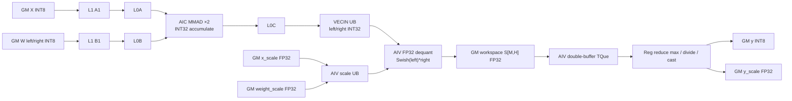

# GroupedMatmulSwigluQuant 950 Direct Invoke 算子知识

## 算子速览

| 项目 | 内容 |
|---|---|
| 实际入口 | `cann_bench::grouped_matmul_swiglu_quant`（Torch schema）→ `grouped_matmul_swiglu_quant_npu` → `calc_grouped_matmul_swiglu_quant_tiling` → `launch_grouped_matmul_swiglu_quant_kernel` |
| 计算语义 | 按累计 `group_list` 做 INT8 GroupedMatmul；INT32 结果乘 FP32 `x_scale`/`weight_scale`，沿 N 二分后做 `Swish(left) * right`，再逐 token 求 `max(abs)/127` 并量化为 INT8。 |
| 输入输出 | 连续 ND `x:[M,K]`、`weight:[E,K,N]`、`weight_scale:[E,N]`、`x_scale:[M]`；输出 `y:[M,N/2]` INT8、`y_scale:[M]` FP32。 |
| 执行类型 | 单 Kernel `MIX_CV`：每个逻辑 block 为 1 个 `AIC_CUBE` 与 2 个 `AIV_VECTOR`；无 SIMT、NDDMA 或通信节点。 |
| Kernel 路线 | P0 / R-001：唯一 active 路线，固定 arch35 INT8/FP32 per-token、RowMajor A/B、ASWT tail-split、`KERNEL_TYPE_MIX_AIC_1_2`；其内保留 L0C DB、L2 hint、空专家、末组 tail split 与 quant 分核等 conditional 分支。 |
| 核心资源 | GM 输入/输出；FP32 SwiGLU workspace；AIC 的 L1/L0A/L0B/L0C；AIC→AIV 的 VECIN UB；AIV 的寄存器和双缓冲 TQue。 |
| 来源闭包 | `direct_implementation_closed`：Torch direct 入口、Host 校验/tiling、POD 与紧凑 launch ABI、MIX entry、Cube/Vector body、workspace、同步、精度、tail、fallback 及捆绑但不可达的 CGMCT 族均已分类。 |
| 证据边界 | 本卡结论来自固定提交的源码闭包；编译可用性、设备执行、数值正确性与性能不由这些源码证据单独证明。 |

## 接口与语义

### 计算语义

令 `r_-1=0`、`r_g=group_list[g]`、`M_g=r_g-r_{g-1}`，`H=N/2`。Direct 路线固定 `groupListType=0`，即累计边界。对每个非空专家：

```text
Z_g = int32_matmul(X[r_{g-1}:r_g, :], W[g, :, :])
L_g = float(Z_g[:, 0:H]) * x_scale[r_{g-1}:r_g, None] * weight_scale[g, 0:H]
R_g = float(Z_g[:, H:N]) * x_scale[r_{g-1}:r_g, None] * weight_scale[g, H:N]
S_g = (L_g / (1 + exp(-L_g))) * R_g
y_scale[row] = max(abs(S_g[row, :])) / 127
y[row, :] = cast_int8(S_g[row, :] / y_scale[row])
```

两次 MMAD 分别计算 N 的左右半部，INT8×INT8 在 INT32 累加；Vector 先转 FP32，再按 `weight_scale` 后 `x_scale` 的顺序反量化，FP32 完成 `exp/div/mul`。`S` 先物化为 workspace 中的 `[M,H]` FP32，所有分组结束并 `SyncAll` 后，逐行求绝对值最大值与 INT8 输出。

### 输入、输出与属性

| 参数 | shape/layout | dtype | 约束、默认值与语义 |
|---|---|---|---|
| `x` | `[M,K]`，连续 ND/RowMajor | INT8 | rank 2；`M,K>0` 由 direct tiler收口。 |
| `weight` | `[E,K,N]`，连续 ND/RowMajor | INT8 | rank 3；K 与 X 一致；Direct 转换固定非转置。 |
| `weight_scale` | `[E,N]`，连续 ND | FP32 | 与专家数和 N 一致；每专家逐通道缩放。 |
| `x_scale` | `[M]`，连续 ND | FP32 | 逐 token 缩放。 |
| `group_list` | Host `int[]`，长度 E | int64 | 累计、非递减、末项必须为 M；`E∈[1,16]`；单组长度不超过 65535；相邻相等表示空组。 |
| `y` | `[M,N/2]`，连续 ND | INT8 | N 必须为正偶数。 |
| `y_scale` | `[M]`，连续 ND | FP32 | 每行 `max(abs(S))/127`。 |
| `workspace` | 一维 byte Tensor | uint8 | `16 MiB + M*(N/2)*4` bytes；前部作为 FP32 SwiGLU 中间结果，额外 16 MiB 保留官方 system-workspace 容量约定。 |

### 入口与版本

这是 Direct Invoke 卡，不是 ACLNN 卡。Torch PrivateUse1 实现创建输出与 workspace，在当前 NPU stream 上通过 `OpCommand::RunOpApi("GroupedMatmulSwigluQuantDirect", callable)` 提交一个 direct kernel。固定转换基于 CANN 9.1.0、ops-transformer Commit `be33d95bb755cedec3108f70805c1874d1792540` 的 `grouped_matmul_swiglu_quant_v2` arch35 per-token CGMCT specialization，目标为 950/Ascend 950、dav-3510。

官方入口接收动态 TensorList `weight/weightScale`、Device `groupList` 和更多量化属性；Direct 入口只接受已连续化的单个 `[E,K,N]`、`[E,N]` Tensor，并把 Host `group_list` 压成四个 uint64。它不执行 TransData、TensorList descriptor 解析、ACLNN executor 构造或通用 tiling-key 分发。官方 README 对 950 公开接口描述的是 MX FP8/FP4 合同；本卡的 INT8/FP32 路线是固定源码内部 per-token body 的 Direct 转换，不应外推为 950 ACLNN 的公开 INT8 支持声明。

## Host/Launcher 执行流程

### 参数校验与前处理

`grouped_matmul_swiglu_quant_meta` 检查 X/weight/scale 的 rank、INT8/FP32 dtype、K/E/N/M 对应关系、N 为正偶数以及 `group_list.size()==E`，并创建 `y:[M,N/2]`、`y_scale:[M]`。NPU 实现再要求四个输入 Tensor 连续；不存在隐式 contiguous 或 TransData。

`calc_grouped_matmul_swiglu_quant_tiling` 拒绝 `M<=0`、`K<=0`、`N<=0/奇数`、空 group、`E>16`，逐项验证累计边界，计算每组差值并把四个 16-bit group size 装入一个 uint64；最后一项不等于 M 或单组大于 65535 均失败。随后查询 AIC/UB/L1/L0C，计算 Cube tiling、`rowLen=N/2`、`ubAvail`、blockDim 和 workspace。

### 参数、Workspace 与生命周期

Host `GMMSQLaunchParams` 按值捕获进 `RunOpApi` callable；launcher 把其中实际 Device 消费的字段重打包为 `meta/dims/tile` 三个 uint64，并连同 7 个 GM pointer 与 4 个 group pack 启动 Kernel，最终 Device launch ABI 为 112 bytes。`TCubeTiling` 不直接穿过 raw launch aggregate ABI，而是在 Device 由三个 scalar pack 重建。

workspace Tensor 的 Host 分配长度是：

```text
H = N / 2
user_fp32 = M * H * sizeof(float)
workspace_total = 16 * 1024 * 1024 + user_fp32
```

当前 direct body 将 workspace 基址直接作为 `[M,H]` FP32 中间区，偏移 `[0,user_fp32)`；代码没有把指针加 16 MiB，因而额外 system-workspace 容量位于未显式切片的剩余区。workspace 的 Host Tensor 活到 callable 完成提交；Device 期间的存活依赖当前 stream 与框架 allocator 的异步生命周期，转换源码未显式 `recordStream`。

### 启动图与失败传播

```text
cann_bench::grouped_matmul_swiglu_quant
  -> grouped_matmul_swiglu_quant_npu / meta validation
    -> calc_grouped_matmul_swiglu_quant_tiling / pack group sizes
      -> allocate y, y_scale, workspace
        -> RunOpApi callable on current stream
          -> launch_grouped_matmul_swiglu_quant_kernel
            -> schemMode=1, blockDim=aicNum
              -> grouped_matmul_swiglu_quant_direct_kernel [MIX_AIC_1_2]
                -> AIC: two INT8 MMAD halves -> L0C -> VECIN
                -> AIV: FP32 dequant + SwiGLU -> GM workspace
                -> SyncAll
                -> AIV: workspace -> per-token quant -> y/y_scale
```

Meta、连续性或 tiling 失败由 `TORCH_CHECK` 在 launch 前终止。平台对象为空、AIC 数为零、UB/L1/L0C 不足也使 tiler 返回 false。launcher 设置 `ACL_RT_LAUNCH_KERNEL_ATTR_SCHEM_MODE=1`；callable 对 launch 本身固定返回 0，未单独检查异步 Kernel launch 状态。空专家在 Device 跳过，但只要最终累计值 M 正确，其余专家继续执行。

## Route 与参数设计

### 分核与资源计算

Host 从原始 M/K/N 推导：

```text
baseM = align_up(min(M,128),16)
baseN = align_up(min(N,256),32)
baseK = align_up(min(K,128),32)
baseA = baseM * baseK bytes
baseB = baseN * baseK bytes
scaleReserve = baseN * sizeof(float)
```

L1 先扣 `scaleReserve`，再由 `GetDepthA1B1Host` 选择 A1/B1 depth；`stepKa=depthA1/2`、`stepKb=depthB1/2`，分别裁到 `ceil(K/baseK)`，并调整为整倍数关系，最终 `depthA1=2*stepKa`、`depthB1=2*stepKb`。`dbL0A=dbL0B=2`；若 `2*baseM*baseN*sizeof(int32)<=L0C_size`，`dbL0C=2`，否则为 1。`usedCoreNum=blockDim=aicNum`。

Vector 行量化使用 `rowLen=N/2`、`alignedRowLen=align_up(rowLen,16)`，`ubAvail=(UB_size-1024)/(alignedRowLen*14)`。实际每次最多处理 `min(ubAvail,255,rows_per_vector_core)` 行；`vectorCoreNum=blockDim*2` 与 MIX 1:2 对应。

### Route 选择

生产 Host 只有一个可达 Route，重要性为 P0。代码包还携带通用 CGMCT 顶层 Kernel、epilogue 和 TileCopy 模板，但“头文件存在”不等于“Host 可选”：本卡先列 active Route，再列其内 conditional 分支，最后给出 dormant 族的不可达证据与重新启用条件。

| 顺序 | Route | Key/模板 | 精确选择条件与优先级 | 不适用去向 |
|---:|---|---|---|---|
| 1 | P0 / R-001 INT8 per-token MIX_CV | 特征：无 runtime tiling key；固定 `RowMajor/RowMajor` CGMCT 与单 Kernel MIX 1:2 实例 | Host 接受域：950、INT8 X/W、FP32 scales、N 正偶数、累计 group list、`1<=E<=16`、单组 `<=65535`、连续 ND且 UB/L1/L0C 可构造 tiling。紧凑 ABI 安全域还要求 M/N/K、`H=N/2`、`ubAvail`、AIC 数与 stage 字段不超过各自 pack 位宽；当前 quant body 的资源安全域还要求 `M>=2*blockDim` | Host 返回失败；无下一 Route 或 Device fallback。Host 已接受但超出 pack 安全域时存在截断/字段串扰；`M<2*blockDim` 时存在 inactive AIV Queue 长度未初始化风险，二者均无自动 fallback |

```text
if schema/shape/dtype/contiguous/group-list invalid: fail before launch
else if AIC/UB/L1/L0C or tiling capacity invalid: fail before launch
else if M < 2*aicNum: Host still launches, but inactive quant AIV initializes Queues from an undefined row count
else if compact fields exceed their encoded widths: Host still launches, but R-001 contract is unsafe
else: P0 / R-001 fixed arch35 per-token MIX_AIC_1_2
```

#### R-001 内部 conditional 分支

下表的分支都不改变 entry、模板实例或输出语义，因此不拆成新 Route ID；它们是 R-001 内必须保留的条件路径。

| 顺序 | 分支 | 触发谓词 | 选中动作 | 否则路径/语义边界 |
|---:|---|---|---|---|
| 1 | C-001 L0C 双缓冲 | `2*baseM*baseN*4 <= L0C_size` | `dbL0C=2` 写入 `meta[47:40]` | `dbL0C=1`；仍是 R-001，仅管线深度不同 |
| 2 | C-002 B L2 one-shot | `M_g<=baseM && N%256==0 && baseN%256==0 && (K<=256 \|\| K>=4096)` | B GM Tensor 设 `CACHE_MODE_DISABLE` | `CACHE_MODE_NORMAL`；中等 K 保留 tail split 间的 B 复用 |
| 3 | C-003 weight-scale L2 one-shot | `M_g<=baseM && N%256==0 && baseN%256==0` | `x2ScaleGlobal_` 设 `CACHE_MODE_DISABLE` | `CACHE_MODE_NORMAL` |
| 4 | C-004 空专家 | `unpack(groupSize[g])==0` | 更新到专家 g 的 W/weight-scale 基址，但不调 scheduler/MMAD/epilogue | 非空组进入 tile 循环；X/x-scale/workspace 只按已消费 token 推进 |
| 5 | C-005 末组 tail split | `g==E-1 && remainTile>1` | 以 M/N 最小切分约束调 `UpdateTailTile` | 保留原 tail tile；若最后一个索引组为空，前一非空组不会补做此优化 |
| 6 | C-006 AIV M 二分 | `subBlockIdx in {0,1}` | sub-block 0 处理 `ceil(singleM/2)` 行，sub-block 1 处理剩余行 | 后半行数为 0 时该 AIV 返回，但仍参与外层 flag 协议 |
| 7 | C-007 quant 行分核 | `M % (2*blockDim)` 决定 `headCoreNum` | active core 每核取 `ceil(M/V)` 或 `floor(M/V)` 行；每批再被 `min(ubAvail,255,rows/core)` 限制 | `M<V` 时存在 inactive AIV，但当前顺序先 `CalParams→InitParams→InitAndSetBuffer`，后检查 `blockIdx>=coreNum`；inactive AIV 的 `multiRowNum_` 未初始化却已用于三处 `InitBuffer` 长度，因此不是安全直返；`V=2*blockDim`，无 fallback |

```text
# R-001 内部分支伪码
dbL0C = 2 if 2*baseM*baseN*4 <= L0C else 1
for g:
  M_g = unpack_u16(groupSizePacks, g)
  advance expert-major W/weight_scale base; advance token-major bases by previous M_g
  if M_g == 0: continue
  B.cache = DISABLE if one_shot_B(M_g,N,K,baseM,baseN) else NORMAL
  Wscale.cache = DISABLE if one_shot_scale(M_g,N,baseM,baseN) else NORMAL
  if g == E-1: split_last_tail_if_profitable()
  run_same_R001_tiles()
partition_quant_rows(V=2*blockDim, batch=min(ubAvail,255,rows_per_core))
# current body: when M<V, inactive AIV reaches Queue initialization with undefined multiRowNum_ before its return guard
```

#### Dormant 族与不可达证据

| 分类 | 捆绑实现 | 生产链不可达原因 | 重新启用的必要条件 |
|---|---|---|---|
| D-001 MX SwiGLU quant | `kernel_gmm_swiglu_mxquant.h`、`block_mmad_mx.h`、`block_epilogue_swiglu_mx_quant.h` | direct translation unit 不 include/不实例化；Host schema 固定 INT8/FP32，也没有 MX scale/POD/key | 扩展 schema、MX tiling/POD/GM 参数，新建明确 selector 与 launcher 分发，并实例化 MX kernel |
| D-002 finalize-routing 族 | `kernel_gmm_finalize_routing*.h`、`block_prologue_finalize_routing.h`、对应 epilogue | 无 routing 索引/计数/deterministic workspace 输入，且无 Host key 或 entry 调用 | 定义 routing 语义、workspace 所有权、POD 与跨核同步，再增加独立 Route |
| D-003 generic GMM/GMM-add | `kernel_grouped_matmul.h`、`kernel_grouped_matmul_add.h`、`block_grouped_matmul_builder.h` | 本入口语义必须融合 dequant、SwiGLU 和逐 token quant；这两个顶层 kernel 未被 include | 只能作为另一逻辑算子/另一 schema路由，不得当作本算子 fallback |
| D-004 QGMM inplace/fixpipe/online-dynamic | `kernel_qgmm_inplace_add*.h`、`block_mmad_fixpipe_dequant.h`、`block_epilogue_dequant.h` | 无 inplace/add 输入、per-tensor dequant 参数或对应 tiling；无 launcher 分支 | 新增独立语义合同、输出别名规则、Host 选择与完整 ABI |
| D-005 QGMM MX/per-tile | `kernel_qgmm_mx.h`、`kernel_qgmm_pertile.h`、`block_mmad_pertile*`、`block_epilogue_pertile.h` | 本 Host 只生成 per-token FP32 scale 路线，无 per-tile/MX 的 scale shape、group type 和 tile POD | 增加 dtype/scale/layout 校验、tiling producer、entry 实例和 selector 优先级 |
| D-006 模板内替代 | `GetTileIdxRowMajor`、其他 `TileCopy` policy、PertokenQuant 的 INT4/FP8/HIF8 分支、DequantSwiglu 的 FP16/BF16 分支 | R-001 的 compile-time type/policy 已固定；没有 runtime 谓词可切换 | 必须形成新的显式模板实例和 Host selector；不能通过改 POD 单字段激活 |

因此，D-001…D-006 只是代码包容量，不是 active/conditional Route，也不是 R-001 失败后的安全兜底。

### 模板/实现执行矩阵

| Route | key/selector | dtype/shape/platform 完整命中条件 | 执行族与 kernel 节点 | 实际模板/body | 内存与同步特征 | tail/fallback |
|---|---|---|---|---|---|---|
| P0 / R-001 | fixed direct specialization | 表中合法域，950/dav-3510；资源安全还要求 `M>=2*blockDim` | 单 Kernel：AIC_CUBE ↔ 两个 AIV_VECTOR；末段仍为同 Kernel AIV | `KernelGmmSwiGluPertokenQuant<MatmulShape,BlockMmadBuilder<int8_t,RowMajor,int8_t,RowMajor,int32_t,RowMajorAlign,float,RowMajor,Shape<_0,_0,_0>,Shape<_0,_0,_0>,GroupedMatmulAswtWithTailSplitScheduler,MatmulMultiBlock<>,TileCopy<DAV3510,CopyInAndCopyOutSplitMWithParams>>,BlockEpilogueDequantSwiglu<Shape<_0,_0,_0>,float,int32_t,float,float,true>,BlockEpiloguePertokenQuant<float,int8_t>,GroupedMatmulAswtWithTailSplitScheduler,float,float>` | AIC/AIV flags 4/20 与 6/22；FP32 workspace；最终 `SyncAll`；量化 TQue 双缓冲 | M/N/K tile tail、末专家 tail split、空组 skip；`M<2*blockDim` 的 inactive AIV 初始化风险无 fallback |

### 性能 Guard

| Guard | Host/Tiling 条件 | Device/资源原因 | 影响 Route | 不满足时去向 | 源码符号 |
|---|---|---|---|---|---|
| Cube base | `M,K,N>0`，base tile 可放入 L1/L0C | 固定 int8 Cube tile 与 FP32 L0C | P0 / R-001 | Host fail | `FillCubeTiling` |
| L1 scale reservation | `L1 > baseN*4` 且剩余 `>=baseA+baseB` | Host 沿用官方 tiler 的 per-channel scale 扣减后再分 A1/B1 depth；当前 Device 的 weight scale 实际走 GM→AIV UB，不得把该保留量解读为 active L1 scale tensor | P0 / R-001 | Host fail | `FillCubeTiling` |
| L0C double buffer | `2*baseM*baseN*4<=L0C_size` | 两阶段 INT32 accumulator | P0 / R-001 | 降为 `dbL0C=1` | `FillCubeTiling` |
| AIV UB 行批 | `ubAvail=(UB-1024)/(align16(H)*14)` | 输入 FP32、INT8 输出、scale 与双缓冲总预算 | P0 / R-001 | `ubAvail==0` 时 Device 行循环不可成立；Host 仅检查 `UB>1024` | `DoOpTilingPertoken` 对应式、`CalParams` |
| inactive quant AIV | 当前实现需 `M>=V=2*blockDim`，使 `coreNum=V`、不存在 inactive AIV | `M<V` 时 inactive AIV 的 `InitParams` 不写 `multiRowNum_`，但后续先据此计算 Queue 长度并执行三次 `InitBuffer`，之后才检查 `blockIdx>=coreNum` | P0 / R-001 | Host 无检查、Device 无安全 fallback；复用时须把 inactive guard 移到所有参数/Queue 初始化之前，或显式初始化安全的零长度状态 | `CalParams`, `InitParams`, `InitAndSetBuffer`, `operator()` |
| dequant 固定 UB | 950 UB 至少覆盖 199680 bytes | 两块 INT32/FP32 VECIN、SwiGLU VECOUT与三个 scale buffer使用固定地址 | P0 / R-001 | 转换 Host没有显式容量 fallback | `BlockEpilogueDequantSwiglu::Init` |
| compact ABI 宽度 | M/N/K 和 rowLen 需 `<=65535`，ubAvail 需 `1..65535`，AIC 数、depth/step 需 `<=255` | raw launch 只传 3 个 uint64 metadata；`dims/tile` 显式截断，`meta` 的 rowLen/ubAvail 还可向高位字段串扰 | P0 / R-001 | 转换源码没有溢出 fallback | `launch_grouped_matmul_swiglu_quant_kernel`, `RebuildCubeTiling` |
| B L2 hint | 单专家 `M_g<=baseM`、`N%256==0`、`baseN%256==0`，且 `K<=256 \|\| K>=4096` | 一次性 B 流关闭 L2；中等 K 保留 cache 供 tail 分片复用 | P0 / R-001 每专家 | normal cache | `UpdateGlobalBuffer` |
| scale L2 hint | `M_g<=baseM && N%256==0 && baseN%256==0` | 一次性 weight_scale 读取 | P0 / R-001 每专家 | normal cache | `SetX2ScaleL2CacheHint` |
| schedule mode | 恒设 `schemMode=1` | MIX 1:2 的配对 AIC/AIV flag 协议要求批调度 | P0 / R-001 | 无替代 launch | `launch_grouped_matmul_swiglu_quant_kernel` |

### POD/ABI

| 结构 | 字段 | 类型/位宽 | ABI 布局 | 单位 | Host/launcher producer | Device consumer | 边界 |
|---|---|---|---|---|---|---|---|
| `GMMSQLaunchParams` | `blockDim` | int64/64 | offset 0 | AIC blocks | `FillCubeTiling=aicNum` | launch grid | >0 |
| 同上 | `groupNum` | uint32/32 | offset 8 | groups | `groupList.size()` | `meta[7:0]` | 1..16 |
| 同上 | `rowLen` | uint32/32 | offset 12 | elements/row | `N/2` | `meta[23:8]`、quant epilogue | Device pack 16 bit |
| 同上 | `ubAvail` | uint32/32 | offset 16 | rows/batch | UB formula | `meta[39:24]`、quant epilogue | Device pack 16 bit |
| 同上 | `groupListType` | uint8/8 | offset 20 | enum | 固定 0 | inactive；Device 构造时写 0 | 仅 cumsum |
| 同上 | `dequantDtype` | uint8/8 | offset 21 | enum | 固定 0 | inactive；模板已固定 float | 不参与 launch |
| 同上 | `quantDtype` | uint8/8 | offset 22 | enum | 固定 2 | inactive；模板已固定 int8 | 不参与 launch |
| 同上 | `reserved` | uint8/8 | offset 23 | reserved | 零初始化 | 不读取 | 必须保持 0 |
| 同上 | `workspaceSize` | size_t/64 | offset 24 | bytes | workspace 公式 | Host allocator | 不传 Device |
| 同上 | `groupSizePacks[4]` | uint64×4 | offset 32..63 | 4×uint16/group | `groupSize << 16*(g%4)` | `GetPackedGroupSize` | 每组 0..65535 |
| 同上 | `cubeTiling[256]` | byte[256], align 8 | offset 64；LP64 推导 `sizeof=320,alignof=8` | POD bytes | `memcpy(TCubeTiling)` | launcher 读取并重打包 | `sizeof(TCubeTiling)<=256` |
| Device args | `x,weight,weightScale,xScale,y,yScale,workspace` | GM pointer×7 | args 0..55 | addresses | launcher | entry/CGMCT | 各 Tensor 生命周期覆盖 stream work |
| Device args | `groupSizePack0..3` | uint64×4 | args 56..87 | group sizes | launch params | `GetPackedGroupSize` | E<=16 |
| Device args | `meta` | uint64 | args 88..95 | packed fields | launcher | entry/Rebuild | group 8b、row 16b、UB 16b、dbL0C 8b、cores 8b；row/UB producer 未先 mask，超宽会串扰高位 |
| Device args | `dims` | uint64 | args 96..103 | packed elements | launcher | `RebuildCubeTiling` | M/N/K 16b、baseM 8b |
| Device args | `tile` | uint64 | args 104..111 | packed tile/stages | launcher | `RebuildCubeTiling` | baseN/baseK 16b；depth/step 8b |
| rebuilt `TCubeTiling` | `M,N,Ka,Kb` | int32 | SDK ABI；本转换不透传结构 | elements | `RebuildCubeTiling(dims)` | Matmul/scheduler | 来自 16-bit pack |
| 同上 | `baseM,baseN,baseK` | int32 | SDK ABI | elements | `RebuildCubeTiling(dims,tile)` | scheduler/Matmul | 16/32/32 对齐 |
| 同上 | `depthA1,depthB1,stepKa,stepKb` | int32 | SDK ABI | stages/K tiles | `RebuildCubeTiling(tile)` | Matmul pipeline | 8-bit pack |
| 同上 | `dbL0A,dbL0B,dbL0C` | int32 | SDK ABI | stages | 2、2、`meta` | L0 pipeline | dbL0C 1/2 |
| 同上 | `usedCoreNum` | int32 | SDK ABI | AIC cores | `meta[55:48]` | scheduler/Matmul | 8-bit pack |

`GMMSQLaunchParams` 的数字布局按声明和 LP64 对齐规则推导；固定转换源码没有单独的 `offsetof` 静态断言，因此这些布局值属于声明推导边界，不构成跨编译器或跨 SDK 的 ABI 兼容性保证。

```text
meta = groupNum | (rowLen<<8) | (ubAvail<<24) | (u8(dbL0C)<<40) | (u8(usedCoreNum)<<48)
dims = u16(M) | (u16(N)<<16) | (u16(K)<<32) | (u8(baseM)<<48)
tile = u16(baseN) | (u16(baseK)<<16) | (u8(depthA1)<<32) | (u8(depthB1)<<40)
     | (u8(stepKa)<<48) | (u8(stepKb)<<56)

Device: mask/unpack -> rebuild TCubeTiling
```

`dims/tile` 的 producer 显式转为 `uint16_t/uint8_t`，因而超宽是截断；`meta` 中 `rowLen` 和 `ubAvail` 直接左移，超过 16 bit 时不仅 consumer 截断本字段，还可改写相邻高位。这是 launcher contract，不是可由 Device 自动修正的 tail。

### Route 源码闭包

| Route | Key/selector | Host/Tiling producer | POD/参数 | Kernel entry/router | Kernel body/直接依赖 | 构建接线 |
|---|---|---|---|---|---|---|
| P0 / R-001 | fixed arch35 per-token | `grouped_matmul_swiglu_quant_plugin.cpp::grouped_matmul_swiglu_quant_npu`；`grouped_matmul_swiglu_quant_kernel.cpp::FillCubeTiling/calc_*` | `GMMSQLaunchParams` → 7 pointers + 4 packs + `meta/dims/tile` | `grouped_matmul_swiglu_quant_direct_kernel` → `RunOfficialPertokenRoute` | `KernelGmmSwiGluPertokenQuant`；`BlockMmadBuilder/MatmulMultiBlock`；ASWT scheduler；dequant-SwiGLU 与 per-token quant epilogues | conversion operator CMake；官方 `gmm/grouped_matmul_swiglu_quant_v2/CMakeLists.txt` 为对应算子构建映射 |

## Kernel 实现

### 公共执行流程

只有 P0 / R-001。entry 声明 `KERNEL_TYPE_MIX_AIC_1_2`，保存 overflow control SPR 60、临时设为 0，重建 `TCubeTiling` 并实例化固定 CGMCT 模板。AIC 与 AIV 共享同一个参数对象和 tiling，但通过 `ASCEND_IS_AIC/AIV` 分支执行不同 body。

每专家由 ASWT 在 `[M_g,H]` tile 域分配工作。AIC 对同一 X tile 先计算 W 左半部、再计算右半部，结果通过 Matmul `TPosition::VECIN`/`CopyInAndCopyOutSplitMWithParams` 落到两块 AIC→AIV UB。两个 AIV sub-block 各处理 M tile 的一半，反量化并做 SwiGLU，写 FP32 workspace。最后一次 AIC/AIV 握手完成后 `SyncAll`，AIV 按全局行域重新分核，从 workspace 做逐 token 量化；AIC 不执行这一尾段。

### Route R-001：P0 INT8 per-token MIX_CV

#### 适用条件

##### 选择证据

| 层级 | 文件 | 符号 | 源码谓词/参数 | 结果/下一跳 |
|---|---|---|---|---|
| Direct Host | `op_plugin/grouped_matmul_swiglu_quant_plugin.cpp` | `grouped_matmul_swiglu_quant_meta/npu` | rank、dtype、shape、N even、continuous | 进入 tiler或抛错 |
| Tiling | `op_kernel/grouped_matmul_swiglu_quant_kernel.cpp` | `calc_grouped_matmul_swiglu_quant_tiling` | cumsum、E<=16、group size<=65535、末项=M、资源合法 | 固定 params 或 false |
| Launcher | 同上 | `launch_grouped_matmul_swiglu_quant_kernel` | 无 key；`schemMode=1`、grid=aicNum | 单 MIX kernel |
| Router | 同上 | `RunOfficialPertokenRoute` | compile-time INT8/FP32、RowMajor A/B、DAV3510 | 固定 `QGmmKernel` |
| Device | `cgmct/kernel/kernel_gmm_swiglu_pertoken_quant.h` | `operator()/ProcessSingleGroup` | 非空专家、ASWT tile 可达 | Cube↔Vector；结束后 quant |

#### Device 数据流

##### 函数级调用链

```text
grouped_matmul_swiglu_quant_direct_kernel
  -> RebuildCubeTiling
  -> RunOfficialPertokenRoute
    -> KernelGmmSwiGluPertokenQuant::operator()
      -> UpdateGroupParams / ProcessSingleGroup
        -> BlockSchedulerGmmAswtWithTailSplit::GetTileIdx/GetBlockShape
        -> AIC: BlockMmad::operator() [left] -> l0cOutUbFirst
        -> AIC: BlockMmad::operator() [right] -> l0cOutUbSecond
        -> CrossCore flags
        -> AIV: BlockEpilogueDequantSwiglu::operator() -> workspace FP32
      -> End -> SyncAll
      -> AIV: BlockEpiloguePertokenQuant::operator() -> y/y_scale
```

##### Launch 节点与核/任务映射

| 节点 | grid/任务类型 | 索引映射 | 实际职责 | 生命期/结束点 |
|---|---|---|---|---|
| Host launch | `grid=blockDim=aicNum`，`schemMode=1` | 当前 stream 上提交一个 MIX entry | 传 7 个 GM 指针、4 个 group pack、3 个 metadata scalar | launcher 没有追加同步；后续存活依赖 stream ordering |
| AIC task | `KERNEL_TYPE_MIX_AIC_1_2` 中每个 logical block 的 1 个 Cube task | scheduler 用 `GetBlockIdx()/GetTaskRation()` 得到 logical block | 两次 MMAD、L0C→两块 VECIN、生产 flag 4/20，等待 flag 6/22 | 最后一 tile 仍等 AIV；`SyncAll` 后不做 quant |
| AIV task 0/1 | 每 logical block 的 2 个 Vector task | scheduler 映射到同一 logical block；`GetSubBlockIdx()` 为 0/1 | 分担 tile 的前/后 M 半，读共享 VECIN，写 workspace，回 flag 6/22 | 所有专家结束后到 `SyncAll` |
| final AIV quant | 仍在同一 MIX entry | 使用物理 Vector `GetBlockIdx()`，因而行域分给 `2*blockDim` 个 AIV | workspace GM→TQue→VF reduce/div/cast→y/y_scale GM | 行域结束即返回；无第二 kernel/event |

`GetTaskRation()` 和 `GetSubBlockIdx()` 是 tile 阶段把 1 AIC 与 2 AIV 配对的核心；final quant 则故意不再除以 task ratio，以便两个 AIV 获得不同行片。

##### 源码等价伪码

```text
# 伪码；保持源码阶段顺序
rebuild mmTiling(meta,dims,tile)
for g in [0,E):
  M_g = unpack_u16(groupPack[g/4], g%4)
  W_base = g*K*N; Wscale_base = g*N
  token_base = sum(groupSize[0:g])
  X_base = token_base*K; Xscale_base = token_base; workspace_base = token_base*H
  if M_g == 0: continue
  scheduler.update([M_g,H,K])
  if g == E-1: scheduler.update_tail_tile()
  for tile in scheduler:
    if AIC:
      if not first tile: wait flags 6 and 22 from two AIV
      C0 = mmad_int8(X_tile, W_left_tile)   # int32 L0C -> first VECIN UB
      C1 = mmad_int8(X_tile, W_right_tile)  # int32 L0C -> second VECIN UB
      set flags 4 and 20
    if AIV:
      wait flag 4 for paired AIC
      load weight_scale halves and x_scale rows GM->UB
      S_tile = swish(float(C0)*wscale0*xscale) * (float(C1)*wscale1*xscale)
      copy S_tile UB->workspace GM
      set flags 6 and 22
AIC waits final AIV completion
SyncAll()
if AIV:
  partition M rows across blockDim*2 vector cores
  for row batch:
    workspace GM -> double-buffered UB
    scale = reduce_max(abs(row))/127
    y = cast_int8(row/scale)
    UB -> y GM and y_scale GM
restore overflow SPR
```

#### 内存与数据搬运

##### 资源与搬运表

| 层级/缓冲区 | offset/地址公式 | extent/容量公式 | dtype/layout | producer | consumer | owner/lifetime | 对齐/复用 |
|---|---|---|---|---|---|---|---|
| GM X | `rowStart_g*K + tile_m*K` | `[M,K]` | INT8 RowMajor | caller | AIC MTE2/Matmul | input Tensor；全 Kernel | K tail 由 Matmul tiling |
| GM W | `g*K*N + tile_n`；右半再 `+H` | `[E,K,N]` | INT8 RowMajor | caller | AIC MTE2/Matmul | input Tensor；全 Kernel | baseK 32、baseN 32 对齐 |
| GM scales | X：`rowStart_g+tile_m`；W：`g*N+tile_n` 与 `+H` | X `[M]`、W `[E,N]` | FP32 ND | caller | AIV MTE2 | inputs；dequant阶段 | W scale tile `singleN*4` bytes |
| L1 A1 | Matmul内部 | `depthA1*baseM*baseK` bytes | INT8 | GM X | L0A | Matmul pipeline | depth=2*stepKa |
| L1 B1 | Matmul内部 | `depthB1*baseN*baseK` bytes | INT8 | GM W | L0B | Matmul pipeline | depth=2*stepKb；Host 预算额外扣 `baseN*4`，但 active scale 不驻留 L1 |
| L0A | Matmul内部 | `2*baseM*baseK` bytes | INT8 | L1 A1 | MMAD | AIC tile | double buffer |
| L0B | Matmul内部 | `2*baseN*baseK` bytes | INT8 | L1 B1 | MMAD | AIC tile | double buffer |
| L0C | Matmul内部 | `dbL0C*baseM*baseN*4` bytes | INT32 RowMajorAlign | MMAD | CopyCo1ToOut | AIC tile | dbL0C 1/2 |
| VECIN first/second | fixed offsets 0、`16384*4` | 各 `64*256*4=65536` bytes | INT32；随后同地址解释 FP32 | AIC CopyCo1ToOut | 两个 AIV | 单 tile；flag 保护 | 两块共 128 KiB；dequant原地复用 |
| AIV SwiGLU VECOUT | offset 128 KiB | `64*256*4=65536` bytes | FP32 | Vector registers | MTE3 | 单 tile | 后接 3 个 256×FP32 scale buffer |
| scale UB | 192 KiB 后顺排 | `3*256*4=3072` bytes | FP32 | GM scales | Vector dequant | 单 tile | left/right W scale + X scale |
| GM workspace S | `(rowStart_g*H)+tileOffset` | `M*H*4` bytes | FP32 RowMajor | AIV SwiGLU | AIV per-token quant | workspace Tensor；两阶段之间 | 有效前缀；无专家间重叠 |
| quant inQueue | active core 的 GM base 按 head/tail 行划分 | `2*multiRow*align8(H)*4` bytes | FP32 | workspace GM | Vector registers | quant loop | active core 为 TQue depth 2；`M<V` 时 inactive core 的 `multiRow` 未初始化却先用于该长度 |
| quant outQueue | 同一 active 行域 | `2*multiRow*align32(H)` bytes | INT8 | Vector registers | y GM | quant loop | active core 为 TQue depth 2；inactive core 同样先执行未定义长度的 `InitBuffer` |
| quant scaleQueue | active core 的每批行 | `2*align8(multiRow)*4` bytes | FP32 | ReduceMax | y_scale GM | quant loop | active core 为 TQue depth 2；inactive core 同样先执行未定义长度的 `InitBuffer` |
| 寄存器 | 每 VF repeat | vector register width | FP32/INT16/FP16/INT8 | UB load | UB store | 单 repeat | mask 保护 H tail |

##### 分层内存布局



##### 字节账、交接边与复用顺序

```text
H = N/2
workspace_total = 16 MiB + M*H*4
Host_L1_budget = depthA1*baseM*baseK + depthB1*baseN*baseK + baseN*4
active_L1_payload = depthA1*baseM*baseK + depthB1*baseN*baseK
L0 = 2*baseM*baseK + 2*baseN*baseK + dbL0C*baseM*baseN*4
dequant_UB = 2*(64*256*4) + (64*256*4) + 3*(256*4) = 199680 bytes
quant_UB = 2*multiRow*align8(H)*4 + 2*multiRow*align32(H) + 2*align8(multiRow)*4
```

| 边/复用子区 | producer | offset/extent | dtype/layout | consumer | ordering/sync | owner/lifetime | 安全条件 |
|---|---|---|---|---|---|---|---|
| AIC→AIV first half | first MMAD | VECIN offset 0，`singleM*singleN*4` logical | INT32 RowMajorAlign | AIV dequant left | flags 4/20；AIV wait 4 | MIX shared local buffer；一 tile | 下次 AIC 覆盖前等 flags 6/22 |
| AIC→AIV second half | second MMAD | VECIN offset 65536，等量 | INT32 RowMajorAlign | AIV dequant right | 同上 | 同上 | `singleM/2<=64`、`singleN<=256` |
| dequant→SwiGLU | AIV dequant | 同两块 UB 原地转 FP32 | FP32 | AIV SwiGLU | MTE2_V hard event | AIV tile | scale copy 完成且 mask 有效 |
| SwiGLU→workspace | AIV MTE3 | `(row*H+col)*4` | FP32 RowMajor | final quant | per tile V_MTE3；全局 `SyncAll` | workspace Tensor | 每 tile disjoint；全生产完成后读取 |
| workspace→quant queues | final AIV | active head/tail core 连续行片 | FP32 | ReduceMax/quant | TQue EnQue/DeQue | quant phase | active core 的 tail batch 单独处理；`M<V` 时 inactive guard 晚于 Queue 初始化，资源边界未闭合 |
| dequant UB→quant UB 复用 | dequant epilogue | 同一物理 UB 空间 | phase-dependent | quant TPipe queues | AIC final wait + `SyncAll` | 单 Kernel | 所有 workspace 写完才重新 InitBuffer |

#### 同步、精度与尾块

##### 同步与数值边界表

| 阶段 | primitive/机制 | producer | consumer/等待点 | 保护对象 | 精度/尾块 |
|---|---|---|---|---|---|
| AIC→2×AIV | `CrossCoreSetFlag<SYNC_AIC_AIV_MODES,PIPE_FIX>(4/20)` | 两次 MMAD+CopyCo1ToOut | AIV `CrossCoreWaitFlag<SYNC_AIC_AIV_MODES,PIPE_V>(4)` | 两块 VECIN UB | INT32 accumulator；M/N/K tail由 Matmul |
| 2×AIV→AIC | AIV逻辑 flag 6/22 | 两个 AIV epilogue | AIC `CrossCoreWaitFlag<SYNC_AIC_AIV_MODES,PIPE_FIX>(6/22)` 或 `End` | 防止 UB 提前覆盖 | AIV 以 subBlockIdx 二分 M；空半块直接返回 |
| GM scale→Vector | `MTE2_V` hard event | MTE2 | dequant VF | scale UB | INT32→FP32 `CAST_RINT`，再乘 FP32 scales |
| Vector→GM workspace | `V_MTE3`、随后 `MTE3_V/V_MTE2` | SwiGLU VF | MTE3/下一搬运 | FP32 S tile | `exp/div/mul` 均 FP32；N tail mask |
| 两大阶段 | AIC final `WaitForVector` + `SyncAll` | 全部 SwiGLU tiles | per-token quant | workspace 完整可见与 UB phase reuse | 空专家不写；总体 M 由 pack 累加 |
| per-token quant | TQue depth 2 + VF masks | workspace MTE2 | ReduceMax/Div/Cast/MTE3 | 行批 | `scale=maxabs/127`；F32→I16 RINT→FP16 ROUND→I8 TRUNC，NO_SAT；H tail padding/mask |
| kernel 范围 | SPR 60 save/set(0)/restore | entry | 全 body/return | float overflow behavior | 没有单独的零行 `scale=0` 分支；固定源码行为保留 |

##### 精度顺序与 tail 落点

```text
# 对每个有效 (row,col)，顺序不可交换
i32_left  = MMAD_i8_i8_acc_i32(X[row,:], W[g,:,col])
i32_right = MMAD_i8_i8_acc_i32(X[row,:], W[g,:,H+col])
f_left  = cast_f32_rint(i32_left)  * weight_scale[g,col]   * x_scale[row]
f_right = cast_f32_rint(i32_right) * weight_scale[g,H+col] * x_scale[row]
s = (f_left / (1.0 + exp(-f_left))) * f_right
scale = reduce_max(abs(pad_zero(s, align8(H)))) * (1.0/127.0)
q = cast_i8_trunc(cast_f16_round(cast_i16_rint(s / scale)))
store q[0:H], scale
```

- K tail 由 Matmul 的 runtime `TCubeTiling` 和 ND→NZ copy 处理；M/N tile tail 由 `GetBlockShape` 给出实际 `singleM/singleN`。
- AIV tile 内，N tail 通过 VF `UpdateMask` 保护；M 为奇数时前 AIV 处理 `ceil(Mtile/2)`、后 AIV 处理剩余行。
- final quant 的 FP32 输入行 pad 到 8 元素，pad 值为 0；INT8 输出 UB 行 stride pad 到 32 元素，GM copy 只写 H 个有效元素。
- INT32→FP32 在大累加值上可发生 FP32 舍入；后续 scale/SwiGLU 始终为 FP32。量化链使用 `NO_SAT`，安全性依赖有限非零 scale 使归一化值位于 INT8 范围内。
- 全零行会得到 `scale=0`，源码没有 epsilon、零除或 NaN/Inf 专用分支；不得为其补造确定 INT8 值。

#### 关键实现

##### 符号证据表

| 阶段 | 文件 | 符号/模板实例 | 实现事实 |
|---|---|---|---|
| Host/Tiling producer | `op_kernel/grouped_matmul_swiglu_quant_kernel.cpp` | `FillCubeTiling`, `calc_grouped_matmul_swiglu_quant_tiling` | tile/depth/UB/workspace/group pack |
| Kernel entry/router | 同上 | `grouped_matmul_swiglu_quant_direct_kernel`, `RunOfficialPertokenRoute` | MIX 1:2 与唯一模板实例 |
| Cube body | `gmm/common/cgmct/block/block_mmad_builder.h`、`block_mmad_multi_block.h` | `BlockMmadBuilder`, `MatmulMultiBlock<>` | GM→L1/L0→INT32 L0C→VECIN |
| MIX orchestration | `gmm/common/cgmct/kernel/kernel_gmm_swiglu_pertoken_quant.h` | `ProcessSingleGroup`, `NotifyVector/Cube`, `End` | 两半 MMAD、flags、workspace阶段、SyncAll |
| Vector epilogues | `gmm/common/cgmct/epilogue/block_epilogue_dequant_swiglu.h`、`block_epilogue_pertoken_quant.h` | `VFDoPertokenDequantAndSwiglu`, `ComputeScaleVF/ComputeYVF` | FP32 dequant/SwiGLU 与逐行 INT8 quant |
| Scheduler | `gmm/common/cgmct/block/block_scheduler_gmm_aswt_with_tail_split.h` | `UpdateNextProblem`, `UpdateTailTile`, `GetTileIdx` | ASWT window、轮转专家起始 core、最后专家 tail split |

## 算子特定优化

### Trick T-001：两次 Cube MMAD 与 Vector epilogue 在单个 MIX Kernel 内交接

#### 触发与源码依据

- 适用 Route：P0 / R-001。
- 触发条件：固定 `KERNEL_TYPE_MIX_AIC_1_2`、RowMajor INT8 per-token specialization，当前 tile 非空。
- 固定源码来源：[`gmm/common/cgmct/kernel/kernel_gmm_swiglu_pertoken_quant.h:301`](../../../../../../../cann-ops-raw/ascendc/ops-transformer/be33d95bb755cedec3108f70805c1874d1792540/gmm/common/cgmct/kernel/kernel_gmm_swiglu_pertoken_quant.h#L301-L316)

**官方源码（固定 Commit 连续逐字摘录）**：

```cpp
            if ASCEND_IS_AIC {
                if (isVecSetSyncCom_) {
                    WaitForVector();
                }
                AscendC::Std::tuple<int32_t, int32_t, int32_t> mmSingleShape{Get<M_VALUES>(singleShape),
                                                                             Get<N_VALUES>(singleShape), k};
                // left block
                mmadOp_(aGlobal_[Get<INDEX_A_OFFSET>(blockOffset_)], bGlobal_[Get<INDEX_B_OFFSET>(blockOffset_)],
                        l0cOutUbFirst_, mmSingleShape, transA, transB);
                // right block
                int64_t bRightOffset = Get<INDEX_B_OFFSET>(blockOffset_);
                ComputeOffset(bRightOffset, n, k);
                mmadOp_(aGlobal_[Get<INDEX_A_OFFSET>(blockOffset_)], bGlobal_[bRightOffset], l0cOutUbSecond_,
                        mmSingleShape, transA, transB);
                NotifyVector();
            }
```

#### 机制与设计原因

当前实例把 Matmul C 类型设为 `TPosition::VECIN` 的 INT32，而非先写 GM。AIC 对左右 N 半区各做一次 MMAD；配对的两个 AIV 在同一 launch 内直接消费共享 local buffer，完成 FP32 dequant 与 SwiGLU。flags 4/20 和 6/22形成生产、消费、再覆盖闭环，消除了 INT32 `[M,N]` 中间 GM 物化。

#### 迁移边界

- 适用：AIC 产生两个等宽门控分支、AIV 紧接非线性 epilogue 的 arch35 MIX 路线。
- 前提：N 为偶数，AIC:AIV=1:2，`schemMode=1`，两块 VECIN 容量覆盖每个 tile，模板 C 类型/布局与 AIV 读取一致。
- 失效：AIC-only launch、比例不同、N 不可二分、C 输出到 GM 或 flags 编号/轮次改变时必须重建交接协议。
- 证据边界：该协议由固定源码的模板实例、flag 与调用顺序闭合；不同 SDK、entry 或 schedule 配置不在其证明域。

#### 错误做法

只保留 `NotifyVector` 而删除 AIC 对 flags 6/22 的等待会允许下一 tile 覆盖仍被两个 AIV 消费的 UB；只启动 AIC 或关闭 schedule mode 1 会使配对等待无法闭合。

### Trick T-002：FP32 SwiGLU workspace 与全局逐 token 量化分阶段复用 AIV

#### 触发与源码依据

- 适用 Route：P0 / R-001。
- 触发条件：`dequantDtype=float`、最终输出 INT8、所有专家 SwiGLU tile 已写 workspace。
- 固定源码来源：[`gmm/common/cgmct/epilogue/block_epilogue_pertoken_quant.h:197`](../../../../../../../cann-ops-raw/ascendc/ops-transformer/be33d95bb755cedec3108f70805c1874d1792540/gmm/common/cgmct/epilogue/block_epilogue_pertoken_quant.h#L197-L205)

**官方源码（固定 Commit 连续逐字摘录）**：

```cpp
    uint32_t rowNum = realM;
    uint32_t vectorCoreNum = uint32_t(GetBlockNum() * GetTaskRation());
    headCoreNum_ = rowNum % vectorCoreNum;
    rowPerHeadCore_ = (rowNum + vectorCoreNum - 1U) / vectorCoreNum;
    rowPerTailCore_ = rowNum / vectorCoreNum;
    coreNum_ = vectorCoreNum < rowNum ? vectorCoreNum : rowNum;
    coreNum_ = coreNum_ > 1 ? coreNum_ : 1;
    multiRowNumHeadCore_ = min(params_->ubAvail, min(COMPARE_INT, rowPerHeadCore_));
    multiRowNumTailCore_ = min(params_->ubAvail, min(COMPARE_INT, rowPerTailCore_));
```

#### 机制与设计原因

SwiGLU 后先写 `[M,H]` FP32 workspace，使逐行 `ReduceMax(abs)` 能在完整行上计算统一 scale。`SyncAll` 把 tile 级 MIX 阶段和全局行量化阶段隔开；随后同一批 AIV 按 `blockDim*2` 划分 head/tail 行，`ubAvail` 与 255 上限约束每批行数，三个 depth-2 TQue 覆盖 GM copy、VF 与 copy-out。

#### 迁移边界

- 适用：非线性结果需要按完整行生成单 scale 的 per-token quant。
- 前提：workspace 至少 `M*H*4` bytes，阶段间存在全局可见性，行域连续，UB 公式与实际 TQue dtype/对齐一致；复用行分核代码时还须把 inactive guard 放到任何参数/Queue 初始化之前，或显式初始化可供三处 `InitBuffer` 使用的安全零长度状态。
- 失效：per-tile scale、不同输出量化格式或跨 Kernel 实现必须重新定义 workspace 边与 stream/event ordering。
- 证据边界：该分阶段语义由固定源码的 workspace 写回、`SyncAll` 与量化读回顺序闭合；替代资源配置不在其证明域。

#### 错误做法

在某个 SwiGLU tile 写完后立即对该 tile独立求 scale 会改变逐 token 全行量化语义；删除 `SyncAll` 会让 quant 读取尚未完成的 workspace 行。

### Trick T-003：仅最后专家启用 ASWT tail tile 再拆分

#### 触发与源码依据

- 适用 Route：P0 / R-001。
- 触发条件：`groupIdx+1==groupNum`；剩余空闲 core 足以使 `remainTile>1`。
- 固定源码来源：[`gmm/common/cgmct/block/block_scheduler_gmm_aswt_with_tail_split.h:151`](../../../../../../../cann-ops-raw/ascendc/ops-transformer/be33d95bb755cedec3108f70805c1874d1792540/gmm/common/cgmct/block/block_scheduler_gmm_aswt_with_tail_split.h#L151-L176)

**官方源码（固定 Commit 连续逐字摘录）**：

```cpp
        int64_t remainTile = (AscendC::GetBlockNum() - endBlockIdx_ - 1) / GetTailTileCnt() + 1;
        if (remainTile <= 1) {
            return;
        }

        // Initialize the minimum tile sizes.
        int64_t mMin = AscendC::BLOCK_CUBE;
        int64_t nMin = AscendC::BLOCK_CUBE;

        // Adjust the minimum tile sizes based on the A/B transpose layout.
        if constexpr (TransA_) {
            mMin = INNER_AXIS_MIN_SPLIT_VAL;
        }
        if constexpr (!TransB_) {
            nMin = INNER_AXIS_MIN_SPLIT_VAL;
        }
        int64_t mTile = Min(CeilDiv(mBaseTail_, mMin), remainTile);
        int64_t nTile = Min(CeilDiv(nBaseTail_, nMin), remainTile);
        while (mTile * nTile > remainTile) {
            if (mTile >= nTile) {
                mTile -= 1;
            } else {
                nTile -= 1;
            }
        }
        UpdateTailTile(mTile, nTile);
```

#### 机制与设计原因

ASWT 在多个专家间轮转起始 core；提前拆某一专家尾块会破坏后续专家复用的 rotating window。Direct body只在最后专家调用官方 `UpdateTailTile()`，此时已无后继专家，可把末轮 M/N tail 拆给原本空闲 core；`GetBlockShape` 仍按实际剩余 M/N 截断，并把 split offset纳入 X/W/workspace 地址。

#### 迁移边界

- 适用：最后一个非后继复用阶段的 ASWT grouped Matmul。
- 前提：scheduler 的 `endBlockIdx_`、tail count、M/N 最小切分对齐与 `GetBlockShape` 同步更新。
- 失效：后面仍有共享同一 rotating window 的专家、transpose 改变 inner-axis 最小切分，或输出 offset未包含 split offset时不能直接复用。
- 证据边界：尾块策略由固定源码的末专家条件与 ASWT 状态更新闭合；其它 scheduler 或分组约定不在其证明域。

#### 错误做法

对每个专家无条件调用 tail split 会占用后续专家预期的 core window；只扩大 `endBlockIdx_` 而不更新 tile 到 split offset 的映射会产生覆盖或漏算。

## 模板与实现对比

| 对比维度 | P0 / R-001 INT8 per-token MIX_CV | 设计选择依据 |
|---|---|---|
| 命中条件/优先级 | P0；唯一 Direct route；Host 合法域通过即命中 | Direct 接口固定该 dtype/layout/量化合同，不保留官方多 dtype/key router |
| 执行族/节点图 | 单 Kernel AIC_CUBE↔2×AIV_VECTOR，随后同 Kernel AIV quant | `KERNEL_TYPE_MIX_AIC_1_2` 与交叉核 flags |
| M/N/K、tile 与 scheduler | baseM<=128、baseN<=256、baseK<=128；ASWT + last-group tail split | arch35 basic tiling 与 CGMCT specialization |
| workspace/L1/L0/UB | FP32 `[M,N/2]` workspace；A1/B1 depth；L0 double buffer；dequant/quant UB phase reuse | SwiGLU tile与全行 scale 的语义边界 |
| AIC/AIV 或 kernel 交接 | VECIN 两块 INT32 local buffer，flags 4/20、6/22 | 避免 INT32 GM 中间结果且防止覆盖 |
| 同步、精度与 tail | schedule mode 1、hard events、SyncAll；INT32→FP32→INT8；M/N/K/VF tail | 固定官方 body 顺序 |
| fallback/失败边界 | Host fail，无第二 Route或 Device fallback | Direct ABI只为该 specialization构造 |

## 平台差异

| 项目 | A2 | A3 | 950 |
|---|---|---|---|
| 支持状态 | 官方公开算子有 INT8 A8W8 描述；固定源码未提供本 Direct 目标或兼容性合同 | 官方公开算子有 INT8 A8W8 描述；固定源码未提供本 Direct 目标或兼容性合同 | 本卡 Direct 目标为 Ascend 950/dav-3510；官方 README 的 950 公开合同仅列 MX FP8/FP4，故不得把本路线声明为 ACLNN INT8 支持 |
| Host/Launcher | 固定仓未提供本 Direct launcher | 固定仓未提供本 Direct launcher | compact 112-byte ABI、schemMode=1、blockDim=aicNum |
| Kernel/资源 | 本卡不外推 | 本卡不外推 | DAV3510 TileCopy、MIX_AIC_1_2、arch35 tiling、950 UB/L1/L0C 查询 |

## 限制与失败边界

- Direct 语义固定 INT8 X/W、FP32 scales、RowMajor non-transpose、cumsum group list、INT8 per-token output；官方其它 dtype、NZ/ZN、transpose、MX、bias、smoothScale、稀疏 group list与确定性 router均不在本卡 Route。
- `E<=16`、每组 token 数 `<=65535`；N 必须正偶数。compact ABI 还要求 M/N/K 与 rowLen 可装入 16 bit，ubAvail 可装入非零 16 bit，AIC 数和 depth/step 可装入 8 bit。Host没有完成这些上界检查；`dims/tile` 会截断，`meta` 还有字段串扰风险。
- Host仅检查输入连续性，没有完成通用 device一致性、workspace 尺寸乘法溢出、固定 199680-byte dequant UB 容量与 `ubAvail>0` 检查；这些是调用方边界。
- Host 未约束 `M>=2*blockDim`。当 `M<2*blockDim` 时，inactive quant AIV 在 return guard 前以未初始化的 `multiRowNum_` 派生并提交三段 TQue 长度；当前 Route 对该输入域没有资源安全证明，也没有 Host/Device fallback。复用时必须前移 guard 或显式建立安全零长度初始化。
- workspace 有效 FP32中间区从基址开始；额外 16 MiB未在 direct body中显式偏移或消费，不得按官方 `GetUserWorkspace` 假设重排。
- AIC/AIV flag ID、1:2比例与 schemMode 1是 correctness协议，不是可独立调整的性能参数。
- tail split 只对 `groupIdx==E-1` 调用；累计 group list 若以空组结尾，最后非空组仍保持未拆 tail，这是调度性能边界，不改语义。
- `scale=max(abs)/127` 对全零行没有单独分支；浮点除零/转换行为按固定 Kernel与 overflow控制执行，本卡不补造数值结果。
- launcher callable固定返回 0，不独立传播异步 launch错误；workspace没有显式 `recordStream`，生命周期依赖框架当前 stream allocator规则。
- 官方 950公开文档与此 Direct INT8内部路线边界不同；禁止用本卡代替 ACLNN产品/数据类型支持表。
- 固定源码中的 `TCubeTiling` 真实 `sizeof/alignof/offsetof` 属 CANN SDK ABI边界；本卡只闭合 direct重建字段，不把声明推导外推为编译器、设备执行、数值或性能保证。

## 源码索引

### 链路索引

| 链路阶段 | 文件 | 关键符号 | 支撑内容 |
|---|---|---|---|
| 公开语义/平台边界 | `gmm/grouped_matmul_swiglu_quant_v2/README.md` | A8W8公式、产品支持与 dtype约束 | 语义及 Direct/ACLNN边界 |
| 官方入口声明 | `gmm/grouped_matmul_swiglu_quant_v2/op_api/grouped_matmul_swiglu_quant_v2.h` | `GroupedMatmulSwigluQuantV2` | TensorList、属性与 executor合同 |
| Kernel router | `gmm/grouped_matmul_swiglu_quant_v2/op_kernel/grouped_matmul_swiglu_quant_v2_apt.cpp` | `GmmSwigluAswtPertoken` branch | FP32 xScale命中 per-token RowMajor route |
| 当前官方实例 | `gmm/grouped_matmul_swiglu_quant_v2/op_kernel/arch35/grouped_matmul_swiglu_quant_v2_pertoken_quant.h` | `GmmSwigluAswtPertokenKernel` | 完整 template/type traits/参数顺序 |
| Host/Tiling | `gmm/grouped_matmul_swiglu_quant_v2/op_host/op_tiling/arch35/grouped_matmul_swiglu_quant_v2_basic_tiling.cpp` | `DoLibApiTiling`, `DoOpTilingPertoken`, `GetWorkspaceSize`, `PostTiling` | baseM clamp、UB、workspace、schedule mode |
| MIX orchestration | `gmm/common/cgmct/kernel/kernel_gmm_swiglu_pertoken_quant.h` | `KernelGmmSwiGluPertokenQuant` | 分组、两半 MMAD、flags、SyncAll |
| Cube specialization | `gmm/common/cgmct/block/block_mmad_builder.h` | `BlockMmadBuilder` | GM type/layout、VECIN C、Matmul策略 |
| Cube body | `gmm/common/cgmct/block/block_mmad_multi_block.h` | `BlockMmad` 的 `MatmulMultiBlock<>` specialization | Matmul初始化、GM输入、L0C到VECIN输出 |
| Scheduler | `gmm/common/cgmct/block/block_scheduler_gmm_aswt_with_tail_split.h` | `BlockSchedulerGmmAswtWithTailSplit` | ASWT与 tail split |
| Vector epilogue 1 | `gmm/common/cgmct/epilogue/block_epilogue_dequant_swiglu.h` | `BlockEpilogueDequantSwiglu` | scale搬运、FP32 dequant/SwiGLU、workspace写 |
| Vector epilogue 2 | `gmm/common/cgmct/epilogue/block_epilogue_pertoken_quant.h` | `BlockEpiloguePertokenQuant` | 行分核、UB双缓冲、reduce/quant/tail |
| 平台接线 | `gmm/grouped_matmul_swiglu_quant_v2/op_host/grouped_matmul_swiglu_quant_v2_def.cpp` | `AICore().AddConfig` 的 `ascend950` 注册 | 950 OpDef与 apt文件接线 |
| 构建接线 | `gmm/grouped_matmul_swiglu_quant_v2/CMakeLists.txt` | operator subdirectory wiring | 官方同算子构建边界 |

每个 Frontmatter URL 都是 ops-transformer 固定 40 位 Commit 的真实文件 blob；Direct conversion文件名仅用于说明转换闭包，不作为外部 source URL。

### 实现复用检查

| 检查项 | 可复用事实 | 不得改变的约束 | 源码符号 |
|---|---|---|---|
| ABI/POD | 7 pointers + 4 group packs + 3 metadata scalars | pack位宽、字段顺序、112-byte Device ABI、TCubeTiling重建一致 | `GMMSQLaunchParams`, `RebuildCubeTiling` |
| 调用顺序 | Host tiling→单 MIX launch→tile级 AIC/AIV→SyncAll→全局 quant | 不能让 quant早于所有 workspace写；不能丢失 overflow SPR restore | entry, `KernelGmmSwiGluPertokenQuant::operator()` |
| workspace/内存 | `[0,M*H*4)` FP32中间区；L1/L0/UB公式可复用 | workspace基址、dtype/layout、owner、tile不重叠、阶段复用顺序 | `GetWorkspaceSize`对应式、两个 epilogue Params |
| 同步 | flags 4/20 与 6/22、hard events、SyncAll | MIX 1:2、PIPE方向、等待/通知轮次、schemMode 1 | `Notify/Wait`, launcher schedule attr |
| 精度与尾块 | INT32累加→FP32 scales/SwiGLU→row max/127→INT8；ASWT/VF masks | 左右半顺序、scale广播、cast/round链、N偶数、last-group tail split | `VFDoDequant`, `VFDoSwiglu`, `ComputeScaleVF/YVF` |
| 失败边界 | Host校验失败即不 launch；空组skip | 不得增加隐式 fallback或把 pack截断静默当合法 | `calc_grouped_matmul_swiglu_quant_tiling`, `UpdateGroupParams` |