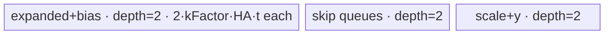

# MoeFinalizeRouting 950 Direct Invoke 算子知识

## 算子速览

| 项目 | 内容 |
|---|---|
| 实际入口 | `cann_bench::moe_finalize_routing` → `moe_finalize_routing_npu` → `calc_moe_finalize_routing_tiling` → `launch_moe_finalize_routing`；入口类型为 Direct Invoke。 |
| 计算语义 | `out[i,:]=skip1[i,:]+skip2[i,:]+Σ_k scale[i,k]·(expanded[rowIdx(i,k),:]+bias[expertIdx(i,k),:])`；缺失项按 0/1 处理，drop-pad 的 `rowIdx=-1` 整项跳过。 |
| 输入输出 | `expanded` 为 drop-less `[ROW·K,H]` 或 drop-pad `[E,C,H]`；索引 `int32[ROW·K]`；可选残差 `[ROW,H]`、bias `[E,H]`、scale/expert `[ROW,K]`；输出 `[ROW,H]`。支持 FP32/FP16/BF16，BF16 允许 FP32 scale。 |
| 执行类型 | 单个 `AIV_VECTOR` Kernel；四个 body 均使用 AscendC Queue/DataCopy 与 MicroAPI RegTensor，不含 Cube/AIC 或 MIX_CV。 |
| Kernel 路线 | P0 R-004 K-H 全载+bias table cache（conditional）；P1 R-003 K-H 全载（active）；P2 R-002 ROW-K-H 全载+整表索引（conditional）；P3 R-001 ROW-K-H 全载（active）；P4 R-005 H 全载（active）；P5 R-006 H 分片（active fallback）。 |
| 核心资源 | GM 输入/输出；AIV UB 中的深度 1/2 `TQue`、少量 `TBuf`、FP32 RegTensor；L1/L0 不分配，调用者 workspace 为 0，无跨 Kernel 中间张量。 |
| 来源闭包 | `direct_implementation_closed`：从 PyTorch schema、校验、Direct tiler、launcher、专用 entry、四个 arch35 body/helper 到 Direct CMake 已闭合；Frontmatter 只列固定 Commit 的官方 HTTP 源码，正文把官方原生部分与 Direct 转换层分开。 |
| 证据边界 | 本卡结论来自固定源码与 Direct 转换代码的静态追踪；不从运行统计推导吞吐量、设备调度或未显式编码的等价性。 |

## 接口与语义

### 计算语义

令 `r∈[0,ROW)`、`j∈[0,H)`、`q∈[0,K)`，其中 `K=scales.size(1)`，缺失 `scales` 时 `K=1`。索引布局由 `drop_pad_mode` 决定：

```text
idx_pos(r,q) = q*ROW+r, mode in {0,1}  # column
             = r*K+q,   mode in {2,3}  # row

y0(r,j) = (skip1 ? skip1[r,j] : 0) + (skip2 ? skip2[r,j] : 0)
y(r,j)  = y0(r,j) + Σ valid q (scales ? scales[r,q] : 1)
                         * (expanded[rowIdx[idx_pos(r,q)],j]
                            + (bias && expertIdx ? bias[expertIdx[r,q],j] : 0))
```

`mode∈{1,3}` 的 `rowIdx=-1` 使该 `q` 的 expanded、bias 和 scale 贡献整体跳过。Direct API 不暴露官方 V2 的 `x/alpha1/alpha2/v` 与 expert-range 属性；launcher 向四个 body 的这些地址传 `nullptr`，POD 的三个 expert range 均写 `[-1,-1)`。

### 输入、输出与属性

| 参数 | shape/layout | dtype | 约束、默认值与语义 |
|---|---|---|---|
| `expanded_permuted_rows` | mode 0/2：`[ROW·K,H]`；mode 1/3：`[E,C,H]`；ND contiguous | FP32/FP16/BF16 | 必选；Direct 校验 rank、连续性、`H>0`。实际 `activeNum=expanded.size(0)`；drop-pad body 将前三维展平为行。 |
| `expanded_src_to_dst_row` | `[ROW·K]`，column 或 row 排列 | INT32 | 必选、1-D contiguous；长度必须整除 `K`。Direct 未逐值检查范围；drop-pad 允许 `-1`。 |
| `skip1` | `[ROW,H]` | 同 expanded | 可选；存在时作为初始累加项。Direct 检查 shape/dtype，但未显式检查 contiguous/device。 |
| `skip2` | `[ROW,H]` | 同 expanded | 可选；存在时 `skip1` 必须存在。 |
| `bias` | `[E,H]` | 同 expanded | 可选；存在时要求 `expertIdx`；drop-pad 检查 `bias.E==expanded.E`。drop-less 的 `E` 从 bias 首维取得。 |
| `scales` | `[ROW,K]` | 同 expanded；BF16 expanded 可配 FP32 | 可选；不存在时 `K=1` 且 scale=1。Direct 在读取 `size(1)` 前未先检查 rank，调用者必须给 2-D。 |
| `expert_for_source_row` | `[ROW,K]` | INT32 | 可选；存在时检查 shape/dtype；Direct 未逐值检查 `[0,E)`。 |
| `drop_pad_mode` | 标量 | `int64` | 默认 0，只允许 0..3；0/1 为 column，2/3 为 row；1/3 允许丢弃。 |
| `out` | `[ROW,H]` | 同 expanded | 新分配输出，非原地。 |

### 入口与版本

本卡受控入口是 Direct Invoke，不是 ACLNN。`TORCH_LIBRARY_FRAGMENT` 注册公开 schema，`PrivateUse1` 落到 `moe_finalize_routing_npu`；该函数取得当前 NPU stream，并通过 `OpCommand::RunOpApi("MoeFinalizeRouting", aclCall)` 包住一次直接 kernel launch。目标为 CANN 9.1.0、950/Ascend 950，Direct 构建把 `ascend950` 映射到 Bisheng `dav-3510`。

官方固定 Commit 中 `aclnnMoeFinalizeRoutingV2.md` 明确列出 Ascend 950PR/950DT 支持，`ascend950/moe_finalize_routing_v2_binary.json` 注册 FP32/FP16/BF16 组合，arch35 Host 与 `_apt` entry 闭合四个 body。它们是 Direct 转换的官方相关基线；PyTorch schema、`MoeFinalizeRoutingLaunchConfig`、无 workspace 的 Direct ABI、shape 专用 entry 和 bias/index cache 都是转换层行为，不属于官方 ACLNN 原生接口。

### 来源与转换关系

| 层次 | 固定 HTTP 来源所证明的事实 | Direct 转换关系 | 不应外推的结论 |
|---|---|---|---|
| API/语义 | 官方文档与 proto 给出 V2 输入、四种 `drop_pad_mode`、dtype 与目标平台 | Direct schema 只暴露 expanded/rowIdx、两路 skip、bias、scale、expertIdx 和 mode | Direct schema 不是 `aclnnMoeFinalizeRoutingV2` 的逐参数别名 |
| Host/Tiling | arch35 tiler给出 ROWKH→KH→H-full→H-partial 顺序、POD 字段及 UB 公式 | `OfficialArch35Tiler` 把框架上下文改成纯值输入，保留四级选择并额外返回 `route/dtype/mode/blockDim` | 固定官方 Host 不证明 Direct 的 shape 专用 launcher guard |
| Device | 官方 `HFullLoad`、`HPartialLoad`、POD 是原生 arch35 实现；base 定义 MicroAPI 计算顺序 | Direct 中这三份实现保持原逻辑；base 只改 include 接线；KH/ROWKH 增加编译期 optional、索引批量化与 bias cache | Direct 扩展不是官方 `_apt` key 的原样实例化 |
| Launch/构建 | 官方 `_apt` 证明四类 body 的 dtype×mode 路由关系 | Direct 生成独立 C entry，以 `<<<blockDim,nullptr,stream>>>` 传值启动；`dav-3510` 由 Direct CMake 选择 | 官方 binary JSON 不证明 PyTorch 生命周期、错误传播或 Direct C ABI |

## Host/Launcher 执行流程

### 参数校验与前处理

`ValidateAndGetShape` 按以下顺序执行：检查 mode 0..3；expanded dtype；row-index 为 1-D INT32；两个必选输入 contiguous；按 mode 检查 expanded rank 2/3；从 scale 的第二维或默认 1 得到 K，并以 `ROW=rowIdx.numel()/K`、`H=expanded.size(-1)`、`E/C` 推导逻辑维；检查 `ROW,H>0`；检查两个 skip；约束 `skip2=>skip1`；检查 bias/expert 依赖；检查 scale dtype；检查 expert shape。

Meta 与 NPU 实现共用上述函数。NPU 路径以 expanded device 建 guard，分配 `[ROW,H]` 输出，把 optional Tensor 转为 `nullptr` 或 GM 地址，构造 Direct tiling，再取得 current stream。校验存在以下严格调用前置条件：

- `scales->size(1)` 早于 `scales.dim()==2`，drop-less 下 `bias->size(0)` 也早于 `bias.dim()==2`；低 rank optional 可能在预期的 `TORCH_CHECK` 前触发框架索引错误。
- mode 0/2 未检查 `expanded.size(0)==ROW*K`；mode 1/3 未检查每个 row index 落在 `[-1,E*C)`。ROWKH body 会按 tiler 推导的完整 extent 搬运，因此调用者必须满足公开 shape 关系。
- optional tensor 除 shape/dtype 外未统一检查 contiguous 与 device；所有传入地址必须与 expanded 同设备且为源码假设的连续布局。
- row index 未逐值检查；expert index 也未检查 `[0,E)`。尤其 KH 的 drop-less `K>1` 路径编译期删除 sentinel/上界分支，非法索引会直接参与 GM 地址计算。

### 参数、Workspace 与生命周期

`calc_moe_finalize_routing_tiling` 从 `PlatformAscendCManager` 取得 AIV core 数和 UB 字节；core 数非正时保守置 1。`hAligned=ceil_align(H*sizeof(T),32)/sizeof(T)`，`rowPerCore=ceil(ROW/coreNum)`，`blockDim=min(ceil(ROW/rowPerCore),coreNum)`，尾核行数为 `ROW-(blockDim-1)*rowPerCore`。

每个 block 的逻辑行起点都是 `blockIdx*rowOfFormerBlock`。非末 block 处理 `rowOfFormerBlock` 行，末 block 处理 `rowOfTailBlock` 行；R-001/R-002/R-003/R-004/R-005 再按 `rowFactor` 切 row tile，R-006 固定一行一循环并在行内切 H。不存在跨 block 的输出重叠或归约。

Host 算术全部是有符号 `int64_t` 的普通乘加/ceil-div：`ROW*K*H*t`、`E*C*H*t`、`RF*K*HA*t`、`x+y-1` 都没有 checked-multiply/checked-add。`AlignBytes(x)` 也直接计算 `ceil(x/32)*32`。因此“Tensor 元数据可由 int64 表示”不足以保证 tiling 乘积不溢出；调用者还要约束所有中间字节数。Device 再把 `processLen/loopCount/nBurst/copyLen` 等缩到 `uint16_t/uint32_t`，超大维度不是该实现的闭合输入域。

调用者 workspace 为 `0`。`launch_moe_finalize_routing` 将 `MoeFinalizeRoutingV2RegbaseTilingData` 按值传入 kernel；body 的 workspace、`x/a1/a2/v` 均为 `nullptr`。输入 Tensor 与输出 Tensor 由调用框架持有到 stream 工作完成；源码内没有临时 GM 或跨节点 owner。

### 启动图与失败传播

| 节点 | Host 启动 | entry/grid | POD/参数 | 输入→输出 | workspace/GM slice | ordering 与失败 |
|---|---|---|---|---|---|---|
| K1 唯一节点 | `launch_moe_finalize_routing` 中专用 entry 或 `LAUNCH_MOE_KERNEL_SET` | `moe_finalize_*<<<config.blockDim,nullptr,stream>>>`；每个 block 对应连续 row 域 | `MoeFinalizeRoutingV2RegbaseTilingData` 按值；dtype/mode/Route 编译期模板化 | 七路 Direct 输入 → `out[ROW,H]` | workspace 0；GM 直达；只用 AIV UB/寄存器，L1/L0 无 slice | 单 stream 单节点，无跨节点 event、无跨核同步；launcher 返回 `void`。 |

```text
moe_finalize_routing_npu
  -> calc_moe_finalize_routing_tiling
     -> ROWKH ? KH ? H-full ? H-partial
  -> launch_moe_finalize_routing
     -> exact-shape/static-mask/cache entry, if guarded
        OR generic dtype×scale-dtype×mode×Route entry
     -> RunOfficialMoeFinalizeRouting（T/S/mode/route 与 Direct 特化参数）
        -> one arch35 class::Init -> Process
        -> out[ROW,H]
```

校验失败由 `TORCH_CHECK` 在 launch 前抛出。Direct `aclCall` 在调用 `void` launcher 后固定返回 0，源码未同步检查单次 kernel launch 错误；这部分错误传播属于 runtime/framework 边界。

### 可选输入掩码与 launcher 短路

专用模板把五个 optional 的存在性编码为 `mask=skip1·1 + skip2·2 + bias·4 + scales·8 + expertIdx·16`。生产代码只实例化下列静态组合；`mask=0` 表示运行时查指针，不表示五项都缺失。

| 名称 | mask | 必有 | 必无 | 使用处 |
|---|---:|---|---|---|
| all | 31 | skip1、skip2、bias、scales、expertIdx | 无 | KH `allOptionalInputsPresent=true` |
| mask29 | 29 | skip1、bias、scales、expertIdx | skip2 | R-004/R-003，及 R-002 FP16 H32 |
| mask28 | 28 | bias、scales、expertIdx | skip1、skip2 | R-003 BF16 H256 K4 |
| mask23 | 23 | skip1、skip2、bias、expertIdx | scales | R-003 K1 fixed |
| mask11 | 11 | skip1、skip2、scales | bias、expertIdx | R-003 FP32 H256 K8 |

```text
config = tiler(shape,dtype,presence,mode)
if route1 && exact static-mask guard: launch static/cache entry; return
if route0 && exact batch-index guard: launch batch-index entry; return
if route1 && mask==31: launch exact-HK/cache or kh_all entry; return
launch generic entry selected by (T,S,mode,route)
```

每个命中分支在一次 `<<<>>>` 后立即 `return`，所以同一调用只启动一个 Device entry；专用 entry 失败不是运行时重试，而是 Host 谓词未命中时才沿源码顺序落到下一分支。

## Route 与参数设计

### 分核与资源计算

记 `A_b(x)=ceil_align(x,32)`（字节）、`t=sizeof(T)∈{2,4}`、`s=sizeof(S)∈{2,4}`、`Q_T(n,S)=ceil_align(n,32/t)*s`（body 按 T 的元素对齐数为 S queue 分配的实际字节）、`I_col(RF,K)=K*A_b(RF*4)`、`I_row(RF,K)=A_b(RF*K*4)`、`RF=rowFactor`、`HA=hAligned`。四级选择保持官方优先级：先判断完整 expanded/bias 是否能全载，再判断每个 row 的 K×H，再判断每个 K tile 的 H，最后切 H。

- ROW-K-H 全载：`expandedBytes=A_b((dropLess?ROW*K:E*C)*H*t)`，`biasBytes=hasBias?A_b(E*H*t):0`；加上双缓冲的 skip/scale/FP32-y 行 tile 后不超过 UB。
- K-H 全载：初始选择式预算为 `2*(K*HA*t + bias?K*HA*t + scale?A_b(K*s) + K==1 的 index 项 + skip 行 + A_b(H*4))`；确定 route1 后，`CalcRowFactorForKHFullLoad` 用 row tile 预算回算 RF。Direct body 对所有 K 批量索引；row-layout 的实际 rowIdx 为 `I_row`，column-layout 为 `I_col`，expertIdx 为 `I_row`。Host 的 `RowsHSizeForKHFullLoad` 对两个 index 项统一按 `I_row` 计，column 且 `RF%8!=0` 时可能低于实际 `I_col`，必须作为复用边界单独审计。
- H 全载：先在 `UB/2` 中二分最大 `kFactor`；Direct Host 实际预算 `kFactor*(1+hasBias)*HA*t + A_b(kFactor*t) + RowsHSize(RF,false)`，再回算 `kLoop/tailKFactor/RF`。其中 scale queue 的 Device 实分配是 `Q_T(kFactor,S)`，混合 BF16+FP32 时必须额外审计二者差额。
- H 分片：`actualInputNum=8-!x1-!x2-!bias-!x-3*!constExpert`；Direct 的 `x/constExpert` 恒缺失。`hFactor=floor((UB/2)/(t*(actualInputNum+1+(T!=FP32))))`，随后用 `hLoop=ceil(H/hFactor)` 重均分。

### Route 选择

**特征/重要性（知识组织顺序）**

| 重要性 | Route | 可达性 | 关键特征 | 复用价值 |
|---:|---|---|---|---|
| P0 | R-004 K-H+bias table cache | conditional：route1 且精确 shape/dtype/mask/E guard | K×H 全载基础上常驻完整 bias table，覆盖 fixed-HK、static-mask 与混合 scale 特化 | 把重复 expert bias 行搬运改为核内 UB 复用；guard 不成立仍有同语义 R-003 |
| P1 | R-003 K-H 全载 | active：所有 route1 未被 R-004 短路的合法输入 | 主体 KH 路径，具备 static/fixed/all-input/generic 多级 entry 与批量索引 | 承接 cache 未命中并保留完整 dtype/mode/optional 覆盖 |
| P2 | R-002 ROW-K-H+整表索引 | conditional：route0 下两个固定 mode/H/K/dtype/optional 的 guard；ROW/E 动态 | 全载 expanded/bias，并把完整 routing/expert 索引表搬入 UB | 消除热循环 scalar GM 索引读取，但现有 Host 未把动态 `ROW*K` 索引表计入 route0 UB 预算 |
| P3 | R-001 ROW-K-H 全载 | active：所有 route0 未被 R-002 短路的合法输入 | 最大数据域常驻 UB 的通用 route0 body | 提供 ROWKH 基线与 R-002 未命中时的同语义收口 |
| P4 | R-005 H 全载 | active：route0/1 失败而 `IsHFullLoad()` 成立 | 以 K tile 保持完整 H 向量 | 保留整行向量计算并承接前两级 Host selector 未命中 |
| P5 | R-006 H 分片 | active fallback：前三个 full-load 谓词均假 | 最小 H tile、逐片 gather 与累加 | 资源压力下的最终合法 Route；没有下一条 Device fallback |

**真实 Host/Launcher 选择顺序**

`H1/H2/H3/H4` 分别表示 Host tiler 的 ROWKH、KH、H-full、H-partial 层级；launcher 的 `L1` 为 KH static-mask 树，`L2` 为 ROWKH batch-id 树，`L3` 为 KH all-input 树，`L4` 为通用 dtype/mode/route 树。每个专用 entry 启动后立即返回，只有未命中才继续后继层。

| 重要性 | Route | Host 顺序 | Key/模板 | 精确选择条件与短路语义 | fallback |
|---:|---|---|---|---|---|
| P0 | R-004 K-H+bias table cache | H2：H1 ROWKH 为假后进入 KH；L1 的 mask29 cache 或 L3 all-input cache guard | route 1；`cacheBiasTable=true` | `IsKHFullLoad()` 成立，且固定 dtype/mode/H/K/optional/E 上界命中；entry 启动后立即 `return` | 同一 guard 的 E 上界未满足时走 R-003 transient-bias；其余未命中继续 KH 子树 |
| P1 | R-003 K-H 全载 | H2：H1 ROWKH 为假；L1 static-mask、L3 all-input non-cache、L4 generic | route 1；generic/all-input/fixed-HK/static-mask | `IsKHFullLoad()` 成立；launcher 按 static mask、all-input、generic 逐级短路 | KH Host 判定失败才进入 H3；KH 子树专用 entry 未命中由 R-003 generic 收口 |
| P2 | R-002 ROW-K-H+整表索引 | H1：最先判断 ROWKH；L2 的两个 batch-id guard | route 0；`batchRoutingIndices=true` | `IsRowKHFullLoad()` 成立、mode0、K=4，并命中对应 dtype/H/optional pattern；ROW/E 不受 launcher guard 约束；启动后立即 `return` | guard 未命中保留 route0，走 R-001；命中后不再复核 R-002 实际 UB |
| P3 | R-001 ROW-K-H 全载 | H1：最先判断 ROWKH；L4 route0 generic | route 0；`RowKHFullLoad<T,S,mode>` | `IsRowKHFullLoad()` 成立且 R-002 未短路 | Host 的 ROWKH 判定失败才进入 H2 KH |
| P4 | R-005 H 全载 | H3：H1 ROWKH、H2 KH 均为假 | route 2；`HFullLoad<T,S,mode>` | `IsHFullLoad()` 成立，generic launcher 按 dtype/mode 选择 route2 entry | 判定失败进入 H4 R-006 |
| P5 | R-006 H 分片 | H4：前三层 Host 判定均为假 | route 3；`HPartialLoad<T,S,mode>` | 最终 fallback，generic launcher 按 dtype/mode 选择 route3 entry | 无下一 Route；合法性依赖 Host/调用者前置条件 |

```text
rowKH = IsRowKHFullLoad()
kh    = !rowKH && IsKHFullLoad()
hfull = !rowKH && !kh && IsHFullLoad()

if rowKH: R-002 when fixed (mode,H,K,dtype,optional) guard matches, else R-001
elif kh:  R-004 cache guards, else R-003 static/fixed/generic
elif hfull: R-005
else:       R-006
```

### launcher 专用 entry 穷举

下表按实际 launcher 短路顺序列出所有专用 entry。`E>` 行不是新 Route：它选择同 shape 的 R-003 transient-bias entry；没有列出的 dtype×mode×optional 组合最终由通用 entry 收口。

| launcher 顺序 | Route | T/S、mode、H、K | optional | 附加 guard | entry 行为 | 未命中去向 |
|---:|---|---|---|---|---|---|
| 1 | R-004/R-003 | FP16/FP16，m0，512，4 | mask29 | `E<=16` | cache，`RF=15` | `E>16` 启动同 mask 的 R-003 fixed |
| 2 | R-003 | FP32/FP32，m0，256，8 | mask11 | 无 | fixed H/K | 下一专用 guard |
| 3 | R-003 | FP16/FP16，m0，1024，1 | mask23 | 无 | fixed H/K | 下一专用 guard |
| 4 | R-003 | BF16/BF16，m0，256，4 | mask28 | `S!=FP32` | fixed H/K | 下一专用 guard |
| 5 | R-003 | FP32/FP32，m0，512，1 | mask23 | 无 | fixed H/K | 下一专用 guard |
| 6 | R-003 | FP16/FP16，m1，512，1 | mask23 | 无 | fixed H/K | 下一专用 guard |
| 7 | R-003 | FP16/FP16，m1，256，1 | mask23 | 无 | fixed H/K | R-002 检查或 all/generic |
| 8 | R-002 | FP32/FP32，m0，64，4 | all | route0；ROW/E 动态 | full row/expert index tables | R-001 generic |
| 9 | R-002 | FP16/FP16，m0，32，4 | mask29 | route0；ROW/E 动态 | full row/expert index tables | R-001 generic |
| 10 | R-004/R-003 | FP32/FP32，m0，1024，4 | all | cache `E<=32` | cache `RF=3`；否则 R-003 fixed | `kh_all` |
| 11 | R-003 | FP32/FP32，m0，128，4 | all | 无 | fixed H/K | `kh_all` |
| 12 | R-003 | FP32/FP32，m3，256，2 | all | 无 | fixed H/K | `kh_all` |
| 13 | R-004/R-003 | FP16/FP16，m0，512，8 | all | cache `E<=16` | cache，沿 tiler RF；否则 R-003 fixed | `kh_all` |
| 14 | R-003 | FP16/FP16，m0，511，8 | all | 无 | fixed H/K/H95012 | `kh_all` |
| 15 | R-003 | FP16/FP16，m0，128，4 | all | 无 | fixed H/K | `kh_all` |
| 16 | R-004/R-003 | FP16/FP16，m0，1021，4 | all | cache `E<=16` | cache `RF=10`；否则 R-003 fixed | `kh_all` |
| 17 | R-003 | FP16/FP16，m1，256，1 | all | 无 | fixed H/K | `kh_all` |
| 18 | R-004/R-003 | BF16/FP32，m0，512，4 | all | cache `E<=16` | cache `RF=15`；否则 R-003 fixed | `kh_all` |
| 19 | R-004/R-003 | BF16/BF16，m0，127，16 | all | cache `E<=32` | cache，沿 tiler RF，HA128；否则 R-003 fixed | `kh_all` |
| 20 | R-004/R-003 | BF16/BF16，m2，2048，2 | all | cache `E<=8` | cache `RF=5`；否则 R-003 fixed | `kh_all` |

`kh_all` 有 16 个模板实例：`T/S∈{FP32/FP32, FP16/FP16, BF16/BF16, BF16/FP32}` × `mode∈{0,1,2,3}`。通用 `DEFINE_MOE_KERNEL_SET` 也有同样 16 组，每组生成 `rowkh/kh/h/partial` 四个 entry；因此专用树未命中后，R-001/R-003/R-005/R-006 的 dtype、scale dtype 与四种布局仍闭合。

R-004 只有七个生产可达 cache entry：表中顺序 1、10、13、16、18、19、20。它们只覆盖 drop-less mode 0/2，故 cache hot loop 中 `validK==K`，`expertIdxLocal[row,k]` 不需要随 drop-pad sentinel 压缩；若新增 mode1/3 cache entry，必须同步压缩 expert index，不能直接复用现有寻址。

### 模板/实现执行矩阵

| 重要性 | Route | 可达性与 key/selector | dtype/shape/platform 完整命中条件 | 执行拓扑与 Kernel 节点 | 实际模板/body | 内存与同步特征 | tail/fallback |
|---:|---|---|---|---|---|---|---|
| P0 | R-004 | conditional；`route=1,cache=true` | 七个固定 cache guard | 单 AIV block 网格 | `MoeFinalizeRoutingV2KHFullLoad<T,S,mode,...,cacheBiasTable=true>` | E×HA bias depth1 常驻，移除 transient bias queue；其余同 KH | odd H 每 expert 独立 DMA 到 HA stride；E 超限回 R-003 |
| P1 | R-003 | active；`route=1,cache=false` | KH UB 式成立；含 fixed H/K、static mask、all-input 与 generic entry | 单 AIV block 网格 | `MoeFinalizeRoutingV2KHFullLoad<T,S,mode,...,false>` | row/K index、gather/bias/skip/scale/y 为 depth2；K≤4 可 16 rows batch | `validK` 压缩 drop-pad；专用 guard失败仍由 generic 收口 |
| P2 | R-002 | conditional；`route=0,batchRoutingIndices=true` | 两个 guard固定 mode/H/K/dtype/optional，ROW/E 动态 | 单 AIV block 网格 | `MoeFinalizeRoutingV2RowKHFullLoad<T,S,mode,true,...>` | R-001 加两个动态 `ROW*K` int32 depth1 queue；route0 Host 预算未包含它们 | guard 未命中回 R-001；命中时 `UB_R002<=UB` 仍缺少证明与 Device fallback |
| P3 | R-001 | active；`route=0` | 950；ROWKH UB 式成立；除 R-002 guard | 单 AIV block 网格 | `MoeFinalizeRoutingV2RowKHFullLoad<T,S,mode>` 基线实例 | expanded/bias depth1 全载；行 tile depth2 | 尾核+尾 row tile；按 body 的索引 guard处理 |
| P4 | R-005 | active；`route=2` | H-full UB 式成立 | 单 AIV block 网格 | `MoeFinalizeRoutingV2HFullLoad<T,S,mode>` | K tile 的 expanded/bias + row tile skip/y；均 depth2 | K 尾 tile、row 尾 tile、按 body 的索引 guard处理 |
| P5 | R-006 | active fallback；`route=3` | 前三层均失败 | 单 AIV block 网格 | `MoeFinalizeRoutingV2HPartialLoad<T,S,mode>` | H tile 的 expanded/bias/skip/y depth2；scale scalar GM | H tail、row tail、按 body 的索引 guard处理；无下一 Route |

### 选择与资源 Guard

| Guard | Host/Tiling 条件 | Device/资源原因 | 影响 Route | 不满足时去向 | 源码符号 |
|---|---|---|---|---|---|
| bias cache E 上界 | launcher 的七个 `E<=8/16/32` guard | 必须保证 `A_b(E*HA*t)` 与其余 queue 总和落入 950 UB | R-004 | R-003 transient bias | `launch_moe_finalize_routing` |
| odd H cache stride | `H!=HA` | compact `E*H` 会使 expert>0 本地起点失去 32B 对齐 | R-004 | 每 expert 单独拷入 `expert*HA` | `KHFullLoad::Process` |
| K≤4 批量 16 row | `k<=4 && RF>=16` | expanded/bias queue 容量固定为 `16*K*HA`，分 batch 搬运与计算 | R-003 | 逐 row gather | `KHFullLoad::ProcessYWithInputK4` |
| optional static mask | 固定 mask 11/23/28/29 或五可选全有 | 编译期删除 pointer-presence 与计算分支 | R-002/R-003/R-004 | generic entry | `RunOfficialMoeFinalizeRouting` 实例 |
| drop-less 无 sentinel | mode 0/2 且 KH `K>1` 普通/cache 分支 | 调用契约要求索引非负有效，`IsValidExpandedRowIdx` 编译期返回 true，并跳过 scale compact；K1 专门分支仍检查 `-1` 与 `activeNum` | R-003/R-004 | mode1/3 保留 `validK` 与 scale 压缩 | `IsValidExpandedRowIdx`、`ProcessExpandedXBiasAndScaleK1` |
| index UB batching | Direct KH 对所有 K；ROWKH 仅在专用 guard | 避免 H/K 热循环的 scalar GM 索引读 | R-002/R-003/R-004 | ROWKH 普通路径 scalar GM | `ProcessWithId`、`LoadRoutingIndices` |
| column index 对齐账 | mode0/1 且 `RF%8!=0` | Device 分 K 段分配 `I_col=K*A_b(RF*4)`，Host RF 搜索按 `I_row=A_b(RF*K*4)`；K>1 时前者可更大 | R-003/R-004 | 源码无 runtime fallback；新形状/新 RF 必须按 `I_col` 重验总 UB | `RowsHSizeForKHFullLoad`、`KHFullLoad::InitQueBuffers` |
| 32B 行对齐 | `HA=A_b(H*t)/t` | gather/bias tile 使用 HA stride，DMA 有效长度仍为 H | R-003/R-004 | 无 fallback，tiler统一生成 | `OfficialArch35Tiler::Run` |
| Host Route 顺序 | ROWKH→KH→H→partial | Host 先取最大可全载域并短路，知识重要性顺序不改变该 selector | 全部 | 下一层 Host Route | `OfficialArch35Tiler::Run` |
| dtype/scale dtype | FP32→S=FP32；FP16→S=FP16；BF16→S=BF16/FP32 | MicroAPI load/cast/broadcast 模板必须与 GM 类型一致 | 全部 | Host dtype 检查失败 | `ToDtypeCode`、launcher dtype tree |
| mixed-scale 对齐账 | T=BF16、S=FP32 时比较 Host 的 `A_b(n*s)`（H-full局部甚至为 `A_b(n*t)`）与 body 的 `Q_T(n,S)` | Queue 用 `RoundUp<T>(n)*sizeof(S)`，可比 Host 项多 32B/slot | R-001/R-003/R-005 | 源码无独立 runtime fallback；复用时按实际 Queue 重验 UB | `RowsHSize*`、`HFullLoad::Init`、`KHFullLoad::InitQueBuffers` |

### POD/ABI

官方 POD 由 28 个连续 `int64_t` 组成。在 LP64 ABI 下推导 `sizeof=224, alignof=8`；每个字段 offset 按 8 字节递增。固定源码没有 `static_assert(sizeof/offsetof)`，Direct 复用应补静态断言。`MoeFinalizeRoutingLaunchConfig` 是 Host-only 包装：POD 后接 `blockDim:int64@224`、`route:int32@232`、`inputDtype:int32@236`、`scaleDtype:int32@240`、`dropPadMode:int32@244`，推导 `sizeof=248,alignof=8`；Device 只收到前 224 字节 POD。

| 结构 | 字段 | 类型/位宽 | ABI 布局 | 单位 | Host/launcher producer | Device consumer | 边界 |
|---|---|---|---|---|---|---|---|
| `MoeFinalizeRoutingV2RegbaseTilingData` | `row` | int64/64 | off 0 | row | `ROW` | 分核、column index stride | `>0` |
| 同上 | `e` | int64/64 | off 8 | expert | drop-pad expanded dim0；否则 bias dim0/0 | full-load、bias cache | 无 bias 的 drop-less 可为0 |
| 同上 | `c` | int64/64 | off 16 | row/expert | drop-pad expanded dim1，否则0 | ROWKH expanded extent | drop-less inactive |
| 同上 | `h` | int64/64 | off 24 | element | expanded last dim | 所有地址/vector长度 | `>0` |
| 同上 | `hAligned` | int64/64 | off 32 | element | `A_b(H*t)/t` | KH UB stride | `>=H` |
| 同上 | `k` | int64/64 | off 40 | expert/token | scales dim1或1 | index/scale/K loop | `>0` |
| 同上 | `rowOfFormerBlock` | int64/64 | off 48 | row/core | `ceil(ROW/coreNum)` | block GM base | 正数 |
| 同上 | `rowOfTailBlock` | int64/64 | off 56 | row | 尾核公式 | 尾核 loop | 正数 |
| 同上 | `rowLoopOfFormerBlock` | int64/64 | off 64 | loop | `ceil(rowFormer/RF)` | outer loop | 正数 |
| 同上 | `rowLoopOfTailBlock` | int64/64 | off 72 | loop | `ceil(rowTail/RF)` | 尾核 outer loop | 正数 |
| 同上 | `rowFactor` | int64/64 | off 80 | row/tile | UB 搜索后重均分；cache entry可固定 | Queue容量、row tile | `>=1` |
| 同上 | `constExpertRangeFactor` | int64/64 | off 88 | expert/tile | `min(-1,RF)` 的 Direct 结果 | Direct body不读 | Direct inactive |
| 同上 | `tailRowFactorOfFormerBlock` | int64/64 | off 96 | row | former尾 tile公式 | `rowInnerLoop` | `1..RF` |
| 同上 | `tailRowFactorOfTailBlock` | int64/64 | off 104 | row | tail-core尾 tile公式 | `rowInnerLoop` | `1..RF` |
| 同上 | `hLoop` | int64/64 | off 112 | loop | full=1；partial=`ceil(H/hFactor)` | R-006 H loop | 正数 |
| 同上 | `hFactor` | int64/64 | off 120 | element/tile | full=H；partial UB公式 | H tile/Queue | 正数 |
| 同上 | `tailHFactor` | int64/64 | off 128 | element | `H-(hLoop-1)*hFactor` | R-006 tail | 正数 |
| 同上 | `kLoop` | int64/64 | off 136 | loop | KH/ROWKH=K；H-full=`ceil(K/kFactor)` | R-005 K loop | 正数 |
| 同上 | `kFactor` | int64/64 | off 144 | K/tile | KH/ROWKH=1；H-full UB二分 | expanded/bias Queue | 正数 |
| 同上 | `tailKFactor` | int64/64 | off 152 | K | `K-(kLoop-1)*kFactor` | R-005 tail | 正数 |
| 同上 | `activeNum` | int64/64 | off 160 | expanded row | `expanded.size(0)` | drop-less范围保护 | drop-pad不读 |
| 同上 | `zeroExpertStart` | int64/64 | off 168 | expert id | -1 | expert-range branch | Direct inactive |
| 同上 | `zeroExpertEnd` | int64/64 | off 176 | expert id | -1 | 同上 | Direct inactive |
| 同上 | `copyExpertStart` | int64/64 | off 184 | expert id | -1 | copy-expert branch | Direct inactive |
| 同上 | `copyExpertEnd` | int64/64 | off 192 | expert id | -1 | 同上 | Direct inactive |
| 同上 | `constantExpertStart` | int64/64 | off 200 | expert id | -1 | constant-expert branch | Direct inactive |
| 同上 | `constantExpertEnd` | int64/64 | off 208 | expert id | -1 | 同上 | Direct inactive |
| 同上 | `constExpertRangeNum` | int64/64 | off 216 | expert count | -1 | Direct body不读 | Direct inactive |

字段是同一 POD 的 route-dependent union-like 用法，而不是所有 Route 都消费全部字段：R-001/R-002/R-003/R-004 由 `SetFullLoadTilingData` 写 `hLoop=1,hFactor=H,kLoop=K,kFactor=1`；R-005 随后覆盖 `kLoop/kFactor/tailKFactor`；R-006 只写 row/H 切片相关字段，`kLoop/kFactor/tailKFactor` 保持零初始化，body 直接循环 `tilingData->k`。R-006 把 `rowLoop*=rowOf*`、`rowFactor=1`，其 `tailRowFactor*` 虽写成整核行数但不被 partial body读取。

```text
blockBase = blockIdx * rowOfFormerBlock
rowsThisBlock = (blockIdx == blockDim-1) ? rowOfTailBlock : rowOfFormerBlock
rowOuterLoop = ceil(rowsThisBlock / rowFactor)       # R001..R005
rowInnerLoop = isLastTile ? tailRowFactor : rowFactor
hLen = isLastHTile ? tailHFactor : hFactor           # R006
kLen = isLastKTile ? tailKFactor : kFactor           # R005
```

`constExpertRangeFactor=min(-1,rowFactor)` 在 Direct 路径得到 -1，但 `x/a1/a2/v` 均为空且 `hasConstExpert=false`，相关 Queue、循环与该字段不可达。复用 POD 时不能把 -1 当作合法分块长度传播到重新启用的 constant-expert 分支。

### Route 源码闭包

| 重要性 | Route | Key/selector | Host/Tiling producer | POD/参数 | Kernel entry/router 节点 | Kernel body/直接依赖 | 构建接线 |
|---:|---|---|---|---|---|---|---|
| P0 | R-004 | route1+cache | Direct `IsKHFullLoad/DoOpTilingKHFullLoad` + launcher E guard | POD；部分 entry 重写 RF | cache entry | Direct 扩展 `KHFullLoad<cacheBiasTable=true>` + base | Direct `register_direct_launch_op`；官方 ascend950 binary 作平台映射 |
| P1 | R-003 | route1 | Direct `IsKHFullLoad/DoOpTilingKHFullLoad` | POD+可选 fixed H/K/RF | generic/all/fixed/mask entry | Direct 扩展 `KHFullLoad<cache=false>` + base | 同上 |
| P2 | R-002 | route0+batch ids | Direct `OfficialArch35Tiler::IsRowKHFullLoad/DoOpTilingRowKHFullLoad` + launcher H/K/dtype/mask guard；ROW/E 动态 | POD+固定 H/K/mask | `*_rowkh_batch_ids` entry | Direct 扩展 `RowKHFullLoad<batchRoutingIndices=true>` | 同上 |
| P3 | R-001 | route0 | Direct `OfficialArch35Tiler::IsRowKHFullLoad/DoOpTilingRowKHFullLoad` | 官方 arch35 POD | generic `moe_finalize_*_rowkh` | `RowKHFullLoad` + base helper | 同上 |
| P4 | R-005 | route2 | Direct `IsHFullLoad/DoOpTilingHFullLoad` | POD | generic `*_h` | 官方 byte-identical `HFullLoad` + base | 同上 |
| P5 | R-006 | route3 | Direct `DoOpTilingSplitH` | POD | generic `*_partial` | 官方 byte-identical `HPartialLoad` + base | 同上 |

### dormant 分支与重新启用条件

这些分支存在于复用的官方 body 或 helper 中，但不构成当前 Direct schema 的 active/conditional Route：

| dormant 分支 | 当前不可达证明 | 重新启用所需闭包 |
|---|---|---|
| zero/copy/constant expert | launcher 对 `x/a1/a2/v` 全传 `nullptr`；POD 三组 expert range 与 `constExpertRangeNum` 为 -1；四个 body 的 `hasX/hasConstExpert` 均为 false | 扩展 schema 与校验；传入四路 GM；产生合法 range、`constExpertRangeFactor`；把 x/a1/a2/v Queue/TBuf 计入每条 Route UB；补齐语义与索引范围约束 |
| 官方 `_apt` TilingKey router | Direct 不传 tiling GM，不调用 `TILING_KEY_IS`，而是以独立 entry 的模板参数携带 T/S/mode/route | 改回官方 launcher ABI、tiling GM 与 workspace 约定，并恢复 key producer；不能与现有传值 C entry 混用 |
| KH K1 cache helper 内的 local-copy 分支 | 七个 cache entry 的 K 都为 2/4/8/16；且 `cacheBiasTable=true` 时 `Process()` 优先进入 `ProcessYWithCachedBias`，不会调用 K1 non-cache pipeline | 新增 K1 cache entry时应直接复用 cached-bias loop，或重新证明 K1 queue 初始化与分支可达性；现有代码不能视为生产 Route |

不存在被遗漏的第五类 Host tiling Route：Direct selector 只产生 route 0/1/2/3；R-002 与 R-004 是 route0/route1 body 的 guarded Device 子类，而不是额外 Host tiling key。

## Kernel 实现

### 公共执行流程

每个 block 处理连续 row 域；末 block 使用 `rowOfTailBlock`。body 先把 `skip1/skip2` 升到 FP32 yLocal，随后按 k 顺序 gather expanded row、可选 bias 与 scale，并以 FP32 RegTensor 执行 `(expanded+bias)*scale+y`。FP16/BF16 输入经 `DIST_UNPACK_B16 + Cast<float>` 升精度；每个 row 的 K 累加保持原次序；最终以 `NO_SAT + CAST_RINT` trait 或 AscendC `Cast` 的 `CAST_RINT` 模式降回 T。MicroAPI 通过 `UpdateMask<float>` 屏蔽 H 尾 lane，Queue 的 `EnQue/DeQue/FreeTensor` 管理 MTE→V→MTE 生命周期。

### 全 Route 核任务、地址与同步不变量

| 维度 | 共同契约 | Route 差异 |
|---|---|---|
| 核任务 | AIV block `b` 独占 `[b*rowFormer, b*rowFormer+rowsThisBlock)`；每个输出 row 只由一个 block 写 | R-006 在核内逐 row×H tile；其余按 row tile |
| GM 地址 | output/skip：`globalRow*H+h0`；scale/expert：`globalRow*K+q`；expanded：`rowIdx*H+h0`；bias：`expertIdx*H+h0` | column rowIdx offset=`q*ROW+globalRow`，row layout=`globalRow*K+q` |
| 存储层级 | 输入输出在 GM；工作集在 UB `TQue/TBuf` 与向量寄存器；L1/L0 不使用；workspace 指针传 `nullptr` 且 body 不解引用 | R-001/R-002 常驻 expanded/bias；R-004 常驻 bias；R-003/R-005/R-006 逐级缩小 tile |
| 核间关系 | 无 atomic、无 `SyncAll`、无跨核 event；正确性依赖 row 域互斥 | 无 Route 例外 |
| 核内关系 | `EnQue→DeQue→FreeTensor` 建立 Queue slot 生命周期；显式 `S_V/MTE2_S` 只出现在对应 KH/H-full 分支；`LocalMemBar<VEC_STORE,VEC_LOAD>` 只在 optimized helper 内出现 | R-003/R-004/R-005 使用 optimized helper；R-001/R-002/R-006 使用逐 K 的 unaligned helper且没有显式 LocalMemBar |
| 尾部 | block tail 由 `rowOfTailBlock`；row tile tail 由两个 `tailRowFactor*`；H/K tile tail 分别由 `tailHFactor/tailKFactor` | R-001..R-004 不切 H/K；R-005 只切 K；R-006 只切 H |
| 精度 | skip/expanded/bias/scale 在 RegTensor 中转 FP32，按 q 原序累计到 FP32 y；全部 q 完成后一次 `CAST_RINT` 到 T | FP32 输入不发生低精度 cast；BF16+FP32 scale 保留 FP32 broadcast |

```text
globalRow = blockIdx * rowOfFormerBlock + rowOuterIdx * rowFactor + rowInnerIdx
rowIdxOff = column ? q * ROW + globalRow : globalRow * K + q
expertOff = globalRow * K + q                    # column mode
          = rowIdxOff                            # row mode
if index is valid:
    x = expanded[rowIdx[rowIdxOff], hSlice]
    b = bias[expertIdx[expertOff], hSlice] if bias else 0
    s = scales[globalRow,q] if scales else 1
    yFP32 += (fp32(x) + fp32(b)) * fp32(s)
```

这里的“valid”必须按具体 body 理解：R-001/R-005/R-006 与 KH-K1 检查 `-1`，drop-less 还检查正向上界；KH `K>1` 的 mode0/2 依赖调用契约并直接视为有效。所有 body 都没有覆盖 `<-1` 的负索引检查。

### Route R-004：K-H 全载与 bias table cache

#### 适用条件

##### 选择证据

| 层级 | 文件 | 符号 | 源码谓词/参数 | 结果/下一跳 |
|---|---|---|---|---|
| Tiler | `op_kernel/moe_finalize_routing_kernel.cpp` | `OfficialArch35Tiler::Run/IsKHFullLoad` | KH基础Route成立 | launcher cache guard |
| Launcher | 同上 | `launch_moe_finalize_routing` | dtype/mode/H/K/E/optional完整谓词 | 七类固定 cache entry |
| Body | `official_arch35/moe_finalize_routing_v2_k_h_full_load.h` | `KHFullLoad<...,cacheBiasTable=true>` | 编译期移除 transient bias | persistent bias table |

#### Device 数据流

##### 函数级调用链

```text
KHFullLoad::Process
  -> DMA whole bias table once (compact if H==HA, per-row padded otherwise)
  -> per row tile: ProcessWithId/skip/scales
  -> ProcessYWithCachedBias
     -> gather only expanded rows
     -> direct VF with biasTableLocal[expert*HA]
  -> cast/copy; free table at kernel end
```

##### 源码等价伪码

```text
for expert: DMA bias[expert,0:H] -> biasTable[expert*HA]
for each row tile:
  load IDs/skip/scale as R-003
  for row:
    gather K expanded rows in original q order  # production cache guards are mode0/2
    for q in 0..K-1:
      e = expertIdxLocal[row,q]
      y += scale[row,q] * (expandedLocal[q*HA] + biasTable[e*HA])
cast/copy output
```

#### 内存与数据搬运

##### 资源与搬运表

| 层级/缓冲区 | offset/地址公式 | extent/容量公式 | dtype/layout | producer | consumer | owner/lifetime | 对齐/复用 |
|---|---|---|---|---|---|---|---|
| bias table | `expert*HA` | `A_b(E*HA*t)` | T padded rows | initial DMA | all row/K | depth1 kernel lifetime | H!=HA逐 expert DMA |
| expanded queue | validK*HA | 同 R-003 Xcap | T | gather | VF | row | depth2 |
| transient bias | N/A | 0 | N/A | N/A | N/A | 未分配 | 被 persistent table 替代 |
| ids/skip/scale/y | 同 R-003 | 同 R-003 | 同上 | 同上 | 同上 | row tile | 同上 |

##### 分层内存布局


##### 字节账与复用顺序

```text
UB_R004 = UB_R003 - 2*transientBiasXcap + A_b(E*HA*t)
          （RF可由固定 cache entry整体重算）
UB_R004 <= platform UB 由 launcher 的 shape/E guard 与固定RF共同保证
workspace_total=0; dynamic_ub=N/A
```

| 复用子区 | 写入者 | 读取者/消费点 | 下一次覆盖 | 同步或释放依据 | 安全条件 |
|---|---|---|---|---|---|
| biasTable | initial MTE | all VF | 不覆盖 | MTE2→S event后，kernel末Free | `expert<E`且E guard成立 |
| expanded queue | gather | 当前 row/K | next row | Queue Free | 不与 table alias |

#### 同步、精度与尾块

##### 同步与数值边界表

| 阶段 | primitive/机制 | producer | consumer/等待点 | 保护对象 | 精度/尾块 |
|---|---|---|---|---|---|
| bias table DMA→V | biasTableQue EnQue/DeQue | initial DMA | cached-bias VF | bias table | odd H用HA stride；现有 cache entry只在mode0/2可达 |
| queued IDs→scalar | `HardEvent::MTE2_S` | `ProcessWithId` 的 MTE copy | `GetExpandedRowIdxValue/GetExpertIdxValue` | row/expert index local | cached loop 前一次显式等待 |
| per-K VF | optimized helper + `LocalMemBar<VEC_STORE,VEC_LOAD>` | expanded/table/scale | 下一 K 的 y load | yLocal | 与 R-003 相同K顺序、FP32 |

#### 关键实现

##### 符号证据表

| 阶段 | 文件 | 符号/模板实例 | 实现事实 |
|---|---|---|---|
| Host/Tiling producer | `op_kernel/moe_finalize_routing_kernel.cpp` | cache guard + `FixedRowFactor` | E上界、RF重算 |
| Kernel entry/router | 同上 | `*_cache_bias` | cache模板实例 |
| Device body/helper | `official_arch35/moe_finalize_routing_v2_k_h_full_load.h`、base | `ProcessYWithCachedBias`、`VFProcessExpandXBiasScaleOptimized` | 整表常驻且直接寻址 |

### Route R-003：K-H 全载

#### 适用条件

##### 选择证据

| 层级 | 文件 | 符号 | 源码谓词/参数 | 结果/下一跳 |
|---|---|---|---|---|
| Direct tiler | `op_kernel/moe_finalize_routing_kernel.cpp` | `IsKHFullLoad` | ROWKH失败且 KH UB式成立 | route1 |
| Launcher | 同上 | `launch_moe_finalize_routing` | shape/mask/all-input/generic tree | R-004 cache guard优先，否则 non-cache entry |
| Body | `official_arch35/moe_finalize_routing_v2_k_h_full_load.h` | `KHFullLoad<...,cacheBiasTable=false>` | K1、K≤4/RF≥16、普通三分支 | 对应 inner pipeline |

#### Device 数据流

##### 函数级调用链

```text
KHFullLoad::Process
  -> ProcessInputWithX (skip/scales row tile)
  -> ProcessWithId (rowIdx/expertIdx row tile into UB)
  -> y=skip1+skip2
  -> K==1 ? ProcessYWithInputK1
     : K<=4 && RF>=16 ? LoadBatchAsync/ComputeBatch
     : ProcessYWithInput
  -> ProcessExpandedXBiasAndScale
  -> ProcessExpandXBiasScaleOptimized -> cast -> CopyOut
```

##### 源码等价伪码

```text
for block rowTile:
  DMA skip/scales; DMA rowIdx and expertIdx tile
  yFP32 = skip1+skip2
  for row batch (RF rows, optionally chunks of 16):
    validK=0
    for q:
      idx = rowIdxLocal; if dropPad && idx==-1: continue
      DMA expanded[idx,0:H] -> expandedLocal[validK*HA]
      DMA bias[e,0:H] -> biasLocal[validK*HA]
      if dropPad: compact scale[q] to scale[validK]
      validK++
    vector loop q=0..validK-1: y += scale*(expanded+bias)
  cast/copy output
```

#### 内存与数据搬运

##### 资源与搬运表

| 层级/缓冲区 | offset/地址公式 | extent/容量公式 | dtype/layout | producer | consumer | owner/lifetime | 对齐/复用 |
|---|---|---|---|---|---|---|---|
| rowIdx queue | column:`q*ceil_align(RF,8)+r`；row:`r*K+q` | depth2 ×（column:`K*A_b(RF*4)`；row:`A_b(RF*K*4)`） | INT32 | tile DMA | scalar gather | row tile | 每 K 段/整块 32B |
| expertIdx queue | `r*K+q` | depth2 × `A_b(RF*K*4)` | INT32 | tile DMA | bias gather | row tile | 32B |
| expanded queue | validK*HA | depth2 × `Xcap` | T | gather DMA | VF | row/batch | `Xcap=RF*HA*t` for K1；`16*K*HA*t` for K≤4 batch；否则 `K*HA*t` |
| bias queue | 同 expanded | depth2 × `Xcap` | T | gather DMA | VF | row/batch | cache=false |
| skip/scale/y | row tile | skip:`A_b(RF*H*t)` each；scale:`Q_T(RF*K,S)`；y:`A_b(RF*H*4)`，均 depth2 | T/S/FP32 | DMA/Vector | Vector/CopyOut | row tile | scale queue 以 T 元素粒度对齐 |

##### 分层内存布局


##### 字节账与复用顺序

```text
rowIdxBytes = isColumn ? I_col(RF,K) : I_row(RF,K)
expertIdxBytes = I_row(RF,K)
UB_R003 = 2*(rowIdxBytes + hasBias*expertIdxBytes
             + Xcap + hasBias*Xcap
             + hasX1*A_b(RF*H*t) + hasX2*A_b(RF*H*t)
             + hasScale*Q_T(RF*K,S) + A_b(RF*H*4))
UB_R003 <= platform UB   # 应按 Device 实际值审计，而非只依赖 Host 近似式
workspace_total=0; dynamic_ub=N/A
```

| 复用子区 | 写入者 | 读取者/消费点 | 下一次覆盖 | 同步或释放依据 | 安全条件 |
|---|---|---|---|---|---|
| index queues | ProcessWithId | row/K gather | next row tile | FreeTensor after y | consumer已结束 |
| expanded/bias queues | LoadBatchAsync/gather | ComputeBatch/VF | next row/batch | EnQue→DeQue→Free | `validK<=K`、Xcap成立 |
| yLocal | skip init/K accumulation | next K load/CopyOut | next row tile | LocalMemBar + yQue | K顺序不变 |

#### 同步、精度与尾块

##### 同步与数值边界表

| 阶段 | primitive/机制 | producer | consumer/等待点 | 保护对象 | 精度/尾块 |
|---|---|---|---|---|---|
| queued IDs→scalar | Queue；K1 分支另有 `HardEvent::MTE2_S` | tile DMA | scalar `GetValue` | row/expert index local | K1 在 row loop 前显式等待；普通/K4路径依赖 Queue 序列 |
| compact scale→V | `HardEvent::S_V`，仅普通 `ProcessYWithInput` 分支 | drop-pad scalar Get/Set | optimized VF | scale LocalTensor | K1/K4源码没有对应的显式 S_V |
| gather→V | Queue | MTE | VF | expanded/bias | HA分配，H有效 |
| K accumulation | LocalMemBar | VEC_STORE | VEC_LOAD | yLocal | FP32、K原顺序 |
| cast/out | CAST_RINT + Queue | VF | MTE | output | row/H tail |

#### 关键实现

##### 符号证据表

| 阶段 | 文件 | 符号/模板实例 | 实现事实 |
|---|---|---|---|
| Host/Tiling producer | official tiling；`op_kernel/moe_finalize_routing_kernel.cpp` | `RowsHSizeForKHFullLoad/DoOpTilingKHFullLoad` | RF与UB上界 |
| Kernel entry/router | Direct kernel 同文件 | generic/all/fixed/mask KH entry | compile-time optional/mode/H/K |
| Device body/helper | KH/base header | `ProcessWithId`、三种 `ProcessYWithInput`、`VFProcessExpandXBiasScaleOptimized` | index batching、gather、FP32融合 |

### Route R-002：ROW-K-H 全载与整表索引

#### 适用条件

##### 选择证据

| 层级 | 文件 | 符号 | 源码谓词/参数 | 结果/下一跳 |
|---|---|---|---|---|
| Tiler | `op_kernel/moe_finalize_routing_kernel.cpp` | `OfficialArch35Tiler::IsRowKHFullLoad` | ROWKH UB成立 | launcher guard |
| Launcher | 同上 | `launch_moe_finalize_routing` | mode0,K4 且 F32/H64/all-input，或 F16/H32/mask29；ROW/E 动态 | 两个 batch-id entry |
| Body | `official_arch35/moe_finalize_routing_v2_row_k_h_full_load.h` | `batchRoutingIndices=true` | 编译期 true | `LoadRoutingIndices` |

#### Device 数据流

##### 函数级调用链

```text
R-001 chain
  + LoadRoutingIndices
      -> DMA rowIdx[ROW*K] once
      -> DMA expertIdx[ROW*K] once when present
  -> K loop reads LocalTensor<int32_t>, not scalar GM
```

##### 源码等价伪码

```text
load whole expanded and bias as R-001
rowIdxLocal = DMA(ROW*K); expertIdxLocal = DMA(ROW*K)
for every row/K: idx,e = local[index_offset]; vector accumulate as R-001
free both index tables only after all row tiles
```

#### 内存与数据搬运

##### 资源与搬运表

| 层级/缓冲区 | offset/地址公式 | extent/容量公式 | dtype/layout | producer | consumer | owner/lifetime | 对齐/复用 |
|---|---|---|---|---|---|---|---|
| R-001 buffers | 同 R-001 | 同 R-001 | 同 R-001 | 同上 | 同上 | 同上 | 同上 |
| rowIdxLocal | logical index | `A_b(ROW*K*4)` | INT32 | one DMA | all K loops | depth1 kernel lifetime | 32B |
| expertIdxLocal | `r*K+q` | `A_b(ROW*K*4)` | INT32 | one DMA | bias lookup | depth1 kernel lifetime | 32B |

##### 分层内存布局


##### 字节账与复用顺序

```text
UB_R002 = UB_R001 + A_b(ROW*K*4) + hasExpertIdx*A_b(ROW*K*4)
workspace_total = 0; dynamic_ub = N/A
```

route0 的 Host `IsRowKHFullLoad/DoOpTilingRowKHFullLoad` 只证明 `UB_R001<=UB`，不包含上面两个 Direct index table。两个 launcher guard 仅固定 H/K/dtype/mode/optional，ROW 与 E 仍动态；因此 `A_b(ROW*K*4)` 会随输入增长，当前生产可达域内就可能出现 `UB_R001<=UB` 但 `UB_R002>UB`。launcher 命中后没有第二次 UB 判定，也没有回退到 R-001 的 Device 机制，故 R-002 的资源安全闭包当前不成立。要闭合该 Route，Host 必须在启动前证明 `UB_R002<=UB`（或把两张表纳入 route0 tiler 预算），失败时选择 R-001；不能把风险限定为未来扩展 shape。

| 复用子区 | 写入者 | 读取者/消费点 | 下一次覆盖 | 同步或释放依据 | 安全条件 |
|---|---|---|---|---|---|
| 两个 index table | `LoadRoutingIndices` | 所有 row/K | 不覆盖 | depth1持有至最终 Free | ROW 动态；当前缺少 `UB_R002<=UB` guard |

#### 同步、精度与尾块

##### 同步与数值边界表

| 阶段 | primitive/机制 | producer | consumer/等待点 | 保护对象 | 精度/尾块 |
|---|---|---|---|---|---|
| index DMA | EnQue/DeQue | MTE | scalar GetValue | 两整表 | 与 R-001 相同有效域 |
| Vector | 同 R-001 | 同 R-001 | 同 R-001 | yLocal | 精度顺序不变 |

#### 关键实现

##### 符号证据表

| 阶段 | 文件 | 符号/模板实例 | 实现事实 |
|---|---|---|---|
| Host/Tiling producer | `op_kernel/moe_finalize_routing_kernel.cpp` | route0 + fixed H/K/dtype/mask guard | ROW/E 动态，且未补 index table UB |
| Kernel entry/router | 同上 | `*_rowkh_batch_ids` | 固定H/K/mask；ROW/E 从 POD 动态读取 |
| Device body/helper | ROWKH header | `LoadRoutingIndices` | 一次搬入索引并跨循环复用 |

### Route R-001：ROW-K-H 全载

#### 适用条件

##### 选择证据

| 层级 | 文件 | 符号 | 源码谓词/参数 | 结果/下一跳 |
|---|---|---|---|---|
| Direct tiler | `op_kernel/moe_finalize_routing_kernel.cpp` | `IsRowKHFullLoad` | full expanded + optional full bias + double-buffer row tile `<=UB` | route0 |
| Launcher | 同上 | `launch_moe_finalize_routing` | route0 且不命中 R-002 | generic entry |
| Router/body | official arch35 rowkh header | `RowKHFullLoad<T,S,mode>` | dtype/mode 编译期 | `Init→Process` |

#### Device 数据流

##### 函数级调用链

```text
entry -> RunOfficialMoeFinalizeRouting -> RowKHFullLoad::Init/Process
  -> LoadExpandedX (whole table)
  -> LoadBiasAndAllocOptionalTensors (whole bias)
  -> for row tile: ProcessInputWithX
     -> ProcessX1AndX2
     -> for row, K: scalar row/expert index -> ProcessExpandXBiasScale
     -> CastYOutput -> CopyOut
```

##### 源码等价伪码

```text
expandedLocal = DMA(all valid expanded rows)
if bias: biasLocal = DMA(E*H)
for block rowTile:
  DMA skip1/skip2/scales
  yFP32 = fp32(skip1) + fp32(skip2)
  for r in tile:
    for q in 0..K-1:
      idx = rowIdx[column_or_row_offset]
      if idx==-1 or (dropLess && idx>=activeNum): continue
      e = expertIdx[r,q] if present
      yFP32[r] += scale[r,q] * (fp32(expandedLocal[idx]) + fp32(biasLocal[e]))
  cast_rint(yFP32) -> output GM
```

#### 内存与数据搬运

##### 资源与搬运表

| 层级/缓冲区 | offset/地址公式 | extent/容量公式 | dtype/layout | producer | consumer | owner/lifetime | 对齐/复用 |
|---|---|---|---|---|---|---|---|
| expanded GM/UB | idx*H | `dropLess?ROW*K*H:E*C*H` | T/flat rows | caller/DMA | K loop | depth1，整个 kernel | 32B 总 extent |
| bias GM/UB | expert*H | `E*H` | T `[E,H]` | caller/DMA | K loop | depth1，整个 kernel | 32B 总 extent |
| skip1/skip2 | blockRow*H | 每路 `RF*H` | T | DMA | init y | depth2，每 row tile | 32B queue |
| scales | blockRow*K | depth2 × `Q_T(RF*K,S)` | S | DMA | K loop | 每 row tile | T 与 S 相同时等于 `A_b(RF*K*s)` |
| yQue | blockRow*H | `RF*H` | FP32→T | Vector | DMA out | depth2，每 row tile | H tail mask |

##### 分层内存布局


##### 字节账与复用顺序

```text
UB_R001 = A_b(expCount*H*t) + hasBias*A_b(E*H*t)
         + 2*(hasX1*A_b(RF*H*t) + hasX2*A_b(RF*H*t)
              + hasScale*Q_T(RF*K,S) + A_b(RF*H*4))
UB_R001 <= platform UB
dynamic_ub = N/A
workspace_total = 0
```

| 复用子区 | 写入者 | 读取者/消费点 | 下一次覆盖 | 同步或释放依据 | 安全条件 |
|---|---|---|---|---|---|
| expanded/bias depth1 | initial DMA | 所有 row/K | kernel结束 | persistent DeQue 后最终 Free | Route UB 式成立 |
| skip/scale/y slot | tile DMA/Vector | init/K/CopyOut | 下一 row tile | Queue FreeTensor | 当前 CopyOut 完成 |

#### 同步、精度与尾块

##### 同步与数值边界表

| 阶段 | primitive/机制 | producer | consumer/等待点 | 保护对象 | 精度/尾块 |
|---|---|---|---|---|---|
| GM→UB | TQue EnQue/DeQue | DataCopyPad | Vector | persistent/table与行 tile | 有效长度 H，分配按32B |
| K 累加 | `ProcessExpandXBiasScale` 的逐 K 调用；无显式 barrier | 每次 helper 内 `DataCopyUnAlignPre/Load`→Add/Mul→`StoreOuputDataUnalign/DataCopyUnAlignPost` | 外层下一 K 的 helper 调用 | 原地 yLocal | FP32；源码按 K 串行调用，无显式 VEC_STORE→VEC_LOAD barrier |
| UB→GM | yQue | Vector/cast | CopyOut | 输出 tile | FP16/BF16 CAST_RINT；尾 row/H |

#### 关键实现

##### 符号证据表

| 阶段 | 文件 | 符号/模板实例 | 实现事实 |
|---|---|---|---|
| Host/Tiling producer | official arch35 tiling；Direct kernel adapter | `IsRowKHFullLoad/DoOpTilingRowKHFullLoad` | 优先级、UB公式、rowFactor |
| Kernel entry/router | official `_apt.cpp`；Direct adapter | route0实例 | T/S/mode到body |
| Device body/helper | official rowkh/base headers | `LoadExpandedX/ProcessInnerLoopBody/ProcessExpandXBiasScale` | 全表常驻、索引、FP32累加 |

### Route R-005：H 全载

#### 适用条件

##### 选择证据

| 层级 | 文件 | 符号 | 源码谓词/参数 | 结果/下一跳 |
|---|---|---|---|---|
| Tiler | official arch35 tiling；`op_kernel/moe_finalize_routing_kernel.cpp` | `IsHFullLoad/DoOpTilingHFullLoad` | 前两级失败且单H/K tile预算成立 | route2 |
| Launcher | Direct kernel 同文件 | generic set route2 | dtype/mode entry |
| Body | official H-full | `HFullLoad<T,S,mode>` | `kLoop/kFactor` | H full body |

#### Device 数据流

##### 函数级调用链

```text
HFullLoad::Process -> row tile skip init
  -> for row -> for K tile
     -> scalar row/expert index
     -> gather curKFactor full-H expanded/bias and scales
     -> ProcessExpandXBiasScaleOptimized(validK,H)
  -> CastYOutput -> CopyOut
```

##### 源码等价伪码

```text
for row tile, row, kTile:
  compact valid q into expandedLocal[validK*HA], biasLocal[validK*HA] and scalesLocal
  VF loops validK and full H, accumulating into yFP32[row]
cast/copy row tile
```

#### 内存与数据搬运

##### 资源与搬运表

| 层级/缓冲区 | offset/地址公式 | extent/容量公式 | dtype/layout | producer | consumer | owner/lifetime | 对齐/复用 |
|---|---|---|---|---|---|---|---|
| expanded/bias | validK*HA | 每路 depth2 × `kFactor*HA*t` | T | gather | VF | K tile | HA stride |
| scales | K tile | depth2 × `Q_T(kFactor,S)` | S | DMA | VF broadcast | K tile | T 与 S 相同时等于 `A_b(kFactor*s)` |
| skip/y | row tile | skip each depth2 × `A_b(RF*H*t)`；y depth2 × `A_b(RF*H*4)` | T/FP32 | DMA/VF | init/out | row tile | tail mask |

##### 分层内存布局



##### 字节账与复用顺序

```text
UB_R005 = 2*(kFactor*HA*t + hasBias*kFactor*HA*t + hasScale*Q_T(kFactor,S)
             + hasX1*A_b(RF*H*t) + hasX2*A_b(RF*H*t) + A_b(RF*H*4))
workspace_total=0; dynamic_ub=N/A
```

| 复用子区 | 写入者 | 读取者/消费点 | 下一次覆盖 | 同步或释放依据 | 安全条件 |
|---|---|---|---|---|---|
| expanded/bias K tile | CopyExpanedXAndBiasScales | VF | next K tile | Queue FreeTensor | validK≤curKFactor |
| yLocal | skip init/K tiles | CopyOut | next row tile | LocalMemBar/Queue | K tile顺序固定 |

#### 同步、精度与尾块

##### 同步与数值边界表

| 阶段 | primitive/机制 | producer | consumer/等待点 | 保护对象 | 精度/尾块 |
|---|---|---|---|---|---|
| scalar scale→V | S_V event | scale compact | VF | scale local | tailKFactor |
| K累加 | LocalMemBar | y store | next K | yLocal | FP32 |
| output | CAST_RINT | FP32 y | DMA | output | tail row/H |

#### 关键实现

##### 符号证据表

| 阶段 | 文件 | 符号/模板实例 | 实现事实 |
|---|---|---|---|
| Host/Tiling producer | official arch35 tiling | `DoOpTilingHFullLoad` | kFactor二分与RF |
| Kernel entry/router | official `_apt.cpp`、Direct generic set | H-full实例 | dtype/mode映射 |
| Device body/helper | official H-full/base | `ProcessKLoopBody`、`CopyInnerLoopBody`、`VFProcessExpandXBiasScaleOptimized` | K tile、FP32累加 |

### Route R-006：H 分片

#### 适用条件

##### 选择证据

| 层级 | 文件 | 符号 | 源码谓词/参数 | 结果/下一跳 |
|---|---|---|---|---|
| Tiler | official arch35 tiling；`op_kernel/moe_finalize_routing_kernel.cpp` | `DoOpTilingSplitH` | 三个 full-load guard均失败 | route3 |
| Launcher | Direct kernel 同文件 | generic set else | partial entry |
| Body | official H-partial | `HPartialLoad<T,S,mode>` | hLoop/hFactor | H切片body |

#### Device 数据流

##### 函数级调用链

```text
HPartialLoad::Process
  -> for row -> for H tile
     -> Copy skip tile -> yFP32
     -> for K: scalar index/scale -> gather expanded/bias H tile
        -> ProcessExpandXBiasScale
     -> cast/copy H tile
```

##### 源码等价伪码

```text
for row assigned to block:
  for hTile in 0..hLoop-1:
    yFP32 = skip1/skip2 slice
    for q:
      idx=scalar rowIdx; if invalid continue
      DMA expanded[idx,h0:h0+len] and bias[e,h0:h0+len]
      yFP32 += scale*(expanded+bias)
    cast/copy only len tail-aware elements
```

#### 内存与数据搬运

##### 资源与搬运表

| 层级/缓冲区 | offset/地址公式 | extent/容量公式 | dtype/layout | producer | consumer | owner/lifetime | 对齐/复用 |
|---|---|---|---|---|---|---|---|
| expanded/bias H tile | `idx*H+hIdx*hFactor` | 每路 depth2 × `A_b(hFactor*t)` | T | DMA | VF | K iteration | 32B |
| skip H tile | `globalRow*H+h0` | 每路 depth2 × `A_b(hFactor*t)` | T | DMA | init y | H tile | 32B |
| y H tile | output同offset | depth2 × `A_b(hFactor*4)` | FP32→T | VF | DMA | H tile | tailHFactor |
| scale | scalar GM | 1 element | S | GetValue | VF | K iteration | 无 UB queue |

##### 分层内存布局


##### 字节账与复用顺序

```text
UB_R006 = 2*((1+hasBias+hasX1+hasX2)*A_b(hFactor*t) + A_b(hFactor*4))
UB_R006 <= platform UB
workspace_total=0; dynamic_ub=N/A
```

| 复用子区 | 写入者 | 读取者/消费点 | 下一次覆盖 | 同步或释放依据 | 安全条件 |
|---|---|---|---|---|---|
| expanded/bias queue | current K DMA | current K VF | next K | FreeTensor | current VF完成 |
| skip/y queue | H tile init/VF | K loop/CopyOut | next H tile | EnQue/DeQue/Free | tail长度正确 |

#### 同步、精度与尾块

##### 同步与数值边界表

| 阶段 | primitive/机制 | producer | consumer/等待点 | 保护对象 | 精度/尾块 |
|---|---|---|---|---|---|
| GM→UB | Queue | DMA | VF | H tile | `tailHFactor` |
| K累加 | `ProcessExpandXBiasScale` 的逐 K unaligned MicroAPI；无显式 barrier | 当前 K 的 load/compute/store/post | 外层下一 K 调用 | yLocal | FP32、mask hFactor；无显式 VEC_STORE→VEC_LOAD barrier |
| output | CAST_RINT/CopyOut | VF | GM | output slice | exact tail length |

#### 关键实现

##### 符号证据表

| 阶段 | 文件 | 符号/模板实例 | 实现事实 |
|---|---|---|---|
| Host/Tiling producer | official arch35 tiling | `DoOpTilingSplitH` | hFactor/hLoop/tail |
| Kernel entry/router | official `_apt.cpp`、Direct generic set | partial实例 | dtype/mode映射 |
| Device body/helper | official H-partial/base | `Process/ProcessInnerLoopBody/ProcessExpandXBiasScale` | H切片、scalar scale、tail |

## 算子特定优化

### Trick T-001：按 UB 可承载范围逐级全载

#### 触发与源码依据

- 适用 Route：R-001 至 R-006。
- 触发条件：按 ROW-K-H、K-H、H 的完整 UB 公式依次判断；第一次成立即停止，三者都失败才切 H。
- 固定源码：[`op_host/moe_finalize_routing_v2_tiling_arch35.cpp:968-985`](../../../../../../../cann-ops-raw/ascendc/ops-transformer/be33d95bb755cedec3108f70805c1874d1792540/moe/moe_finalize_routing_v2/op_host/moe_finalize_routing_v2_tiling_arch35.cpp#L968-L985)

**官方源码（固定 Commit 连续逐字摘录）**：

```cpp
rowKHFullLoad_ = IsRowKHFullLoad();
if (rowKHFullLoad_) {
    return true;
}

kHFullLoad_ = IsKHFullLoad();
if (kHFullLoad_) {
    return true;
}
hFullLoad_ = IsHFullLoad();

return true;
```

#### 机制与设计原因

Route 优先级把最大的可复用域优先留在 UB：R-001 整张 expanded/bias 只搬一次，R-003 每 row gather K×H，R-005 进一步切 K，R-006 才切 H。Direct tiler保留相同判断顺序与字节公式，只把框架 Host 上下文改成纯值 ABI。

#### 复用边界

- 适用：存在多个“全载粒度”的 gather+逐项融合算子。
- 前提：每一级必须用实际 Queue depth、dtype bytes、alignment 和可选项计算 UB。
- 失效：上一级总量超过 UB 时必须下降一级，不能仅缩小 `blockDim`。
- 边界：跳过 UB guard 强行全载会使 `InitBuffer` 总量失去上界；KH column index 与 BF16/FP32 scale 还要按 Device 对齐式补账。

### Trick T-002：在 FP32 yLocal 中按 K 原序融合

#### 触发与源码依据

- 适用 Route：全部 Route。
- 触发条件：`T` 为 FP16/BF16 时 load 先升 FP32；每个有效 K 依次执行 bias、scale、累加，最终一次降精度。
- 固定源码：[`op_kernel/arch35/moe_finalize_routing_v2_base.h:274-311`](../../../../../../../cann-ops-raw/ascendc/ops-transformer/be33d95bb755cedec3108f70805c1874d1792540/moe/moe_finalize_routing_v2/op_kernel/arch35/moe_finalize_routing_v2_base.h#L274-L311)

**官方源码（固定 Commit 连续逐字摘录）**：

```cpp
for (uint16_t k = 0; k < validK; k++) {
    srcLocalAddr = yOriginAddr;
    yLocalAddr = yOriginAddr;
    DataCopyUnAlignPre<float>(uSrc, srcLocalAddr);
    if constexpr (hasScale) {
        LoadInputDataWithBrc<S>(scaleReg, scalesLocalAddr, pregMain, k);
    }
    for (uint16_t i = 0; i < loopCount; i++) {
        LoadInputDataUnalign<float>(src, srcLocalAddr, uSrc, pregMain, VL_FP32);
        LoadInputData<T>(expandedX, expandedXLocalAddr, pregMain, k * processLenAlign + i * VL_FP32);
        if constexpr (hasBias) {
            LoadInputData<T>(bias, biasLocalAddr, pregMain, k * processLenAlign + i * VL_FP32);
            Add(expandedX, expandedX, bias, pregMain);
        }
        if constexpr (hasScale) {
            Mul(expandedX, expandedX, scaleReg, pregMain);
        }
        Add(y, src, expandedX, pregMain);
```

#### 机制与设计原因

`yLocal` 物理存储为 FP32，低精度 expanded/bias/scale 在寄存器加载时升精度；K 维不做树形重排，因此 Direct 的 fixed-H/K、index batching 和 bias cache 都保持相同累加顺序。R-003/R-004/R-005 调用 `VFProcessExpandXBiasScaleOptimized`，其内部 K 循环在每次 store 后执行 `LocalMemBar<VEC_STORE,VEC_LOAD>`；R-001/R-002/R-006 调用非 optimized `ProcessExpandXBiasScale`，由外层 K 循环逐次进入 `DataCopyUnAlignPre/Load→Add/Mul→StoreOuputDataUnalign/DataCopyUnAlignPost`，源码没有显式 `LocalMemBar`，不得把 optimized helper 的同步原语泛化过去。

#### 复用边界

- 适用：低精度输入、较小 K 的逐行 gather-and-accumulate。
- 前提：UB 必须按 FP32 y 的 4 字节计账；降精度只发生在输出阶段。
- 失效：改变 K 顺序或每 K 都降回 T 会改变数值语义与误差。
- 边界：源码要求 y 在全部 K 完成前保持 FP32；改变 K 顺序或每 K 降回 T 都不是该实现的数值路径。

### Trick T-003：Direct 批量索引与整表 bias cache

#### 触发与源码依据

- 适用 Route：R-002、R-003、R-004。
- 触发条件：R-003 对每个 row tile 批量搬入 row/expert index；R-002 在两个固定 H/K/dtype/mask guard 下搬入动态 `ROW*K` 整表；R-004 仅在固定 H/K/E guard 内缓存完整 bias。
- 固定源码：[`op_kernel/arch35/moe_finalize_routing_v2_k_h_full_load.h:430-454`](../../../../../../../cann-ops-raw/ascendc/ops-transformer/be33d95bb755cedec3108f70805c1874d1792540/moe/moe_finalize_routing_v2/op_kernel/arch35/moe_finalize_routing_v2_k_h_full_load.h#L430-L454)

**官方源码（固定 Commit 连续逐字摘录）**：

```cpp
for (int64_t kIdx = 0; kIdx < tilingData->k; kIdx += 1) {
    SetExpandedRowIdxOffset(rowOuterIdx, rowInnerIdx, kIdx);
    int64_t expandedRowIdxGmValue = expandedRowIdxGm.GetValue(expandedRowIdxOffset);
    if (!IsValidExpandedRowIdx(expandedRowIdxGmValue)) {
        continue;
    }
    int64_t expertIdx = GetExpertIdxValue(rowInnerIdx, rowOuterIdx, kIdx);
    if (!LoadExpandedXForK(rowOuterIdx, rowInnerIdx, expertIdx, expandedRowIdxGmValue, offset)) {
        continue;
    }

    if (hasBiasAndExpertIdx) {
        int64_t biasGmOffset = expertIdxGm.GetValue(expertIdxOffset) * tilingData->h;
        CopyIn(biasGm[biasGmOffset], biasLocal[offset + validK * tilingData->hAligned], 1, tilingData->h);
    }
```

#### 机制与设计原因

上段官方基线在 K 热循环中 scalar 读取索引并逐 expert 搬 bias。Direct 适配把索引先批量搬到 UB；cache Route 再把 `E×HA` bias table 搬一次并由 VF 直接选行，从而消除重复 GM 索引读和重复 bias 行 DMA。odd H 必须以 `expert*HA` padding，否则第 2 行起点不满足 32B 对齐。该机制不改变 expanded gather、K 次序或 FP32 累加。

#### 复用边界

- 适用：索引被 H 维反复复用，且索引 tile/完整 bias table 可证明放入 UB。
- 前提：cache guard 同时约束 `E,H,dtype,RF`；expert 值必须在 `[0,E)`；column index 的每 K 段需单独对齐。
- 失效：E 超过 guard 时回 R-003 transient bias；ROWKH 非专用 shape 回 R-001 scalar index。
- 边界：仅把 GM bias 变成本地 table 后仍逐次复制到 transient K×H buffer，会把 GM 流量换成同量 UB-to-UB 流量；R-004 的实现关系是直接把 `biasTableLocal[expert*HA]` 交给 VF。

## 模板与实现对比

| 对比维度 | P0/P1 R-004/R-003 KH | P2/P3 R-002/R-001 ROWKH | P4 R-005 H-full | P5 R-006 H-partial | 设计选择依据 |
|---|---|---|---|---|---|
| Host 命中层级 | H2：H1 ROWKH 为假后判断 K×H 可入 UB | H1：最先判断完整表可入 UB | H3：前两层为假后判断 H 可入 UB | H4：前三层为假 | 本表按知识重要性排列；Host 仍按 H1→H2→H3→H4 短路 |
| 模板与 dtype | `KHFullLoad<T,S,mode>` 加 Direct bool/mask | `RowKHFullLoad<T,S,mode>` 加 Direct bool/mask | `HFullLoad<T,S,mode>` | `HPartialLoad<T,S,mode>` | T三类；BF16 S两类 |
| 循环与分核 | block→rowTile→row/batch→K→H | block→rowTile→row→K | block→rowTile→row→Ktile→K→H | block→row→Htile→K→H | UB承载域决定循环层次 |
| Queue/TBuf/寄存器 | 全部行/K tile depth2；R004 bias depth1 | expanded/bias depth1；R002 index depth1 | K/H tile depth2 | H tile depth2 | FP32 RegTensor公共 |
| 内存总占用与复用 | 中等，按row复用；R004按kernel复用 bias table | 最大 persistent expanded/bias table；R002 另加动态索引整表 | K tile | 最小H tile | R001 受Host UB式限制；R002 的索引增量未纳入 Host 预算 |
| 搬运/Vector API | gather DMA+批量ID；R004直接寻址 bias cache | 全表DMA+scalar/local索引 | Ktile gather | Htile gather | Vector公式相同 |
| 同步、精度与 tail | 加 S_V/MTE2_S；validK/drop-pad | Queue/FP32/K原序；row tail | K tail | H tail | CAST_RINT统一 |
| fallback/失败边界 | R-004→R-003；KH Host失败→H3 | R-002→R-001；ROWKH Host失败→H2 | →H4 R-006 | 无 | 非法输入不应进入Device |

## 平台差异

| 项目 | A2 | A3 | 950 |
|---|---|---|---|
| 支持状态 | 官方 V2 文档支持；本卡 Direct 转换层不覆盖 | 官方 V2 文档支持；本卡 Direct 转换层不覆盖 | 官方文档、ascend950 binary、arch35 与 Direct `dav-3510` 接线闭合 |
| Host/Launcher | 本卡不提供 Direct 路径 | 本卡不提供 Direct 路径 | 自包含 Direct tiler+PyTorch launcher |
| Kernel/资源 | 本卡不推导 | 本卡不推导 | arch35 AIV/MicroAPI；950 UB/core 数运行时查询 |

## 限制与失败边界

- Direct 只覆盖公开的七输入 schema；官方 V2 的 `x/alpha1/alpha2/v` 与三类 expert range 不可从该 Direct 入口设置。
- optional tensor 除 shape/dtype 外未统一检查 contiguous、device；`scales` 在读 `size(1)` 前、drop-less bias 在读 `size(0)` 前都未检查 rank；调用者需保证正确 rank、同 device、可按连续地址访问。
- mode0/2 未检查 `expanded.size(0)==ROW*K`；Direct 未逐值检查 row/expert index。KH `K>1` 的 drop-less 分支会编译期移除 sentinel/上界判断；其他 body 也只识别 `-1`，不拒绝 `<-1`。
- 所有 UB 公式使用 `int64_t`，POD 也是 int64；Device 部分 DMA 参数窄化为 `uint16_t/uint32_t`，Direct Host 未对极大维度逐项验证这些 API 上限。
- `CalcRowFactor*` 以 RF=1 为下界且没有“最小 tile 不可容纳”失败返回；若 RF=1 已超预算仍会返回1。其扩张序列为1→2→8→64…后再二分，不能当成普通逐次翻倍；新公式必须保留单调性并先显式检查 RF=1。
- BF16 expanded 配 FP32 scale 时，Host scale 项与 Device `RoundUp<T>(n)*sizeof(S)` 的对齐口径不完全一致；KH column index 也存在 `I_row` 与 `I_col` 差异。复用实现必须据此重算实际 UB，不能只照抄 Host 选择式。
- R-002 的两张完整 index table 不在 route0 tiler 的原始预算中；launcher 只固定 H/K/dtype/mode/optional，ROW/E 仍动态。当前可达域即缺少 `UB_R002<=UB` 证明，不能依赖所谓固定 shape 余量；应在 Host 补实际 UB guard并以 R-001 收口。
- `calc_moe_finalize_routing_tiling` 假设 UB 至少能容纳一个最小 tile；若输入超出公开支持范围导致搜索下界为0/除数异常，源码没有独立 fallback。
- launcher 返回 `void`，`aclCall` 固定返回0；异步 launch 错误不在该源码闭包内同步传播。
- Frontmatter 只收录固定 Commit 的官方 HTTP 文件；Direct 转换层事实在正文中明确标识，不把它伪称为官方 ACLNN 原生行为。

## 源码索引

### 链路索引

| 链路阶段 | 文件 | 关键符号 | 支撑内容 |
|---|---|---|---|
| 入口声明/约束 | `docs/aclnnMoeFinalizeRoutingV2.md` | 产品支持与公式 | 950支持、dtype/shape语义（官方相关） |
| 入口声明/约束 | `op_graph/moe_finalize_routing_v2_proto.h` | `REG_OP(MoeFinalizeRoutingV2)` | 输入、属性、scale 950差异 |
| Host/Tiling/Launcher | `op_host/moe_finalize_routing_v2_tiling_arch35.cpp` | `MoeFinalizeRoutingV2Regbase` | 四级selector、POD、UB公式 |
| Kernel entry/body | `op_kernel/moe_finalize_routing_v2_apt.cpp` | `moe_finalize_routing_v2` | key到四body的官方映射 |
| Kernel entry/body | `op_kernel/arch35/moe_finalize_routing_v2_base.h` | `VFProcess*`、`CopyIn/CopyOut` | FP32计算、cast、DMA helper |
| Kernel entry/body | `op_kernel/arch35/moe_finalize_routing_v2_row_k_h_full_load.h` | `MoeFinalizeRoutingV2RowKHFullLoad` | ROWKH基线 |
| Kernel entry/body | `op_kernel/arch35/moe_finalize_routing_v2_k_h_full_load.h` | `MoeFinalizeRoutingV2KHFullLoad` | KH基线 |
| Kernel entry/body | `op_kernel/arch35/moe_finalize_routing_v2_h_full_load.h` | `MoeFinalizeRoutingV2HFullLoad` | H-full body |
| Kernel entry/body | `op_kernel/arch35/moe_finalize_routing_v2_h_partial_load.h` | `MoeFinalizeRoutingV2HPartialLoad` | H-partial body |
| POD/ABI | `op_kernel/arch35/moe_finalize_routing_v2_tiling_struct.h` | `MoeFinalizeRoutingV2RegbaseTilingData` | 28字段 ABI |
| 构建接线 | `op_host/config/ascend950/moe_finalize_routing_v2_binary.json` | `MoeFinalizeRoutingV2` entries | 950 dtype/optional 注册 |

每行官方文件都存在于 Frontmatter `sources`。下列 Direct 转换层文件只用于解释转换关系，不作为 Frontmatter source，也不伪造远端 URL：

| Direct 相对路径 | 关键符号 | 与官方源码的关系 |
|---|---|---|
| `op_plugin/moe_finalize_routing_plugin.cpp` | `ValidateAndGetShape`、`moe_finalize_routing_npu` | PyTorch schema、Meta、device guard、output owner、current-stream 适配 |
| `op_kernel/moe_finalize_routing_launch.h` | route/dtype enum、`MoeFinalizeRoutingLaunchConfig` | 224B 官方 POD 外包 Host-only selector 字段 |
| `op_kernel/moe_finalize_routing_kernel.cpp` | `OfficialArch35Tiler`、`RunOfficialMoeFinalizeRouting`、launcher | 纯值 tiler、传值 entry、专用 guard 与通用收口 |
| `op_kernel/official_arch35/*` | 四类 body、base、POD | H-full/H-partial/POD 保持官方逻辑；base 改 include；KH/ROWKH 增加 Direct 模板参数与缓存/索引路径 |
| `CMakeLists.txt`、算子 CMake | `register_direct_launch_op`、`--npu-arch=dav-3510 -xasc` | kernel/plugin 编译与共享库接线 |

### 实现复用检查

| 检查项 | 可复用事实 | 不得改变的约束 | 源码符号 |
|---|---|---|---|
| ABI/POD | 28×int64 POD、Direct wrapper按值传递 | 字段顺序、224B POD、T/S/mode模板一致 | `MoeFinalizeRoutingV2RegbaseTilingData` |
| 调用顺序 | 校验→tiling→单次同stream launch | 专用 guard必须在generic前；只启动一个entry | `moe_finalize_routing_npu`、`launch_moe_finalize_routing` |
| workspace/内存 | workspace=0；UB按实际depth计账 | cache table不与transient queue同时计漏；odd H按HA stride | 四个 `InitBuffer` 网络 |
| 同步 | 全 Route 使用 Queue 生命周期；R-003/R-004/R-005 的 optimized helper含 `LocalMemBar`，部分分支另有 S_V/MTE2_S；R-001/R-002/R-006 无显式 barrier | 不把 optimized helper 的 barrier 外推到非 optimized helper | `VFProcessExpandXBiasScaleOptimized`、`VFProcessExpandXBiasScale`、四个 body |
| 精度与尾块 | FP32累加、K原序、CAST_RINT、mask/tail | 不可每K降精度或重排K；drop-pad要压缩validK/scale | `VFProcessExpandXBiasScaleOptimized` |
| 失败边界 | Host拒绝dtype/rank/shape依赖 | Direct未检查的device/contiguous/index/API窄化由调用者补齐 | `ValidateAndGetShape`、Direct tiler |
